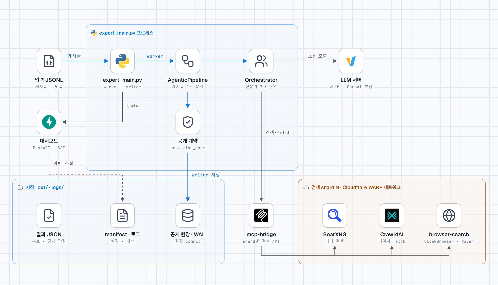

# LLM 웹소설 매칭 파이프라인

커뮤니티 게시글과 댓글에서 웹소설 작품과 약어를 찾고, 검색 근거로 작품을 확인해 작품 식별과 담론 분석 결과를 저장합니다. 주 실행기는 `expert_main.py`이며, 웹 대시보드에서 진행률·분석 메모·문맥 진단·실행 이력을 볼 수 있습니다.

## 빠른 시작

Python 3.10 이상이 필요합니다. 저장소 루트에서 실행합니다.

```powershell
python -m pip install -e .
docker compose up -d --build
```

`docker compose`는 검색·fetch에 쓰는 SearXNG, Crawl4AI, browser-search, MCP bridge(포트 3333)를 띄웁니다. 여러 worker가 검색 shard를 나눠 쓰는 구성은 [검색·WARP 운영 안내](docs/warp_sharding.md)를 참고하세요.

`expert_main`은 원격 LLM 서버(OpenAI 호환 API)에 접속합니다. 서빙 엔진 기본값은 vLLM이고, 코드에 들어 있는 기본 서버 주소는 개발 환경용입니다. 접근할 수 있는 서버 주소와 모델을 직접 지정하세요.

```powershell
$env:LLM_ENDPOINT = "http://localhost:8000"
$env:LLM_MODEL = "<서버가 제공하는 모델명>"
python expert_main.py tests/inputs/sample.jsonl --parallel 12 --execution-profile low-load-validation --output out/example/result.json
```

`--parallel`은 worker 수의 상한이며 위 예시는 12입니다. 실제 병렬도는 입력 수와 사용할 수 있는 endpoint 수에 따라 줄어들 수 있으니 manifest의 `requested_parallel`과 `effective_parallel`을 함께 확인하세요.

저부하 프로필(`low-load-validation`)은 프로세스를 CPU 하나와 낮은 우선순위로 제한하고 VLM·OCR, 호출 원장 기록, 문맥 진단을 켭니다. `--parallel`을 주지 않으면 요청 병렬도를 1로 둡니다. CLI 옵션이나 환경 변수로 따로 지정한 값은 프로필 기본값보다 우선합니다.

설치 의존성의 기준은 `pyproject.toml`입니다. `requirement.txt`는 기존 개발 환경의 고정 버전 목록이며 `pyproject.toml`과 같은 목록이라고 보장하지 않습니다.

대시보드 기본 주소는 `http://127.0.0.1:8080`입니다. 포트가 이미 쓰이고 있거나 다른 대시보드 서버가 떠 있으면 시작 로그와 `DASHBOARD_PORT` 설정을 확인하세요.

### 실행이 끝나도 대시보드 유지하기

standalone 대시보드 서버를 별도 터미널에서 먼저 띄우면 `expert_main`이 같은 포트의 서버로 진행 이벤트를 보냅니다.

```powershell
python tools/dashboard_server.py --port 8080
```

대시보드 없이 시작한 실행은 manifest를 읽어 진행률을 나중에 붙일 수 있습니다.

```powershell
python tools/attach_manifest_dashboard.py --manifest out/example/result_manifest.json
```

테마·이력·운영 방법은 [대시보드 안내](docs/devs/EXPERT_DASHBOARD_DESIGN_KO.md)에, 전체 옵션은 `python expert_main.py --help`에 있습니다.

## 입력과 결과

JSONL 입력은 한 줄에 게시글 하나를 담습니다. 댓글은 생략할 수 있습니다.

```json
{"post_id":123,"title":"게시글 제목","content_blocks":[{"type":"text","text":"본문"}],"comments":[]}
```

| 산출물 | 위 실행 예시의 위치 | 내용 |
| --- | --- | --- |
| 결과 | `out/example/result.json` | 작품 후보, 공개 판정, 담론·문맥 분석 |
| manifest | `out/example/result_manifest.json` | 실행 설정, 병렬도, 종료 상태, 계측 |
| 로그 | `logs/expert_run_<run_id>.log` | 전문가 협업과 실행 진단 |
| worker 로그 | `logs/expert_run_<run_id>_W<N>.log` | 병렬 작업별 진단 |

작품 후보와 공개 제목·URL은 서로 다른 필드에 저장됩니다. 공개하지 않은 결과(`HOLD`, `context_only`)에도 문맥에서 언급된 후보는 남아 있을 수 있습니다.

## 구성과 설정

<picture>
  <source media="(prefers-color-scheme: dark)" srcset="docs/assets/architecture/system-overview-dark.png">
  
</picture>

| 경로 | 역할 |
| --- | --- |
| `expert_main.py` | 주 분석 실행, checkpoint, manifest와 대시보드 연결 |
| `src/llm_batch/experts/` | 전문가 협업과 작품·담론 판단 |
| `src/llm_batch/grounding/` | 후보·출처·문맥·발화 역할 검증과 연구용 기록 |
| `src/llm_batch/ledger/` | 공개 결정과 호출·복구 원장 |
| `src/llm_batch/monitor/` | 대시보드 API·화면·이력 |
| `tools/`, `tests/` | 실행 도구와 기능별 회귀시험 |
| `main.py` | 과거 순차 파이프라인 비교용 진입점 |

주요 환경 변수는 `LLM_ENDPOINT`, `LLM_MODEL`, `MCP_ENDPOINTS`, `DASHBOARD_PORT`입니다. 검색과 fetch는 MCP bridge를 거쳐 검색 shard로 나갑니다. shard 설정은 [검색·WARP 운영 안내](docs/warp_sharding.md), 패키지 경계는 [소스 구조](docs/devs/SOURCE_LAYOUT_KO.md)를 참고하세요.

## 문서 안내

| 목적 | 문서 |
| --- | --- |
| 전문가 역할·실행 옵션 | [전문가 실행 안내](expert_readme.md) |
| 시스템 구조 | [아키텍처](docs/ARCHITECTURE.md) · [소스 구조](docs/devs/SOURCE_LAYOUT_KO.md) |
| 대시보드 사용·설정 | [대시보드 안내](docs/devs/EXPERT_DASHBOARD_DESIGN_KO.md) |
| 검색 서비스 구성 | [검색·WARP 운영 안내](docs/warp_sharding.md) |
| 기능별 기술 문서 | [개발 문서 안내](docs/devs/README.md) |
| 순차 파이프라인 | [레거시 실행 안내](README_legacy_pipeline.md) |
