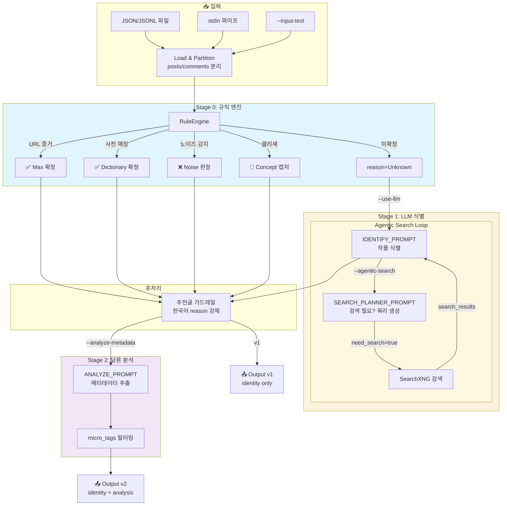

# LLM Novel Batch Pipeline

디시인사이드 장르소설 갤러리 크롤링 데이터에서 **웹소설 관련 글을 식별**하고, 선택적으로 **담론 메타데이터(마이크로태그/감성/NSFW 등)를 추출**하여 JSON으로 출력합니다.

---

## 📋 목차

1. [핵심 개념](#-핵심-개념)
2. [구성 요소](#-구성-요소)
3. [설치](#-설치)
4. [빠른 시작](#-빠른-시작)
5. [실행 옵션](#-실행-옵션)
6. [분석 파이프라인 흐름도](#-분석-파이프라인-흐름도)
7. [프롬프트 구조](#-프롬프트-구조)
8. [프롬프트 작성 지침](#-프롬프트-작성-지침) ⭐ **NEW**
9. [입출력 형식](#-입출력-형식)
10. [도커 환경](#-도커-환경)
11. [고급 설정](#-고급-설정)

---

## 🎯 핵심 개념

이 파이프라인은 **3단계 아키텍처**로 동작합니다:

```
📥 입력(JSONL/JSON)
      ↓
┌─────────────────────────────────────────────────────────────┐
│ Stage 0: 규칙 엔진 (RuleEngine)                              │
│ • URL/제목 증거 감지 → 즉시 확정                              │
│ • 속어 사전 매칭 (전독시→전지적 독자 시점)                      │
│ • 노이즈 필터 (글카/채굴/정치 등)                              │
│ • 클리셰/개념 담론 캡처                                       │
└─────────────────────────────────────────────────────────────┘
      ↓ (reason=Unknown일 때만)
┌─────────────────────────────────────────────────────────────┐
│ Stage 1: LLM 식별 (IDENTIFY_PROMPT)                          │
│ • 커뮤니티 속어/별칭 정규화                                    │
│ • 검색 필요 여부 판단 (SEARCH_PLANNER_PROMPT)                  │
│ • SearchXNG 검색 → 결과를 근거로 작품 확정                     │
│ • 한국어 reason 출력 강제                                     │
└─────────────────────────────────────────────────────────────┘
      ↓ (--analyze-metadata 옵션 시)
┌─────────────────────────────────────────────────────────────┐
│ Stage 2: 담론 분석 (ANALYZE_PROMPT)                          │
│ • 마이크로태그: 고구마/사이다/4드론/드리프트/후집피 등           │
│ • 감성 프로파일: pacing/drift_risk/sentiment                  │
│ • NSFW 감지 (순화된 태그로 출력)                              │
│ • 유저 세그먼트: 누렁이/무틀딱/대역퍼거 등                      │
└─────────────────────────────────────────────────────────────┘
      ↓
📤 출력(JSON)
```

---

## 🧩 구성 요소

| 구성 요소 | 설명 |
|-----------|------|
| **llm-batch** | 메인 배치 CLI |
| **RuleEngine** | 규칙 기반 1차 판정 (URL/사전/노이즈) |
| **LLMClient** | HTTP 또는 로컬(llama-cpp-python) LLM 백엔드 |
| **MCPClient** | SearchXNG 검색 브릿지 |
| **Docker Compose** | SearchXNG + MCP 브릿지 컨테이너 |

---

## 📦 설치

```bash
pip install -e .
```

로컬 GGUF 모델 사용 시:
```bash
pip install llama-cpp-python
```

---

## 🚀 빠른 시작

### 기본 실행 (규칙 기반만)
```bash
llm-batch --input tests/inputs/sample.jsonl
```

### LLM 활성화 (Unknown 항목 정밀 분석)
```bash
llm-batch --input tests/inputs/sample.jsonl --use-llm --trace
```

### LLM + 검색 + 메타데이터 추출 (풀 파이프라인)
```bash
llm-batch --input tests/inputs/sample.jsonl --use-llm --trace --agentic-search --output-schema v2 --analyze-metadata
```

---

## ⚙️ 실행 옵션

### 입력 방식

| 옵션 | 설명 |
|------|------|
| `--input <파일>` | JSON/JSONL 파일 경로 |
| `--input-text <텍스트>` | JSONL 문자열 직접 입력 |
| `--stdin` | 파이프로 입력 받기 |

### LLM 설정

| 옵션 | 설명 |
|------|------|
| `--use-llm` | LLM 정밀 분석 활성화 |
| `--llm-backend http\|local` | HTTP 서버 또는 로컬 GGUF |
| `--model-path <경로>` | 로컬 GGUF 모델 경로 |
| `--llm-profile tool\|general` | 샘플링 프로파일 |
| `--temp`, `--top-p`, `--min-p` | 샘플링 파라미터 직접 설정 |
| `--repeat-penalty 1.0` | 반복 패널티 비활성화 (권장) |
| `--max-tokens <N>` | 최대 생성 토큰 수 |
| `--llm-stream` | 토큰 스트리밍 출력 |

### 검색 설정

| 옵션 | 설명 |
|------|------|
| `--no-search` | 검색 비활성화 |
| `--agentic-search` | LLM이 검색 필요 여부와 쿼리를 자율 결정 |

### 출력 설정

| 옵션 | 설명 |
|------|------|
| `--output <파일>` | 결과 저장 경로 |
| `--incremental-output <파일>` | 처리 즉시 저장 (원본+분석 포함) |
| `--output-schema v1\|v2` | 출력 스키마 선택 |
| `--analyze-metadata` | Stage2 담론 분석 활성화 (v2 권장) |
| `--trace` | 상세 로그 출력 (stderr) |
| `--limit <N>` | 처음 N개만 처리 (디버그용) |

### 로컬 백엔드 설정

| 옵션 | 설명 |
|------|------|
| `--n-ctx <N>` | 컨텍스트 윈도우 (권장: 16384) |
| `--n-gpu-layers <N>` | GPU 오프로드 레이어 수 |
| `--chat-format <포맷>` | 채팅 포맷 (예: chatml) |

### 예시: 로컬 GGUF 풀 파이프라인
```powershell
llm-batch --input tests\inputs\sample.jsonl `
  --use-llm --trace `
  --llm-backend local `
  --model-path "C:\models\gemma-2-2b.gguf" `
  --n-ctx 16384 `
  --agentic-search `
  --output-schema v2 `
  --analyze-metadata `
  --llm-profile tool `
  --repeat-penalty 1.0
```

---

## 📊 분석 파이프라인 흐름도

### 전체 흐름 (Mermaid)



### 단계별 상세 설명

#### Stage 0: 규칙 엔진 (RuleEngine)

| 판정 우선순위 | 조건 | 결과 |
|---------------|------|------|
| 1. URL 증거 | 댓글에 novelpia.com 등 URL 포함 | `confidence: Max` 즉시 확정 |
| 2. 제목 답변 | 댓글이 `[제목]` 형태 단독 | `confidence: Max` 확정 |
| 3. 사전 매칭 | `전독시` → `전지적 독자 시점` | `confidence: High` |
| 4. 클리셰 | `학폭 악역`, `사파 복지` 등 | `inference` 캡처 |
| 5. 노이즈 | `글카`, `채굴`, `정치` 등 | `is_relevant: false` |
| 6. 미확정 | 위 모두 해당 없음 | `reason: Unknown` → LLM |

#### Stage 1: LLM 식별 (IDENTIFY_PROMPT)

**실행 파이프라인 (Per Item):**

```
STEP 0: 커뮤니티 정규화
├── 초성체: ㅈㄷㅅ → 전독시 → 전지적 독자 시점
├── 축약어: 화귀/죽깨수/약먹마
├── 별칭/멸칭: 작가/작품 별명
└── 표기 변형: 띄어쓰기/오타/특수문자 무시

STEP 0.5: 커뮤니티 밴터 필터
├── 고신뢰: URL, 명시적 제목 답변
└── 저신뢰: ㅋㅋ/드립/욕설 (증거로 취급 금지)

STEP 1: 증거 체크 (Golden Key)
├── URL → official_title = URL
└── 제목만 언급 → 검색으로 확인 필요

STEP 1.5: 검색 결과 활용 (search_results 있을 때)
├── 소설 사이트 URL → 강한 증거
├── 스니펫에서 공식 제목 확인 가능
└── 모호하면 official_title = null

STEP 2: 사전 매칭
└── rules_config.slang_dictionary 참조

STEP 3: 개념/Unknown 캡처
└── 클리셰 담론이면 inference로 캡처

STEP 4: 노이즈 필터
└── 웹소설과 무관한 글
```

#### Agentic Search (검색 자율 판단)

`--agentic-search` 옵션 활성화 시:

```
LLM: "검색이 필요한가?" (SEARCH_PLANNER_PROMPT)
      ↓
{
  "need_search": true,
  "queries": [
    "즉사무림 웹소설",           // 일반 검색
    "site:namu.wiki 즉사무림",   // 나무위키
    "site:novelpia.com 즉사무림" // 플랫폼 검색
  ],
  "why": "별칭으로 보이나 공식 제목 확인 필요"
}
      ↓
SearchXNG 실행 → 결과 요약 (top-k)
      ↓
LLM: search_results를 근거로 최종 판정
```

**검색 쿼리 전략:**
1. 첫 번째: `{term} 웹소설` (넓은 범위)
2. 두 번째: `site:namu.wiki {term}` (용어 해설)
3. 세 번째: `site:novelpia.com {term}` (플랫폼 직접)

#### Stage 2: 담론 분석 (ANALYZE_PROMPT)

`--analyze-metadata` 옵션 활성화 시:

**커뮤니티 어휘 매핑:**

| 용어 | 의미 | 추출 필드 |
|------|------|-----------|
| 고구마 | 전개 지연, 답답함 | `pacing: Slow` |
| 사이다 | 즉각 해결/해소 | `pacing: Fast`, `sentiment: Positive` |
| 4드론 | 초반 자극 몰아치기 | `micro_tag: 4드론` |
| 드리프트 | 장르 급전환/기만 | `drift_risk: High/Critical` |
| 후집피 | 후회/집착/피폐 서사 | `micro_tag: 후집피` |
| 누렁이 | 킬링타임 선호 독자 | `user_segment: 누렁이` |
| 무틀딱 | 정통무협 선호 | `user_segment: 무틀딱` |

**허용된 마이크로태그 (화이트리스트):**
```
고구마, 사이다, 4드론, 드리프트, 드리프트_의심, 후집피,
아카데미물, 정실_논쟁, 캣파이트, 분양, 킬링타임, 양판소,
착각계, 헌터물, 무협, 퓨전무협, 하렘, 순애,
성인요소_언급, 자극적_표현
```

---

## 📜 프롬프트 구조

### ⭐ 프롬프트 작성 지침

**중요**: 모든 Expert 프롬프트는 **범용적 원리 기반**으로 작성되어야 하며, **기계적 매칭을 금지**합니다.

📖 **상세 지침**: [PROMPT_GUIDELINES.md](./PROMPT_GUIDELINES.md)

**핵심 원칙:**
- ❌ 특정 작품명/용어를 예시로 하드코딩 금지
- ❌ "if X then Y" 형태의 기계적 규칙 금지
- ✅ 언어학적/형태학적 원리 설명
- ✅ 새로운 용어/작품에도 적용 가능한 패턴 제시

**예시:**
```
❌ 금지: "즉사무림" = "즉사기 들고 무림에 떨어지다"
✅ 권장: 한글 약어는 음절 추출 또는 형태소 결합 방식으로 형성됨
```

### 프롬프트 파일 위치
`src/llm_batch/llm/prompt.py`

### 프롬프트 종류

| 프롬프트 | 용도 | 출력 형식 |
|----------|------|-----------|
| `IDENTIFY_PROMPT` | Stage1 작품 식별 | JSON List `[{...}]` |
| `SEARCH_PLANNER_PROMPT` | 검색 필요 여부 판단 | JSON Object `{need_search, queries, why}` |
| `ANALYZE_PROMPT` | Stage2 담론 분석 | JSON Object (PickvelAnalysis) |

### 공통 규칙

1. **한국어 강제**: `reason`, `topic` 등 모든 자연어 값은 한국어
2. **JSON Only**: 마크다운 펜스 금지, 순수 JSON만 출력
3. **증거 우선**: URL/명시적 제목 > 사전 매칭 > 문맥 추론
4. **환각 금지**: 확실하지 않으면 `official_title: null`

### IDENTIFY_PROMPT 주요 단계

```
STEP 0: 커뮤니티 정규화 (Mental Preprocessing)
- 초성체/축약어/별칭/표기변형 → 핵심 토큰 추출

STEP 0.5: 밴터 신뢰도 필터
- 고신뢰: URL, [제목] 형식
- 저신뢰: ㅋㅋ, 드립, 욕설 → 증거로 취급 금지

STEP 1: 증거 체크 (Golden Key)
- URL/명시적 제목 → 즉시 확정

STEP 1.5: 검색 결과 활용
- search_results의 소설 사이트 URL → 강한 증거
- 스니펫 기반 추론 허용 (reason에 명시)

STEP 2: 사전 매칭
- rules_config.slang_dictionary 참조

STEP 3: 개념/Unknown 캡처
- 클리셰 담론 → inference로 캡처

STEP 4: 노이즈 필터
- 웹소설과 무관 → is_relevant: false
```

### IDENTIFY_PROMPT 출력 스키마

```json
[
  {
    "post_id": 123,
    "is_relevant": true,
    "novel_identity": {
      "official_title": "https://novelpia.com/novel/382324",
      "confidence": "Max"
    },
    "evidence": {
      "found_in_comment": true,
      "source_text": "https://novelpia.com/novel/382324"
    },
    "slang_insight": {
      "detected_term": "전독시",
      "decoded_term": "전지적 독자 시점"
    },
    "inference": {
      "type": "클리셰 담론",
      "topic": "학폭 악역"
    },
    "reason": "댓글에 노벨피아 링크 존재"
  }
]
```

### SEARCH_PLANNER_PROMPT 출력 스키마

```json
{
  "need_search": true,
  "queries": [
    "즉사무림 웹소설",
    "site:namu.wiki 즉사무림",
    "site:novelpia.com 즉사무림"
  ],
  "why": "별칭으로 보이나 공식 제목 확인 필요"
}
```

### ANALYZE_PROMPT 출력 스키마

```json
{
  "detected_titles": [
    {
      "official_title": "https://novelpia.com/novel/123",
      "confidence": "High",
      "alias_or_mention": "전독시"
    }
  ],
  "micro_tags": ["고구마", "아카데미물"],
  "sentiment_profile": {
    "pacing": "Slow",
    "drift_risk": "Low",
    "sentiment": "Mixed"
  },
  "is_nsfw": false,
  "user_segment": "누렁이",
  "notes": "초반 전개가 느리다는 평가 다수"
}
```

---

## 📁 입출력 형식

### 입력 형식

JSON 배열 또는 JSONL(라인별 JSON). 게시글과 댓글이 섞여 있어도 자동 분리됩니다.

**예시 JSONL:**
```json
{"gallery_id":"genrenovel","post_id":11687616,"title":"랫따싶 진짜...","author":"ㅇㅇ","created_at":"2026-01-21 15:05:16","url":"https://gall.dcinside.com/...","content_blocks":[{"type":"text","text":"내용"}]}
{"comment_id":"40364376","author":"ㅇㅇ","content":"링크좀","created_at":"01.21 15:06:28","post_id":11687616}
{"comment_id":"40364402","author":"ㅇㅇ","content":"https://novelpia.com/novel/382324","created_at":"01.21 15:08:21","post_id":11687616}
```

### 출력 형식

#### v1 (기본): 작품 식별만
```json
[
  {
    "post_id": 11687616,
    "is_relevant": true,
    "novel_identity": {
      "official_title": "https://novelpia.com/novel/382324",
      "confidence": "Max"
    },
    "evidence": {
      "found_in_comment": true,
      "source_text": "https://novelpia.com/novel/382324"
    }
  }
]
```

#### v2: 식별 + 담론 분석
```json
[
  {
    "post_id": 11687616,
    "identity": {
      "is_relevant": true,
      "novel_identity": {
        "official_title": "https://novelpia.com/novel/382324",
        "confidence": "Max"
      },
      "evidence": {...}
    },
    "analysis": {
      "detected_titles": [...],
      "micro_tags": ["사이다"],
      "sentiment_profile": {
        "pacing": "Fast",
        "drift_risk": "Low",
        "sentiment": "Positive"
      },
      "is_nsfw": false,
      "user_segment": null
    }
  }
]
```

### Incremental 출력 (`--incremental-output`)

원본 데이터와 분석 결과를 함께 저장:
```json
[
  {
    "post_id": 11687616,
    "title": "랫따싶 진짜...",
    "author": "ㅇㅇ",
    "created_at": "2026-01-21 15:05:16",
    "url": "https://gall.dcinside.com/...",
    "content": ["내용"],
    "comments": ["링크좀", "https://novelpia.com/novel/382324"],
    "analysis_result": {
      "post_id": 11687616,
      "identity": {...},
      "analysis": {...}
    }
  }
]
```

---

## 🐳 도커 환경

### 실행
```bash
docker compose up -d --build
```

### 기본 포트
| 서비스 | URL |
|--------|-----|
| SearchXNG | `http://localhost:9000` |
| MCP 브릿지 | `http://localhost:3333` |

### 환경 변수

| 변수 | 설명 | 기본값 |
|------|------|--------|
| `LLM_ENDPOINT` | LLM 서버 주소 | `http://localhost:11434` |
| `MCP_TOP_K_RESULTS` | 검색 결과 상위 K개 | `5` |
| `MCP_MAX_CONTENT_CHARS` | 결과 본문 최대 길이 | `400` |
| `LLM_MAX_SEARCH_ROUNDS` | 검색 라운드 최대 횟수 | `2` |
| `LLM_MAX_SEARCH_QUERIES` | 라운드당 최대 쿼리 수 | `3` |
| `LLM_PROGRESS_EVERY` | 진행 로그 간격(초) | `5` |
| `LLM_N_CTX` | 로컬 백엔드 컨텍스트 | - |
| `LLM_N_GPU_LAYERS` | GPU 오프로드 레이어 | - |

---

## 🔧 고급 설정

### 샘플링 프로파일

| 프로파일 | temp | top_p | min_p | repeat_penalty | 용도 |
|----------|------|-------|-------|----------------|------|
| `tool` | 0.7 | 1.0 | 0.01 | 1.0 | JSON 출력 (권장) |
| `general` | 1.0 | 0.95 | 0.01 | 1.0 | 일반 생성 |

### 사전 설정 (rules.py)

```python
# 속어 → 공식 제목 매핑
SLANG_DICTIONARY = {
    "아카살": "아카데미에서 살아남기",
    "전독시": "전지적 독자 시점",
    "빌환": "빌어먹을 환생",
    "죽깨수": "죽었다 깨어도 수선",
    ...
}

# 소설 플랫폼 도메인
NOVEL_SITES = (
    "novelpia.com",
    "munpia.com",
    "page.kakao.com",
    "joara.com",
    "series.naver.com",
)

# 노이즈 키워드
NOISE_TERMS = ("글카", "채굴", "날씨", "음식", ...)
```

### 추천글 가드레일

"추천좀", "추천해줘" 등의 요청글은 단일 작품으로 확정하지 않고:
- `is_relevant: true` 유지
- `novel_identity: null`
- `inference.type: "추천 요청"`
- Stage2에서 댓글에 언급된 후보들을 `detected_titles`로 기록

### 한국어 강제

LLM이 영어로 `reason`을 출력하면 자동으로 재시도:
```
KOREAN_ONLY_REASON: reason은 반드시 한국어로만 작성. 영어 알파벳(A-Z) 금지.
```

### 디버깅

```bash
# 첫 5개만 처리
llm-batch --input sample.jsonl --use-llm --trace --limit 5

# 토큰 스트리밍 확인
llm-batch --input sample.jsonl --use-llm --trace --llm-stream --llm-backend local --model-path model.gguf
```

---

## 📄 라이선스

MIT License
