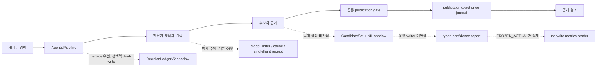

# LLM 웹소설 매칭 파이프라인

디시인사이드 장르소설 갤러리 게시글을 읽고, 글이 가리키는 웹소설 작품과 관련 담론을 구조화하는 LLM 파이프라인입니다.

커뮤니티 글에는 작품명보다 축약어, 초성, 캐릭터명, 작가명, 밈이 먼저 나오는 경우가 많습니다. 이 프로젝트는 여러 분석 역할과 검색 결과를 함께 사용하되, 근거가 부족하면 작품명을 공개하지 않고 후보 상태로 남기는 것을 기본 원칙으로 삼습니다.

## 최신 검증 — 2026-07-23

코드 동결 32행의 `BEFORE/OFF`와 `AFTER/AUDIT_ONLY`를 각각 3회 실행한 v7 qualified 검증은 runtime·measurement·publication noninterference를 `6/6`, exact linked observation을 `192/192`로 닫았습니다. 2,712행 persisted publish-contract replay도 mismatch와 정상→비정상 contract regression `0`으로 통과했습니다.

다만 majority 의미 품질은 `18/32→18/32`이고 persistent unsafe publish와 wrong-work 미해결이 남아 semantic/search/router/P2/full scan은 계속 `NO-GO`, `full_scan_approval=false`입니다. 개선·미미·실패 사례와 재시도 원장까지 포함한 정본은 [v7 최종 BEFORE/AFTER 보고서](docs/devs/NEXT_STRUCTURAL_AND_MEASUREMENT_IMPROVEMENT_FINAL_REPORT_20260723_KO.html)와 [검증문](docs/devs/NEXT_STRUCTURAL_AND_MEASUREMENT_IMPROVEMENT_FINAL_VALIDATION_20260723_KO.md)입니다.

## 현재 상태

아키텍처 구현 완료와 실제 성능 검증은 서로 다른 단계입니다.

| 범위 | 상태 | 의미 |
| --- | --- | --- |
| 아키텍처 통합 | `COMPLETE_SAFE_TERMINAL / ARCHITECTURE_V2_INTEGRATED` | 공개 결과를 바꾸지 않는 선택적 shadow·측정 계층과 검증 도구가 코드베이스에 통합됐습니다. |
| 실제 효과 검증 | `ACTUAL_BLOCKED_HANDOFF / NOT_COMPLETE` | source-backed DEV/CAL/FROZEN, policy v3, 10+6 actual packet, fresh BEFORE/AFTER가 없어 정확도·비용·지연 개선률을 아직 계산할 수 없습니다. |
| 의미 품질 승인 | `REVIEW-LOCKED` | 테스트 통과와 처리 완료만으로 작품 매칭 품질이 승인되지는 않습니다. |
| 운영 적용 | `full_scan_approval=false` | cheap routing과 전체 스캔 운영 전환은 승인되지 않았습니다. |

현재 수치가 없는 항목은 `null` 또는 `NOT_ESTIMABLE`로 둡니다. 합성 fixture, 저장본 재생, queue 0, WAL coverage는 계약과 복구 경로를 검증하는 근거이지 실제 정확도나 비용 절감률이 아닙니다.

## 파이프라인이 하는 일

입력은 게시글 제목, 본문, 댓글, 링크, 이미지 메타데이터입니다. 파이프라인은 다음 순서로 처리합니다.

1. 게시글이 특정 작품 이야기인지, 장르 일반론이나 플랫폼 이야기인지 구분합니다.
2. 축약어와 초성을 풀고 검색·본문·댓글에서 작품 후보를 모읍니다.
3. 후보 제목과 공식 URL이 같은 작품을 가리키는지, 경쟁 후보나 검색 실패가 있는지 확인합니다.
4. 공통 publication gate가 공개 가능한 근거인지 판정합니다.
5. 근거가 충분하면 작품명과 URL을 기록하고, 부족하면 후보를 보존한 채 `HOLD` 또는 null로 닫습니다.
6. 선택적 shadow 계층은 후보 집합, 행별 확률, 호출 비용과 복구 영수증을 기록할 계약과 reader를 제공합니다. 기본 OFF 기능은 명시적으로 활성화하고, 집계 지표는 결속된 `FROZEN_ACTUAL` 입력이 있을 때만 산출합니다.



실선은 현재 공개 결과를 만드는 경로입니다. 점선은 기본 OFF이거나 관측·측정만 수행하는 경로입니다.

## Architecture V2에서 달라진 점

기존 파이프라인은 전문가가 찾은 후보를 여러 후처리 지점에서 승격하거나 차단했습니다. 개선 구조는 공개 판정, 후보 보존, 측정, 복구를 분리했습니다.

| 구성요소 | 해결하려는 문제 | 현재 적용 범위 |
| --- | --- | --- |
| 공통 publication gate | 여러 위치에서 서로 다르게 작품명과 URL을 공개하는 문제 | `GroundingState`, `RetrievalState`, `PromotionDecision`을 사용해 공개 승격을 fail-close합니다. |
| publication exact-once | 재시도나 복구 중 같은 행의 최종 판정이 덮어써지는 문제 | 실행 범위와 입력에 결속된 첫 정상 판정을 정본으로 재사용합니다. |
| Producer completion proof | 검색·fetch가 일부만 끝났는데 후보 목록을 완전하다고 보는 문제 | 계획한 bounded 범위의 완료 여부를 `COMPLETE`, `UNKNOWN`, `TRUNCATED`로 구분합니다. |
| CandidateSet + NIL | 한 후보만 남기면서 경쟁 작품과 `작품 없음` 가능성을 잃는 문제 | 후보들과 `NIL`을 하나의 사건 공간에 보존합니다. 공개 결과에는 직접 개입하지 않습니다. |
| Typed confidence | 모델의 자신감과 전체 정확도를 같은 퍼센트로 오해하는 문제 | 행별 보정 확률과 집계 정확도를 다른 필드와 다른 reader로 분리합니다. |
| Stage runtime adapter | 검색 단계의 중복 호출, 대기, cache 출처를 추적하기 어려운 문제 | search 단계에 명시 주입할 때만 동작합니다. limiter는 process-local, shared result는 같은 filesystem 범위입니다. |
| DecisionLedgerV2 | 대형 원장의 재생·복구·대조 비용과 crash 경계를 확인하기 어려운 문제 | legacy writer를 정본으로 유지한 dual-write shadow입니다. 자동 production 활성화는 없습니다. |
| Actual packet intake | 서로 다른 입력과 실행 조건을 BEFORE/AFTER로 비교하는 문제 | 실제 실행 전에 policy, source, label, replay artifact와 동일 frozen input을 무쓰기 검사합니다. |

### 공개 판정의 핵심 원칙

- Decoder나 Verifier가 제시하지 않은 제목을 Arbiter가 새로 만들어 공개하지 않습니다.
- 공식 제목과 URL은 같은 작품에 결속된 근거가 있어야 합니다.
- 해당 근거가 필요한 행에서 검색이 복구되지 않았거나 후보·source·이미지 근거가 불완전하면 안전한 공개 근거로 승격하지 않습니다.
- `아생갤`처럼 실제 작품 약어일 수 있는 표현은 단순 갤러리명으로 단정하지 않고 alias 관계와 작품 근거를 함께 확인합니다.
- 차단된 제목은 버리지 않고 후보와 reason code로 남겨 후속 검토가 가능하게 합니다.

## 정확도 퍼센트는 무엇을 뜻하나

`confidence_percentage`는 한 행에서 선택한 후보가 맞을 것으로 보정된 확률입니다. 예를 들어 `78`은 그 행의 선택 확률을 78%로 기록했다는 뜻이지, 시스템 전체 정확도가 78%라는 뜻이 아닙니다.

전체 성능은 동결된 정답 자료에서 별도로 계산합니다.

| 지표 | 확인하는 질문 |
| --- | --- |
| Candidate recall | 정답 작품이 후보 목록에 들어왔는가 |
| Top-label accuracy | 가장 높은 확률의 후보 또는 NIL이 정답과 같은가 |
| NIL precision / recall | 작품 없음 판정을 과하게 하거나 놓치지 않았는가 |
| ECE / Brier / log loss | 확률값이 실제 정답 빈도와 맞는가 |
| Selective risk / AURC | 불확실한 행을 보류할 때 자동 처리 구간의 오류가 줄어드는가 |

후보 확률과 NIL 확률의 합이 100%라는 사실도 정확도 100%를 의미하지 않습니다. 실제 집계에는 producer `COMPLETE`, source-backed `FROZEN_ACTUAL`, 분리된 calibration artifact와 prediction artifact가 모두 필요합니다. 하나라도 없으면 reader는 숫자를 만들지 않고 `NOT_ESTIMABLE`로 종료합니다.

## 아직 증명되지 않은 것

다음 항목은 구현 아이디어나 계약 테스트가 아니라 실제 자료와 fresh runtime으로 확인해야 합니다.

- 실제 후보 재현율과 top-label accuracy
- 실제 NIL precision과 recall
- 실제 ECE, Brier, log loss, selective risk, AURC
- BEFORE/AFTER의 물리 호출 수, token, 비용 감소율
- 게시글별 E2E p50/p95와 paired confidence interval
- actual crash/restart recovery canary
- production cheap routing과 전체 스캔 승인

현재 external blocker는 policy owner 결정, source-backed DEV/CAL/FROZEN, complete 10+6 packet, 별도 fresh BEFORE/AFTER입니다. 준비 절차는 [실제 입력 준비와 출시 판정 런북](docs/devs/LAUNCH_READINESS_RUNBOOK_KO.md)에 정리돼 있습니다.

## 빠른 시작

Python 3.10 이상이 필요합니다.

```bash
python -m pip install -e .
docker compose up -d --build
python expert_main.py tests/inputs/sample.jsonl --parallel 4
```

`--parallel`은 최대 worker 수입니다. 실제 worker 수는 입력 수와 healthy endpoint 수에 따라 줄어들 수 있으므로 실행 manifest의 `requested_parallel`과 `effective_parallel`을 함께 확인해야 합니다.

regression-safe grounding 테스트런과 검증런은 별도 지시가 없으면 다음처럼 요청 병렬도 16과 대시보드를 사용합니다.

```bash
python expert_main.py tests/inputs/sample.jsonl --parallel 16
```

이미지 게시글의 의미 회귀를 확인하는 실행은 VLM과 OCR 누락을 조용히 허용하지 않도록 옵션을 명시합니다.

```bash
python expert_main.py tests/inputs/sample.jsonl \
  --parallel 16 \
  --vlm on \
  --ocr on \
  --require-vlm-ocr-for-images
```

### 실행 모드

| 목적 | 명령 또는 엔트리포인트 | 설명 |
| --- | --- | --- |
| 주력 분석 | `expert_main.py` | 전문가 협업, 검색, publication gate, 복구·관측 계약을 포함합니다. |
| 단일 worker 재현 | `expert_main.py --parallel 1` | 순서와 로그를 좁혀 확인할 때 사용합니다. |
| regression-safe 검증 | `expert_main.py --parallel 16` | 대시보드를 켜고 manifest의 실제 병렬도를 확인합니다. |
| 레거시 비교 | `main.py` | 기존 sequential pipeline과의 회귀 비교용입니다. |

`--no-dashboard`는 명시적인 로컬 디버그에서만 사용합니다. 이미 대시보드 없이 시작한 실행은 다음 명령으로 manifest 기반 진행률을 붙일 수 있습니다.

```bash
python tools/attach_manifest_dashboard.py --manifest <result_manifest.json>
```

## 입력과 출력

입력은 한 줄에 게시글 하나를 담은 JSONL입니다.

```json
{"post_id": 123, "title": "게시글 제목", "content_blocks": ["본문"], "comments": ["댓글"]}
```

주요 출력은 다음과 같습니다.

| 산출물 | 기본 위치 | 용도 |
| --- | --- | --- |
| 분석 결과 | `out/expert_result_YYYYMMDD_HHMMSS.json` | 작품 식별, 공개 URL, 담론 정보와 근거 |
| 실행 manifest | 결과 디렉터리의 manifest JSON | 입력, 병렬도, 모델, checkpoint, 실행 상태 추적 |
| 통합 로그 | `logs/expert_run_YYYYMMDD_HHMMSS.log` | 전체 실행과 전문가 협력 로그 |
| worker 로그 | `logs/expert_run_YYYYMMDD_HHMMSS_W<N>.log` | 병렬 worker별 진단 |
| 대시보드 | `http://127.0.0.1:8080` | 진행률과 로그 관측 |

대시보드는 실행 상태를 보여 주는 도구입니다. 대시보드 정상, pending 0, queue 0만으로 의미 품질이나 전체 스캔을 승인하지 않습니다.

## 검색과 병렬 처리

기본 검색 경로는 MCP bridge 뒤의 SearchXNG, Crawl4AI, browser fallback을 사용합니다. 로컬 자동 shard를 사용할 때 각 worker는 같은 shard의 검색·fetch·WARP egress를 사용합니다.

```text
expert_main.py worker
  -> mcp-bridge-N
  -> SearchXNG-N / Crawl4AI-N
  -> 필요한 경우 browser-search-N
  -> WARP-N egress
```

직접 endpoint를 지정하려면 `MCP_ENDPOINTS`를 사용합니다.

```bash
export MCP_ENDPOINTS="http://localhost:3333,http://localhost:3334"
python expert_main.py tests/inputs/sample.jsonl --parallel 2 --no-auto-up-shards
```

브라우저 fallback은 CAPTCHA를 완전히 제거하지 못합니다. shard별 호출 간격과 차단 cooldown을 유지하고, 상태는 `logs/warp_shards_status_*.json`과 browser-search health에서 확인합니다.

## 주요 설정

| 설정 | 용도 |
| --- | --- |
| `LLM_BACKEND` | `http` 또는 `local` LLM backend 선택 |
| `LLM_ENDPOINT` | HTTP LLM endpoint |
| `LLM_MODEL` | HTTP backend 모델명 |
| `LLM_MODEL_PATH` | local backend 모델 파일 |
| `MCP_ENDPOINTS` | 검색 shard endpoint 목록 |
| `LLM_MAX_SEARCH_ROUNDS` | 게시글당 최대 검색 라운드 |
| `LLM_MAX_SEARCH_QUERIES` | 라운드당 최대 검색 쿼리 |
| `DASHBOARD_PORT` | 대시보드 포트, 기본 `8080` |

설정 전체와 shard 운영법은 [WARP 및 검색 shard 문서](docs/warp_sharding.md)를 참고하세요.

## 코드 구조

```text
expert_main.py                    주력 실행 엔트리포인트
src/llm_batch/
  agentic_pipeline.py             게시글 단위 파이프라인
  promotion_gate.py               공개 제목과 URL의 공통 판정 경계
  domain/                         모델, 규칙, BatchContext, 제목 무결성
  grounding/                      후보·감사·보정·confidence 계약
  ledger/                         decision event, WAL, 원장, publication commit
  runtime/                        stage budget, cache, singleflight, shadow adapter
  measurement/                    early route, paired readback, selective compute
  slang/                          slang DB, governance, transaction
  pipelines/                      legacy·staged 실행기
  experts/, prompts/              전문가 구현과 실제 LLM 프롬프트
tools/                            실행, preflight, audit, readback 도구
tests/                            계약·회귀·공격 시나리오
docs/                             아키텍처와 운영 문서
```

Goal 전용 smoke·builder는 `scratch/` 또는 `out/`에서만 만들고, 반복 사용되는 계약만 `tools/`와 `tests/`의 Git allowlist로 승격합니다. 수명주기와 2026-07-15 정리 결과는 [Goal 코드 산출물 정리 정책](docs/devs/CODE_ARTIFACT_CLEANUP_POLICY_KO.md)을 따릅니다.

기능별 패키지 경계, 이전 import에서 새 import로 옮기는 표, 한국어 주석·프롬프트 규칙은 [`src/llm_batch` 소스 구조](docs/devs/SOURCE_LAYOUT_KO.md)를 참고하세요.

## 문서 안내

처음 읽을 때는 다음 순서가 가장 짧습니다.

1. [시스템 아키텍처](docs/ARCHITECTURE.md): 공개 경로와 shadow 계층의 전체 구조
2. [Architecture V2 내부 재감사](docs/devs/ARCHITECTURE_V2_INTERNAL_REAUDIT_KO_20260713.md): 구현 범위와 검증 결과
3. [실제 입력 인벤토리](docs/devs/ACTUAL_PACKET_INPUT_INVENTORY_KO_20260712.md): actual effect 검증이 멈춘 이유와 재개 조건
4. [검증 결과](docs/devs/VERIFICATION_RESULTS.md): 테스트 명령, 통과 범위와 증거 경계
5. [실제 입력 준비와 출시 판정 런북](docs/devs/LAUNCH_READINESS_RUNBOOK_KO.md): packet부터 fresh pair까지의 실행 순서
6. [개발 문서 허브](docs/devs/README.md): 상세 설계, loop 보고서, 체크리스트 인덱스

과거 구조를 재현해야 할 때만 [레거시 파이프라인 문서](README_legacy_pipeline.md)와 [전문가 시스템 상세 문서](expert_readme.md)를 참고하세요. 최신 상태와 충돌하면 위 1~6번 문서를 우선합니다.

## 개발과 검증

변경한 범위에 맞는 테스트를 먼저 실행하고, 문서 링크와 whitespace도 함께 검사합니다.

```bash
python -m unittest tests.test_promotion_gate_contract
python -m unittest tests.test_pipeline_stage_runtime_adapter
git diff --check
```

Architecture V2 통합 시점에는 별도 clean export에서 compile/import와 핵심 `181 tests PASS`를 확인했습니다. 이 수치는 해당 통합 commit 범위의 검증 기록이며, 현재 작업트리 전체가 항상 clean하거나 모든 실제 효과가 검증됐다는 뜻은 아닙니다. 최신 명령과 결과는 [검증 결과](docs/devs/VERIFICATION_RESULTS.md)를 기준으로 확인하세요.

## 상태를 해석하는 기준

- `ARCHITECTURE_V2_INTEGRATED`: 내부 코드, rollback, 비간섭, clean-export 범위를 닫았다는 뜻입니다.
- `ACTUAL_BLOCKED_HANDOFF`: 실제 효과 검증에 필요한 외부 입력이 없어 해당 lane이 멈췄다는 뜻입니다.
- `NOT_ESTIMABLE`: 근거나 분모가 없어 수치를 만들면 안 된다는 뜻입니다.
- `REVIEW-LOCKED`: 사람과 공식 근거를 사용한 의미 품질 승인이 남았다는 뜻입니다.
- `full_scan_approval=false`: 전체 스캔 또는 production routing 전환 승인이 아니라는 뜻입니다.

아키텍처 완료, 실제 효과, 의미 품질, 운영 승인은 각각 별도로 판단합니다.
