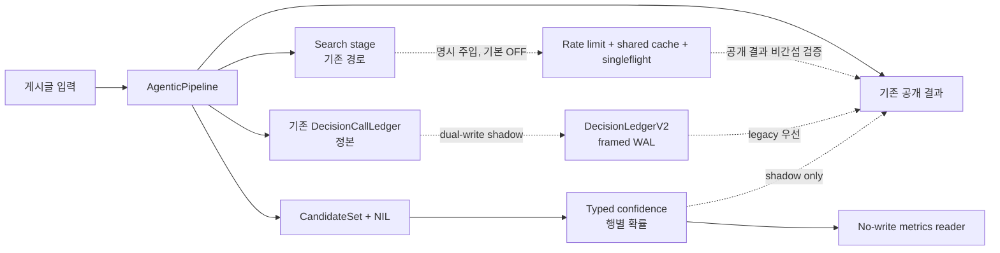
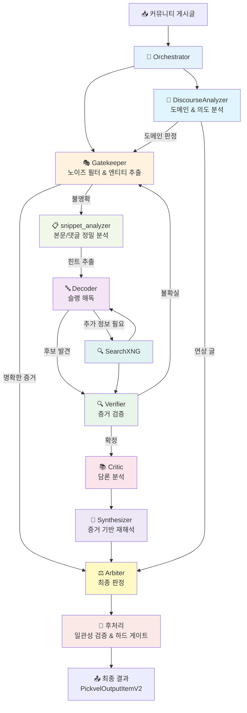
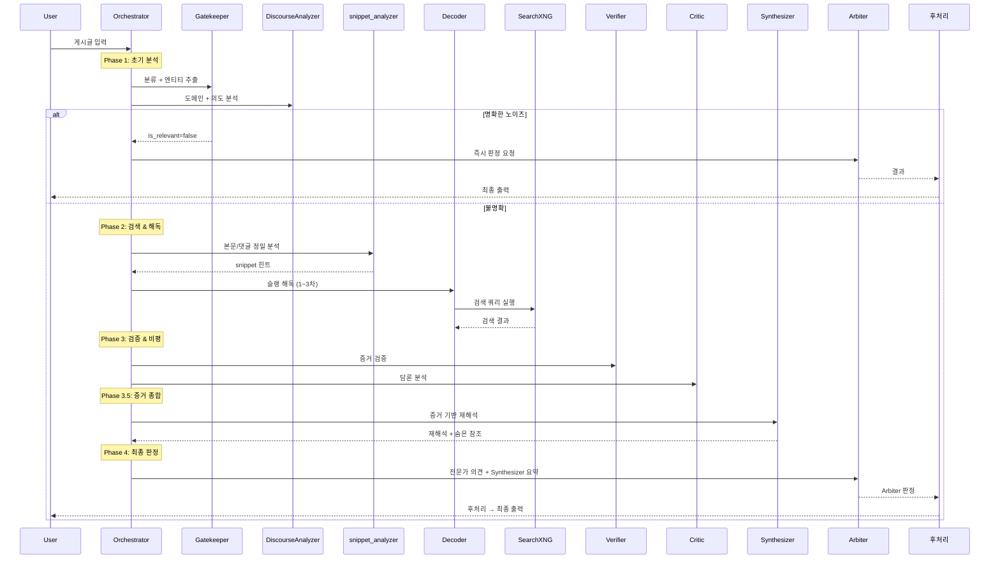

# Expert Orchestration System - 전문가 오케스트레이션 시스템

디시인사이드 장르소설 갤러리 크롤링 데이터를 **유기적 전문가 시스템(Agentic Expert System)**으로 분석하여 웹소설을 식별하고 담론 메타데이터를 추출합니다.

## 현재 파이프라인 상태: Architecture V2 통합 완료

| 구분 | 현재 상태 | 쉬운 뜻 |
| --- | --- | --- |
| 내부 아키텍처 | `ARCHITECTURE_V2_INTEGRATED` | 기본 OFF인 새 계층을 기존 공개 결과 경로에 안전하게 접목하고 clean export까지 검증했다. |
| 실제 효과 | `ACTUAL_EFFECT_WAITING_EXTERNAL_INPUT`, `null/NOT_ESTIMABLE` | source-backed DEV/CAL/FROZEN과 fresh BEFORE/AFTER가 없어 정확도·비용 개선률을 아직 주장하지 않는다. |
| 운영 적용 | `REVIEW-LOCKED`, `full_scan_approval=false` | 내부 통합 완료는 cheap routing 또는 전체 스캔 운영 승인이 아니다. |

### Architecture V2가 추가한 기능

| 계층 | 하는 일 | 현재 안전 경계 |
| --- | --- | --- |
| Stage runtime adapter | search 단계의 rate limit, filesystem shared cache, singleflight와 영수증을 연결 | 명시 주입만 가능하고 기본 OFF. limiter는 process-local, cache/singleflight는 같은 filesystem 범위 |
| DecisionLedgerV2 | 기존 원장을 정본으로 둔 채 framed WAL에 dual-write하고 재시작 시 대조·복구 | V2-root coordination lock, one-way rollback latch, receipt coverage. production 자동 활성화 금지 |
| CandidateSet/NIL | 여러 작품 후보와 `작품 없음(NIL)`을 하나의 사건 공간으로 보존 | producer가 `UNKNOWN/TRUNCATED`면 후보 재현율·확률 평가를 중단 |
| Typed confidence | 행별 보정 확률과 전체 정확도 지표를 분리 | `confidence_percentage`는 그 행의 선택 확률이며 전체 정확도 `%`가 아님 |
| Policy-free metrics reader | ECE, Brier, log loss, candidate recall, selective risk, AURC를 무쓰기 재계산 | source/label/calibration/prediction이 결속된 `FROZEN_ACTUAL`만 산출 가능 |
| Packet intake | actual packet, policy, 동일 frozen input, BEFORE/AFTER 명령과 복구 명령을 사전 검사 | 입력이 없으면 runtime을 시작하지 않고 `WAITING_EXTERNAL_INPUT` |



### 검증과 다음 단계

- 로컬 회귀 네 묶음: `187`, `113`, `53`, `197` tests PASS.
- exact 137-path Git index를 clean export한 뒤 compile/import와 `181 tests PASS`.
- confidence source-less fixture는 `NOT_ESTIMABLE_NOT_FROZEN_ACTUAL`이며 실제 성능 자료가 아니다.
- 실제 자료가 도착하면 동일 RunSpec으로 `--parallel 16`, dashboard ON의 fresh BEFORE/AFTER를 실행하고 accuracy, candidate recall, calls/tokens, E2E p50/p95 paired CI를 검증한다.
- 정본: [`docs/ARCHITECTURE.md`](docs/ARCHITECTURE.md), [`Architecture V2 내부 재감사`](docs/devs/ARCHITECTURE_V2_INTERNAL_REAUDIT_KO_20260713.md), [`검증 결과`](docs/devs/VERIFICATION_RESULTS.md), [`actual packet runbook`](docs/devs/LAUNCH_READINESS_RUNBOOK_KO.md).

## 이전 P0~P4 계보 기록

> 이전 기록 — P4 v3(현재 P4 v21가 대체): 글의 공개 결과를 바꾸지 않고 전체 전문가 처리가 필요한지를 관측하는 **선택적 비용 라우팅 그림자 계약**의 초기 기반이다. Golden18은 `FULL_EXPERT_REQUIRED 18 / CHEAP_RULE_ELIGIBLE 0`, 공개 결과·CandidateSet 불변 `18/18`이었다. 실제 calls/post·절감률·처리시간 개선률은 전부 `null/NOT_ESTIMABLE`이며, 합성 4행의 호출 `16→8`·50% 회피는 계산식 시험이지 실제 절감률이 아니다. 당시 정본은 `out/selective_compute_shadow_harness_20260712/v3/comparison.md`이고, 현재 판단에는 위 P4 v21 정본을 사용한다.

> 이전 단계 — 2026-07-11 P3: 후보 작품들과 `작품 없음(NIL)`에 확률을 나누는 정확도 퍼센트 그림자 기록의 안전 계약 기반을 구현했다. v20은 actual policy v3의 `top_label_accuracy` ABSTAIN 분모를 hash-bind하고, P1·라벨·동결 split·source manifest·행별 source payload·외부 예상 행·producer·AFTER·baseline·replay 6종을 재판독한다. `actual-preflight`는 쓰기와 runtime 없이 누락·readiness·구조·coverage를 먼저 보여주며, actual-readback은 같은 파일을 다시 검증한다. 실제 DEV/CAL/FROZEN 자료가 없어 지표는 계속 `null`이며 현재 판정은 `GO_P3_CONTRACT_FOUNDATION_ONLY / NOT_RUN / REVIEW-LOCKED / full_scan_approval=false / ACTIVE_NOT_COMPLETE`다. 쉬운 설명은 `docs/devs/loop_reports/LOOP_P3_P4_DENOMINATOR_EXECUTION_ENVELOPE_20260712.md`, 최신 정본은 `out/candidate_set_calibration_shadow_harness_20260711/v20/comparison.md`를 따른다.

> 이전 단계 — 2026-07-11 P2: 같은 실행 범위의 같은 게시글에 대해 **최종 공개 판정을 한 번만 확정**하는 WAL(선행기록 로그) 계약을 구현했다. 재시도는 첫 정상 결과를 다시 사용하고, 실제 분석 내용이 다르거나 다른 입력·설정·코드 범위가 섞이면 중단한다. v8은 exact recovery witness를 만드는 복구 도구 구현까지 새 해시로 재결속했다. Golden18 저장본은 유효 판정 영수증 `0→18`, 재시작 무쓰기 `18/18`, 기존 공개 결과·전체 행 불변 `18/18`, 합성 공격 `21/21`, 거짓 통과 `0`이다. 이것은 저장본·합성 범위의 `GO`이며 실제 새 LLM 실행은 `NOT_RUN`, 의미 품질은 `REVIEW-LOCKED`, `full_scan_approval=false`, goal은 `ACTIVE / NOT_COMPLETE`다. 기능 설명은 `docs/devs/loop_reports/LOOP_P2_PUBLICATION_EXACT_ONCE_20260711.md`, 최신 정본은 `out/publication_exact_once_harness_20260711/v8/comparison.md`를 따른다.

> 이전 단계 — 2026-07-11 P1 v8/v6: query/search/fetch 계획과 실제 실행 영수증을 비교하는 `ProducerCompletionProof`를 추가했다. canonical search+fetch 계획이 사전에 고정되고, 모든 작업이 명시적으로 끝나며 누락·저하·오류·결과 손실이 없을 때만 `COMPLETE(정해 둔 범위 완료)`가 된다. 웹 전체 후보를 모두 찾았다는 뜻은 아니다. 합성 6개 시나리오는 `COMPLETE 1 / UNKNOWN 4 / TRUNCATED 1 / 거짓 COMPLETE 0`이다. 원 실행 receipt/hash에 결합되지 않은 cache, 사후 direct plan, 부분 엔진 실패, 검색·fetch fallback은 `UNKNOWN`이다. Golden18 저장본은 새 영수증이 없어 실제 행 모두 `UNKNOWN`, 후보 재현율 `NOT_EVALUABLE`이다. 공개 작품명·주소·판정은 `18/18` 불변이고 확률은 `null`이다. 집중 `62/62`, 영향 범위 `529/529 tests OK`; 실제 새 runtime은 `NOT_RUN`, `semantic_quality=REVIEW-LOCKED`, `full_scan_approval=false`, goal `ACTIVE / NOT_COMPLETE`다. 기능 설명은 `docs/devs/loop_reports/LOOP_P1_PRODUCER_COMPLETION_PROOF_20260711.md`, 정본은 `out/candidate_set_nil_shadow_harness_20260711/v8/`와 `out/candidate_generation_completeness_harness_20260711/v6/comparison.md`를 따른다.

> 현재 개선 작업 2026-07-11: Loop643 Golden18 저장본을 변경하지 않고 재생하는 P0 RunSpec v2 정적 하네스를 추가했다. Required-search blocker 5건에서 baseline promotion 결정을 `5/5` 재현한 뒤 실제 fail-close 게이트를 적용한 결과, 잘못된 공개 게시가 `1 -> 0`으로 줄었지만 검색 근거를 회복하지 않아 hard blocker는 `5 -> 5`다. 후보 누락은 `0`, 합성 계약 시험은 unsafe publish `5 -> 0`, correct publish `2 -> 2`, 결정적 회귀 시험은 `275 tests OK`다. 확률값은 calibration 전이라 제공하지 않는다. 실제 after runtime은 아직 실행하지 않았고 `semantic_quality=REVIEW-LOCKED`, `full_scan_approval=false`, goal `ACTIVE / NOT_COMPLETE`다. 읽기 쉬운 설명은 `docs/devs/LLM_PIPELINE_ARCHITECTURE_RESEARCH_20260711.md`, 정본 수치와 게이트는 `docs/devs/loop_reports/LOOP_P0_RETRIEVAL_FAILCLOSE_HARNESS_20260711.md`, 실행 명세는 `out/pipeline_improvement_harness_20260711/retrieval_failclose_v5/run_spec.json`을 따른다.

> 운영 상태 2026-07-11: 승인된 Loop643 `ARCH-MULTIWORK-TITLE-BODY-SUBJECT-CONFLICT`를 구현하고 새 fingerprint의 Golden18을 run `20260711_062543_156139`로 정확히 1회 실행했다. Runtime/Golden/publication은 `18/18/18/0/0`, semantic `18/18`, violation `0`이지만 publish-dependent search hard blocker `5`가 남았다. Non-required miss 4건은 safe terminal ledger로 닫아 unreviewed `0`이며, hard fail stop rule에 따라 N=5/fresh375는 실행하지 않았다. 현재 판정은 `LIMIT_REACHED_HANDOFF`, `semantic_quality=REVIEW-LOCKED`, production `full_scan_approval=false`다. 상세는 `docs/devs/loop643_limit_reached_handoff_20260711_071812.json`을 따른다.

---

## 📋 목차

1. [TL;DR 빠른 시작](#-tldr-빠른-시작)
2. [실행 모드 선택 가이드](#-실행-모드-선택-가이드)
3. [운영 체크리스트](#-운영-체크리스트)
4. [문서 맵](#-문서-맵)
5. [핵심 개념](#-핵심-개념)
6. [전문가 시스템 아키텍처](#-전문가-시스템-아키텍처)
7. [전문가 간 협력 메커니즘](#-전문가-간-협력-메커니즘)
8. [파이프라인 단계별 상세](#-파이프라인-단계별-상세)
9. [후처리 시스템](#-후처리-시스템)
10. [타임어택 시스템](#-타임어택-시스템)
11. [설치 및 실행](#-설치-및-실행)
12. [프로젝트 구조](#-프로젝트-구조)
13. [전문가 역할 상세](#-전문가-역할-상세)
14. [전문가 I/O 계약 & 협업 규칙](#-전문가-io-계약--협업-규칙)
15. [실행 흐름도](#-실행-흐름도)
16. [규칙 엔진 (rules.py)](#-규칙-엔진-rulespy)
17. [출력 형식](#-출력-형식)
18. [환경 설정](#-환경-설정)
19. [병렬 처리 & 대시보드](#-병렬-처리--대시보드)
20. [운영 관측 포인트](#-운영-관측-포인트)
21. [고급 기능](#-고급-기능)
22. [트러블슈팅](#-트러블슈팅)

---

## ⚡ TL;DR 빠른 시작

```bash
# 1) 의존성 설치
pip install -e .

# 2) 검색 스택 준비 (SearchXNG + Crawl4AI + CloakBrowser fallback + MCP bridge)
docker compose up -d --build

# 3) 전문가 파이프라인 실행
#    --parallel은 최대 worker 상한입니다. 실제 worker 수는 manifest의 effective_parallel을 확인하세요.
python expert_main.py tests/inputs/sample.jsonl --parallel 4
```

출력:
- 결과 JSON: `out/expert_result_YYYYMMDD_HHMMSS.json`
- 실행 로그: `logs/expert_run_YYYYMMDD_HHMMSS.log`
- 대시보드: `http://127.0.0.1:8080` (기본, `DASHBOARD_PORT`로 변경 가능)

### 검색 스택 한눈에 보기

현재 검색 경로는 비용 없는 로컬/브라우저 fallback을 기본값으로 둡니다.

```
expert_main.py worker
  -> MCPClient
  -> mcp-bridge-N
  -> SearchXNG-N / Crawl4AI-N
  -> 필요 시 browser-search-N (CloakBrowser 기반 Google fallback)
  -> 같은 shard의 WARP egress
```

기본값은 `BROWSER_SEARCH_PROVIDER_ORDER=cloak`입니다. 비용이 발생하는 검색 API 키는 필요 없고, Google 직접 브라우저 fallback은 shard별 최소 간격(`45s + jitter 0~15s`)을 두고 호출됩니다. CAPTCHA/차단 징후가 보이면 해당 shard에서 2시간 쿨다운합니다.

---

## 🧭 실행 모드 선택 가이드

| 목적 | 권장 엔트리포인트 | 설명 |
|------|------------------|------|
| **운영/주력 분석** | `expert_main.py` | 8개 전문가 협업, 타임어택, 후처리 하드게이트 포함 |
| **레거시 단일 흐름 재현** | `main.py` | 기존 Sequential Pipeline 비교/회귀 테스트 용도 |
| **regression-safe 테스트런/검증런** | `expert_main.py --parallel 16` | 웹 대시보드 기본 ON, 실제 worker 수는 manifest의 `effective_parallel` 확인 |
| **명시적 로컬 디버그** | `expert_main.py --parallel 1 --no-dashboard` | 대시보드가 방해되는 단일 워커 재현에만 사용 |

---

## ✅ 운영 체크리스트

- 입력 파일 형식 확인: JSONL 한 줄당 1 post (`post_id`, `title`, `content_blocks`, `comments`)
- 검색 백엔드 확인: `docker compose up -d --build` 또는 자동 WARP shard가 `mcp-bridge`/`SearchXNG`/`Crawl4AI`/`browser-search`와 통신 가능한지 점검
- LLM 연결 확인: `LLM_BACKEND`, `LLM_ENDPOINT` 또는 `LLM_MODEL_PATH` 유효성 점검
- 품질 보호 옵션 확인: `LLM_MAX_SEARCH_ROUNDS`, `LLM_MAX_SEARCH_QUERIES`, `MCP_TOP_K_RESULTS`
- 병렬 처리 전 확인: 원격 LLM QPS/토큰 한도와 WARP shard 수 대비 `--parallel` 값 조정
- 추적성 확보: `logs/`, `out/` 아카이브 및 실험별 설정값 기록
- 검색 안정성 확인: `logs/warp_shards_status_*.json`의 `warp=on` 및 `browser-search` `/healthz` 상태 확인

---

## 📚 문서 맵

- 현재 문서(`README.md`): 전문가 오케스트레이션 시스템 기준 문서
- 레거시 문서: [`README_legacy_pipeline.md`](README_legacy_pipeline.md)
- 장문 전문가 문서 원본: [`expert_readme.md`](expert_readme.md)
- WARP/search shard 운영 문서: [`docs/warp_sharding.md`](docs/warp_sharding.md)

---

## 🎯 핵심 개념

### 유기적 전문가 시스템 (Agentic Expert System)

기존의 단방향 파이프라인과 달리, **8명의 전문가들이 서로 소통하고 협력**하여 문제를 해결하는 시스템입니다:

```
❌ 기존 방식 (Sequential Pipeline):
Stage0 → Stage1 → Stage2 → 결과

✅ 전문가 시스템 (Collaborative):
Orchestrator
    ↓
Gatekeeper ↔ Discourse ↔ Decoder ↔ Verifier ↔ Critic ↔ Synthesizer
    ↕           ↕          ↕          ↕          ↕          ↕
                    [검색/질문/요청]
    ↕           ↕          ↕          ↕          ↕          ↕
                   Arbiter (최종 판정)
```

**핵심 특징:**
- 🤝 **협력적**: 전문가들이 서로에게 질문하고 요청
  - Decoder → Verifier: "이 후보 검증해줘"
  - Verifier → Gatekeeper: "원문 다시 확인해줘"
  - Synthesizer → Arbiter: "증거 기반으로 재해석한 결과야"
- 🔄 **반복적**: 확신이 생길 때까지 재분석
  - 최대 10회 반복 (max_iterations=10)
  - 각 반복마다 전문가들이 새로운 정보 교환
- ⏱️ **타임어택**: 분석 시간이 부족하면 긴급 모드 진입
  - **NORMAL** → 충분한 시간, 자유로운 협력
  - **HIGH** → ⚠️ 시간 부족, 의견 정리 요구
  - **CRITICAL** → 🚨 즉시 결론 도출, Arbiter 강제 소환
- 🧠 **지능적**: 상황에 따라 동적으로 분석 전략 조정
- ⚖️ **균형적**: Arbiter가 갈등을 조정하고 최종 판단
- 🔬 **증거 기반**: Synthesizer가 모든 증거를 종합하여 재해석

---

## 🏗️ 전문가 시스템 아키텍처

### 전문가 구성원 (총 8명)

| 전문가 | 이모지 | 역할 | 전문 분야 | 코드 규모 |
|--------|--------|------|-----------|-----------|
| **Orchestrator** | 🎼 | 전문가 조율 | 전문가 간 라우팅, 대화 관리, 반복 제어 | ~3,744줄 |
| **Gatekeeper** | 🎭 | 커뮤니티 문화 분석 | 게시글 분류, 노이즈 필터, 엔티티 추출 | ~456줄 |
| **DiscourseAnalyzer** | 📖 | 담론/도메인 분석 | 글의 본질적 의도, 도메인 식별, 연상 vs 토론 구분 | ~367줄 |
| **Decoder** | 🔤 | 한글 슬랭 해독 | 초성체/축약어 복원, 검색 결과 매칭, snippet 분석 | ~4,060줄 |
| **Verifier** | 🔍 | 증거 검증 | 교차 검증, 거짓 긍정 방지, 증거 체인 구축 | ~986줄 |
| **Critic** | 📚 | 문학 비평 | 담론 분석, 감성 프로파일, NSFW 탐지 | ~246줄 |
| **Synthesizer** | 🔬 | 증거 기반 재해석 | 숨은 참조 발견, 증거 정합성 평가, 댓글 인사이트 | ~460줄 |
| **Arbiter** | ⚖️ | 최종 판정 | 전문가 의견 종합, 갈등 해소, 최종 결론 | ~2,859줄 |

> 전문가 코드 총 합계: **~13,178줄**

### ExpertType 열거형

```python
class ExpertType(Enum):
    GATEKEEPER   = "gatekeeper"
    DISCOURSE    = "discourse"
    DECODER      = "decoder"
    VERIFIER     = "verifier"
    CRITIC       = "critic"
    SYNTHESIZER  = "synthesizer"   # 증거 기반 재해석기
    ARBITER      = "arbiter"
```

### 시스템 흐름



---

## 🤝 전문가 간 협력 메커니즘

### 메시지 교환 시스템

전문가들은 `ExpertMessage` 객체를 통해 서로 소통합니다:

```python
@dataclass
class ExpertMessage:
    from_expert: ExpertType      # 발신 전문가
    to_expert: ExpertType        # 수신 전문가 (None이면 전체)
    message_type: str            # "request", "question", "answer", "analysis"
    content: Dict[str, Any]      # 메시지 내용
    timestamp: float             # 타임스탬프
```

### 협력 패턴

#### 패턴 1: 순차 협력 (Sequential)
```
🎭 Gatekeeper → 🎼 Orchestrator
  "작품 토론으로 보이지만 제목이 모호함. 슬랭 해독 필요."
🎼 Orchestrator → 🔤 Decoder
  "'전독시' 해독해주세요"
🔤 Decoder → 🎼 Orchestrator
  "'전지적 독자 시점'으로 추정됨 (95% 신뢰도)"
🎼 Orchestrator → 🔍 Verifier
  "'전지적 독자 시점' 맞는지 검증해주세요"
```

#### 패턴 2: 증거 기반 재해석 (Synthesizer 협력)
```
🔤 Decoder → 🔬 Synthesizer
  "해독 결과: 캐릭터명 3개, 작가명 1개 식별"
🔍 Verifier → 🔬 Synthesizer
  "검증 결과: URL 증거 있지만 본문이 애매"
🔬 Synthesizer → ⚖️ Arbiter
  "원본 재해석: 본문+댓글이 작품에 대해 논의. 숨은 참조 2개 발견."
```

#### 패턴 3: 갈등 해소 (Conflict Resolution)
```
🔤 Decoder: "'노피아'는 '노벨피아 웹소설' 추천 글"
🔍 Verifier: "'노피아'는 플랫폼명, 작품명 아님"
🎼 Orchestrator → ⚖️ Arbiter
  "Decoder와 Verifier 의견 충돌. 판정 필요."
⚖️ Arbiter:
  "Verifier가 맞음. 플랫폼명 단독 언급은 is_relevant=false"
```

### 대화 컨텍스트 공유

모든 전문가는 공통 컨텍스트를 공유합니다:

```python
class ConversationContext:
    post_data: Dict           # 원본 게시글
    comments: List[str]       # 댓글 목록 (최대 15개)
    search_results: List      # 검색 결과 (누적)
    messages: List            # 전문가 간 메시지 기록
    expert_outputs: Dict      # 각 전문가의 분석 결과
    iteration: int            # 현재 반복 횟수
    snippet_hints: Dict       # snippet_analyzer 힌트
    verified_character_work_links: List  # 검증된 캐릭터-작품 연결
```

---

## 🔬 파이프라인 단계별 상세

Orchestrator가 관리하는 전체 파이프라인 흐름:

### Phase 1: 초기 분석
| 순서 | 전문가 | 역할 |
|------|--------|------|
| 1-1 | **Gatekeeper** | 게시글 분류, 엔티티 추출, 노이즈 필터링 |
| 1-2 | **DiscourseAnalyzer** | 도메인 식별, 연상 vs 토론 판별 |

### Phase 2: 검색 & 해독
| 순서 | 전문가 | 역할 |
|------|--------|------|
| 2-1 | **snippet_analyzer** | 본문/댓글에서 제목·약어·작가·캐릭터 힌트 정밀 추출 |
| 2-2 | **Decoder** (1~3차) | 슬랭 해독, 검색 결과 매칭, 후보 생성 |
| 2-3 | **SearchXNG** | Decoder/Verifier 요청에 따른 웹 검색 |

> **3차 Decoder 최적화**: 2차 결과가 이미 medium/high 이상이면 3차 실행 생략

### Phase 3: 검증 & 비평
| 순서 | 전문가 | 역할 |
|------|--------|------|
| 3-1 | **Verifier** | 교차 검증, URL/앵커 증거 확인, 거짓 긍정 방지 |
| 3-2 | **Critic** | 담론 메타데이터 추출, 감성 분석, NSFW 탐지 |

### Phase 3.5: 증거 종합 ⭐ NEW
| 순서 | 전문가 | 역할 |
|------|--------|------|
| 3.5 | **Synthesizer** | 축적된 증거를 바탕으로 원본 전문 재해석, 숨은 참조 발견 |

### Phase 4: 최종 판정
| 순서 | 전문가 | 역할 |
|------|--------|------|
| 4-1 | **Arbiter** | 모든 전문가 의견 종합, 갈등 해소, 최종 결론 |
| 4-2 | **후처리** | 증거 버킷 검증, 앵커 하드 게이트, 일관성 교정 |

---

## 🔧 후처리 시스템

Arbiter 판정 이후 `agentic_pipeline.py`에서 수행되는 자동 교정 로직입니다.

### Discussion Type 분류 체계 (16종)

#### 작품 관련 (is_relevant=True 가능) — 7종
| 타입 | 설명 |
|------|------|
| `general` | 일반 작품 토론 |
| `review` | 작품 리뷰/평가 |
| `spoiler` | 스포일러 포함 토론 |
| `anticipation` | 연재/출간 기대 |
| `meme` | 작품 관련 밈/드립 |
| `character_talk` | 등장인물 토론 |
| `general_discussion` | 범용 토론 |

#### 항상 비관련 (is_relevant=False 강제) — 9종
| 타입 | 설명 |
|------|------|
| `noise` | 무관한 노이즈 |
| `meta` | 커뮤니티 메타 토론 |
| `author_talk` | 작가 품평/비교 |
| `recommendation` | 추천 요청 |
| `trope_discussion` | 장르/클리셰 토론 |
| `community_banter` | 커뮤니티 잡담 |
| `genre_opinion` | 장르 의견 |
| `image_post` | 이미지 게시글 |
| `off_topic` | 주제 벗어남 |

### 증거 버킷 검증 (Evidence Bucket)

```python
# suspected_titles에서 medium 이상만 필터
strong_suspected_titles = [t for t in suspected if conf_rank >= 2]

# Verifier 앵커 확인
has_work_anchor = anchor in {
    "title_mention", "author_mention",
    "character_title_link", "character_mention", "plot_mention"
}
```

### 앵커 하드 게이트

**조건**: `is_relevant=True` + `official_title` 존재 시 적용

```
차단 트리거:
  1. 본문에 강한 앵커가 없음 (_no_body_evidence)
  2. 제목-본문 불일치 연상글 (_association_block)

Rescue 면제 조건 (하나라도 충족하면 차단하지 않음):
  1. strong_suspected_title + has_work_anchor
  2. Decoder가 title_mention/character_title_link 앵커 + high/max confidence
  3. verified_character_work_links 존재

차단 시 → is_relevant=False, confidence="None", discussion_type="noise"
```

### 일관성 교정 (Consistency Correction)

| 상황 | 교정 내용 |
|------|-----------|
| `always_irrelevant` 타입 + `is_relevant=True` + 제목 있음 | **Rescue**: discussion_type → `"general"` |
| `author_talk` + `is_author_criticism` + 2개 이상 작품 | **Rescue 차단**: FP 방지 |
| `is_relevant=True` + `discussion_type="noise"` | `"noise"` → `"general"` 교정 |
| `is_relevant=False` + `work_relevant_types` | discussion_type → `"noise"` 교정 |

---

## ⏱️ 타임어택 시스템

### 시간 상태 3단계

| 단계 | 남은 Step | 전문가 행동 | Orchestrator 행동 |
|------|-----------|-------------|-------------------|
| **NORMAL** | 충분 | 자유로운 탐색, 추가 검색 허용 | 메시지 자유롭게 라우팅 |
| **HIGH** | ≤ 4 | 의견 정리, 불확실성 감소 집중 | 우선순위 높은 전문가만 호출 |
| **CRITICAL** | ≤ 2 | 즉시 최선의 답변 제공 | Arbiter 강제 소환, 판정 강제 |

### 타임어택 동작 예시

```
=== Iteration 1/10 (NORMAL) ===
🎭 Gatekeeper: "작품 토론 같은데 확실하지 않아요. 검색해볼게요."

=== Iteration 2-4/10 (NORMAL) ===
🔤 Decoder 1~3차: 슬랭 해독 + 검색 결과 매칭

=== Iteration 5-6/10 (NORMAL) ===
🔍 Verifier: 증거 검증 + 📚 Critic: 담론 분석
🔬 Synthesizer: 증거 기반 재해석

⚠️ === Iteration 7-8/10 (HIGH) === ⚠️
🎼 Orchestrator: "분석 시간이 얼마 남지 않았습니다!"

🚨 === Iteration 9-10/10 (CRITICAL) === 🚨
⚖️ Arbiter: "강제 판정 모드. 현재 증거 기반 최종 결론 도출."
```

### 조기 종료 조건

시간이 남아도 결론이 명확하면 조기 종료:

```python
if gatekeeper.noise_score > 0.95:
    # 명백한 노이즈 → 즉시 Arbiter
    return arbiter.reject(reason="노이즈")

if verifier.confidence == "Max" and verifier.has_url_evidence:
    # URL 증거 → 즉시 Arbiter
    return arbiter.confirm(title_from_url)
```

### max_iterations 설정 가이드

```python
pipeline = AgenticPipeline(
    max_iterations=3,   # 빠른 처리 (정확도 약간 하락)
    max_iterations=5,   # 가벼운 분석
    max_iterations=10,  # 정밀 분석 (현재 기본값) ⭐
)
```

---

## 🚀 설치 및 실행

### 설치

```bash
pip install -e .
```

### 빠른 시작

```bash
# 검색 스택 준비
docker compose up -d --build

# 기본 실행 (단일 워커)
python expert_main.py

# 입력 파일 지정
python expert_main.py tests/inputs/sample.jsonl

# regression-safe 테스트런/검증런 기본 병렬 상한 16
# 실제 worker 수는 input 수/healthy endpoint 수에 따라 effective_parallel로 줄어들 수 있음
python expert_main.py tests/inputs/sample.jsonl --parallel 16

# 대시보드 비활성화: 명시적 로컬 디버그에만 사용
python expert_main.py --no-dashboard
```

### CLI 인자

| 인자 | 타입 | 기본값 | 설명 |
|------|------|--------|------|
| `input` | positional | `tests/inputs/test01.jsonl` | 입력 JSONL 파일 경로 |
| `--parallel`, `-p` | int | `1` | 병렬 처리 worker 최대치. regression-safe 테스트런/검증런은 사용자 지시에 따라 `--parallel 16`을 요청하고, 실제 실행 worker 수는 `effective_parallel`로 manifest/run_meta에 기록됨 |
| `--no-dashboard` | flag | — | 대시보드 비활성화. 신규 테스트런/검증런 기본 명령에는 넣지 않고, 명시적 로컬 디버그에만 사용 |

### LLM 모드

#### Remote (기본 — 원격 서버)
```python
LLM_MODE = "remote"
# LLM_ENDPOINT = http://a100:10000/
# LLM_MODEL = unsloth/GLM-4.7-Flash-GGUF:IQ3_XXS
```

#### Local (로컬 GGUF)
```python
LLM_MODE = "local"
# LLM_MODEL_PATH = GLM-4.7-Flash-UD-IQ3_XXS.gguf
# LLM_N_GPU_LAYERS = 60
```

---

## 📁 프로젝트 구조

### 디렉토리 구조

```
llm_novel_dc_coommunity_parser/
├── src/
│   └── llm_batch/
│       ├── experts/               # 전문가 시스템 (~13,178줄)
│       │   ├── orchestrator.py    # 🎼 오케스트레이터 (~3,744줄)
│       │   ├── decoder.py         # 🔤 디코더 (~4,060줄)
│       │   ├── arbiter.py         # ⚖️ 중재자 (~2,859줄)
│       │   ├── verifier.py        # 🔍 검증자 (~986줄)
│       │   ├── synthesizer.py     # 🔬 재해석기 (~460줄) ⭐ NEW
│       │   ├── gatekeeper.py      # 🎭 게이트키퍼 (~456줄)
│       │   ├── discourse.py       # 📖 담론 분석가 (~367줄)
│       │   ├── critic.py          # 📚 비평가 (~246줄)
│       │   ├── prompts.py         # 전문가 프롬프트
│       │   └── utils.py           # 유틸리티 함수
│       ├── llm/                   # LLM 클라이언트
│       │   ├── client.py          # LLM 백엔드 인터페이스
│       │   └── prompt.py          # 프롬프트 템플릿
│       ├── search/                # 검색 시스템
│       │   └── client.py          # MCP/SearchXNG 클라이언트
│       ├── mcp_bridge/            # MCP 브릿지 서버
│       │   └── server.py
│       ├── browser_search/        # CloakBrowser 기반 headless Google fallback
│       │   └── server.py
│       ├── agentic_pipeline.py    # 전문가 파이프라인 (~1,408줄)
│       ├── pipeline.py            # 기존 Sequential 파이프라인
│       ├── models.py              # 데이터 모델 (~159줄)
│       └── rules.py               # 규칙 엔진 (~325줄)
├── tests/
│   ├── inputs/                    # 테스트 입력 데이터
│   └── test_*.py                  # 각종 테스트
├── docker/                        # Docker 설정
│   ├── browser-search/Dockerfile  # CloakBrowser fallback 서비스
│   ├── mcp-bridge/Dockerfile
│   ├── warp/Dockerfile
│   └── searchxng/settings.yml
├── docs/
│   ├── ARCHITECTURE.md
│   └── warp_sharding.md           # WARP/SearchXNG/Crawl4AI/browser-search shard 문서
├── expert_main.py                 # 전문가 시스템 실행 엔트리포인트 (~816줄)
├── main.py                        # 기존 파이프라인 엔트리포인트
├── expert_readme.md               # 전문가 문서 원본(상세판)
└── README.md                      # 현재 기준 문서
```

### 주요 파일 역할

| 파일 | 역할 |
|------|------|
| `expert_main.py` | 전문가 시스템 원클릭 실행 (병렬 처리, 대시보드, 로깅 관리) |
| `agentic_pipeline.py` | 유기적 전문가 협력 파이프라인 + 후처리 로직 |
| `orchestrator.py` | 전문가 라우팅, 대화 관리, snippet_analyzer, Phase 제어 |
| `decoder.py` | 한글 슬랭 해독, 검색 매칭, resolved_mappings 필터링 |
| `browser_search/server.py` | CloakBrowser 기반 비용 없는 Google fallback 검색 서버 |
| `mcp_bridge/server.py` | SearchXNG/Crawl4AI/browser-search를 묶는 MCP 브릿지 |
| `tools/warp_shards.py` | WARP/SearchXNG/Crawl4AI/browser-search/MCP shard 생성·상태확인·재기동 |
| `arbiter.py` | 최종 판정, 갈등 해소, author_talk 업그레이드 로직 |
| `verifier.py` | 증거 교차 검증, 앵커 확인, 작가 비평 판별 |
| `synthesizer.py` | 증거 기반 원문 재해석, 숨은 참조 발견 |
| `gatekeeper.py` | 1차 필터링, 엔티티 추출, 커뮤니티 접두어 제거 |
| `discourse.py` | 도메인/의도 분석, 연상 vs 토론 구분 |
| `critic.py` | 담론 메타데이터 추출, 감성 프로파일 |
| `models.py` | 출력 스키마 (PickvelOutputItemV2), 데이터 모델 |
| `rules.py` | 장르 용어, 플랫폼 사전, 연상 패턴, 커뮤니티 접두어 |

---

## 🧩 전문가 역할 상세

### 🎼 Orchestrator (오케스트레이터)

**책임:**
- 전문가 간 메시지 라우팅 및 대화 컨텍스트 관리
- 반복 횟수 제어 (기본: 최대 10회)
- snippet_analyzer 내장 실행 (Phase 2-1)
- 3차 Decoder 회귀 방지 (2차에서 medium/high면 3차 생략)
- `irrelevant_authors` 보호 (Gatekeeper가 work_discussion + 3+ 캐릭터면 제거 차단)

**snippet_analyzer:**

Orchestrator 내부에 구현된 분석 모듈로, Decoder 호출 전에 본문/댓글을 정밀 분석하여 힌트를 추출합니다:
- 제목 힌트 (`title_hints`)
- 약어 힌트 (`abbreviation_hints`)
- 작가/캐릭터 힌트
- 장르 패턴 식별

### 🎭 Gatekeeper (게이트키퍼)

**전문 분야:**
- 커뮤니티 문화와 속어 이해
- 노이즈 게시글 필터링
- 작품명/작가명/캐릭터명 추출
- 커뮤니티 접두어 (`소신발언)`, `스포)`, `추천)` 등) 자동 제거

**출력 예시:**
```json
{
  "classification": "work_discussion",
  "confidence": 0.85,
  "detected_entities": {
    "titles": ["전독시", "ORV"],
    "authors": ["싱숑"],
    "characters": ["김독자", "유중혁"]
  },
  "noise_score": 0.1,
  "search_strategy": {
    "should_search": true,
    "queries": ["전독시 웹소설", "site:namu.wiki 전독시"]
  }
}
```

### 📖 DiscourseAnalyzer (담론 분석가)

**전문 분야:**
- 글의 본질적 의도 파악
- 도메인 식별 (20+ 도메인: `novel_literature`, `manga_comics`, `gaming`, `medical_health` 등)
- 연상(Association) vs 토론(Discussion) 구분

**연상 vs 토론 구분:**
```
# 연상 (Association) - is_relevant: false
"길 가다가 전독시 생각남"           # 수동적 회상
"사진 보니까 ㅇㅇ 떠올랐다"         # 외부 자극

# 토론 (Discussion) - is_relevant: true  
"전독시 읽는중인데 복선 미쳤다"     # 능동적 몰입
"ㅇㅇ 봤는데 전개가 이상함"        # 분석적 평가
```

**출력 예시:**
```json
{
  "domain": "novel_literature",
  "domain_confidence": 0.95,
  "intent": "discuss_work",
  "intent_confidence": 0.90,
  "is_association": false,
  "reasoning": "게시글이 '전독시'에 대한 깊이 있는 토론"
}
```

### 🔤 Decoder (디코더)

**전문 분야:**
- 한글 초성체 복원 (ㅈㄷㅅ → 전독시)
- 축약어 해독 (화귀, 죽깨수, 약먹마)
- 검색 결과와 후보 매칭
- `resolved_mappings` 가비지 필터링 (자기 참조, 사전 항목, 비속어, 장르 용어 차단)

**다중 실행 (최대 3차):**
- 1차: 기본 검색 + 해독
- 2차: 1차 결과 반영 재검색
- 3차: (2차가 medium/high 이상이면 **생략**)

**형태소 분석 예시:**
```
입력: "즉사무림"
분석:
  - 즉[즉시] + 사[死, 사망] + 무림[武林]
  - 패턴: 즉시 죽는 + 무협
후보: "즉사 무협", "즉시 사망 무협"
검색: "즉사무림 웹소설"
매칭: "모두가 죽는 무림에서 나홀로 즉사합니다"
```

### 🔍 Verifier (검증자)

**전문 분야:**
- 증거 교차 검증
- 앵커 유형 확인 (`title_mention`, `author_mention`, `character_title_link`, `character_mention`, `plot_mention`)
- 거짓 긍정 방지
- 작가 비평(`is_author_criticism`) 판별

**검증 프로세스:**
```
1. 증거 수집 (본문, 댓글, 검색 URL/스니펫)
2. 교차 검증 (여러 소스에서 일관성 확인)
3. 신뢰도 평가
   - Max: URL 증거 또는 명시적 제목
   - High: 사전 매칭 + 검색 확인
   - Medium: 문맥 추론
   - Low: 불확실
4. 결론 → Critic/Synthesizer로 전달
```

### 📚 Critic (비평가)

**전문 분야:**
- 담론 분석 (고구마/사이다/드리프트)
- 감성 프로파일 (pacing, sentiment, drift_risk)
- NSFW/스포일러 탐지
- 독자 세그먼트 (누렁이/무틀딱)

**커뮤니티 용어 매핑:**

| 용어 | 의미 | 추출 필드 |
|------|------|-----------|
| 고구마 | 전개 지연, 답답함 | `pacing: Slow` |
| 사이다 | 즉각 해결, 시원함 | `pacing: Fast`, `sentiment: Positive` |
| 4드론 | 초반 자극 몰아치기 | `micro_tag: 4드론` |
| 드리프트 | 장르 급전환 | `drift_risk: High` |
| 후집피 | 후회/집착/피폐 | `micro_tag: 후집피` |

### 🔬 Synthesizer (증거 기반 재해석기) ⭐ NEW

**Phase 3.5에서 실행** — 모든 전문가(Decoder, Verifier, Critic) 분석 완료 후, Arbiter 판정 전에 개입합니다.

**핵심 역할:**
1. **텍스트 재해석**: 본문의 각 문장/표현을 증거 기반으로 재해석
2. **댓글 재해석**: 댓글에서 작품/캐릭터 관련 추가 실마리 발견
3. **숨은 참조 발견**: 초기 Decoder가 놓쳤지만 증거로 뒷받침되는 참조
4. **증거 정합성 평가**: 전문가들의 식별이 원문 맥락과 실제로 맞는지
5. **최종 확신도**: 모든 증거를 종합한 뒤의 판단

**입력:** Decoder 해독 결과, Verifier 검증 결과, 검색 증거, snippet 힌트, Discourse 분석, Critic 감지 제목

**출력 예시:**
```json
{
  "reinterpretation": {
    "post_intent": "개돌청년 작가의 신작에 대한 비평 글",
    "text_analysis": [
      {
        "segment": "초대남이 너무 좆같은데",
        "interpretation": "작품 속 '초대남' 캐릭터에 대한 부정적 평가",
        "evidence_source": "search"
      }
    ],
    "comment_insights": [...]
  },
  "hidden_references": [
    {
      "text": "금태양",
      "reference_type": "character",
      "matched_to": "신작의 등장인물",
      "evidence": "검색 결과에서 개돌청년 작품 캐릭터로 확인"
    }
  ],
  "evidence_alignment": {
    "decoder_match": "strong",
    "verifier_match": "partial",
    "overall_coherence": "high"
  },
  "confidence_assessment": {
    "is_about_identified_work": true,
    "confidence": "High",
    "reasoning": "캐릭터명 3개 + 작가명이 모두 검색 증거와 일치"
  },
  "synthesis_summary": "Arbiter에게 전달할 핵심 요약 3-5문장"
}
```

**Arbiter 전달:** `summarize_for_arbiter()` 메서드로 compact 요약을 생성하여 Arbiter 프롬프트에 삽입

### ⚖️ Arbiter (중재자)

**전문 분야:**
- 전문가 의견 종합 및 갈등 해소
- Synthesizer 재해석 결과 반영
- Verifier의 확정 제목을 suspected_titles에 우선 주입 (null-guard)
- `author_talk` → `work_discussion` 업그레이드 로직
  - 조건: Gatekeeper=`work_discussion` + 3+캐릭터 + Decoder가 작가 식별

**판정 프로세스:**
```
1. 의견 수집 — 모든 전문가 + Synthesizer 분석 결과 검토
2. 갈등 해소 — 불일치 지점 파악, 증거 무게 평가
3. 종합 판정 — is_relevant, official_title, confidence, discussion_type
4. 메타데이터 병합 — Critic의 분석 통합
```

**중요 규칙:**
```
⚠️ 플랫폼 이름은 작품이 아닙니다:
- 노벨피아, 문피아, 카카오페이지 → is_relevant: false
- "노피에서 뭐 볼까?" → 추천 요청, 작품 아님
```

---

## 🧾 전문가 I/O 계약 & 협업 규칙

### 공통 메시지 계약 (ExpertMessage)

전문가 간 협업 메시지는 아래 구조로 기록됩니다 (`orchestrator.py`):

```python
{
  "from": "gatekeeper|discourse|decoder|verifier|critic|synthesizer|arbiter",
  "to": "expert_name|orchestrator",
  "type": "analysis|request|question|answer|final",
  "content": {...},
  "timestamp": 1700000000.0
}
```

핵심 원칙:
- `request` 메시지는 반드시 왜 필요한지(`reason`)와 무엇을 확인할지(`question`)를 포함
- 동일 요청 루프를 막기 위해 Orchestrator가 처리 이력을 관리
- 타임어택 `HIGH/CRITICAL` 구간에서는 신규 요청보다 결론 수렴을 우선

### 전문가별 핵심 입력/출력 필드

| Expert | 주요 입력 | 주요 출력 | 다운스트림 영향 |
|--------|----------|----------|----------------|
| Gatekeeper | `post_data`, `comments` | `classification`, `search_requests`, `context_clues`, `is_noise` | 검색 전략 및 초깃값 결정 |
| DiscourseAnalyzer | 제목/본문/댓글 | `discourse_analysis.primary_domain`, `intent`, `is_association_not_discussion` | 도메인 역방향 경고, 연상글 차단 |
| Decoder | Gatekeeper 힌트 + 검색 결과 | `decoded_terms[]`, `suspected_titles`, `overall_confidence`, `request_expert` | 후보 작품 생성/정제 |
| Verifier | Decoder 후보 + 원문/검색 증거 | `verification_result`, `final_confidence`, `verification_search`, `counter_arguments` | FP 차단, 앵커 검증 |
| Critic | 확정/준확정 식별 결과 | `analysis.detected_titles`, `micro_tags`, `sentiment_profile`, `is_nsfw` | 메타데이터 생성 |
| Synthesizer | Decoder+Verifier+Critic+검색 | `reinterpretation`, `hidden_references`, `evidence_alignment`, `synthesis_summary` | Arbiter 판정 재해석 근거 제공 |
| Arbiter | 전체 전문가 출력 + 컨텍스트 | `final_decision`, `metadata_synthesis`, `expert_consensus` | 최종 identity/analysis 결정 |

### 협업 요청 트리거 가이드

| 요청 주체 | 요청 대상 | 요청 시점 | 예시 |
|----------|----------|----------|------|
| Decoder | Verifier | 후보 2개 이상 경합, 앵커 약함 | "A/B 중 본문 앵커 일치 쪽 검증 필요" |
| Verifier | Decoder | 축약 복원이 약칭 수준으로만 남음 | "detected_term은 있는데 정식명 복원 실패" |
| Verifier | Gatekeeper | 포스트 타입(추천/작가비평/작품토론) 불확실 | "작품이 주제인지 예시 언급인지 재분류 필요" |
| Orchestrator | Arbiter | 반복 한도 임박, 의견 충돌 지속 | "타임어택 CRITICAL 강제 판정" |

실무 팁:
- `request_expert`를 남길 때는 불확실 용어를 배열로 남기면 후속 검증 품질이 높아집니다.
- 증거가 이미 충분한데 협업을 반복하면 오히려 false override가 늘어납니다.

---

## 📊 실행 흐름도



---

## 📏 규칙 엔진 (rules.py)

### GENRE_ARCHETYPE_TERMS

작품명이 아닌 **장르/속성 용어** — 제목 후보에서 제외합니다:

```python
(
    "초대남", "금태양", "거근쇼타", "거근", "쇼타",
    "NTR", "네토라레", "순애", "하렘",
    "먼치킨", "사이다", "고구마", "빌런", "흔막",
    "현판", "현판물", "백합난입",
    "회귀물", "환생물", "빙의물", "전생물",
    "막내아들물", "아카데물", "무협물", "이세계물", "헌터물",
    "로판", "판무",
    "시스템", "상태창", "만담", "스텟", "스킬",
    "파이어볼", "마검사", "타임슬립", "루프물",
    "농", "ts물", "TS물", "TS"
)
```

### COMMUNITY_PREFIX_PATTERNS

게시글 제목에서 자동 제거되는 커뮤니티 태그 접두어:

```python
(
    "소신발언)", "소신발언))", "소신발언 )",
    "스포)", "스포))", "스포 )",
    "추천)", "추천))", "질문)", "질문))",
    "정보)", "정보))", "후기)", "후기))",
    "잡담)", "잡담))", "리뷰)", "리뷰))",
    "토론)", "토론))", "공지)", "공지))",
    "속보)", "속보))", "ㅈㄴ)"
)
```

### 기타 주요 상수

| 상수 | 설명 |
|------|------|
| `NOVEL_SITES` | `novelpia.com`, `munpia.com`, `page.kakao.com`, `kakao.page`, `joara.com`, `series.naver.com`, `ridibooks.com` |
| `OFFICIAL_PLATFORMS` | `NOVEL_SITES` + `namu.wiki` |
| `SLANG_DICTIONARY` | 음절 두문자 사전 (아카살, 전독시, 죽신성, 로나좋, 나혼렙 등) |
| `NOISE_TERMS` | `글카`, `채굴`, `날씨`, `음식`, `애니`, `만화` 등 |
| `PLATFORM_ABBREVIATIONS` | 노피아, 문피, 카카페, 시리즈, 리디, 조아라 등 |
| `PLATFORM_FEATURE_TERMS` | 콘, 이모티콘, 뱃지, 캐시, 쿠폰, 이벤트 등 |
| `ASSOCIATION_PATTERNS` | 연상글 감지 패턴 11종 |
| `GENRE_KEYWORDS` | `fantasy`, `martial_arts`, `romance`, `modern` 4개 장르별 키워드 사전 |
| `NON_NOVEL_MEDIA_KEYWORDS` | 히토미, 엔헨, 이헨, 마루마루, 뉴토끼 등 (비소설 미디어) |

---

## 📤 출력 형식

### PickvelOutputItemV2 스키마

```
PickvelOutputItemV2
├── post_id: int
├── identity: PickvelIdentity
│   ├── is_relevant: bool
│   ├── novel_identity: Optional[NovelIdentity]
│   │   ├── official_title: Optional[str]
│   │   ├── heretic_url: Optional[str]    # 작품 공식 페이지 URL
│   │   └── confidence: str               # None|Low|Medium|High|Max
│   ├── discussion_type: Optional[str]    # 16종 중 하나
│   ├── evidence: Optional[Evidence]
│   ├── slang_insight: Optional[SlangInsight]
│   ├── inference: Optional[Inference]
│   └── reason: Optional[str]
└── analysis: Optional[PickvelAnalysis]
    ├── detected_titles: List[DetectedTitle]
    │   ├── official_title, heretic_url, confidence, alias_or_mention
    ├── micro_tags: List[str]
    ├── sentiment_profile: Optional[SentimentProfile]
    │   ├── pacing: Fast|Normal|Slow|FastStart_SlowEnd|Unknown
    │   ├── drift_risk: Low|High|Critical|Unknown
    │   └── sentiment: Positive|Neutral|Negative|Mixed|Unknown
    ├── is_nsfw: bool
    ├── user_segment: Optional[str]
    └── notes: Optional[str]
```

### 출력 파일

| 파일 | 경로 | 설명 |
|------|------|------|
| 결과 JSON | `out/expert_result_YYYYMMDD_HHMMSS.json` | 전체 분석 결과 |
| 통합 로그 | `logs/expert_run_YYYYMMDD_HHMMSS.log` | 전문가 간 대화 로그 |
| 워커별 로그 | `logs/expert_run_YYYYMMDD_HHMMSS_W{N}.log` | 병렬 모드 워커별 로그 |

---

## ⚙️ 환경 설정

### LLM 설정

| 변수 | 현재 값 | 설명 |
|------|---------|------|
| `LLM_BACKEND` | `http` | `local` 또는 `http` |
| `LLM_ENDPOINT` | `http://a100:10000/` | HTTP 모드 서버 주소 |
| `LLM_MODEL` | `unsloth/GLM-4.7-Flash-GGUF:IQ3_XXS` | 모델 이름 |
| `LLM_N_CTX` | `65536` | 컨텍스트 윈도우 (64K) |
| `LLM_MAX_TOKENS` | `16384` | 최대 생성 토큰 |
| `LLM_FLASH_ATTN` | `1` | Flash Attention 활성화 |
| `LLM_CACHE_TYPE_K` / `V` | `q8_0` | KV 캐시 양자화 |
| `LLM_JSON_GRAMMAR` | `1` | JSON 문법 강제 |
| `LLM_STREAM` | `1` | 스트리밍 출력 활성화 |
| `LLM_ENABLE_THINKING` | `0` | 사고 모드 비활성화 |
| `LLM_N_GPU_LAYERS` | `60` | GPU 오프로드 레이어 (local 모드) |

### MCP/Search/WARP 설정

| 변수 | 현재 값 | 설명 |
|------|---------|------|
| `MCP_ENDPOINT` | `http://localhost:3333` | 단일 MCP 브릿지 주소 |
| `MCP_ENDPOINTS` | — | 콤마 구분 shard 브릿지 주소 목록. 지정하면 자동 shard 구성을 존중 |
| `MCP_ENDPOINT_STRATEGY` | `round_robin` | `round_robin`, `random`, `first` 중 선택 |
| `MCP_SHARD_COUNT` | `--parallel` 값 | 로컬 자동 WARP shard 개수 |
| `MCP_SHARD_BASE_PORT` | `3333` | 자동 shard MCP 포트 시작값 |
| `MCP_AUTO_SHARD_LIMIT` | `0` | 자동 생성 shard 상한. `0`이면 제한 없음 |
| `MCP_TOP_K_RESULTS` | `10` | 최대 검색 결과 수 |
| `MCP_DEFAULT_NUM_RESULTS` | `15` | 기본 검색 결과 수 |
| `MCP_MAX_CONTENT_CHARS` | `400` | 결과당 최대 문자 수 |
| `MCP_SEARCH_ENGINES` | `google,bing,presearch,webcrawler,naver` | SearchXNG 1차 검색 엔진 |
| `MCP_SEARCH_FALLBACK_ENGINES` | `webcrawler,google,bing,presearch,naver` | SearchXNG 재시도/저하 시 fallback 엔진 |

### CloakBrowser fallback 설정

`browser-search`는 SearchXNG 결과가 비거나 외국어/저품질 결과가 지배적일 때만 보조로 호출됩니다. 기본 설정은 비용 없는 CloakBrowser 단일 provider입니다.

| 변수 | 기본값 | 설명 |
|------|--------|------|
| `BROWSER_SEARCH_PROVIDER_ORDER` | `cloak` | 비용 없는 CloakBrowser fallback만 사용 |
| `BROWSER_SEARCH_HEADLESS` | `1` | headless 브라우저 실행 |
| `BROWSER_SEARCH_HUMANIZE` | `1` | CloakBrowser humanize 동작 활성화 |
| `BROWSER_SEARCH_HUMAN_PRESET` | `default` | humanize preset |
| `BROWSER_SEARCH_WAIT_MS` | `3000` | Google 결과 DOM 대기 시간 |
| `BROWSER_SEARCH_GOOGLE_MIN_INTERVAL_SEC` | `45` | shard별 Google 직접 검색 최소 간격 |
| `BROWSER_SEARCH_GOOGLE_JITTER_SEC` | `15` | 검색 간격 랜덤 지터 |
| `BROWSER_SEARCH_BLOCK_COOLDOWN_SEC` | `7200` | CAPTCHA/차단 감지 시 해당 shard Google 직접 검색 쿨다운 |
| `CLOAKBROWSER_AUTO_UPDATE` | `false` | Docker 빌드 시 받은 바이너리를 런타임에서 자동 갱신하지 않음 |

주의:
- `BROWSER_SEARCH_PROVIDER_ORDER=playwright,ucd`처럼 Google 직접 provider를 여러 개 이어붙이면 CAPTCHA 시 연쇄 재시도가 늘 수 있습니다.
- 현재 기본값은 비용 없는 운영을 전제로 하며, 유료 검색 API 키를 요구하지 않습니다.
- Google 직접 브라우저 검색인 이상 CAPTCHA를 100% 피할 수는 없으므로, shard별 저빈도 호출과 쿨다운으로 리스크를 낮춥니다.

### WARP shard 운영 설정

| 변수 | 기본값 | 설명 |
|------|--------|------|
| `WARP_SHARDS_COMPOSE_PARALLEL` | `8` | `docker compose` 내부 병렬도 |
| `WARP_SHARDS_BATCH_SIZE` | compose 병렬도 | 대량 shard를 나눠 올릴 배치 크기 |
| `WARP_SHARDS_WAIT_TIMEOUT` | `180` | 배치별 `docker compose up --wait` 타임아웃 |
| `WARP_SHARDS_BATCH_PAUSE_SEC` | `1` | 배치 사이 대기 시간 |
| `WARP_SHARDS_ENSURE_PAUSE_SEC` | `5` | WARP 미연결 shard 재기동 후 재확인 대기 |
| `WARP_SHARDS_ENSURE_MAX_ATTEMPTS` | `0` | `warp=on` 보장 재시도 횟수. `0`이면 계속 재시도 |

### Agentic 설정

| 변수 | 현재 값 | 설명 |
|------|---------|------|
| `LLM_MAX_SEARCH_ROUNDS` | `2` | 최대 검색 라운드 |
| `LLM_MAX_SEARCH_QUERIES` | `2` | 라운드당 최대 쿼리 수 |
| `LLM_PROGRESS_EVERY` | `5` | 진행률 출력 간격 |

### Pipeline 설정

```python
pipeline = AgenticPipeline(
    llm=llm_client,
    mcp=mcp_client,
    output_dir=Path("out"),
    max_iterations=10,  # 전문가 협력 최대 반복 횟수 (기본값)
)
```

---

## 🔀 병렬 처리 & 대시보드

### 병렬 실행

주의: 이 절의 병렬은 `expert_main.py` 런타임 worker/shard 병렬도만 뜻한다. Codex `/goal`에서 사용자가 "여러 전문가", "subagent", "병렬 검토"를 말한 경우는 Codex `spawn_agent` 기반 전문가 분업이며, `docs/devs/SCAN_RESULT_REVIEW_GUIDE.md`와 `docs/devs/OPERATION_QUALITY_CHECKLIST.md`를 따른다.

```bash
python expert_main.py tests/inputs/sample.jsonl --parallel 16
```

**ThreadPoolExecutor** 기반 병렬 처리:
- `--parallel`은 고정 worker 수가 아니라 최대치다. small input에서는 `effective_parallel=min(requested_parallel,input_post_count,healthy_endpoint_count)` 계열로 줄어드는 것이 정상이다.
- 2026-07-06 이후 regression-safe grounding 계열 테스트런/검증런은 명시적 반대 지시가 없으면 `--parallel 16`을 요청한다.
- Gemma 4 E4B/4B 계열 운영 상한은 `36`이다. `--parallel 36`은 36 worker 강제 실행이 아니라 최대치 지정이다.
- 각 워커는 독립된 게시글 묶음을 처리
- 로컬 shard가 이미 healthy이면 재사용한다. goal/test small run에서 Docker compose up/recreate는 기본 금지이며, shard lifecycle 자체를 검증할 때만 `--allow-goal-shard-lifecycle`과 `--auto-up-shards` 또는 `--auto-recreate-shards`를 함께 사용한다.
- 로컬 자동 shard 모드가 명시적으로 허용된 경우에만 필요한 `mcp-bridge-N` / WARP/SearchXNG/Crawl4AI/browser-search 묶음을 준비한다.
- 각 shard는 `warp-N + searchxng-N + crawl4ai-N + browser-search-N + mcp-bridge-N` 번들
- 한 워커의 `search()`/`fetch()`는 같은 MCP endpoint에 고정되어 같은 WARP egress를 사용
- `_worker_tls` (thread-local storage)로 워커별 상태 관리
- `_print_lock` / `_results_lock`으로 스레드 안전 보장
- `_shutdown_event`로 `Ctrl+C` graceful 종료

자동 shard를 끄고 직접 endpoint를 지정하려면:

```bash
export MCP_ENDPOINTS="http://localhost:3333,http://localhost:3334"
export MCP_ENDPOINT_STRATEGY=round_robin
python expert_main.py tests/inputs/sample.jsonl --parallel 2 --no-auto-up-shards
```

VLM/OCR semantic regression이나 이미지 포함 post 검증은 명령에 `--vlm on --ocr on --require-vlm-ocr-for-images`를 붙여, 이미지 row가 VLM/OCR 없이 조용히 통과하지 않게 한다.

WARP 연결 상태 확인:

```bash
python tools/warp_shards.py status
```

특정 shard만 재기동:

```bash
python tools/warp_shards.py recreate --shards 33,35-38
```

### _Tee 로그 시스템

`stdout`/`stderr`를 **파일과 콘솔에 동시 출력**하는 커스텀 스트림:

| 모드 | 콘솔 | 통합 로그 | 워커별 로그 | 대시보드 |
|------|------|-----------|-------------|----------|
| 단일 워커 | ✅ | ✅ | — | ✅ |
| 병렬 (메인 스레드) | ✅ | ✅ | — | ✅ |
| 병렬 (워커 스레드) | ❌ (억제) | ✅ | ✅ | ✅ |

### 대시보드

`monitor.event_bus`를 통해 실시간 로그 포워딩:
- 줄바꿈 단위 버퍼링
- `monitor.add_log(line, worker_id=wid)` 전송
- regression-safe 테스트런/검증런은 기본적으로 standalone dashboard `http://127.0.0.1:8080`에 붙인다.
- plan runner(`tools/run_independent_plan.py`)는 기본값으로 dashboard를 확인/시작하고 child run에 `DASHBOARD_URL`, `DASHBOARD_PORT`, `EXPERT_DASHBOARD_FORWARD=1`을 전달한다.
- 이미 `--no-dashboard`로 시작한 run은 `tools/attach_manifest_dashboard.py --manifest <result_manifest.json> --dashboard-url http://127.0.0.1:8080`로 manifest 기반 진행률을 사후 부착한다.
- `--no-dashboard` 플래그는 명시적 로컬 디버그 opt-out이다.
- 기본 포트는 `8080`이며 `DASHBOARD_PORT`로 변경 가능
- 대시보드는 runtime 관측 도구다. `full375 collateral GO`, `semantic_quality`, `full_scan_approval` 근거로 단독 승격하지 않는다.

### Session Knowledge

- `parallel_count <= 1`일 때만 활성화
- 이전 게시글 분석에서 학습한 지식을 다음 게시글에 전달

---

## 🛰️ 운영 관측 포인트

### 로그에서 먼저 확인할 신호

| 로그 키워드 | 의미 | 우선 액션 |
|------------|------|-----------|
| `Discourse 경고` | non-novel 도메인 고신뢰 경고 | 장르/메타/연상글 오분류 여부 점검 |
| `search_requests 스킵` | 불필요 검색 억제 작동 | 검색 억제가 과도하지 않은지 확인 |
| `MCP shards:` | 워커가 사용할 MCP endpoint 목록 | `localhost:3333+` 포트 수와 `--parallel` 값 확인 |
| `WARP shard 메모 저장` | shard별 `warp-cli status`/Cloudflare trace 저장 | `logs/warp_shards_status_*.json`에서 `warp=on` 확인 |
| `WARP 미연결 shard 감지` | 특정 shard가 WARP 경유 상태가 아님 | 자동 재기동 로그 이후에도 지속되면 `tools/warp_shards.py recreate` 실행 |
| `headless_google fallback` | SearchXNG 저하/빈 결과로 CloakBrowser fallback 호출 | `headless_count`, `blocked`, `error` 확인 |
| `Synthesizer 합의-이탈 가드` | 합의된 제목을 Synthesizer가 덮으려다 차단 | Decoder/Verifier 합의 근거 재확인 |
| `Arbiter 독자 제목 생성 차단` | Arbiter 환각 후보 차단 | suspected_titles 품질 및 anchor 상태 확인 |
| `Arbiter null 가드` | 의도적 null 판정 유지 | author_talk/recommendation 분류와 일치 여부 확인 |

### 품질 점검 체크포인트 (샘플 검수 시)

- `official_title`이 URL/플랫폼명이 아닌지 확인
- `is_relevant=false`인데 `discussion_type`이 작품 관련 타입으로 남지 않았는지 확인
- `recommendation`/`author_talk`에서 제목 강제 승격이 없는지 확인
- `general_discussion`이 작품 고유 앵커 없이 `true`로 올라가지 않았는지 확인
- `reason`이 최종 판정 근거를 설명하고 있는지 확인 (모호한 문구만 반복 금지)

### 장애 대응 루틴 (권장 순서)

1. `logs/expert_run_*.log`에서 `Decoder`, `Verifier`, `Arbiter` 구간을 먼저 확인합니다.
2. `suspected_titles`, `grounding_check`, `counter_arguments` 필드의 정합성을 점검합니다.
3. 검색 품질 문제는 `raw_preview`, `filtered_preview`, `lang_filter_reasons`, `headless_*` 필드를 함께 확인합니다.
4. shard 문제는 `logs/warp_shards_status_*.json`에서 `ip`, `warp`, `loc`, `colo`를 먼저 확인합니다.
5. 반복적으로 같은 오판이 나오는 경우 `rules.py` 사전/플랫폼 용어/장르 용어를 우선 수정합니다.
6. 그래도 해결되지 않으면 `expert_prompts.py`보다 `prompt_router.py` 오버레이부터 최소 수정합니다.

---

## 🔧 고급 기능

### 1. 전문가 협력 모니터링

로그에서 전문가 간 대화 추적:

```
[14:32:15.123] 🎭 Gatekeeper: 작품 토론 감지 (work_discussion, 5 characters)
[14:32:16.456] 📋 snippet_analyzer: 제목 힌트 ["전독시"], 약어 힌트 ["ㅈㄷㅅ"]
[14:32:17.789] 🔤 Decoder 1차: "전독시" → "전지적 독자 시점" (95%)
[14:32:19.012] 🔍 Verifier: URL 증거 확정, anchor=title_mention
[14:32:20.345] 📚 Critic: 사이다, 생존물
[14:32:21.678] 🔬 Synthesizer: 숨은 참조 2개, coherence=high
[14:32:23.901] ⚖️ Arbiter: is_relevant=true, 전지적 독자 시점 (Max)
[14:32:24.012] 🔧 후처리: 앵커 하드 게이트 통과
```

### 2. 동적 검색 전략

전문가들이 상황에 따라 검색 전략 조정:

```python
# Gatekeeper: 일반 검색
queries = ["전독시 웹소설"]

# Decoder: 정밀 검색
queries = [
    "전독시 웹소설",
    "site:namu.wiki 전독시",
    "site:novelpia.com 전독시"
]

# Verifier: 검증 검색
queries = [
    "\"전지적 독자 시점\" 싱숑",
    "site:novelpia.com \"전지적 독자 시점\""
]
```

### 3. 커스텀 전문가 추가

새로운 전문가 추가 방법:

```python
# 1. 전문가 클래스 정의
class MyExpert:
    def __init__(self, llm_client):
        self.llm = llm_client
        self.name = "MyExpert"
        self.emoji = "🌟"
    
    def analyze(self, ctx: ConversationContext) -> Dict:
        # 분석 로직
        return {...}

# 2. ExpertType에 추가
class ExpertType(Enum):
    MY_EXPERT = "my_expert"

# 3. experts/__init__.py에서 export
```

---

## 🐛 트러블슈팅

### Q: Decoder의 resolved_mappings에 가비지가 섞여요
A: `decoder.py`의 `resolved_mappings` 필터가 자동으로 차단합니다:
- 자기 참조 (포스트 제목과 동일)
- 사전 항목 ("욕설/러시아어", "네이버 국어사전")
- 장르 용어 (`GENRE_ARCHETYPE_TERMS`)
- `/ ( )` 패턴 포함 항목
- 비속어/욕설

### Q: 전문가들이 무한 루프에 빠졌어요
A: `max_iterations=10`이 기본이므로 반드시 종료됩니다. 그래도 문제 시 값을 낮추세요.

### Q: 작가 품평 글이 작품으로 잘못 매칭돼요
A: Verifier의 `is_author_criticism` + 2개 이상 작품 식별 시 후처리에서 rescue가 차단됩니다.

### Q: 커뮤니티 접두어가 제목에 포함돼요
A: Gatekeeper가 `COMMUNITY_PREFIX_PATTERNS`에 매칭되는 접두어를 자동 제거합니다.

### Q: 명백한 작품 토론인데 noise로 분류돼요
A: Arbiter의 `author_talk` → `work_discussion` 업그레이드 로직이 Gatekeeper 증거(work_discussion + 3+ 캐릭터)를 확인하여 교정합니다.

### Q: 토큰 사용량이 너무 많아요
A: `max_iterations`를 줄이거나, `SYNTHESIZER_MAX_TOKENS` 환경변수(기본 1536)를 낮추세요.

### Q: Google fallback에서 CAPTCHA가 걸려요
A: 기본값은 `BROWSER_SEARCH_PROVIDER_ORDER=cloak` 단일 provider입니다. `playwright,ucd`를 이어붙이면 같은 Google에 연속 재시도하므로 기본값으로 되돌리세요. CAPTCHA 징후가 보이면 해당 shard는 `BROWSER_SEARCH_BLOCK_COOLDOWN_SEC` 동안 Google 직접 검색을 쉽니다.

권장 운영값:

```bash
export BROWSER_SEARCH_PROVIDER_ORDER=cloak
export BROWSER_SEARCH_GOOGLE_MIN_INTERVAL_SEC=45
export BROWSER_SEARCH_GOOGLE_JITTER_SEC=15
export BROWSER_SEARCH_BLOCK_COOLDOWN_SEC=7200
```

### Q: WARP shard가 계속 `warp=off`로 보여요
A: 자동 관리 모드에서는 `expert_main.py`가 미연결 shard를 감지해 재기동합니다. 수동으로 확인/복구하려면 아래 명령을 사용하세요.

```bash
python tools/warp_shards.py status
python tools/warp_shards.py recreate --shards 3
```

### Q: `browser-search`와 대시보드 포트가 헷갈려요
A: `browser-search` 컨테이너는 내부 포트 `8765`를 사용합니다. 전문가 대시보드는 기본 `8080`이며 `DASHBOARD_PORT`로 바꿀 수 있습니다.

---

## 🔗 관련 문서

- [README_legacy_pipeline.md](README_legacy_pipeline.md) - 기존 Sequential Pipeline 문서
- [expert_readme.md](expert_readme.md) - 전문가 문서 원본(상세판)
- [src/llm_batch/experts/prompts.py](src/llm_batch/experts/prompts.py) - 전문가 프롬프트
- [src/llm_batch/agentic_pipeline.py](src/llm_batch/agentic_pipeline.py) - Pipeline 구현
- [src/llm_batch/rules.py](src/llm_batch/rules.py) - 규칙 엔진
- [src/llm_batch/models.py](src/llm_batch/models.py) - 데이터 모델
- [expert_main.py](expert_main.py) - 실행 엔트리포인트
- [docs/ARCHITECTURE.md](docs/ARCHITECTURE.md) - 아키텍처 문서
- [docs/warp_sharding.md](docs/warp_sharding.md) - WARP/SearchXNG/Crawl4AI/CloakBrowser shard 운영 문서
