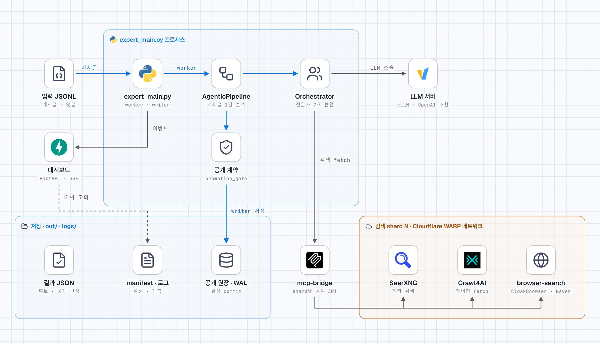
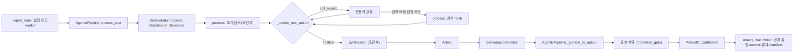

# 시스템 아키텍처

이 문서는 커뮤니티 게시글에서 웹소설 작품을 식별하는 주 실행 경로의 구조를 설명한다. 설치와 실행 방법은 [README](../README.md)와 [전문가 실행 안내](../expert_readme.md), 패키지 경계는 [소스 구조](devs/SOURCE_LAYOUT_KO.md)를 따른다.

## 1. 목적과 문제

입력은 DC인사이드 장르소설 갤러리 같은 커뮤니티의 게시글·댓글이다. 시스템은 글이 특정 웹소설 작품을 다루는지 판단하고, 근거가 충분하면 공식 제목과 작품 URL을 공개 결과로 남긴다. 근거가 부족하면 후보와 보류 사유를 남기고 공개 제목은 비워 둔다.

어려운 지점은 다음과 같다.

- 커뮤니티 약어·초성·별칭이 작품 제목을 대신한다. 예를 들어 "전독시"는 "전지적 독자 시점"을 가리킨다.
- 같은 표면이 작가명, 캐릭터명, 작품명 중 어느 것인지 문맥에 따라 달라진다.
- 장르·트로프 일반론과 특정 작품 토론을 구분해야 한다.
- 밈, 비유, 비꼼, 질문, 인용처럼 화자의 의도가 판정을 바꾼다.
- 본문과 댓글의 화자가 다르며, 댓글 근거를 게시글 작성자의 발언으로 바꾸면 안 된다.

`갤러리` 표면을 현실 DC 갤러리명으로만 단정하지 않는다. `아생갤`은 `아카데미 생존 갤러리`처럼 실제 웹소설 작품의 약어일 수 있고, 요즘 웹소설은 작품 안에 갤러리·댓글식 커뮤니티를 서사 장치로 쓰거나 오마주로 차용하기도 한다. 그래서 명시적인 별칭 관계, 특정 작품 대상, 공식·커뮤니티 근거, 본문에서 경쟁하는 작품 근거를 함께 확인한다.

## 2. 진입점

| 진입점 | 역할 |
| --- | --- |
| `expert_main.py` | 주 분석 실행기. 입력 로드, 병렬 worker, 검색 shard 구성, 대시보드, checkpoint, 결과·manifest 저장, 공개 결정 commit을 맡는다. |
| `src/llm_batch/runtime/expert_cli.py` | `expert_main`의 CLI 정의(`build_arg_parser`). `expert_main._build_arg_parser`는 이 함수를 감싸는 얇은 wrapper다. |
| `tools/dashboard_server.py` | 실행이 끝나도 유지되는 standalone 대시보드 서버. 같은 포트의 `expert_main`이 이벤트를 전달한다. |
| `llm-batch` (`src/llm_batch/cli.py`), `main.py` | 레거시 순차·staged 파이프라인. [레거시 안내](../README_legacy_pipeline.md)를 따른다. |

## 3. 구성 요소와 책임

<picture>
  <source media="(prefers-color-scheme: dark)" srcset="assets/architecture/system-overview-dark.png">
  
</picture>

그림의 원본은 아이콘과 글꼴을 포함한 [system-overview.html](assets/architecture/system-overview.html)이다. 구성이 바뀌면 원본을 고친 뒤 밝은 테마와 어두운 테마 PNG를 다시 만든다.

| 구성 요소 | 위치 | 책임 |
| --- | --- | --- |
| `AgenticPipeline` | `src/llm_batch/agentic_pipeline.py` | 게시글 한 건의 분석 단위. 입력 정규화, 이미지·OCR 보강, 선택 관측, Orchestrator 호출, 출력 변환을 묶는다. |
| `Orchestrator`, `ConversationContext` | `src/llm_batch/experts/orchestrator.py` | 전문가 호출과 검색을 상황에 따라 고르는 조율기와 호출별 공유 문맥 |
| 전문가 | `src/llm_batch/experts/` | Gatekeeper·Discourse·Decoder·Verifier·Critic·Synthesizer·Arbiter |
| 프롬프트 | `src/llm_batch/prompts/expert_prompts.py`, 일부 전문가 모듈 | 역할별 system·user 프롬프트와 공유 상수 |
| 공개 계약 | `src/llm_batch/promotion_gate.py` | 제목·URL·범위·근거를 함께 확인해 하나의 공개 판정으로 확정하는 경계. 하나라도 확인되지 않으면 공개하지 않는다(fail-closed). |
| 원문 근거·후보 | `src/llm_batch/grounding/` | 원문 span, 화자·발화 역할, 후보 감사, 별칭 관계, 기록 전용 선택 기능의 계약 |
| 원장 | `src/llm_batch/ledger/` | 공개 결정 commit, framed WAL, 호출·복구 원장 |
| 실행 설정 | `src/llm_batch/runtime/` | 실행 프로필, 선택 실행 지문, budget·cache, 기록 전용 선택 기능의 adapter |
| 검색·LLM | `src/llm_batch/search/`, `src/llm_batch/llm/`, `src/llm_batch/mcp_bridge/` | MCP 검색·fetch와 OpenAI 호환 LLM 호출 |
| 대시보드 | `src/llm_batch/monitor/` | 이벤트 버스, API, 정적 화면, 실행 이력 색인 |

전문가 역할은 다음과 같다.

| 전문가 | 역할 |
| --- | --- |
| Gatekeeper | 노이즈 판별, 엔티티 추출, 첫 검색 요청 |
| Discourse | 담론 영역·의도, 인용·비유·질문 역할 |
| Decoder | 약어·초성·별칭을 작품 후보로 풀이 |
| Verifier | 원문과 후보의 관계, 공식 제목·URL과 출처를 비판적으로 검증 |
| Critic | 다른 전문가 분석의 메타 검토. 기본 순차 경로에서는 별도로 호출하지 않고 그 역할을 Arbiter가 코드 수준에서 처리한다. 협력 요청 같은 일부 경로에서만 호출될 수 있다. |
| Synthesizer | 흩어진 근거·댓글·참조 종합 |
| Arbiter | 전문가 판단을 종합해 최종 분석안 작성 |

Arbiter는 Decoder·Verifier가 제시하지 않은 제목을 스스로 만들어 공개하지 못한다. 최종 공개 여부는 이후 공개 계약에서 다시 판정한다.

## 4. 동적 흐름

1. `expert_main`이 입력 JSONL을 읽고 요청 병렬도를 상한으로 입력 수를 반영해 worker 수를 정한다. 적용된 모델 병렬 정책이나 endpoint health 조건에 따라 실제 병렬도가 더 줄 수 있다. 각 worker는 `AgenticPipeline.process_post`를 호출한다.
2. `process_post`는 직전 호출의 문맥을 지우고, 원문 입력·댓글 참조·로더 기록을 이번 호출의 문맥으로 옮긴다. 후보 회수 같은 선택 기능은 설정된 경우에만 결과를 기록한다.
3. `Orchestrator.process`는 새 `ConversationContext`를 만들고, 명확한 글은 fast-path로 끝낸다. 그 밖의 글은 Gatekeeper와 Discourse를 거치고 조건에 따라 초기 검색을 실행한 뒤 `_decide_next_action`이 고르는 행동을 반복한다.
4. `_decide_next_action`은 `call_expert` 또는 `finalize`를 돌려준다. 기억 질의 거절이 확정됐으면 마무리하고, 그 밖에는 유효한 전문가 간 협력 요청(같은 요청 쌍은 한 번, 전체 최대 3회), Decoder 다음 Verifier, 예약된 Verifier 재검증 순으로 전문가를 고른다. Gatekeeper·Decoder·Verifier가 끝나면 마무리한다. 반복은 실행기가 지정한 `max_iterations` 안에서 멈춘다. 검색은 이 함수가 고르지 않는다. `process`가 전문가 출력의 검색 요청이나 검증 검색 조건을 보고 검색·fetch를 실행한 뒤 다음 결정을 이어 간다. `process`에는 `search` 행동을 처리하는 분기가 남아 있지만 기본 결정 함수는 이를 반환하지 않는다.
5. 마무리 단계에서 Synthesizer가 근거를 재해석하고(노이즈 글처럼 재해석할 근거가 없으면 생략), Arbiter가 최종 분석안을 만든다. Synthesizer가 Decoder·Verifier의 합의 작품을 다른 작품으로 바꾸면 별도 guard가 이를 감지한다.
6. 모든 게시글이 같은 전문가 순서나 호출 수로 처리되지는 않는다. fast-path, 기억 질의 거절, 조기 종료, Synthesizer 생략 같은 경로가 있다.
7. `_context_to_output`은 전문가 결과를 공개 전에 정리한다. 후보 보존, 공식 제목·URL 쌍, 문맥과 제목 상태의 일관성을 맞추고 `evaluate_publish_contract`·`apply_publish_contract`를 거쳐 `PickvelOutputItemV2`를 만든다.
8. 결과 파일 저장과 공개 결정 commit은 `expert_main`의 main thread writer가 맡는다. checkpoint와 manifest도 이 단계에서 기록한다.

## 5. 원문·후보·공개·저장 경계

| 경계 | 의미 | 지키는 규칙 |
| --- | --- | --- |
| 원문 | 입력 게시글·댓글과 화자 | 원문을 덮어쓰지 않는다. 댓글 근거를 작성자 발언으로 바꾸지 않는다. 로더의 절단·형식 오류도 원문 기록으로 남긴다. |
| 후보 | 전문가·검색이 제시한 작품 후보와 근거 | 후보 점수나 형태 유사도만으로 원문의 작품 관계를 확정하지 않는다. 공개되지 않은 후보도 사유와 함께 보존한다. |
| 공개 | 공식 제목·URL을 결과에 싣는 판정 | `promotion_gate`의 공개 계약이 제목·URL·범위·근거를 함께 확인해 하나의 판정으로 확정한다. 근거가 맞지 않으면 공개하지 않고 후보로 남긴다. |
| 저장 | 결과 파일, manifest, 원장 | `expert_main` writer가 행 단위로 공개 결정을 commit한다. 과거 결과에 기록되지 않은 값은 미기록으로 두고 새 해석으로 채우지 않는다. |

`HOLD`나 `context_only` 결과에도 문맥상 참조 후보가 남을 수 있다. 작품 후보와 공개 제목·URL은 별도 필드다.

## 6. 선택 기능

아래 기능의 기본값은 기능마다 다르다. 실행 설정은 CLI > 환경 변수 > 실행 프로필(`--execution-profile`) > 기존 기본값 순서로 정해지며, 실제 값은 시작 로그와 manifest의 유효 설정으로 확인한다. 결과를 기록만 하고 공개 판정에는 영향을 주지 않는 기능은 표에 그렇게 적었다.

| 기능 | 켜는 방법 | 기본값과 성격 |
| --- | --- | --- |
| 후보 회수·재정렬·의미 역할·교정·inference | `--candidate-retrieval`, `--candidate-reranker`, `--candidate-semantics`, `--candidate-calibration`, `--candidate-inference`와 고정 corpus·manifest·bundle | 기본 OFF. `SHADOW`로 켜면 결과를 `run_meta`에 기록만 하고 공개 판정에는 반영하지 않는다. |
| 커뮤니티 지식 | `--community-knowledge`와 고정 snapshot | 기본 OFF. 후보 지식 문맥이며 `READ_ONLY`에서는 Slang DB와 배치 학습 쓰기를 끈다. |
| 호출 원장 | `--decision-call-ledger` | 일반 프로필 기본 OFF, `low-load-validation` 프로필은 `SHADOW`, `paired-measurement` 프로필은 `REQUIRED`. 실제 LLM 호출과 사용량을 기록한다. `REQUIRED`는 비교 계측용으로, 미리 정한 실행 계획(RunSpec·pair·arm)과 연결돼야 실행되고 계측이 실패하면 실행도 실패로 처리한다. |
| 문맥 진단 | `--context-diagnostics` | 일반 프로필 기본 OFF, `low-load-validation`·`paired-measurement` 프로필은 ON. 원문 문맥·발화 구조 진단을 크기 제한 안에서 저장한다. |
| VLM/OCR | `--vlm`, `--ocr` | 일반 프로필 기본은 VLM OFF·OCR ON(OCR은 VLM 경로에서만 쓰인다), `low-load-validation` 프로필은 둘 다 ON. 이미지 게시글의 텍스트·시각 근거를 보강한다. |
| Slang DB | `--slang-db` | 기본 OFF. 중앙 slang DB 검토용 저장 |
| native 복구 | `--native-recovery ON`과 정책 파일·SHA | 기본 OFF. 일반 분석이 끝난 뒤 같은 호출의 문맥으로 별도 복구를 실행한다. 결과는 별도 파일(`SEPARATE_RESULT_ONLY`)이며 원래 결과·manifest·WAL을 덮어쓰지 않는다. 학습 쓰기는 꺼진다. |
| 복구 계획 | `--recovery-simulation-plan`, `--recovery-provider-plan` | 지정할 때만 실행. 일반 분석과 분리된 합성·provider 근거 수집 계획 |

`native/p0_windows_owner_observer/`의 Windows native observer는 native 복구와 다른 구성이다. 서명되지 않은 read-only 후보 구성요소이고 판정은 `NO_GO`다. `expert_main`의 실행 경로에 연결되지 않으며, 코드가 있다는 사실이 운영 권한이나 production 활성화를 뜻하지 않는다.

## 7. 프롬프트와 규칙

- 전문가 프롬프트는 `src/llm_batch/prompts/expert_prompts.py`에 있다. 역할별 언어 프레임(`LF_GATEKEEPER`, `LF_DECODER`, `LF_VERIFIER`, `LF_ARBITER`)과 `GATEKEEPER_*`, `DECODER_*`, `VERIFIER_*`, `CRITIC_*` 프롬프트, 공유 플랫폼 약칭표 `PLATFORM_ABBREVIATION_MAP`을 둔다.
- Arbiter와 Synthesizer의 system 프롬프트는 각각 `experts/arbiter.py`, `experts/synthesizer.py`에 있다.
- 프롬프트 구획은 줄 번호가 아니라 상수명으로 참조한다. 실제 LLM 입력에는 장식용 Unicode를 쓰지 않는다.
- 프롬프트는 특정 작품 하드코딩 대신 한국어 문장 구조와 화용론 원리로 판단을 유도한다.
- 정적 규칙(`NOISE_TERMS`, `NOVEL_SITES`, `SLANG_DICTIONARY`, `TROPE_TERMS`)은 `src/llm_batch/domain/rules.py`에 있다.

## 8. 코드 탐색

| 찾는 것 | 시작점 |
| --- | --- |
| 실행 옵션과 기본값 | `runtime/expert_cli.py`의 `build_arg_parser`, `python expert_main.py --help` |
| 게시글 한 건의 처리 | `AgenticPipeline.process_post` |
| 전문가 라우팅 | `Orchestrator.process`, `Orchestrator._decide_next_action`, `Orchestrator._call_expert` |
| 공개 전 정리 | `AgenticPipeline._context_to_output` |
| 공개 판정 | `promotion_gate.evaluate_publish_contract`, `promotion_gate.apply_publish_contract` |
| 저장과 공개 결정 commit | `expert_main.py`의 `_commit_final_result`, `ledger/publication_commit.py` |
| 검색 shard 구성 | `expert_main._configure_mcp_endpoints`, [검색·WARP 운영 안내](warp_sharding.md) |
| 선택 실행 지문 | `runtime/execution_config.py`의 `source_snapshot` |
| 대시보드 | `monitor/server.py`, `monitor/run_index.py`, [대시보드 안내](devs/EXPERT_DASHBOARD_DESIGN_KO.md) |

함수 단위의 판정 규칙은 해당 함수의 docstring과 회귀시험을 기준으로 확인한다. 이 문서는 줄 번호와 파일 크기를 기록하지 않는다.
