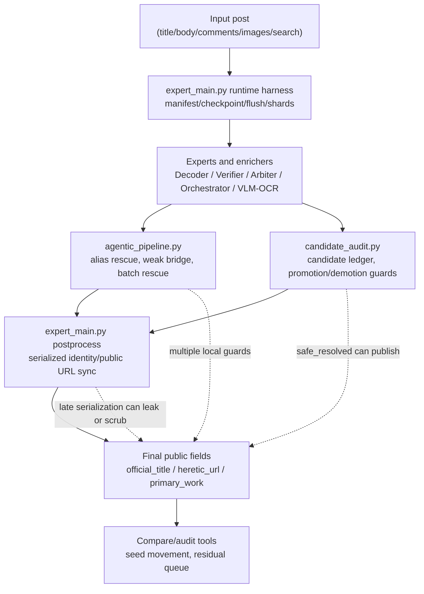
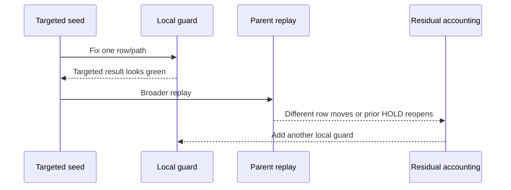
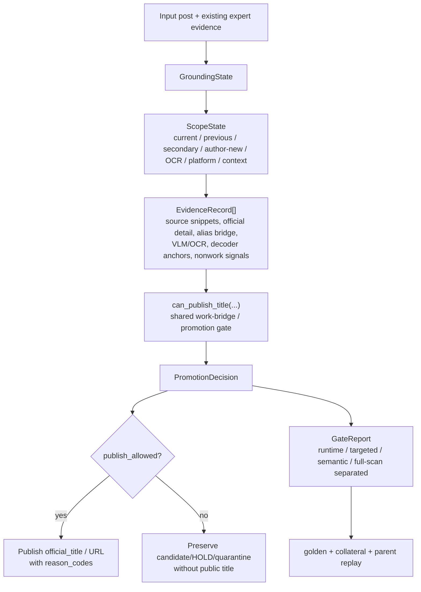
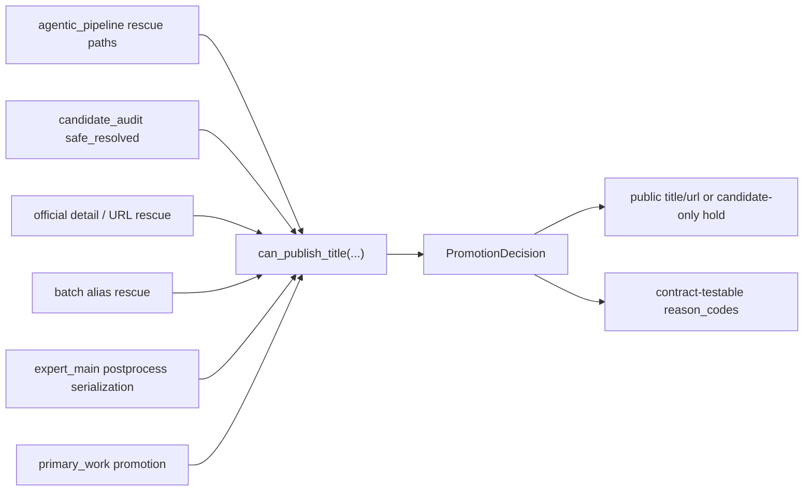
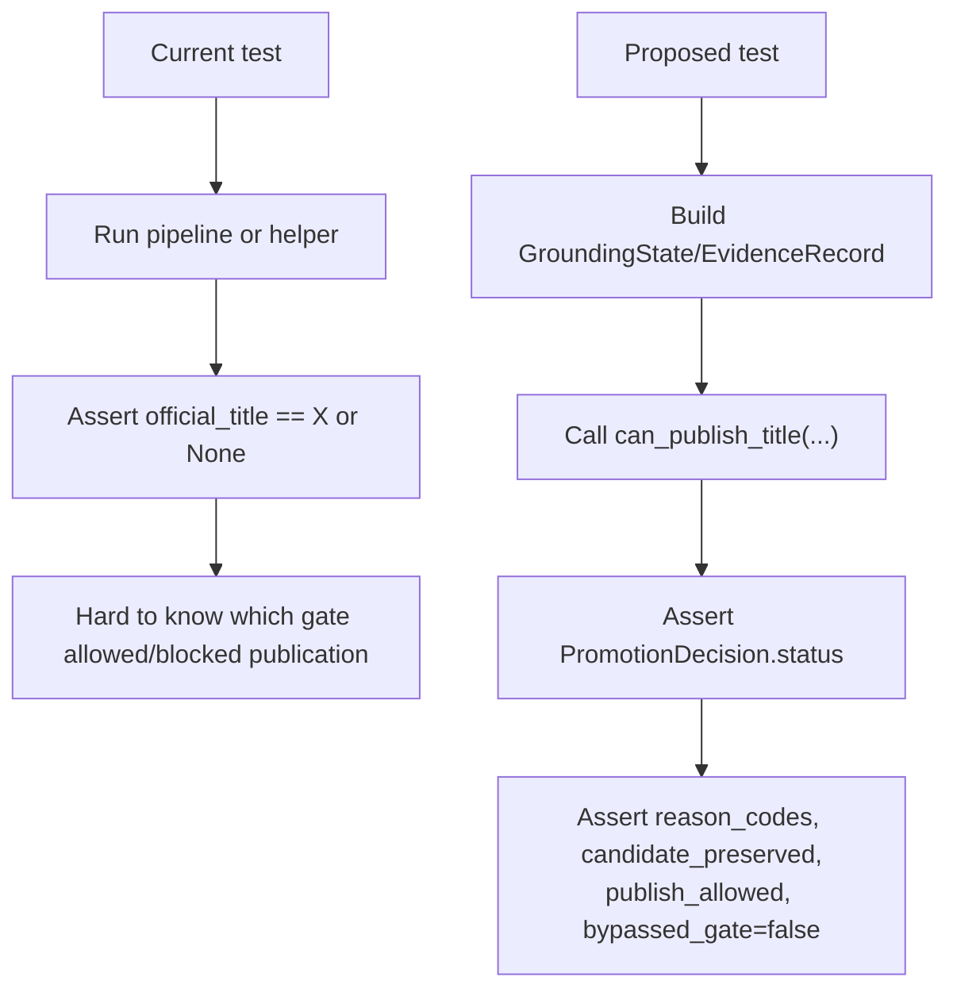

# Promotion Gate Architecture Migration

Date: 2026-06-30

Status: `PARTIALLY_IMPLEMENTED_AS_SHARED_LAYER / LOOP179_UNITTEST_GO / LOOP182_PARENT_RUNTIME_GO / LOOP184_TARGETED_RUNTIME_GO_NO_DELTA / LOOP185_EXACT_ALIAS_CANDIDATE_HOLD_GO_NO_DELTA / LOOP186_COLLATERAL_FOLLOWUP_GO_NO_DELTA / LOOP187_NESTED_SCRUB_GO_UNIT_ONLY_NO_DELTA / LOOP189_PACKET_SEMANTIC_NO_GO / LOOP190_PUBLISH_TRACE_GO_UNIT_ONLY / LOOP191_192_TRACE_COVERAGE_GO_PACKET_NO_GO / LOOP195_ACK_PREVIOUS_WORK_SCOPE_GATE_GO_UNIT_ONLY / LOOP196_BATCH_ALIAS_SCOPE_GATE_GO_UNIT_ONLY / LOOP197_DIRECT_OCR_SCOPE_GATE_GO_UNIT_ONLY / LOOP198_199_PACKET_RUNTIME_GO_SEMANTIC_NO_GO / LOOP200_202_FINAL_LEDGER_CONSISTENCY_GO / LOOP203_204_UPSTREAM_GATE_GO / LOOP205_208_PACKET_VARIANCE_REVIEW_GO_NO_DELTA / LOOP209_211_PREVIOUS_WORK_PRESERVED_GO_NO_DELTA / LOOP212_213_TITLE_LED_ALIAS_GUARD_GO_NO_DELTA / LOOP214_217_EXACT_ALIAS_IMAGE_CONTEXT_TRACE_GO_NO_DELTA / LOOP218_CHARACTER_BRIDGE_SCOPE_TRACE_GO_NO_DELTA / LOOP219_SHARED_GATE_UNCONFIRMED_ALIAS_GO_NO_DELTA / LOOP220_DIRECT_ALIAS_PROBE_GO_PACKET_POSITIVE_DELTA_REPLAY_REQUIRED / LOOP221_PARENT_REPLAY_RUNTIME_GO_SEMANTIC_REVIEW_LOCKED_NO_DELTA / LOOP222_SAFE_LOSS_SOURCE_NATIVE_REVIEW_NO_DELTA / LOOP223_FOCUSED_PATCH_GO_NO_DELTA / LOOP224_PARENT_RUNTIME_GO_SEMANTIC_NO_GO_NO_DELTA / LOOP225_ENVELOPE_TITLE_GATE_RUNTIME_GO_SEMANTIC_NO_GO_NO_DELTA / LOOP230_TITLE_LED_SERIALIZER_PARTIAL_GO / LOOP231_PARENT_RUNTIME_GO_SEMANTIC_NO_GO_NO_DELTA / LOOP232_SOURCE_NATIVE_VARIANCE_REVIEW_NO_DELTA / LOOP233_DIRECT_IMAGE_CHARACTER_GATE_GO_UNIT_ONLY_NO_DELTA / LOOP234_DIRECT_IMAGE_RUNTIME_GO_PUBLICATION_NO_GO_NO_DELTA / LOOP235_CHARACTER_PARENT_BRIDGE_RUNTIME_GO_PUBLICATION_NO_GO_URL_TITLE_CONTRACT_REQUIRED / LOOP236_URL_TITLE_DIRECT_SUPPORT_GUARD_TARGETED_GO_NO_DELTA / LOOP237_PARENT_RUNTIME_GO_SEMANTIC_NO_GO_NO_DELTA / LOOP239_TITLE_LED_PROBE_RUNTIME_GO_SEMANTIC_NO_GO_NO_DELTA / LOOP277_CANDIDATE_PUBLICATION_CONTRACT_REQUIRED_REVIEW_LOCKED / LOOP293_FINAL_SCOPE_ORDER_GO_UNIT_RUNTIME_REVIEW_LOCKED / LOOP296_SAFE_LOSS_N5_WRAPPER_GO_PLAN_READY / LOOP304_SAFE_LOSS_ALIAS_CONTRACT_GO_UNIT / LOOP307_SAFE_LOSS_ALIAS_CONTRACT_GO_UNIT_FLIP_NO_GO / LOOP308_UNSAFE_PROMOTION_TRIAGE_COMPLETE / LOOP309_BACKGROUND_HANDOFF_QUEUE_RECONCILED / LOOP310_SAFE_LOSS_SOURCE_NATIVE_PARTIAL / LOOP311_RUNTIME_REFRESH_DISPATCHED_NOT_APPROVAL / LOOP312_SAFE_LOSS_SOURCE_NATIVE_PARTIAL_59_OF_147 / LOOP313_SAFE_LOSS_ALIAS_CONTRACT_GO_UNIT_RUNTIME_NOT_RUN / LOOP314_CURRENT_HEAD_RUNTIME_DISPATCHED_NOT_APPROVAL / LOOP315_CHARACTER_SETTING_BRIDGE_GO_UNIT_RUNTIME_NOT_RUN / LOOP316_SAFE_LOSS_SOURCE_NATIVE_PARTIAL_74_OF_147 / LOOP317_SAFE_LOSS_SOURCE_NATIVE_PARTIAL_89_OF_147 / LOOP318_SAFE_LOSS_SOURCE_NATIVE_PARTIAL_104_OF_147 / LOOP319_OVERRIDE_AUDIT_ROW_GO / LOOP320_SAFE_LOSS_SOURCE_NATIVE_PARTIAL_119_OF_147 / GOAL_NOT_COMPLETE`

Latest addendum: `LOOP330_CURRENT_HEAD_HEALTH_OVERRIDE_AUDIT_TRANSITION / GOAL_NOT_COMPLETE / REVIEW_LOCKED`

Current status override: source-native queue is complete at `147/147`, Loop322 promoted 7 direct alias rows into shared unit contracts, Loop325 routes curated alias work-discussion cues through one Pipeline/Arbiter helper, Loop327 repaired one override-audit false negative at unit-contract level, Loop328 narrowed the exact-title weak-source public guard after runtime reproduced the overblock, Loop329 stopped stale Loop314/326 background runs before dispatching current HEAD `c033dd97` runtime evidence, and Loop330 moved the large-run wait path into background health while launching current HEAD non-light override-audit `11705250`. Runtime completion, residual closure, full375/bounded/golden18 approval, `11668283` post-patch analysis, override-audit `11705250` analysis, N5 flip analysis, and search recovery are still open.

This note visualizes the current parser-improvement architecture and the additive architecture now promoted into the active regression-safe grounding goal. The current contract is `docs/devs/GOAL_ARCHITECTURE_INTEGRATED_REGRESSION_SAFE_GROUNDING.md`: architecture integration comes before the next ordinary residual-queue reduction. The goal remains `NOT_COMPLETE`, with `semantic_quality=REVIEW-LOCKED`, source full completion `OPEN`, full-panel collateral approval `NO-GO`, and `full_scan_approval=false`.

## Source References

## 2026-07-03 Loop330 Current HEAD Health and Override Audit Transition

- Loop330은 approval 회차가 아니라 Loop329 background run health를 최신 감사하고, 대형 런 대기만 반복되는 흐름을 `OVERRIDE AUDIT(LLM=False->final=True)` 단건 current HEAD non-light 검증으로 전환한 회차다.
- Loop329 최신 snapshot은 post-patch `11668283` `0/0/0/0`, full375 `3/1/2/0`, bounded1200 `7/2/5/0`, golden18 `1/1/0/0`, safe-loss N5 first run `0/0/0/0`이다. 모두 완료 전이라 approval 근거가 아니다.
- post-patch `11668283` health audit는 `search_degraded_detected=7`, `search_upstream_zero=5`를 기록해 search recovery는 계속 `P0 / OPEN`이다.
- old light run `20260702_065642_030743`에서 `LLM=False -> final=True` 후보 `93`건, 이미 검토한 `11708445/11668283` 제외 checkpoint-matched 미검토 후보 `91`건을 확인했다.
- 선택 후보 `11705250 / 심해법사 묵혀둔거 간만에 보니까 ㄹㅇ 맛있네`는 old light에서 `safe_resolved=true`였지만 public contract는 `candidate_only / publish_allowed=false / post_gate_official_title=null`이었다.
- current HEAD non-light 단건 run은 PID `93016`, run `20260703_034549_939485`, health `include_search=true`, `light_mode=false`, `1/1` OK로 발주했다. 결과 JSON은 아직 없고, 검색 단계에서 `search_degraded_detected=6`, `search_upstream_zero=2`가 관측됐다.
- Artifacts: `docs/devs/loop_reports/LOOP_330_REPORT_20260703.md`, `docs/devs/loop330_current_head_health_override_audit_20260703.json`, `out/regression_safe_grounding_20260626_000008_928006_loop01/review/loop330_*_health_audit.json`.
- Gate는 Loop329 runtime `IN_PROGRESS / NOT_APPROVAL`, override audit `11705250` `RUNNING_BACKGROUND / NOT_ANALYZED_CURRENT_HEAD / SEARCH_DEGRADED_OBSERVED`, safe-loss flip `RUNNING_BACKGROUND / NOT_ANALYZED`, golden18 `APPROVAL_NOT_OPEN`, search recovery `P0 / OPEN`, `semantic_quality=REVIEW-LOCKED`, `full_scan_approval=false`, goal `ACTIVE / NOT_COMPLETE`다.

## 2026-07-03 Loop329 Current HEAD c033dd97 Runtime Dispatch

- Loop329은 Loop328 guard patch 커밋 `c033dd97` 이후 stale Loop314/Loop326 background 프로세스를 중단했다.
- 기존 Loop314/326 산출물은 현 HEAD approval evidence가 아니라 `reference-only / NOT_APPROVAL`이다.
- 새 background run은 post-patch `11668283` PID `75828`, full375 PID `3232`, bounded1200 PID `119924`, golden18 PID `95980`, safe-loss N5 PID `107596`이다.
- post-patch single/full375/bounded/golden18 manifest 모두 `mcp_health_include_search=true`, `mcp_health_light_mode=false`이며 초기 health는 각각 `1/1`, `12/12`, `12/12`, `2/2` OK다.
- N5 plan은 `15` planned runs이며 first marker를 생성했다.
- Artifacts: `docs/devs/loop_reports/LOOP_329_REPORT_20260703.md`, `docs/devs/loop329_current_head_c033dd97_runtime_dispatch_20260703.json`, `out/regression_safe_grounding_20260626_000008_928006_loop01/review/loop329_current_head_c033dd97_runtime_dispatch_review.json`.
- Gate는 launch health `GO_SEARCH_NONLIGHT_INITIAL`, post-patch single/N5 `RUNNING_BACKGROUND / NOT_ANALYZED`, full375/bounded `IN_PROGRESS / NOT_APPROVAL`, golden18 `APPROVAL_NOT_OPEN`, search recovery `P0 / OPEN`, `semantic_quality=REVIEW-LOCKED`, `full_scan_approval=false`, goal `ACTIVE / NOT_COMPLETE`다.

## 2026-07-03 Loop328 Known-abbreviation Exact-title Guard Repair

- Loop328은 `11668283 / 게임 마인드의 중세 현대인 좋았다...` post-patch targeted replay를 완료했다.
- run `20260703_020949_643836`는 `1/1/0/0`, search 포함 non-light였다.
- Runtime은 정답 후보를 회복했지만 final public output은 `official_title=null`, `title_resolution_state=unresolved_matchable`, blocker `weak_source_exact_title_without_official_support_public_title_bridge`였다.
- Guard repair는 `known_abbreviation_title_guard:*` current-work scope, exact title surface, work consumption marker, row work discussion, title/body/search context가 모두 있을 때만 weak-source guard를 면제한다.
- Verification은 py_compile PASS, focused guard `2/2` PASS, existing controls `2/2` PASS, related bundle `33/33` PASS다.
- Artifacts: `docs/devs/loop_reports/LOOP_328_REPORT_20260703.md`, `docs/devs/loop328_known_abbreviation_exact_title_guard_20260703.json`, `out/regression_safe_grounding_20260626_000008_928006_loop01/review/loop328_known_abbreviation_exact_title_guard_review.json`.
- Gate는 code contract `GO_UNIT`, runtime replay `PRE_PATCH_REPRODUCED_OVERBLOCK / NOT_APPROVAL`, post-patch runtime replay `NOT_RUN_AFTER_GUARD_PATCH`, search recovery `P0 / OPEN`, `semantic_quality=REVIEW-LOCKED`, `full_scan_approval=false`, goal `ACTIVE / NOT_COMPLETE`다.

## 2026-07-03 Loop327 Override Audit Middle-age-modern Alias Repair

- Loop327은 `OVERRIDE AUDIT(LLM=False->final=True)` 확장 중 `11668283 / 게임 마인드의 중세 현대인 좋았다...` false negative를 확인했다.
- 최신 light run `20260702_065642_030743`는 `off_topic / context_only / official_title=null`였고, 과거 독립 run `20260423_170321_250907`는 official detail URL resolved였다.
- Partial current canary는 health `include_search=true`, `light_mode=false`, Gatekeeper `work_discussion`, Discourse `review`였지만 semantic seed guard가 `중세 현대인`을 일반어로 drop했다.
- `중세현대인`, `중세 현대인`, `게임마인드중세`, `게임마인드 중세 현대인`을 shared curated alias registry에 추가하고, `좋았다` 계열 감상 cue를 gate에 추가했다.
- Verification은 py_compile PASS, focused unit `9` PASS, related bundle `62` PASS다.
- Artifacts: `docs/devs/loop_reports/LOOP_327_REPORT_20260703.md`, `docs/devs/loop327_override_audit_middle_age_modern_alias_20260703.json`, `out/regression_safe_grounding_20260626_000008_928006_loop01/review/loop327_override_audit_middle_age_modern_alias_review.json`.
- Gate는 row contract `GO_UNIT_REPAIR`, runtime replay `NOT_RUN_AFTER_PATCH`, search recovery `P0 / OPEN`, `semantic_quality=REVIEW-LOCKED`, `full_scan_approval=false`, goal `ACTIVE / NOT_COMPLETE`다.

## 2026-07-03 Loop326 Current HEAD Runtime Dispatch

- Loop326은 Loop325 커밋 `1095d447` 이후 current HEAD 기준 runtime evidence를 새 output 경로로 발주한 회차다.
- 발주: safe-loss N5 PID `73076`, full375 PID `106428`, bounded1200 completed-source PID `34796`, golden18 PID `124704`.
- Initial health: full375/bounded search non-light `12/12` OK, golden18 search non-light `2/2` OK, N5 first marker 생성.
- Artifacts: `docs/devs/loop_reports/LOOP_326_REPORT_20260703.md`, `docs/devs/loop326_current_head_runtime_dispatch_20260703.json`.
- Gate는 launch health `GO_SEARCH_NONLIGHT_INITIAL`, full375/bounded `IN_PROGRESS / NOT_APPROVAL`, golden18 `APPROVAL_NOT_OPEN`, safe-loss N5 `RUNNING_BACKGROUND / NOT_ANALYZED`, search recovery `P0 / OPEN`, `semantic_quality=REVIEW-LOCKED`, `full_scan_approval=false`, goal `ACTIVE / NOT_COMPLETE`다.

## 2026-07-03 Loop325 Curated Alias Work-cue Contract

- Loop325는 Loop324 `11708443 / 괴담출근` 회귀를 Pipeline bridge와 Arbiter curated-alias null guard의 작품 담론 cue 불일치로 분해했다.
- `_has_curated_alias_work_discussion_cue`를 추가하고 known-title abbreviation bridge와 Arbiter contextual work anchor가 함께 쓰도록 배선했다.
- `11708443` 독창성/SCP cue와 `11718099` 표지변경 cue를 positive 계약으로 추가했다.
- comparison-only negative `괴담텔 ... 괴담동`은 계속 blocked다.
- Verification은 known-title abbreviation safe-loss contract `8` PASS, Arbiter curated alias guard `21` PASS, py_compile PASS, related work-bridge/title-lead bundle `214` PASS다.
- Artifacts: `docs/devs/loop_reports/LOOP_325_REPORT_20260703.md`, `docs/devs/loop325_curated_alias_work_cue_contract_20260703.json`.
- Gate는 code contract `GO_UNIT_AND_BROADER_214`, runtime replay `NOT_RUN_CURRENT_PATCH`, targeted canary `LOOP324_NO-GO`, search recovery `P0 / OPEN`, `semantic_quality=REVIEW-LOCKED`, `full_scan_approval=false`, goal `ACTIVE / NOT_COMPLETE`다.

## 2026-07-02 Loop322 Safe-loss Alias Shared Contract

- Loop322는 Loop321 `repair_safe_loss=76` 중 직접 별칭과 작품 소비 cue가 함께 있는 7건을 shared `KNOWN_TITLE_ABBREVIATIONS` 계약으로 올렸다.
- 추가 alias는 `괴담출근`, `절꺾않`, `무마`, `아카엄창`, `성좌안무서움`, `빌환`, `지구온라인`이다.
- known-title abbreviation work cue에 `표절`, `보러감`을 추가했다.
- `주전무`는 실제 packet cue가 강하지만 shared cue 폭을 더 넓혀야 하므로 이번 registry 승격에서 보류했다.
- Verification은 py_compile PASS, safe-loss contract `4` PASS, related alias/arbiter/title-lead bundle `230` PASS, always-on/convergence `12` PASS다.
- Actual packet helper check는 선택 7건 allowed, held `주전무=false`다.
- Artifacts: `docs/devs/loop_reports/LOOP_322_REPORT_20260702.md`, `docs/devs/loop322_safe_loss_alias_contract_20260702.json`, `out/regression_safe_grounding_20260626_000008_928006_loop01/review/loop322_safe_loss_alias_contract_review.json`.
- Gate는 contract `GO_UNIT_CONTRACT_ONLY`, runtime replay `NOT_RUN`, residual closure `NOT_COUNTED`, search recovery `P0 / OPEN`, `semantic_quality=REVIEW-LOCKED`, `full_scan_approval=false`, goal `ACTIVE / NOT_COMPLETE`다.

## 2026-07-02 Loop321 Safe-loss Source-native Queue Closure

- Loop321은 Loop301 `safe_loss_resolved_to_null` batch의 source-native review를 `119/147`에서 `147/147`로 닫았다.
- Delta 결과는 `REPROCESS=15`, `ACCEPT=9`, `HOLD=4`, validation issues `0`이다.
- 누적 결과는 `REPROCESS=76`, `ACCEPT=42`, `HOLD=29`, unreviewed `0`이다.
- 초기 작업 메모의 `16/8/4` 총계는 원문 packet 재확인 후 `15/9/4`로 정정했다.
- `REPROCESS=76`은 shared gate 또는 targeted runtime replay 전까지 residual closure가 아니다.
- `ACCEPT=42`는 collateral gate wiring 전까지 regression count 제외 후보일 뿐이며 approval이 아니다.
- `HOLD=29`는 native image/OCR/source/scope 확인 전까지 닫지 않는다.
- Artifacts: `docs/devs/loop_reports/LOOP_321_REPORT_20260702.md`, `docs/devs/loop321_safe_loss_source_native_verdicts_delta_28.json`, `docs/devs/loop321_safe_loss_source_native_verdicts_cumulative_147.json`, `out/regression_safe_grounding_20260626_000008_928006_loop01/review/loop321_safe_loss_source_native_review.json`.
- Gate는 source-native review `REVIEW-LOCKED / COMPLETE_SOURCE_NATIVE_QUEUE`, runtime replay `NOT_RUNTIME_VERIFIED`, search recovery `P0 / OPEN`, `semantic_quality=REVIEW-LOCKED`, `full_scan_approval=false`, goal `ACTIVE / NOT_COMPLETE`다.

## 2026-07-02 Loop320 Safe-loss Source-native Next Slice

- Loop320은 Loop301 `safe_loss_resolved_to_null` batch의 source-native review를 `104/147`에서 `119/147`로 확장했다.
- Delta 결과는 `REPROCESS=8`, `ACCEPT=5`, `HOLD=2`, validation issues `0`이다.
- 누적 결과는 `REPROCESS=61`, `ACCEPT=33`, `HOLD=25`, unreviewed `28`이다.
- `REPROCESS=61`은 shared gate 또는 targeted runtime replay 전까지 residual closure가 아니다.
- `ACCEPT=33`은 collateral gate wiring 전까지 regression count 제외 후보일 뿐이며 approval이 아니다.
- Artifacts: `docs/devs/loop_reports/LOOP_320_REPORT_20260702.md`, `docs/devs/loop320_safe_loss_source_native_verdicts_delta_15.json`, `docs/devs/loop320_safe_loss_source_native_verdicts_cumulative_119.json`, `out/regression_safe_grounding_20260626_000008_928006_loop01/review/loop320_safe_loss_source_native_review.json`.
- Gate는 source-native review `REVIEW-LOCKED / PARTIAL`, runtime replay `NOT_RUNTIME_VERIFIED`, search recovery `P0 / OPEN`, `semantic_quality=REVIEW-LOCKED`, `full_scan_approval=false`, goal `ACTIVE / NOT_COMPLETE`다.

## 2026-07-02 Loop319 OVERRIDE AUDIT 11708445

- Loop319은 코드 변경 없는 대형 run 감시/문서 회차 반복 조건에 따라 ordinary safe-loss reduction 대신 `OVERRIDE AUDIT(LLM=False->final=True)` 행을 검증한 회차다.
- 대상 `11708445`는 source run `20260702_065642_030743`에서 completed로 flush됐다.
- Final public contract는 `official_title=null`, `official_url=null`, `candidate_ledger_status=promotion_blocked`, `promotion_decision.status=candidate_only`, `publish_allowed=false`, `candidate_preserved=true`, `bypassed_gate=false`다.
- Blind/source-native verdict는 `ACCEPT / candidate_only_block_is_correct`다. `제냥꾼` 후보는 보존하지만 public title로 publish하지 않는다.
- Artifacts: `docs/devs/loop_reports/LOOP_319_REPORT_20260702.md`, `docs/devs/loop319_override_audit_11708445_20260702.json`, `out/regression_safe_grounding_20260626_000008_928006_loop01/review/loop319_override_audit_11708445_review.json`.
- Gate는 override audit `GO_ROW_CONTRACT_ONLY`, runtime source `BACKGROUND_LIGHT_RUN_NOT_APPROVAL`, search recovery `P0 / OPEN`, `semantic_quality=REVIEW-LOCKED`, `full_scan_approval=false`, goal `ACTIVE / NOT_COMPLETE`다.

## 2026-07-02 Loop318 Safe-loss Source-native Next Slice

- Loop318은 Loop301 `safe_loss_resolved_to_null` batch의 source-native review를 `89/147`에서 `104/147`로 확장했다.
- Delta 결과는 `REPROCESS=5`, `ACCEPT=7`, `HOLD=3`, validation issues `0`이다.
- 누적 결과는 `REPROCESS=53`, `ACCEPT=28`, `HOLD=23`, unreviewed `43`이다.
- `REPROCESS=53`은 shared gate 또는 targeted runtime replay 전까지 residual closure가 아니다.
- `11698880`은 `가챠펑크` bridge가 있어도 known variance/secondary comparison control이라 repair나 hard-hold 완화 근거로 세지 않는다.
- Artifacts: `docs/devs/loop_reports/LOOP_318_REPORT_20260702.md`, `docs/devs/loop318_safe_loss_source_native_verdicts_delta_15.json`, `docs/devs/loop318_safe_loss_source_native_verdicts_cumulative_104.json`, `out/regression_safe_grounding_20260626_000008_928006_loop01/review/loop318_safe_loss_source_native_review.json`.
- Gate는 source-native review `REVIEW-LOCKED / PARTIAL`, runtime replay `NOT_RUNTIME_VERIFIED`, search recovery `P0 / OPEN`, `semantic_quality=REVIEW-LOCKED`, `full_scan_approval=false`, goal `ACTIVE / NOT_COMPLETE`다.

## 2026-07-02 Loop317 Safe-loss Source-native Next Slice

- Loop317은 Loop301 `safe_loss_resolved_to_null` batch의 source-native review를 `74/147`에서 `89/147`로 확장했다.
- Delta 결과는 `REPROCESS=7`, `ACCEPT=6`, `HOLD=2`, validation issues `0`이다.
- 누적 결과는 `REPROCESS=48`, `ACCEPT=21`, `HOLD=20`, unreviewed `58`이다.
- `REPROCESS=48`은 shared gate 또는 targeted runtime replay 전까지 residual closure가 아니다.
- Artifacts: `docs/devs/loop_reports/LOOP_317_REPORT_20260702.md`, `docs/devs/loop317_safe_loss_source_native_verdicts_delta_15.json`, `docs/devs/loop317_safe_loss_source_native_verdicts_cumulative_89.json`, `out/regression_safe_grounding_20260626_000008_928006_loop01/review/loop317_safe_loss_source_native_review.json`.
- Gate는 source-native review `REVIEW-LOCKED / PARTIAL`, runtime replay `NOT_RUNTIME_VERIFIED`, search recovery `P0 / OPEN`, `semantic_quality=REVIEW-LOCKED`, `full_scan_approval=false`, goal `ACTIVE / NOT_COMPLETE`다.

## 2026-07-02 Loop316 Safe-loss Source-native Next Slice

- Loop316은 Loop301 `safe_loss_resolved_to_null` batch의 source-native review를 `59/147`에서 `74/147`로 확장했다.
- Delta 결과는 `REPROCESS=7`, `ACCEPT=6`, `HOLD=2`, validation issues `0`이다.
- 누적 결과는 `REPROCESS=41`, `ACCEPT=15`, `HOLD=18`, unreviewed `73`이다.
- `REPROCESS=41`은 shared gate 또는 targeted runtime replay 전까지 residual closure가 아니다.
- Artifacts: `docs/devs/loop_reports/LOOP_316_REPORT_20260702.md`, `docs/devs/loop316_safe_loss_source_native_verdicts_delta_15.json`, `docs/devs/loop316_safe_loss_source_native_verdicts_cumulative_74.json`, `out/regression_safe_grounding_20260626_000008_928006_loop01/review/loop316_safe_loss_source_native_review.json`.
- Gate는 source-native review `REVIEW-LOCKED / PARTIAL`, runtime replay `NOT_RUNTIME_VERIFIED`, search recovery `P0 / OPEN`, `semantic_quality=REVIEW-LOCKED`, `full_scan_approval=false`, goal `ACTIVE / NOT_COMPLETE`다.

## 2026-07-02 Loop315 Character-setting Bridge Contract

- Loop315는 Loop312의 `11669933` `회귀수선전` 후보를 shared work bridge 계약 테스트로 고정한 회차다.
- 원문 cluster는 `중경계`, `서휼`, `해방상제`이며, source-native verdict는 `repair_safe_loss + character_bridge_contract_required`다.
- `회귀수선전`은 전역 alias registry가 아니라 `_has_deliberated_character_setting_work_convergence(...)`와 `_post_discusses_work_as_work(...)` 경유로만 release한다.
- 추가 테스트는 positive bridge, conflicting hidden work negative control, shared predicate ownership contract다.
- Verification은 py_compile PASS, targeted `3` PASS, related promotion/work-bridge bundle `32` PASS다.
- Artifacts: `docs/devs/loop_reports/LOOP_315_REPORT_20260702.md`, `docs/devs/loop315_character_setting_bridge_contract_20260702.json`.
- Gate는 character bridge `GO_UNIT_CONTRACT_ONLY`, runtime replay `NOT_RUN`, residual closure `NOT_COUNTED`, search recovery `P0 / OPEN`, `semantic_quality=REVIEW-LOCKED`, `full_scan_approval=false`, goal `ACTIVE / NOT_COMPLETE`다.

## 2026-07-02 Loop314 Current-HEAD Runtime Dispatch

- Loop314는 Loop313 이후 stale/mixed runtime evidence를 current HEAD `64864278` 경로로 분리한 회차다.
- 기존 Loop288/Loop302 프로세스는 Loop313 이전 코드로 시작됐으므로 approval 근거에서 제외하고 중단했다.
- 새 background run은 safe-loss N5 PID `111032`, full375 PID `75828`, bounded1200 PID `9908`, golden18 PID `43208`이다.
- full375/bounded/golden18/N5 first manifest 모두 `mcp_health_include_search=true`, `mcp_health_light_mode=false`다.
- `tools/run_independent_plan.py`를 추가해 N5 plan runner를 안정화했다.
- Artifacts: `docs/devs/loop_reports/LOOP_314_REPORT_20260702.md`, `docs/devs/loop314_current_head_runtime_dispatch_20260702.json`.
- Gate는 N5 `RUNNING_BACKGROUND / NOT_ANALYZED_CURRENT_HEAD`, golden18 `APPROVAL_NOT_OPEN`, full375/bounded `IN_PROGRESS / NOT_APPROVAL`, search recovery `P0 / OPEN`, `semantic_quality=REVIEW-LOCKED`, `full_scan_approval=false`, goal `ACTIVE / NOT_COMPLETE`다.

## 2026-07-02 Loop313 Safe-loss Alias Contract Repair

- Loop313은 Loop312 `repair_safe_loss=34` 중 `악살싶`과 `전독시`를 shared known-title abbreviation 계약으로 올린 `GO_UNIT` 회차다.
- `악살싶` canonical title은 `악당은 살고 싶다`로 정정했고, `전독시`는 `전지적 독자 시점`으로 추가했다.
- `전독시 영화 나왔었지` 같은 adaptation 맥락을 위해 curated alias work-cue에 `영화/극장판/실사화/애니화/드라마화/원작/각색`을 추가했다.
- `악신총애`는 동음 후보 위험 때문에 registry 추가를 보류했고, `회귀수선전`은 Loop313 시점에 character-setting bridge 계약 후보로 남긴 뒤 Loop315에서 shared bridge 계약 테스트로 고정했다.
- Verification은 py_compile PASS, focused alias `3` PASS, promotion/work-bridge `23` PASS, related bundle `266` PASS, Data Analytics validate/render PASS다.
- Artifacts: `docs/devs/loop_reports/LOOP_313_REPORT_20260702.md`, `docs/devs/loop313_safe_loss_alias_contract_repair_20260702.json`.
- Gate는 code/unit contract `GO_UNIT`, runtime replay `NOT_RUN`, N5 `RUNNING_BACKGROUND / NOT_ANALYZED` result `1/15`, full375/bounded `IN_PROGRESS / NOT_APPROVAL`, `semantic_quality=REVIEW-LOCKED`, `full_scan_approval=false`, goal `ACTIVE / NOT_COMPLETE`다.

## 2026-07-02 Loop312 Safe-loss Source-native 다음 Slice

- Loop312는 Loop310 이후 남은 `safe_loss_resolved_to_null` 미검토분에서 15건을 추가 판정한 회차다.
- Delta 결과는 `REPROCESS=7`, `ACCEPT=3`, `HOLD=5`다.
- 누적 결과는 `59/147` reviewed, unreviewed `88`, validation issues `0`, labels `REPROCESS=34`, `ACCEPT=9`, `HOLD=16`이다.
- `REPROCESS=34`는 shared gate 또는 targeted runtime replay 전까지 residual closure가 아니며, `HOLD=16`은 native image/web/source/canonical policy 확인 전까지 닫지 않는다.
- Loop311 N5는 아직 result JSON `0/15`라 current HEAD flip-rate 갱신 근거가 아니다.
- Artifacts: `docs/devs/loop_reports/LOOP_312_REPORT_20260702.md`, `docs/devs/loop312_safe_loss_source_native_verdicts_delta_15.json`, `docs/devs/loop312_safe_loss_source_native_verdicts_cumulative_59.json`, `out/regression_safe_grounding_20260626_000008_928006_loop01/review/loop312_safe_loss_source_native_review.json`.
- Gate는 source-native review `REVIEW-LOCKED / PARTIAL`, runtime replay `NOT_RUNTIME_VERIFIED`, N5 `RUNNING_BACKGROUND / NOT_ANALYZED`, search recovery `P0 / OPEN`, `semantic_quality=REVIEW-LOCKED`, `full_scan_approval=false`, goal `ACTIVE / NOT_COMPLETE`다.

## 2026-07-02 Loop311 Current HEAD Runtime Refresh Dispatch

- Loop311은 current HEAD runtime 증거 갱신 회차다. search shard `/api/health`는 `3333/3334` 모두 HTTP 200으로 확인했다.
- safe-loss N5 `15`개 독립 반복 plan을 background runner로 발주했다. PID는 `90532`, 로그는 `logs/loop311_safe_loss_independent_n5_plan/`에 남는다.
- report 시점 N5 result JSON은 `0/15`이므로 flip rate는 아직 갱신되지 않았다.
- Golden18은 rows `18`이며 `11660237`, `11698880`을 포함한다. tracked 상태는 확인됐지만 golden approval은 아직 열지 않는다.
- full375 최신 health는 checkpoint/result `135/105`, pending `30`이고 bounded1200은 `205/188`, pending `17`이다. 둘 다 search 포함 non-light이지만 `IN_PROGRESS/ordered_flush_gap_in_progress`와 blockers `search_timeout_observed`, `search_degraded_observed`가 남았다.
- Artifacts: `docs/devs/loop_reports/LOOP_311_REPORT_20260702.md`, `docs/devs/loop311_current_head_runtime_refresh_20260702.json`, `out/regression_safe_grounding_20260626_000008_928006_loop01/review/loop311_full375_search_nonlight_current_health_audit.json`, `out/regression_safe_grounding_20260626_000008_928006_loop01/review/loop311_bounded1200_search_nonlight_current_health_audit.json`.
- Gate는 N5 `RUNNING_BACKGROUND / NOT_ANALYZED`, full375/bounded `IN_PROGRESS / NOT_APPROVAL`, golden18 `TRACKED / APPROVAL_NOT_OPEN`, search recovery `P0 / OPEN`, `promotion_blocked=search-blind conditional`, `semantic_quality=REVIEW-LOCKED`, `full_scan_approval=false`, goal `ACTIVE / NOT_COMPLETE`다.

## 2026-07-02 Loop310 Safe-loss Source-native 다음 Slice

- Loop310은 Loop306 이후 남은 `safe_loss_resolved_to_null` 미검토분에서 15건을 추가 판정한 회차다.
- Delta 결과는 `REPROCESS=4`, `ACCEPT=2`, `HOLD=9`다.
- 누적 결과는 `44/147` reviewed, unreviewed `103`, validation issues `0`, labels `REPROCESS=27`, `ACCEPT=6`, `HOLD=11`이다.
- `REPROCESS=27`은 shared gate 또는 targeted runtime replay 전까지 residual closure가 아니며, `HOLD=11`은 native image/web/canonical policy 확인 전까지 닫지 않는다.
- Artifacts: `docs/devs/loop_reports/LOOP_310_REPORT_20260702.md`, `docs/devs/loop310_safe_loss_source_native_verdicts_delta_15.json`, `docs/devs/loop310_safe_loss_source_native_verdicts_cumulative_44.json`, `out/regression_safe_grounding_20260626_000008_928006_loop01/review/loop310_safe_loss_source_native_review.json`.
- Gate는 source-native review `REVIEW-LOCKED / PARTIAL`, runtime replay `NOT_RUNTIME_VERIFIED`, search recovery `P0 / OPEN`, `semantic_quality=REVIEW-LOCKED`, `full_scan_approval=false`, goal `ACTIVE / NOT_COMPLETE`다.

## 2026-07-02 Loop309 백그라운드 전환 및 큐 정합성

- Loop309은 current HEAD evidence를 다시 맞추고, Loop308의 `repair_unsafe_promotion=14` 중복 queue 표기를 정정한 회차다.
- Loop300 current contract replay가 이미 `unsafe_promotion_from_hold=26` 전체를 `26/26` match로 검증했고, `REPROCESS=14`는 `14/14 promotion_blocked`로 수렴했다. 따라서 이 bucket은 새 코드 queue로 다시 등재하지 않는다.
- 최신 background health는 full375 checkpoint/result `129/105`, bounded1200 `190/177`이다. 둘 다 search 포함 non-light이지만 `IN_PROGRESS/ordered_flush_gap_in_progress`이며 blockers `search_timeout_observed`, `search_degraded_observed`가 남았다.
- N5 safe-loss flip gate는 계속 `NO-GO`다. `11674712`와 `11698880`은 flip_rate `0.4`, `11660237`은 stable blind judge confirmed다.
- 다음 actionable queue는 Loop306 기준 `safe_loss_resolved_to_null` 누적 `29/147` reviewed, `118` unreviewed, `repair_safe_loss=23`이다. 대형 run 대기만 반복되면 `OVERRIDE AUDIT(LLM=False->final=True)` blind judge 검증으로 전환한다.
- Artifacts: `docs/devs/loop_reports/LOOP_309_REPORT_20260702.md`, `docs/devs/loop309_background_handoff_20260702.json`, `out/regression_safe_grounding_20260626_000008_928006_loop01/review/loop309_full375_search_nonlight_current_health_audit.json`, `out/regression_safe_grounding_20260626_000008_928006_loop01/review/loop309_bounded1200_search_nonlight_current_health_audit.json`.
- Gate는 background full375/bounded `IN_PROGRESS / NOT_APPROVAL`, search recovery `P0 / OPEN`, promotion blocked interpretation `search-blind conditional`, `semantic_quality=REVIEW-LOCKED`, `full_scan_approval=false`, goal `ACTIVE / NOT_COMPLETE`다.

## 2026-07-02 Loop308 Collateral Unsafe-promotion Triage

- Loop308은 collateral183 P0 `unsafe_promotion_from_hold` bucket을 source-native 기준으로 `26/26` 판정한 회차다.
- 결과는 `ACCEPT=12`, `REPROCESS=14`, validation issues `0`이다.
- Loop309 정정 기준, `REPROCESS=14`는 Loop300 current contract replay에서 이미 `14/14 promotion_blocked`로 수렴했으므로 새 shared promotion gate repair queue로 중복 등재하지 않는다. 다만 search degraded와 run incomplete 때문에 residual closure나 approval은 아니다.
- full375/bounded1200은 각각 `120/105`, `180/167`로 `IN_PROGRESS`이고 blockers `search_timeout_observed`, `search_degraded_observed`가 남았다.
- Artifacts: `docs/devs/loop_reports/LOOP_308_REPORT_20260702.md`, `docs/devs/loop308_unsafe_promotion_from_hold_source_native_verdicts.json`, `out/regression_safe_grounding_20260626_000008_928006_loop01/review/loop308_unsafe_promotion_from_hold_source_native_review.json`.
- Gate는 collateral triage `REVIEW-LOCKED`, search recovery `P0 / OPEN`, `semantic_quality=REVIEW-LOCKED`, `full_scan_approval=false`, goal `ACTIVE / NOT_COMPLETE`다.

## 2026-07-02 Loop307 Safe-loss Alias Contract Expansion

- Loop307은 Loop306 source-native alias 후보 일부를 shared known-abbreviation 계약으로 올린 `GO_UNIT` 회차다.
- 추가 alias는 `럽코빙의`, `빚세구`, `마줍`, `여신애호`, `별품소`다.
- `가챠펑크`와 `즉사기`는 search-blind registry release에서 제외했다. 전자는 search/detail evidence 의존 및 nonwork hold 계약, 후자는 무림/게임 속으로 다중작 충돌 때문이다.
- N5 current HEAD 분석은 gate `NO-GO`다. `11674712`와 `11698880`은 flip_rate `0.4`, `11660237`만 stable blind judge confirmed다.
- full375/bounded1200은 각각 `118/105`, `172/167`로 아직 `IN_PROGRESS`이며 search blocker `search_degraded_observed`가 남았다.
- Artifacts: `docs/devs/loop_reports/LOOP_307_REPORT_20260702.md`, `docs/devs/loop307_safe_loss_alias_contract_expansion_20260702.json`, `out/regression_safe_grounding_20260626_000008_928006_loop01/review/loop307_safe_loss_flip_rate_n5_current_head_review.json`.
- Gate는 code contract `GO_UNIT`, safe-loss flip `NO-GO`, search recovery `P0 / OPEN`, `semantic_quality=REVIEW-LOCKED`, `full_scan_approval=false`, goal `ACTIVE / NOT_COMPLETE`다.

## 2026-07-02 Loop306 Safe-loss Source-native Next Slice Review

- Loop306은 promotion gate migration의 residual accounting 보조 회차다. code path를 새로 열지 않고, Loop301 `safe_loss_resolved_to_null=147`의 source-native 판정 범위를 `15/147`에서 `29/147`로 넓혔다.
- 누적 결과는 `REPROCESS=23`, `ACCEPT=4`, `HOLD=2`, unreviewed `118`, validation issue `0`이다.
- `REPROCESS`는 shared gate/runtime replay 전까지 residual closure가 아니며, `ACCEPT`는 collateral gate wiring 전까지 regression count 제외 후보일 뿐이다.
- Artifacts: `docs/devs/loop_reports/LOOP_306_REPORT_20260702.md`, `docs/devs/loop306_safe_loss_source_native_verdicts_cumulative_29.json`, `out/regression_safe_grounding_20260626_000008_928006_loop01/review/loop306_safe_loss_source_native_review.*`.
- Gate는 source-native review `REVIEW-LOCKED / PARTIAL`, search recovery `P0 / OPEN`, `semantic_quality=REVIEW-LOCKED`, `full_scan_approval=false`, goal `ACTIVE / NOT_COMPLETE`다.

## 2026-07-02 Loop305 Safe-loss Alias Targeted Replay Handoff

- Loop305는 Loop304의 unit-only alias repair를 실제 panel 입력 replay로 넘긴 회차다.
- 입력은 `11`행이며 positive alias seed `7`, comparison-only negative `1`, safe-loss core control `3`으로 구성했다.
- Replay run id는 `20260702_181813_388157`, PID는 `16380`이다.
- 현재 결과는 `completed=0`, `flushed=0`, `failed=0`이라 runtime success나 queue 감소로 세지 않는다.
- Small-run health가 `include_search=false`, `light_mode=true`이므로 search recovery approval 증거가 아니다.
- Gate는 targeted runtime `IN_PROGRESS / NOT_APPROVAL`, search recovery `P0 / OPEN`, `semantic_quality=REVIEW-LOCKED`, `full_scan_approval=false`, goal `ACTIVE / NOT_COMPLETE`다.

## 2026-07-02 Loop304 Safe-loss Known-Alias Contract Repair

- Loop304는 Loop301 `repair_safe_loss=14` 중 일부를 shared known-abbreviation work-cue 계약으로 전환한 `GO_UNIT` 회차다.
- 추가 alias는 `암흑가보스/암보스`, `기계공주`, `약먹마`, `악살싶`, `마도줍`, `괴담동`, `즉사무림`, `밀리언클래스`다.
- release cue는 직접 작품 소비/평가/작가/공지/표지 표면으로 제한했다. registry 자체는 public publish 권한이 아니며, 기존 `_known_title_abbreviation_update_question_anchor(...)`와 promotion gate를 통과해야 한다.
- Negative control: `괴담텔 ... 괴담동이 살짝 생각나네`는 adjacent 비교라 `괴담 동아리`로 release되지 않는다.
- Verification: py_compile PASS, focused `2` tests PASS, related bundle `217` tests PASS, `git diff --check` PASS.
- Runtime replay는 Loop305에서 발주했지만 아직 `IN_PROGRESS / NOT_APPROVAL`이다. full375/bounded는 background `IN_PROGRESS / NOT_APPROVAL`, search recovery는 `P0 / OPEN`, goal은 `ACTIVE / NOT_COMPLETE`다.
- Artifacts: `docs/devs/loop_reports/LOOP_304_REPORT_20260702.md`, `docs/devs/loop304_safe_loss_alias_contract_repair_20260702.json`.

## 2026-07-02 Loop296 Safe-loss N5 Independent Run Wrapper

- Loop294의 중복 입력 방식은 `post_id` de-dupe로 `N>=5` 증거가 아니었다.
- `tools/safe_loss_flip_rate_probe.py build-run-plan`은 반복마다 단일행 JSONL과 독립 `expert_main.py` command를 생성한다.
- 새 plan manifest는 planned runs `15`, repeat_count_by_post `5/5/5`, missing post_ids `[]`, dedupe guard `one_post_per_process`다.
- 현재 실제 N5 evidence는 Loop288이며 gate는 `NO-GO`다. Loop296은 실행 계획 계약 `GO_UNIT`이고 아직 새 15-run 결과가 아니다.
- Artifacts: `docs/devs/loop_reports/LOOP_296_REPORT_20260702.md`, `out/regression_safe_grounding_20260626_000008_928006_loop01/review/loop296_safe_loss_independent_n5_run_plan.json`.

## 2026-07-02 Loop293 Final Scope Ordering Contract

- `_has_verified_contextual_alias_work_bridge`는 이미 `_post_discusses_work_as_work(..., source="verified_contextual_alias_work_bridge")`를 경유한다. 이번 회차의 남은 결함은 shared predicate가 아니라 final publication ledger의 scope fallback 순서였다.
- `expert_main.py`는 이제 promotion-blocked 후보에서 `current_work` scope를 먼저 평가하고, 그 다음에 nonpromotable image context의 `context_only` fallback을 평가한다.
- noise/off-topic hard negative는 current scope를 만들지 못하게 보존했다.
- Loop293 runtime은 `11698890` targeted resolved, `11716448` candidate preserved/context_only를 보였지만 두 행 모두 `SEARCH_DEGRADED`라 approval이 아니다.
- Loop294 flip probe는 post_id de-dupe로 `N>=5` 증거가 아니며 무효다. Loop296에서 독립 실행 wrapper를 추가했다.
- Loop295 smoke는 search degraded와 긴 fallback 경로 때문에 `completed=0`에서 중단했으므로 runtime verdict가 없다.
- Artifacts: `docs/devs/loop_reports/LOOP_293_REPORT_20260702.md`, `out/regression_safe_grounding_20260626_000008_928006_loop01/review/loop293_295_publication_scope_contract_review.json`.

## 2026-07-02 Loop292 Known-Alias Guard Before Promotion Gate

- Loop292는 shared `PromotionDecision` 이후 단계가 아니라, 그 전에 Gatekeeper low-specific guard가 source-native alias search를 지우는 문제를 보강했다.
- `댓천마`, `전1시`, `탐재`는 `KNOWN_TITLE_ABBREVIATIONS`에 추가했지만, registry 자체는 public publish 권한이 아니다. public title은 기존 known-abbreviation work-cue, official URL recall, promotion gate를 통과해야 한다.
- `11698890` pre-fix 로그는 `Gatekeeper continuation-fragment guard`가 `댓천마`/`한별`을 `noise/community_banter`로 내리는 경로를 보여줬다. 이 경로는 search 전에 source-native 후보를 잃게 만든다.
- `11716448`은 `아생갤` alias와 `히로인/괴이/인간/라나` 내부 설정 토론이 결속될 때 known-abbreviation recall work-cue를 통과하도록 계약 테스트를 추가했다.
- Unit contract는 `GO`지만 post-patch 5-row runtime replay는 아직 `NOT_RUN`이다. 따라서 `repair_after_wrong_work` queue 감소와 full collateral approval은 계속 보류한다.
- Artifacts: `docs/devs/loop_reports/LOOP_292_REPORT_20260702.md`, `out/regression_safe_grounding_20260626_000008_928006_loop01/review/loop292_known_alias_guard_contract_review.json`.

## 2026-07-02 Loop277 Completed Source Candidate Publication Contract Requirement

- `build_completed_source_candidate_audit.py` now requires `publication_contract_convergence_gate=GO` before a source can become an approval source candidate.
- Latest candidate audit: `out/regression_safe_grounding_20260626_000008_928006_loop01/review/loop277_completed_source_candidate_publication_contract_audit.md/json`.
- Result: manifest_count `733`, approval_source_candidate_count `0`, clean_vlm_ocr_source_count `429`, clean_vlm_ocr_random_shortfall_count `9`, clean_vlm_ocr_search_health_not_ready_count `420`, clean_vlm_ocr_publication_contract_not_ready_count `0`.
- Interpretation: publication contract is now enforced at candidate selection time. Current approval remains blocked because no clean completed source reaches random target `1000`; this is not semantic approval or full-scan approval.

## 2026-07-02 Loop276 Integrated Health Audit Gate

- `audit_expert_run_health.py` now includes `publication_contract_convergence` as a top-level gate.
- Latest integrated health audit: `out/regression_safe_grounding_20260626_000008_928006_loop01/review/loop276_health_audit_with_publication_contract_gate.json`.
- Result: result_rows `164`, checkpoint_rows `208`, publication contract gate `GO`, violation_row_count `0`, but run integrity remains `IN_PROGRESS` and search evidence remains `REVIEW`.
- Interpretation: architecture contract visibility is now part of completed-source health auditing, but approval is still blocked by incomplete source/search evidence gates.

## 2026-07-02 Loop275 Publication Contract Artifact Gate

- `tools/audit_publication_contract_convergence.py` adds an artifact-level gate for `PromotionDecision`, `publish_contract_trace`, `publish_ledger`, and serialized public identity convergence.
- Latest partial flushed result audit: `out/regression_safe_grounding_20260626_000008_928006_loop01/review/loop275_publication_contract_convergence_audit.md/json`.
- Result: row_count `162`, gate `GO`, violation_row_count `0`.
- Interpretation: this clears publication-contract convergence for audited flushed rows only. It is not completed source, semantic approval, residual decrement, or full-scan approval.

## 2026-07-02 Loop239 11660237 Title-Led Probe Update

- Loop239 did not rerun the same 38-row parent packet.
- It focused on `11660237`, the Loop238 `nondeterminism_unresolved` row.
- The new code lets a title-led current-work gate replace prior `candidate_only/context_only` gate decisions, but only publish-safe current-work evidence can bypass the generic genre bridge demotion.
- Runtime run04 is clean: `20260702_003226_807802`, completed/flushed/pending/failed `1/1/0/0`, VLM/OCR `READY`.
- Semantic result is still `NO-GO`: public title `null`, `candidate_ledger_status=promotion_blocked`, `title_resolution_state=unresolved_matchable`.
- Search preservation worked, but the exact official detail `https://novelpia.com/novel/61947` was not recovered; included-title candidates created wrong-publish pressure and the final publication contract held them.
- Accounting remains `NO_DELTA_TARGETED_CANARY_NO_GO`; `semantic_quality=REVIEW-LOCKED`, `full_scan_approval=false`, goal `ACTIVE / NOT_COMPLETE`.
- Artifacts: `docs/devs/loop_reports/LOOP_239_REPORT_20260702.md`, `out/regression_safe_grounding_20260626_000008_928006_loop01/review/loop239_11660237_title_led_probe_review.md/json`.

## 2026-07-01 Loop237 Parent Replay After Loop236 Update

- Loop237 reran the 38-row parent/representative packet after Loop236.
- Runtime is clean: run `20260701_215903_177630`, completed/flushed/pending/failed `38/38/0/0`, VLM/OCR `READY`, MCP health ok/failure `36/0`.
- Parent semantic result is still `NO-GO / MIXED_MOVEMENT`: Loop231 safe/public counts `11->9`, promotion_blocked `25->28`.
- `11663540` proves the architecture gap remains: focused canary restored `전 버튜버가 하고 싶은데요`, but parent replay held it as `promotion_blocked` with public title `null`.
- Safe losses `11660237`, `11674712`, `11698880` require source/native and `publish_contract_trace` comparison before any approval claim.
- Accounting remains `NO_DELTA_PARENT_REPLAY_AFTER_LOOP236_MIXED_MOVEMENT`; `semantic_quality=REVIEW-LOCKED`, `full_scan_approval=false`, goal `ACTIVE / NOT_COMPLETE`.
- Artifacts: `docs/devs/loop_reports/LOOP_237_REPORT_20260701.md`, `out/regression_safe_grounding_20260626_000008_928006_loop01/review/loop237_parent_replay_after_loop236_url_title_direct_support_guard_review.md/json`.

## 2026-07-01 Loop236 URL-Title Direct Support Guard Update

- Loop236 implements the URL-title precondition exposed by Loop235.
- Same-URL page title support is no longer sufficient for public publish; the candidate must also have direct post/OCR/alias support.
- The original Loop236 canary exposed unsafe publish for `두 문명과의 충돌은, 그 누구도 예상하지 못하게 일어난다 (필력 구림)` / `https://novelpia.com/novel/427233`.
- The new demotion contract converts that unsafe path to `promotion_blocked` with `official_detail_url_missing_direct_source_support`.
- Loop236b patched canary completed `1/1/0/0`, VLM/OCR `READY`, and published `전 버튜버가 하고 싶은데요` / `https://novelpia.com/novel/275975`.
- Accounting remains no-delta: parent replay is `NOT_RUN`, `semantic_quality=REVIEW-LOCKED`, `full_scan_approval=false`.
- Artifacts: `docs/devs/loop_reports/LOOP_236_REPORT_20260701.md`, `out/regression_safe_grounding_20260626_000008_928006_loop01/review/loop236_url_title_direct_support_guard_review.md/json`.

## 2026-07-01 Loop235 Character-Parenthetical Bridge NO-GO Update

- Loop235 extended the direct-image branch with `search_character_parenthetical_bridge` and `direct_image_work_surface_bridge`.
- Runtime evidence is mixed but not approval: the first run was stopped as incomplete after tool-output pipe loss; Loop235b completed `1/1/0/0`, VLM/OCR `READY`.
- Internal expert decision resolved `전 버튜버가 하고 싶은데요`, but serialized public identity stayed `null`.
- The architecture gap is now sharper: title resolution state can be internally resolved while final publication contract remains candidate-only.
- Loop235b also observed URL-title mismatch for `https://novelpia.com/novel/311328`, so the next architecture layer must require URL-title verified official detail before public publish.
- Accounting remains `NO_DELTA_TARGETED_CANARY_NO_GO`; parent replay is `NOT_RUN`, `semantic_quality=REVIEW-LOCKED`, `full_scan_approval=false`.
- Artifacts: `docs/devs/loop_reports/LOOP_235_REPORT_20260701.md`, `out/regression_safe_grounding_20260626_000008_928006_loop01/review/loop235_character_parenthetical_bridge_no_go_review.md/json`.

## 2026-07-01 Loop234 Direct-Image Cover-Title Runtime Canary Update

- Loop234 ran the actual `11663540` focused payload twice after Loop233 exposed the direct-image branch.
- Runtime integrity is clean: both runs completed `1/1/0/0`, VLM/OCR `READY`.
- Public publication is still `NO-GO`: both runs serialized `official_title=null` and `candidate_ledger_status=promotion_blocked`.
- The exact-cover unit contract is now represented by `test_direct_image_exact_cover_title_restores_precision_seed_hold`, but the actual runtime repeated with OCR variance: `전 버튜버가 하고 싶은데요` in run `20260701_202952_860752`, `전 버두바가 하고 싶은데요` in run `20260701_203559_843860`.
- The key architecture gap is no longer simple title detection. Official detail URL, structured image work surface, and character-page bridge can exist while final serializer still applies `precision_seed_official_title_requires_review` and `serialized_public_identity_scrubbed`.
- Next architecture step: converge candidate preservation, `scope_state`, `publish_contract_trace`, and serializer output through a shared `PromotionDecision` re-evaluation state before public title publication.
- Accounting remains `NO_DELTA_TARGETED_CANARY_NO_GO`; parent replay is `NOT_RUN`, `semantic_quality=REVIEW-LOCKED`, `full_scan_approval=false`.
- Artifacts: `docs/devs/loop_reports/LOOP_234_REPORT_20260701.md`, `out/regression_safe_grounding_20260626_000008_928006_loop01/review/loop234_direct_image_cover_title_runtime_canary_review.md/json`.

## 2026-07-01 Loop233 Direct-Image Character Shared Gate Update

- Loop233 implements the first code/test patch from the Loop232 `11663540` branch.
- The final publication ledger restore now recognizes a direct-image character path only when candidate title equals promotion-eligible OCR/work-title evidence and verified character bridge connects to the post-side surface.
- Positive contract: `11663540` style `전 버튜버가 하고 싶은데요` + `주서연` + official detail URL restores to `safe_resolved`.
- Negative contract: wrong-work candidate `방구석 여신이 되었다` remains `promotion_blocked` when OCR title does not match candidate.
- Verification is unit/contract only: focused tests 2 PASS, `tests.test_expert_main_comment_metadata` 26 OK, `tests.test_promotion_gate_contract + tests.test_candidate_audit` 128 OK, `py_compile` PASS.
- Accounting remains `NO_DELTA_UNIT_CONTRACT_ONLY`; targeted canary and parent replay are still `NOT_RUN`, with `semantic_quality=REVIEW-LOCKED` and `full_scan_approval=false`.
- Artifacts: `docs/devs/loop_reports/LOOP_233_REPORT_20260701.md`, `out/regression_safe_grounding_20260626_000008_928006_loop01/review/loop233_direct_image_character_shared_gate_review.md/json`.

## 2026-07-01 Loop232 Source/Native Variance Update

- Loop232 did not run new code; it decomposed Loop231 focus rows before choosing the next architecture patch.
- `11661876` and `11663540` are the next patch candidates, but both require shared `PromotionDecision` convergence and negative controls.
- `11695637` is not an old-title recovery candidate; keep old `도네하지 마라` restore blocked and retarget lane open.
- `11706832` is not a safe gain for accounting; it reopens the accepted caveated demotion from Loop145.
- `11660237` remains a targeted/parent variance replay target despite official `테라포밍` page confirmation.
- This reinforces the migration rule: official page existence, candidate preservation, and final public-title publish must remain separate states until the authoritative promotion ledger converges.
- Artifacts: `docs/devs/loop_reports/LOOP_232_REPORT_20260701.md`, `out/regression_safe_grounding_20260626_000008_928006_loop01/review/loop232_loop231_safe_loss_variance_review.md/json`.

## 2026-07-01 Loop231 Parent Replay After Loop230 Update

- Loop231 reran the 38-row parent/representative packet after Loop230.
- Runtime is clean: run `20260701_190002_650661`, completed/flushed/pending/failed `38/38/0/0`, VLM/OCR `READY`, MCP health `36/36`.
- `11660257` survived as `암흑가 보스요? 제가요?`, so the title-led serializer/gate path has parent-scope positive evidence.
- The parent semantic result is still `NO-GO / MIXED_MOVEMENT`: Loop225 public title `12` moved to Loop231 public title `11`; safe gain `2`, safe loss `3`, safe identity drift `2`.
- `11660237` is targeted/parent variance because Loop230 held it as `context_only`, while Loop231 publishes `테라포밍`.
- This keeps the migration focus on authoritative promotion-state convergence and safe-loss decomposition, not residual decrement.
- Artifacts: `docs/devs/loop_reports/LOOP_231_REPORT_20260701.md`, `out/regression_safe_grounding_20260626_000008_928006_loop01/review/loop231_parent_replay_after_loop230_title_led_serializer_gate_review.md/json`.


## 2026-07-01 Loop228 Safe-Loss Source/Native Update

- Loop227 safe-loss 4건은 source/native 검토에서 `likely_overblock=3`, `false_safe_title_retarget_required=1`로 갈렸다.
- `11660237`/`11660257`은 title-led evaluation bridge 후보이고, `11705231`은 character/comment/native seed convergence 재발 후보다.
- `11695637`은 old safe title `도네하지 마라` 복구 금지다. source/native character cluster는 `[림월드]변방계에서 회귀자로 살아남기` retarget lane을 요구한다.
- 이 결과는 architecture migration이 단순 publish restore가 아니라 authoritative promotion state와 retarget/false-safe 분리를 함께 가져야 함을 보여준다.
- Artifacts: `docs/devs/loop_reports/LOOP_228_REPORT_20260701.md`, `out/regression_safe_grounding_20260626_000008_928006_loop01/review/loop228_loop227_safe_loss_source_native_review.md/json`.

## 2026-07-01 Loop227 Composite Parent Replay Update

- Parent 원 런은 `37/38` partial이므로 단독 runtime approval이 아니다.
- Missing `11698897` 단건 보강으로 composite 38/38 분석은 가능해졌다.
- Loop225 대비 safe gain 4건과 safe loss 4건이 상쇄되어 `NO_DELTA_COMPOSITE_PARENT_REPLAY_MIXED_MOVEMENT`다.
- 이 결과는 final scrub trace 개선만으로 parent semantic movement를 닫을 수 없음을 재확인한다. 다음 architecture work는 upstream authoritative promotion state convergence에 둔다.
- Artifacts: `docs/devs/loop_reports/LOOP_227_REPORT_20260701.md`, `out/regression_safe_grounding_20260626_000008_928006_loop01/review/loop227_composite_parent_replay_after_trace_candidate_priority_review.md/json`.
- `docs/devs/GOAL_REGRESSION_SAFE_GROUNDING_LOOP.md`: active goal contract, work-bridge gate, collateral/golden gates.
- `docs/devs/DETECTION_SURVEY_AND_ROOTCAUSE_20260626.md`: FIX-0/FIX-1/FIX-2~4 root-cause plan.
- `docs/devs/IMPROVEMENT_REGISTER.md`: common `GroundingState` / `PromotionDecision` / `can_publish_title(...)` proposal.
- `docs/devs/VERIFICATION_RESULTS.md`: existing `_post_discusses_work_as_work(...)` first-cut verification.
- `docs/devs/TODO.md`: open item to introduce the common semantic layer before more broad single-post guard accumulation.
- `docs/devs/loop_reports/LOOP_176_REPORT_20260630.md`: latest evidence that the broader unittest gate is now explicitly failing.
- `out/regression_safe_grounding_20260626_000008_928006_loop01/review/loop176_broader_unittest_gate_audit.md`: concrete failure clusters that define the first architecture-integrated repair surface.
- `docs/devs/loop_reports/LOOP_179_REPORT_20260630.md`: first shared promotion gate implementation and broader unittest recovery evidence.
- `out/regression_safe_grounding_20260626_000008_928006_loop01/review/loop179_promotion_gate_architecture_review.md`: Loop179 implementation/review artifact.
- `docs/devs/loop_reports/LOOP_180_REPORT_20260630.md`: first post-architecture residual queue canary.
- `out/regression_safe_grounding_20260626_000008_928006_loop01/review/loop180_p1_recall_loss_image_anchor_gate_review.md`: Loop180 residual-return review artifact.
- `docs/devs/loop_reports/LOOP_181_REPORT_20260701.md`: Bridge-only rerun of the Loop180 residual canary.
- `out/regression_safe_grounding_20260626_000008_928006_loop01/review/loop181_p1_recall_loss_image_anchor_gate_bridge_health_review.md`: Loop181 runtime-GO / semantic-review artifact.
- `docs/devs/loop_reports/LOOP_182_REPORT_20260701.md`: architecture-integrated parent/representative replay.
- `out/regression_safe_grounding_20260626_000008_928006_loop01/review/loop182_parent_representative_after_architecture_review.md`: Loop182 runtime-GO / parent movement review artifact.
- `docs/devs/loop_reports/LOOP_183_REPORT_20260701.md`: source/native review of Loop182 safe gains/losses.
- `out/regression_safe_grounding_20260626_000008_928006_loop01/review/loop183_loop182_movement_source_native_review.md`: Loop183 movement review artifact.
- `docs/devs/loop_reports/LOOP_184_REPORT_20260701.md`: targeted follow-up of Loop183 movement rows.
- `out/regression_safe_grounding_20260626_000008_928006_loop01/review/loop184_loop183_source_native_followup_review.md`: Loop184 targeted runtime-GO / semantic-review artifact.
- `docs/devs/loop_reports/LOOP_185_REPORT_20260701.md`: exact-alias candidate-hold repair for `11660257`.
- `out/regression_safe_grounding_20260626_000008_928006_loop01/review/loop185_11660257_exact_alias_candidate_hold_review.md`: Loop185 candidate-preservation GO / no-delta artifact.
- `docs/devs/loop_reports/LOOP_186_REPORT_20260701.md`: five-row follow-up after Loop185 candidate-hold patch.
- `out/regression_safe_grounding_20260626_000008_928006_loop01/review/loop186_loop184_followup_after_candidate_hold_patch_review.md`: Loop186 runtime-GO / semantic-movement no-delta artifact.
- `docs/devs/loop_reports/LOOP_187_REPORT_20260701.md`: nested promotion-gate scrub follow-up after Loop186 collision.
- `out/regression_safe_grounding_20260626_000008_928006_loop01/review/loop187_loop186_followup_after_nested_gate_scrub_review.md`: Loop187 runtime-GO / nested scrub unit-GO / semantic-movement no-delta artifact.
- `docs/devs/loop_reports/LOOP_189_REPORT_20260701.md`: packet replay after Loop188 title-led bridge, exposing publish-contract gap.
- `out/regression_safe_grounding_20260626_000008_928006_loop01/review/loop189_loop184_followup_after_title_led_bridge_review.md`: Loop189 runtime-GO / packet semantic NO-GO / all-promotion-blocked artifact.
- `docs/devs/loop_reports/LOOP_190_REPORT_20260701.md`: publish-contract trace unit checkpoint after Loop189.
- `out/regression_safe_grounding_20260626_000008_928006_loop01/review/loop190_publish_contract_trace_unit_review.md`: Loop190 `GO_UNIT_ONLY` publish trace review artifact.
- `docs/devs/loop_reports/LOOP_191_192_REPORT_20260701.md`: packet replay after publish trace instrumentation and candidate-ledger source fallback.
- `out/regression_safe_grounding_20260626_000008_928006_loop01/review/loop192_after_candidate_ledger_trace_source_fix_review.md`: Loop191/192 runtime-GO / trace-coverage-GO / packet semantic NO-GO artifact.
- `docs/devs/loop_reports/LOOP_193_REPORT_20260701.md`: first scope-state promotion gate contract checkpoint.
- `out/regression_safe_grounding_20260626_000008_928006_loop01/review/loop193_scope_state_contract_review.md`: Loop193 `GO_UNIT_ONLY` scope-state contract artifact.
- `docs/devs/loop_reports/LOOP_194_REPORT_20260701.md`: scope propagation from promotion gate state into publish-contract trace.
- `out/regression_safe_grounding_20260626_000008_928006_loop01/review/loop194_publish_trace_scope_propagation_review.md`: Loop194 `GO_UNIT_ONLY` publish-trace scope propagation artifact.
- `docs/devs/loop_reports/LOOP_195_REPORT_20260701.md`: acknowledged previous-work override path wired through the shared scope gate.
- `out/regression_safe_grounding_20260626_000008_928006_loop01/review/loop195_acknowledged_previous_work_scope_gate_review.md`: Loop195 `GO_UNIT_ONLY` previous-work scope gate artifact.
- `docs/devs/loop_reports/LOOP_196_REPORT_20260701.md`: batch-alias public-title path wired through the shared scope gate.
- `out/regression_safe_grounding_20260626_000008_928006_loop01/review/loop196_batch_alias_scope_gate_review.md`: Loop196 `GO_UNIT_ONLY` batch-alias scope gate artifact.
- `docs/devs/loop_reports/LOOP_197_REPORT_20260701.md`: direct OCR work-surface lock path wired through the shared scope gate.
- `out/regression_safe_grounding_20260626_000008_928006_loop01/review/loop197_direct_ocr_scope_gate_review.md`: Loop197 `GO_UNIT_ONLY` direct OCR scope gate artifact.
- `docs/devs/loop_reports/LOOP_198_199_REPORT_20260701.md`: five-row packet replay after Loop193-197 scope-gate wiring and Loop199 title-led gate recorder.
- `out/regression_safe_grounding_20260626_000008_928006_loop01/review/loop199_title_led_gate_packet_replay_review.md`: Loop198/199 runtime-GO / packet semantic NO-GO / final-publication ledger gap artifact.
- `docs/devs/loop_reports/LOOP_200_202_REPORT_20260701.md`: final-publication ledger unification checkpoint after Loop199.
- `out/regression_safe_grounding_20260626_000008_928006_loop01/review/loop202_final_publication_ledger_review.md`: Loop202 runtime-GO / final-ledger consistency-GO / residual no-delta artifact.
- `docs/devs/loop_reports/LOOP_203_204_REPORT_20260701.md`: upstream resolved public-title gate checkpoint.
- `out/regression_safe_grounding_20260626_000008_928006_loop01/review/loop204_resolved_public_title_gate_review.md`: Loop204 runtime-GO / inferred decisions closed / packet variance open artifact.
- `docs/devs/loop_reports/LOOP_205_208_REPORT_20260701.md`: packet variance scope-block review after Loop203/204.
- `out/regression_safe_grounding_20260626_000008_928006_loop01/review/loop205_208_packet_variance_scope_block_review.md`: Loop205-208 runtime-GO / semantic review-lock / residual no-delta artifact.
- `docs/devs/loop_reports/LOOP_209_211_REPORT_20260701.md`: previous-work candidate preservation after Loop205-208.
- `out/regression_safe_grounding_20260626_000008_928006_loop01/review/loop211_previous_work_candidate_preservation_review.md`: Loop211 current-work public title preserved / previous-work candidate-only / residual no-delta artifact.
- `docs/devs/loop_reports/LOOP_212_213_REPORT_20260701.md`: title-led unconfirmed-alias guard repeat evidence after Loop209-211.
- `out/regression_safe_grounding_20260626_000008_928006_loop01/review/loop212_213_title_led_unconfirmed_alias_bridge_review.md`: Loop212/213 `11669928` repeat-publish / packet variance no-delta artifact.
- `docs/devs/loop_reports/LOOP_214_217_REPORT_20260701.md`: exact-alias image/OCR context trace after Loop212-213.
- `out/regression_safe_grounding_20260626_000008_928006_loop01/review/loop214_217_exact_alias_image_context_trace_review.md`: Loop214-217 `11660257` candidate-only reason trace / residual no-delta artifact.
- `docs/devs/loop_reports/LOOP_218_REPORT_20260701.md`: character bridge scope trace after Loop214-217.
- `out/regression_safe_grounding_20260626_000008_928006_loop01/review/loop218_character_bridge_scope_trace_review.md`: Loop218 `11674712` recovery plus `11669928` regression / residual no-delta artifact.
- `docs/devs/loop_reports/LOOP_219_REPORT_20260701.md`: shared gate unconfirmed-alias follow-up after Loop218.
- `out/regression_safe_grounding_20260626_000008_928006_loop01/review/loop219_shared_gate_unconfirmed_alias_review.md`: Loop219 `11669928` recovery plus `11713222`/`11674712` regression / residual no-delta artifact.
- `docs/devs/loop_reports/LOOP_220_REPORT_20260701.md`: direct body alias probe follow-up after Loop219.
- `out/regression_safe_grounding_20260626_000008_928006_loop01/review/loop220_direct_alias_probe_review.md`: Loop220 `11713222` and `11674712` recovery / packet-positive-delta but replay-required artifact.
- `docs/devs/loop_reports/LOOP_221_REPORT_20260701.md`: parent replay after Loop220 direct alias probe.
- `out/regression_safe_grounding_20260626_000008_928006_loop01/review/loop221_parent_replay_after_direct_alias_probe_review.md`: Loop221 parent runtime-GO / direct-alias target recovery / mixed movement no-delta artifact.
- `docs/devs/loop_reports/LOOP_222_REPORT_20260701.md`: source/native review of Loop221 safe-loss rows.
- `out/regression_safe_grounding_20260626_000008_928006_loop01/review/loop222_loop221_safe_loss_source_native_review.md`: Loop222 six-row safe-loss decomposition / no-delta artifact.
- `docs/devs/loop_reports/LOOP_223_REPORT_20260701.md`: focused publish-contract/title-field patch for `11661876` and `11705231`.
- `out/regression_safe_grounding_20260626_000008_928006_loop01/review/loop223_publish_contract_title_field_review.md`: Loop223 focused recovery / parent replay required artifact.
- `docs/devs/loop_reports/LOOP_224_REPORT_20260701.md`: parent replay after Loop223 patch.
- `out/regression_safe_grounding_20260626_000008_928006_loop01/review/loop224_parent_replay_after_loop223_title_field_patch_review.md`: Loop224 runtime-GO / semantic mixed movement / no-delta artifact.
- `docs/devs/loop_reports/LOOP_225_REPORT_20260701.md`: envelope title gate fix parent replay after Loop224.
- `out/regression_safe_grounding_20260626_000008_928006_loop01/review/loop225_parent_replay_after_envelope_title_gate_fix_review.md`: Loop225 runtime-GO / targeted deterministic recovery / semantic mixed movement / no-delta artifact.
- `docs/devs/loop_reports/LOOP_226_REPORT_20260701.md`: safe-loss trace candidate priority after Loop225 mixed movement.
- `out/regression_safe_grounding_20260626_000008_928006_loop01/review/loop226_trace_candidate_priority_review.md`: Loop226 deterministic trace-GO / publish still blocked / residual no-delta artifact.

## Loop226 Safe-Loss Trace Candidate Priority Update

Loop226는 Loop225 safe-loss rows의 trace 품질을 보강했다. final publication ledger sync가 `promotion_blocked` 행에서 `comment_surface`/`hold_without_promotion` 후보를 그대로 pre-gate candidate로 쓰지 않고, 더 강한 `candidate_preservation_sources`, `title_candidates`, `primary_work` 후보를 우선한다.

Deterministic replay result: `11668288` trace candidate becomes `가챠 중독자의 퓨전펑크 생활` / `https://novelpia.com/novel/387014`; `11674712` becomes `이 무림의 미친년은 나야` / `https://novelpia.com/novel/217943?sid=main5`; `11706832` becomes `황제분충`. All three remain `promotion_blocked` with `publish_allowed=false`.

This is a ledger observability and candidate-priority architecture step, not a recall/publish expansion. Current accounting is `NO_DELTA_TRACE_LEDGER_ONLY`; `semantic_quality=REVIEW-LOCKED`, source full completion `OPEN`, full-panel collateral approval `NO-GO`, and `full_scan_approval=false` remain unchanged.

## Loop225 Envelope Title Gate Fix Update

Loop225 closes one concrete architecture gap: final publication ledger sync now receives the caller post title when the analyzed payload is only the inner `analysis_result`. Deterministic replay of the Loop224 `11661876` payload plus caller post title restores the row to `safe_resolved`.

Runtime is clean: run `20260701_151744_526664`, completed/flushed/pending/failed `38/38/0/0`, image_post_count `24`, VLM/OCR `READY`, MCP health `36/36`, and Data Analytics validate/render passed.

The semantic result is still `NO-GO / MIXED_MOVEMENT`. Loop225 counts are `safe_resolved=12`, `promotion_blocked=24`, `hold_without_candidates=1`, `output_consistency_lint=1`, but Loop224 -> Loop225 changed rows are `21`. The target `11661876` recovers to `와인의 신`; however `11668288`, `11674712`, and `11706832` are safe-loss rows, while `11658615`, `11695637`, and `11705231` are safe identity drift rows.

This confirms that envelope/payload state propagation belongs in the shared publication ledger architecture, but it also confirms that final serialization repair is not enough for approval. Upstream PromotionDecision/GateReport convergence remains required. Current accounting remains next actionable `131`, P0/P1/P2 `0/61/70`, with `semantic_quality=REVIEW-LOCKED` and `full_scan_approval=false`.

## Loop224 Parent Replay After Loop223 Patch Update

Loop224 ran the required parent replay for Loop223b. Runtime is clean: run `20260701_141454_629022`, completed/flushed/pending/failed `38/38/0/0`, image_post_count `24`, VLM/OCR `READY`, MCP health `36/36`, and runtime audit `GO` with issues `[]`. Data Analytics validate/render passed.

The semantic result is `NO-GO / MIXED_MOVEMENT`. Loop224 counts are `safe_resolved=10`, `promotion_blocked=26`, `hold_without_candidates=1`, `output_consistency_lint=1`. `11705231` survives as `탐식의 재림`, but `11661876` fails parent survival and returns to `promotion_blocked`. `11698880` regresses from the stable `가챠 중독자의 퓨전펑크 생활` result to candidate-only under `platform_meta_nonwork`.

This is the current architecture pressure point: final scrub restore is not enough when upstream `title_resolution_state`, `work_resolution`, `scope_state`, and `publish_contract_trace` disagree. The next architecture change should make an upstream authoritative promotion decision ledger the source of truth and make final serialization reflect that ledger. Current accounting remains next actionable `131`, P0/P1/P2 `0/61/70`, with `semantic_quality=REVIEW-LOCKED` and `full_scan_approval=false`.

## Loop222 Loop221 Safe-Loss Source/Native Review Update

Loop222 reviewed the six Loop221 safe-loss rows before accepting any residual decrement. It did not run a new canary and did not change production code. Official/native evidence exists for all six, but the row dispositions are not uniform: `likely_overblock=3`, `ambiguous_hold=2`, and `title_field_bug=1`.

The architecture signals are strongest on `11661876` and `11705231`. `11661876` keeps current-work/high, work-discussion, and official detail evidence for `와인의 신`, so final publish-contract scrub is likely overblocking. `11705231` shows a field separation bug: character/entity surface `설지후` is being attached to the official `탐식의 재림` URL instead of preserving `탐식의 재림` as the official title.

Treat Loop222 as source/native decomposition only. Current accounting remains next actionable `131`, P0/P1/P2 `0/61/70`, with `semantic_quality=REVIEW-LOCKED` and `full_scan_approval=false`.

## Loop221 Parent Replay After Direct Alias Probe Update

Loop221 ran the 38-row parent/representative packet after Loop220's direct alias search guard. Runtime is clean: completed/flushed/pending/failed `38/38/0/0`, effective/requested parallel `36/36`, image_post_count `24`, VLM/OCR required scope `READY`, and runtime audit `GO` with issues `[]`. Data Analytics validate/render also passed.

The semantic result is mixed and remains locked. Loop182 `safe_resolved=12,promotion_blocked=24,hold_without_candidates=1,output_consistency_lint=1` moved to Loop221 `safe_resolved=9,promotion_blocked=27,hold_without_candidates=1,output_consistency_lint=1`. `11713222` recovered to `잘생기면 편해지는 인방 생활` / `https://novelpia.com/novel/384016`, and `11674712` recovered to `이 무림의 미친년은 나야`, but six previous safe rows moved to `promotion_blocked`.

Treat Loop221 as parent replay executed, not approved. Current accounting remains next actionable `131`, P0/P1/P2 `0/61/70`, with `semantic_quality=REVIEW-LOCKED` and `full_scan_approval=false`.

## Loop220 Direct Alias Probe Update

Loop220 adds a search-side architecture guard for direct worklike aliases in non-comment post text. `orchestrator.py` now collects direct alias probe norms from Gatekeeper/discourse/search request context, keeps those official/community/author/abbreviation queries through semantic no-work pruning, boosts them in search rerank, and defers broad official-hit early stop while an unprocessed direct alias probe remains.

Runtime is clean: completed/flushed/pending/failed `5/5/0/0`, VLM/OCR `READY`, Bridge-only MCP health `2/2`, and runtime audit `GO` with issues `[]`. Verification is also clean: `py_compile` PASS, focused direct-alias test PASS, title-lead inferred guard suite `157 OK`, expert metadata + promotion bundle `39 OK`, candidate-audit `102 OK`, full unittest discover `1332 OK`, and Data Analytics validate/render PASS.

The semantic result is packet-positive but still replay-required. Loop219 `safe_resolved=1,promotion_blocked=4` improved to Loop220 `safe_resolved=3,promotion_blocked=2`: `11713222` recovered to `잘생기면 편해지는 인방 생활` with `https://novelpia.com/novel/384016`, `11674712` recovered to `이 무림의 미친년은 나야` with `https://novelpia.com/novel/217943?sid=main5`, and `11669928` stayed safe. Treat Loop220 as packet-local positive delta only. Current accounting remains next actionable `131`, P0/P1/P2 `0/61/70`, `semantic_quality=REVIEW-LOCKED`, and `full_scan_approval=false`.

## Loop219 Shared Gate Unconfirmed-Alias Update

Loop219 repairs the immediate `11669928` candidate-audit demotion exposed by Loop218. `candidate_audit.py` now exempts `unconfirmed_alias_official_detail_bridge` only when the shared promotion gate already recorded a publishable current-work decision with official-detail URL support, matching title/URL evidence, and no hard context-only or conflict flags.

Runtime is clean: completed/flushed/pending/failed `5/5/0/0`, VLM/OCR `READY`, Bridge-only MCP health `2/2`, and runtime audit `GO` with issues `[]`. Verification is also clean: `py_compile` PASS, focused candidate-audit tests `4 OK`, full candidate-audit `102 OK`, expert metadata + promotion bundle `39 OK`, full unittest discover `1331 OK`, and Data Analytics validate/render PASS.

The semantic result is still no-delta. `11669928` recovers to `safe_resolved` with `탑의 성좌들이 날 애호한다` and `https://novelpia.com/novel/377032`, but `11713222` and `11674712` move from `safe_resolved` to `promotion_blocked`. Treat Loop219 as shared-gate unconfirmed-alias evidence only. Current accounting remains next actionable `131`, P0/P1/P2 `0/61/70`, `semantic_quality=REVIEW-LOCKED`, and `full_scan_approval=false`.

## Loop218 Character Bridge Scope Trace Update

Loop218 repairs the immediate `11674712` trace gap exposed by Loop217. The serialized result-contract scrub now recovers official-detail URLs from `search_evidence_catalog` and can infer `scope=current_work` for blocked character-bridge candidates only when official-detail evidence and row context converge without hard context-only flags.

Runtime is clean: completed/flushed/pending/failed `5/5/0/0`, VLM/OCR `READY`, Bridge-only MCP health `2/2`, and runtime audit `GO` with issues `[]`. Verification is also clean: `py_compile` PASS, focused new tests `2 OK`, expert metadata + promotion bundle `39 OK`, title-led character bridge focused tests `2 OK`, full unittest discover `1329 OK`, and `git diff --check` PASS with CRLF warnings only.

The semantic result is still no-delta. `11674712` recovers to `safe_resolved` with `이 무림의 미친년은 나야` and `https://novelpia.com/novel/217943`, but `11669928` moves from `safe_resolved` to `promotion_blocked` under `unconfirmed_alias_official_detail_bridge`. Treat Loop218 as character-bridge trace evidence only. Current accounting remains next actionable `131`, P0/P1/P2 `0/61/70`, `semantic_quality=REVIEW-LOCKED`, and `full_scan_approval=false`.

## Loop179 Implementation Update

Loop179 promoted the design from documentation into the first shared layer:

- `src/llm_batch/promotion_gate.py` now defines the shared `GroundingState`, `EvidenceRecord`, `PromotionDecision`, `GateReport`, and `can_publish_title(...)` contract.
- Selected high-risk public-title publish paths in `src/llm_batch/agentic_pipeline.py` now route through the shared gate or preserve the gate decision on `final_decision`.
- `src/llm_batch/candidate_audit.py` treats `promotion_decision.publish_allowed=false` as `promotion_blocked`, preserving candidate evidence without leaking into `safe_resolved`.
- `tests/test_promotion_gate_contract.py` adds contract coverage for decision status, reason codes, candidate preservation, and `bypassed_gate=false`.
- Loop179 authoritative broader unittest result: `1299` tests, `0` failures, `0` errors, `OK`.

This update clears the architecture-phase unittest blocker only. The active goal remains `NOT_COMPLETE`, with `semantic_quality=REVIEW-LOCKED`, source full completion `OPEN`, full-panel collateral approval `NO-GO`, and `full_scan_approval=false`.

## Loop180 Residual Return Update

Loop180 applied the shared-gate architecture to the next residual P1 `image_anchor_gate` canary. Manifest completion is clean by counts (`9/9/0/0`, `large_run_complete=true`, VLM/OCR `READY`), but the strict runtime contract audit is `REVIEW` because search health was included in a small reuse-only run. The row ledger split is `safe_resolved=5` and `promotion_blocked=4`.

This is useful architecture evidence: candidates can be preserved while public `official_title` promotion is blocked. It is not residual accounting closure. Current accounting remains full reviewed residual ledger `136`, quarantine/human_review `5`, next actionable `131`, P0/P1/P2 `0/61/70`.

## Loop181 Bridge-Only Runtime Update

Loop181 reran the same 9-row P1 `image_anchor_gate` canary with Bridge-only small-run health. This removes the Loop180 strict runtime caveat: manifest completion is `9/9/0/0`, `large_run_complete=true`, VLM/OCR `READY`, `mcp_health_include_search=false`, MCP health `2/2`, and runtime audit `GO` with issues `[]`.

The semantic gate remains locked. Loop181 produced `safe_resolved=6`, `promotion_blocked=3`, but `6/9` rows moved versus Loop180 and degraded search counters increased `57 -> 67`. Treat Loop181 as runtime evidence only, not residual accounting closure. Current accounting remains full reviewed residual ledger `136`, quarantine/human_review `5`, next actionable `131`, P0/P1/P2 `0/61/70`.

## Loop182 Parent Replay Update

Loop182 applied the architecture-integrated code to the 38-row parent/representative packet used by Loop169. Runtime is clean: manifest completion `38/38/0/0`, `large_run_complete=true`, VLM/OCR `READY`, search-included MCP health `36/36`, and runtime audit `GO` with issues `[]`.

The semantic gate remains locked. Loop182 produced `safe_resolved=12`, `promotion_blocked=24`, `hold_without_candidates=1`, `output_consistency_lint=1`. Versus Loop169, `22/38` rows moved, including `promotion_blocked -> safe_resolved` 2 rows and `safe_resolved -> promotion_blocked` 3 rows; degraded search counters increased `166 -> 178`. Treat Loop182 as architecture-integrated parent runtime evidence only, not residual accounting closure. Current accounting remains full reviewed residual ledger `136`, quarantine/human_review `5`, next actionable `131`, P0/P1/P2 `0/61/70`.

## Loop183 Source/Native Review Update

Loop183 reviewed the five Loop182 safe gain/loss movement rows before accepting any closure. It confirmed official/source existence and row-bridge shape for safe gains `11669928`, `11695623` and safe losses `11660257`, `11674712`, `11713222`.

The result is still review-only:

- `11660257`: likely recall regression where exact title alias `암흑가보스` lost to generic/platform-title drift.
- `11713222`: direct-body current-work alias `잘생인방` competes with comment previous-work alias `잘생인편`.
- `11695623`: new safe gain that should be repeated with VLM/OCR on before counting.
- `11669928` and `11674712`: keep as variance-attention controls.

Residual accounting remains unchanged: next actionable `131`, P0/P1/P2 `0/61/70`. Semantic quality remains `REVIEW-LOCKED`; full scan approval remains `false`.

## Loop184 Targeted Follow-up Update

Loop184 reran the five Loop183 follow-up rows with VLM/OCR on, `--slang-db off`, and Bridge-only small-run health. Runtime is clean: completed/flushed/pending/failed `5/5/0/0`, `large_run_complete=true`, VLM/OCR `READY`, MCP health `2/2`, and runtime audit `GO` with issues `[]`.

The semantic gate remains locked. Loop184 produced `safe_resolved=4` and `promotion_blocked=1`, but `11660257` still fails exact-alias recall, `11713222` publishes the previous-work candidate while retaining the current-work candidate, and `11674712` remains a character-bridge variance row. Treat Loop184 as targeted evidence only, not residual accounting closure. Current accounting remains next actionable `131`, P0/P1/P2 `0/61/70`.

## Loop185 Exact-Alias Candidate-Hold Update

Loop185 patched the `11660257` failure mode without changing the public-promotion gate. The architecture now skips platform/listing/structural official alias candidates such as generic `노벨피아` surfaces and preserves blocked `search_evidence_alias_inference` candidates as hold-only candidate evidence.

The targeted canary is clean: completed/flushed/pending/failed `1/1/0/0`, `large_run_complete=true`, VLM/OCR `READY`, Bridge-only MCP health `1/1`, and runtime audit `GO` with issues `[]`. The result keeps public `official_title=null` and `candidate_ledger_status=promotion_blocked`, while candidate preservation now records `암흑가 보스요? 제가요?` with `https://novelpia.com/novel/384111` and `promotion_policy=hold_without_promotion`.

Treat Loop185 as candidate-preservation evidence only. It is not residual accounting closure, source full completion, full-panel collateral approval, or full-scan approval. Current accounting remains next actionable `131`, P0/P1/P2 `0/61/70`.

## Loop186 Collateral Follow-up Update

Loop186 reran the Loop184 five-row follow-up packet after the Loop185 patch. Runtime is clean: completed/flushed/pending/failed `5/5/0/0`, `large_run_complete=true`, VLM/OCR `READY`, Bridge-only MCP health `2/2`, and runtime audit `GO` with issues `[]`.

The architecture result is mixed. `11660257` no longer preserves generic `노벨피아`; it keeps `암흑가 보스요? 제가요?` as a `hold_without_promotion` candidate with public title blocked. But the packet also moved from Loop184 `safe_resolved=4`, `promotion_blocked=1` to Loop186 `safe_resolved=2`, `promotion_blocked=3`. `11695623` becomes promotion-blocked under image/OCR and recommendation-context guards, and `11713222` retains a title value while reporting `candidate_ledger_status=promotion_blocked`.

Treat Loop186 as collateral follow-up review only. It confirms the candidate-hold repair surface but does not reduce residual accounting or unlock parent/full-panel/full-scan approval. Current accounting remains next actionable `131`, P0/P1/P2 `0/61/70`.

## Loop187 Nested Scrub Follow-up Update

Loop187 repaired a serialization boundary exposed by Loop186. If `promotion_decision.publish_allowed=false` or the ledger marks the row `promotion_blocked`, nested `novel_identity` fields must not continue publishing `official_title` or public URL values. Focused verification passed via `py_compile` and a 10-test promotion-gate/result-contract bundle.

The runtime follow-up is clean: completed/flushed/pending/failed `5/5/0/0`, `large_run_complete=true`, VLM/OCR `READY`, Bridge-only MCP health `2/2`, and runtime audit `GO` with issues `[]`.

The semantic result is still mixed. `11660257` keeps candidate-hold stability, `11695623` stays blocked, `11713222` returns to safe-resolved instead of reproducing Loop186's collision, and `11669928` newly moves to promotion-blocked. Treat Loop187 as nested scrub unit evidence only. It does not reduce residual accounting or unlock parent/full-panel/full-scan approval. Current accounting remains next actionable `131`, P0/P1/P2 `0/61/70`.

## Loop189 Publish-Contract Gap Update

Loop188 recovered `11669928` with a targeted `title_led_consumption_bridge`, but Loop189 showed the single-row recovery does not survive packet replay. Loop189 reran the five-row Loop184 packet and runtime remained clean: completed/flushed/pending/failed `5/5/0/0`, `large_run_complete=true`, VLM/OCR `READY`, Bridge-only MCP health `2/2`, and runtime audit `GO` with issues `[]`.

The semantic result is a hard packet `NO-GO`: `safe_resolved=0`, `promotion_blocked=5`, public title count `0`. The important observation is not just stricter promotion. Candidate evidence is still present in the packet rows, but final serialized public identity blocks all titles. For example, candidate fields preserve `탑의 성좌들이 날 애호한다`, `이 무림의 미친년은 나야`, `[림월드]변방계에서 회귀자로 살아남기`, and `잘생기면 편해지는 인방 생활`, while final public fields remain null.

This adds a second architecture requirement on top of the existing shared promotion gate:

- add a row-level publish trace: `pre_gate_candidate`, `gate_decision`, `post_gate_identity`, `reason_codes`, `bypassed_gate=false`
- split candidate preservation ledger from public publish ledger in artifacts and tests
- make scope explicit before `can_publish_title(...)`: current-work, previous-work, secondary-reference, author-new-work, image/OCR-derived work, and platform-meta/nonwork
- require stable packet replay before residual accounting can decrement

Treat Loop189 as architecture-gap evidence only. It does not reduce residual accounting or unlock source/full-panel/full-scan approval. Current accounting remains next actionable `131`, P0/P1/P2 `0/61/70`.

## Loop190 Publish-Contract Trace Update

Loop190 implements the first unit-level observability required by the Loop189 gap. `expert_main._scrub_promotion_blocked_result_contract` now records a `publish_contract_trace` when a serialized result is promotion-blocked:

- `pre_gate_candidate`: candidate title/URL before publication is blocked
- `gate_decision`: normalized gate decision with `publish_allowed=false`, `candidate_preserved`, reason codes, and `bypassed_gate=false`
- `post_gate_identity`: public identity after the gate, with public title/URL null
- `reason_codes`: includes `serialized_public_identity_scrubbed`

It also writes `publish_ledger`, splitting `candidate_preservation` from `public_publish`, and mirrors both structures inside `candidate_ledger` for downstream artifact readers.

Verification is unit-only: `py_compile` PASS and focused unittest PASS (`11 tests OK`). This does not close the Loop189 packet semantic gap. Packet replay remains required before residual accounting can change.

## Loop191/192 Publish-Trace Packet Replay Update

Loop191 performed the required packet replay after Loop190 instrumentation. Runtime stayed clean, but the result showed a trace-source gap: `11660257` had a preserved candidate in `candidate_ledger`, while `pre_gate_candidate` was empty.

The follow-up patch makes the serialized result-contract scrub read candidate evidence from `candidate_ledger.candidate_preservation_sources` and string `title_candidates`. Focused verification now has `12 tests OK`.

Loop192 reran the same five-row packet after the patch:

- runtime: `GO`, completed/flushed/pending/failed `5/5/0/0`, VLM/OCR `READY`, Bridge-only MCP health `2/2`
- trace coverage: `5/5`
- pre-gate title rows: `5/5`
- semantic packet: `safe_resolved=0`, `promotion_blocked=5`, public title count `0`

This closes the immediate publish-trace observability gap, but it does not close the packet semantic gate. The architecture now has better diagnostic evidence for why candidates remain candidate-only, especially `11669928` and `11713222`, but residual accounting cannot move until a stable packet/parent/collateral replay is achieved.

## 2026-07-01 Scope-State Delta

The next architecture addition is an explicit scope-state layer before `can_publish_title(...)`. Loop189-192 show that the system can now preserve candidate evidence and trace public-publish blocking, but it still cannot consistently explain whether a candidate is the current work discussed by the row, a previous work mentioned in comments, a secondary reference, an author-new-work context, an image/OCR-derived candidate, or platform/nonwork metadata.

This delta changes the next goal step:

- Stop treating each blocked row as a new isolated rescue condition.
- Classify candidate scope before public title publication.
- Feed scope into `PromotionDecision.reason_codes` and `publish_contract_trace`.
- Keep candidates preserved even when scope blocks public publication.
- Require packet replay before any residual accounting decrement.

Initial scope categories:

- `current_work`: direct title/body/comment/OCR bridge says the row discusses this candidate as the work.
- `previous_work`: candidate appears as acknowledged prior work, older work, or comment-side comparison.
- `secondary_reference`: character, author, recommendation, or discourse reference that is not the row's main work.
- `author_new_work`: evidence points to another/new work by the author rather than the row's target.
- `image_ocr_derived_work`: candidate is primarily from image/OCR and needs explicit row bridge before publish.
- `platform_meta_nonwork`: platform/listing/search UI title or structural metadata, not a work.
- `context_only`: title exists but the row only contains generic reaction, availability, recommendation, or nonwork context.
- `unknown`: insufficient scope evidence; default to candidate-only/HOLD.

Loop193 should start with contract tests for this scope layer, using `11669928`, `11713222`, and `11695623` as generalized fixtures. Do not add post_id/title-specific production branches for those rows.

## Loop193 Scope-State Contract Update

Loop193 adds the first code-level scope contract:

- `src/llm_batch/promotion_gate.py` defines `ScopeState` and the eight initial scope categories.
- `can_publish_title(...)` now emits scope reason codes and blocks public publishing when an explicit non-current-work scope is present.
- `src/llm_batch/agentic_pipeline.py` wires scope-state into `_can_promote_title_after_semantic_no_work`, preserving scope in `_promotion_gate_state`.
- `tests/test_promotion_gate_contract.py` covers:
  - `11669928` as unknown scope / candidate-only
  - `11713222` current-work as publishable
  - `11713222` previous-work as candidate-only
  - `11695623` image/OCR-derived scope as candidate-only

Verification: `py_compile` PASS for `promotion_gate.py` and `agentic_pipeline.py`; focused promotion gate contract suite PASS with `11 tests OK`; Data Analytics artifact validate/render PASS.

This remains `GO_UNIT_ONLY`; packet replay and residual accounting movement are still open.

## Loop194 Publish-Trace Scope Propagation Update

Loop194 carries the scope-state contract through the serialized publish boundary:

- `expert_main._scrub_promotion_blocked_result_contract` now reads `promotion_gate_state.scope` from `identity` or `candidate_ledger`.
- `publish_contract_trace.scope_state` records the blocked candidate's explicit scope.
- `publish_contract_trace.gate_decision.scope` mirrors the same scope payload.
- `publish_contract_trace.reason_codes` is backfilled with scope codes when the upstream decision omitted them.
- Focused result-contract tests now assert `scope_previous_work`, `scope_not_current_work`, and competing-current-work conflict preservation.

Verification: `py_compile` PASS for `expert_main.py`, `promotion_gate.py`, and `agentic_pipeline.py`; focused combined suite PASS with `23 tests OK`; Data Analytics artifact validate/render PASS.

This remains `GO_UNIT_ONLY`; the next acceptance gate is still a packet replay.

## Loop195 Acknowledged Previous-Work Scope Gate Update

Loop195 wires the first remaining high-risk public-title publish path into the shared scope-state gate:

- `_record_public_title_gate_decision(...)` is now a reusable helper, not only a semantic-no-work nested function.
- `acknowledged_previous_work_comment_override` records a `GroundingState` and `ScopeState` before it can replace the public title.
- direct current-work alias versus comment previous-work alias conflicts now use `scope_kind=previous_work`.
- when that gate returns `publish_allowed=false`, the override is cancelled and reason codes are preserved in `_title_null_block_reasons`.

Verification: `py_compile` PASS, focused combined suite PASS with `24 tests OK`, broader unittest discover PASS with `1309 tests OK`, and Data Analytics validate/render PASS.

This remains `GO_UNIT_ONLY`; batch alias rescue and direct OCR/canonical rescue publish paths still need scope-state wiring before the five-row packet replay can be treated as an acceptance gate.

## Loop196 Batch Alias Scope Gate Update

Loop196 wires the next high-risk public-title publish path into the shared scope-state gate:

- `_record_batch_alias_public_title_gate_decision(...)` records a `GroundingState`, `ScopeState`, and `PromotionDecision` for batch-alias public-title output.
- the pipeline remembers the last batch-alias candidate/hit only when a batch-alias branch actually produces public identity output.
- the final identity phase records the gate after demotion and semantic reread logic has settled, so stale demoted candidates do not receive publish traces.
- final candidate ledgers now preserve `promotion_gate_state.scope.scope_kind=current_work` and direct bridge sources such as `batch_alias_candidate_accepted`.

Verification: `py_compile` PASS, promotion-gate focused suite PASS with `13 tests OK`, targeted batch-alias rework PASS with `2 tests OK`, combined promotion/rework PASS with `15 tests OK`, known-title/title-lead suites PASS with `182 tests OK`, broader unittest discover PASS with `1310 tests OK`, and Data Analytics validate/render PASS.

This remains `GO_UNIT_ONLY`; the direct OCR work-surface lock / canonical rescue bypass path still needs scope-state wiring before the five-row packet replay can be treated as an acceptance gate.

## Loop197 Direct OCR Scope Gate Update

Loop197 wires the direct OCR work-surface lock path into the shared scope-state ledger:

- `_record_direct_image_work_surface_gate_decision(...)` records a `GroundingState`, `ScopeState`, and `PromotionDecision` for `direct_image_work_surface_lock` output.
- final candidate ledgers now preserve `promotion_gate_state.scope.scope_kind=current_work` and direct bridge sources such as `direct_image_work_surface_lock` and `ocr_catalog_official_title`.
- the existing direct OCR/canonical rescue bypass fixture still skips stale canonical rescue scanning, but now leaves a reviewable publish decision with `bypassed_gate=false`.

Verification: `py_compile` PASS, direct OCR contract PASS with `1 test OK`, direct OCR integration PASS with `1 test OK`, promotion-gate suite PASS with `14 tests OK`, direct OCR focused bundle PASS with `5 tests OK`, rank OCR/lock suites PASS with `30 tests OK`, expert metadata plus promotion suite PASS with `26 tests OK`, broader unittest discover PASS with `1311 tests OK`, and Data Analytics validate/render PASS.

This remains `GO_UNIT_ONLY`; the next acceptance gate is the five-row packet replay. If that packet exposes a broader canonical rescue path that still bypasses scope-state accounting, stay in architecture mode before decrementing the queue.

## Loop198/199 Packet Replay And Final-Publication Ledger Gap

Loop198 ran the required five-row packet replay after the acknowledged previous-work, batch-alias, and direct OCR scope-gate wiring.

- runtime: `GO`, completed/flushed/pending/failed `5/5/0/0`, VLM/OCR `READY`, Bridge-only MCP health `2/2`
- packet counts: `safe_resolved=1`, `promotion_blocked=4`, public title count `1`, trace rows `4`
- exposed gap: `11669928` safe-resolved as `탑의 성좌들이 날 애호한다` without `publish_contract_trace`

Loop199 added `_record_title_led_alias_public_title_gate_decision(...)` and a focused title-led scope-gate contract, then reran the same packet.

- verification: `py_compile` PASS, title-led contract PASS, promotion-gate suite PASS with `15 tests OK`, title-led acceptance test PASS, full unittest discover PASS with `1312 tests OK`
- runtime: `GO`, completed/flushed/pending/failed `5/5/0/0`, VLM/OCR `READY`, Bridge-only MCP health `2/2`
- packet counts: `safe_resolved=1`, `promotion_blocked=4`, public title count `1`, trace rows `4`
- Data Analytics artifact: `Loop199 Five-Row Packet Replay Review`, validate/render PASS

This is still packet semantic `NO-GO`. Loop199 shows the next architecture layer cannot be another isolated rescue condition. The final publication ledger must become authoritative:

- `11669928`: `candidate_ledger.promotion_decision.status=publish`, but serialized public identity is blocked/null.
- `11713222`: safe-resolved as `잘생기면 인생이 편하다` without `publish_contract_trace`, while competing `잘생기면 편해지는 인방 생활` evidence remains preserved.

Next architecture requirement: unify `promotion_decision`, `publish_contract_trace.gate_decision`, `publish_ledger.public_publish`, and serialized `novel_identity` so they cannot disagree. No residual queue decrement is allowed until that unification is implemented and the packet/parent replay gates stabilize.

## Loop200-202 Final-Publication Ledger Unification

Loop200-202 added the final publication ledger sync layer around the serialized result contract.

- `_sync_final_publication_ledger_contract(...)` now normalizes blocked and allowed publication outcomes before packet emission.
- blocked outcomes with stale `status=publish` are rewritten to `candidate_only`, `publish_allowed=false`, and matching `publish_contract_trace`, `publish_ledger`, and `promotion_decision` records.
- allowed serialized public titles now receive a matching final ledger trace when upstream gate records are absent, with `scope_state.scope_kind=current_work` inferred from the serialized public identity.
- Loop202 runtime: `GO`, completed/flushed/pending/failed `5/5/0/0`, VLM/OCR `READY`, Bridge-only MCP health `2/2`.
- Loop202 ledger coverage: trace rows `5/5`, final-ledger consistency `PASS`, missing public traces `0`, stale publish mismatches `0`, inferred publish decisions `2`.

This closes the packet-level final publication ledger mismatch exposed by Loop198/199. It does not close the architecture goal. The two inferred publish decisions prove that some public-title choices are still being finalized too late in the pipeline. The next architecture move is to replace those inferred records with explicit shared promotion-gate decisions upstream, then rerun the packet plus parent/collateral replay before any residual queue decrement.

## Loop203-204 Upstream Resolved Public-Title Gate

Loop203-204 replaced serialization-time safe-publication inference with an upstream shared promotion-gate record.

- `_record_resolved_public_title_gate_decision(...)` records `GroundingState`, `ScopeState(scope_kind=current_work)`, and `PromotionDecision(status=publish)` for already-resolved public titles that reach the final identity path.
- `build_candidate_audit_fields(...)` now preserves existing `candidate_ledger.promotion_gate_state` and `candidate_ledger.promotion_gate_evidence` when it regenerates the ledger.
- Loop204 runtime: `GO`, completed/flushed/pending/failed `5/5/0/0`, VLM/OCR `READY`, Bridge-only MCP health `2/2`.
- Loop204 ledger coverage: trace rows `5/5`, final-ledger consistency issues `0`, inferred publish decisions `0`.

This closes the packet-level upstream ledger source gap. It does not close semantic approval: Loop203 still showed repeat-run packet movement for `11695623`, `11713222`, and `11669928`. The next architecture move is packet-variance investigation before parent/collateral replay and any residual queue decrement.

## Loop205-208 Packet Variance Scope-Block Review

Loop205-208 performed that packet-variance investigation and added two small architecture hardenings:

- stronger official-detail candidates are preserved as hold-only review evidence before weak comment-only blocked labels;
- resolved public-title gate recording treats hard context-only / unresolved-worklike flags as `candidate_only` scope instead of public publish.

Loop208 also filters `@...` comment mentions from title candidates and restores the character-alias official-detail path for `11674712` when official search and current-work context agree.

- Loop208 runtime: `GO`, completed/flushed/pending/failed `5/5/0/0`, VLM/OCR `READY`, Bridge-only MCP health `2/2`.
- Loop208 packet result: `safe_resolved=3`, `promotion_blocked=2`, public title count `3`, inferred publish decisions `0`.
- Remaining review-lock: `11713222` publishes through previous-work/comment override flags while competing candidates remain.

This is `GO_PACKET_VARIANCE_REVIEW_ONLY`. Residual accounting remains unchanged: next actionable `131`, P0/P1/P2 `0/61/70`. The next architecture step is to stabilize `11713222` current-work versus previous-work alias precedence before parent/collateral replay or residual decrement.

## Loop209-211 Previous-Work Candidate Preservation

Loop209-211 stabilizes the immediate `11713222` current-work versus previous-work collision:

- current-work public title remains `잘생기면 편해지는 인방 생활` / `https://novelpia.com/novel/384016`;
- previous-work `잘생기면 인생이 편하다` / `https://novelpia.com/novel/300042` is preserved as candidate-only evidence;
- final-title correction no longer uses a verified-current-alias bypass to publish a conflicting previous-work comment candidate.

Loop211 runtime is clean: completed/flushed/pending/failed `5/5/0/0`, VLM/OCR `READY`, Bridge-only MCP health `2/2`, runtime contract `GO`. Verification is also clean: previous-work focused tests `4 OK`, focused architecture bundle `38 OK`, broad architecture bundle `290 OK`, and full unittest discover `1324 OK`.

This is `GO_PACKET_SCOPE_PRECEDENCE_ONLY`. It does not close residual accounting because packet variance remains: `11660257` and `11669928` moved between Loop210 and Loop211. Current accounting remains next actionable `131`, P0/P1/P2 `0/61/70`, with `semantic_quality=REVIEW-LOCKED` and `full_scan_approval=false`.

## Loop212-213 Title-Led Unconfirmed-Alias Guard

Loop212-213 closes one specific gap exposed by Loop210-211: `11669928` can have a title-led work-consumption bridge (`탑성좌애호`, `연중`, official evidence) but still be demoted later by `candidate_audit.py` as `unconfirmed_alias_official_detail_bridge`.

The patch keeps the demotion guard, but exempts only the narrow combination of short title-led alias, title/search/body-or-comments context, work consumption/status token, and official evidence title/snippet support. Existing pollution cases still block.

- Loop212 runtime: `GO`, completed/flushed/pending/failed `5/5/0/0`, VLM/OCR `READY`; `11669928` publishes, but `11713222` and `11674712` temporarily move to candidate-only.
- Loop213 runtime: `GO`, completed/flushed/pending/failed `5/5/0/0`, VLM/OCR `READY`; `11669928`, `11713222`, and `11674712` publish.
- Verification: `py_compile` PASS, focused candidate-audit tests `3 OK`, `tests.test_candidate_audit` `100 OK`, title-led acceptance test `1 OK`.

This is `GO_TITLE_LED_ALIAS_GUARD_REPEAT_EVIDENCE_ONLY`. It does not close residual accounting because `11660257` remains candidate-only and Loop212 still showed packet movement. Current accounting remains next actionable `131`, P0/P1/P2 `0/61/70`, with `semantic_quality=REVIEW-LOCKED` and `full_scan_approval=false`.

## Current Architecture

The useful part of the current system is the runtime harness: `expert_main.py` already has manifest, checkpoint, pending/flush, shard lifecycle, VLM/OCR readiness, and restart evidence. That should be preserved.

The weak part is title publication. Public title / URL decisions can be influenced by multiple rescue and postprocess paths. Focused fixes can pass a single row and still move another row during parent replay.



### Current Failure Shape



This is the whack-a-mole pattern recorded in the active goal. Loop175 is a compact semantic example: `11668288` has strong official-title existence, but row-level work discussion is unstable, so it must not be forced into a stable positive-control closure. Loop176 turns the architecture pressure into a test gate: `1292` broader unittests ran with `8` failures across acknowledged previous-work override, batch alias rescue, direct OCR lock, community headline collision, and candidate-audit lint clusters.

## Proposed Additive Architecture

The proposed change is not a rewrite. Keep the runtime harness. Add a small semantic/promotion layer that every public-title publishing path must use.



### Intended Interfaces

Names can change to match local style, but the shape should stay stable.

```text
GroundingState
  post_id
  source_title/body/comments
  candidate_title/url
  official_title_exists
  row_discusses_work_as_work
  nonwork_or_context_only_signals

ScopeState
  scope_kind: current_work | previous_work | secondary_reference | author_new_work | image_ocr_derived_work | platform_meta_nonwork | context_only | unknown
  confidence: high | medium | low
  direct_bridge_sources[]
  competing_candidates[]
  conflict_reason_codes[]

EvidenceRecord
  kind
  strength
  source_path_or_snippet
  supports_publish
  reason_code

PromotionDecision
  status: publish | hold | candidate_only | quarantine | reject
  publish_allowed: bool
  official_title
  official_url
  candidate_preserved: bool
  reason_codes[]
  bypassed_gate: bool

GateReport
  run_integrity
  targeted_canary_status
  semantic_quality
  full_scan_approval
  collateral_regression_count
  golden_gate
  next_actionable_queue
```

## Proposed Gate Placement



The active goal already names the important entrypoints in `GOAL_REGRESSION_SAFE_GROUNDING_LOOP.md` section 7. Before implementation, refresh those symbols with `rg` because line numbers drift.

## Test Shape Before And After

Current tests often assert only the final public title shape. That misses why a row changed.



Minimum contract scenarios for the first migration:

- `11668288`: official title exists, but row-level work discussion is not stable; decision should be candidate/quarantine, not stable publish.
- `11706832`: caveated alias boundary; direct work-bridge evidence must be required before publish.
- `11658615`: URL/source-shape variance; do not let same-title movement imply approval.
- `11669928` / `11674712`: prior variance quarantine rows; a later safe-resolved movement is evidence, not approval.
- Golden negative controls such as `11694035`: public title publication must stay blocked unless direct work-bridge evidence is present.

## Migration Plan

1. Inventory public-title and URL publication paths.
   - `agentic_pipeline.py`
   - `candidate_audit.py`
   - `expert_main.py` postprocess
   - `arbiter.py`, `verifier.py`, `decoder.py`, `orchestrator.py`
   - compare/audit scripts that turn movement into queue status

2. Extend the shared objects with scope-state fields before broad residual fixes.

3. Reuse `_post_discusses_work_as_work(...)` inside the scope-aware gate. Do not discard the first-cut work-bridge predicate.

4. Add contract tests for scope classification and `bypassed_gate=false`.

5. Wire only the highest-risk 2-3 publishing paths first.

6. Run focused tests and affected-module tests.

7. Run targeted canary, then parent/representative replay or frozen regression controls.

8. Record `GateReport` style evidence in review JSON/MD, loop report, TODO/CHECKLIST/HISTORY/VERIFICATION_RESULTS/IMPROVEMENT_REGISTER.

## Non-Goals

- Do not replace `expert_main.py` runtime/checkpoint/shard machinery.
- Do not add post_id/title-specific production rules.
- Do not treat P0 `0`, queue `0`, or targeted green as semantic approval.
- Do not mark the active goal complete after this migration alone.

## Completion Signal For This Architecture-Integrated Phase

The migration phase can be considered ready to return to the original residual queue only when:

- at least one shared promotion gate exists,
- the selected high-risk publish paths route through it,
- contract tests prove `bypassed_gate=false` for representative rows,
- focused and affected tests pass or failures are explicitly dispositioned,
- Loop176 broader unittest failures are fixed or explicitly dispositioned,
- targeted/parent replay evidence is recorded,
- docs and checklists point back to the latest residual map.

Then the active goal should resume from the latest residual accounting, not restart from scratch.

## 2026-07-01 Loop229 Addendum - Title-Led Evaluation Bridge Gap

Loop229 showed a remaining architecture gap after the shared promotion gate migration started.

- `11660257` can now reach `PromotionDecision.scope.scope_kind=current_work` when a title-led evaluation marker and official detail candidate converge.
- The same row still ends as `candidate_only` because `weak_alias_surface_public_title_bridge` and `serialized_public_identity_scrubbed` remain active.
- `11660237` remains `context_only` because broad recommendation/non-novel force paths win before the title-led evaluation question can become a current-work scope candidate.

Next migration rule:

1. Treat title-led evaluation questions as a distinct scope route before broad recommendation/noise forcing.
2. Make final serialization consume the upstream `PromotionDecision` as the single publish contract instead of re-litigating scope with stale weak-alias scrub flags.
3. Add end-to-end tests that assert final JSON public identity, `publish_contract_trace`, and candidate ledger preservation together.

Gate remains `NO_DELTA_TITLE_LED_BRIDGE_CANARY_NO_GO`, `semantic_quality=REVIEW-LOCKED`, `full_scan_approval=false`, and active goal `NOT_COMPLETE`.

## 2026-07-01 Loop230 Addendum - Serializer/Gate Partial Recovery

Loop230 partially closed the Loop229 gap.

- `11660257` now reaches `PromotionDecision.status=publish`, `publish_allowed=true`, `scope_current_work`, and serialized public title `암흑가 보스요? 제가요?`.
- `11660237` remains `candidate_only`, `scope_context_only`, and public title null.
- The restored path is generalized around title-led consumption markers, alias compact keys, official detail evidence, and shared current-work scope. It is not a post_id/title-specific production rule.
- The remaining risk is stability: `11660257` still shows intermediate low-specific/noise force logs before final reread and serializer restore. Parent/representative replay must prove this does not oscillate.

Next migration rule:

1. Keep final serialization, candidate audit, `PromotionDecision`, `publish_contract_trace`, and `publish_ledger` synchronized as one publication contract.
2. Treat `public_title_count=1/2` as partial recovery only.
3. Require parent/representative replay before residual decrement.
4. Keep all reader-facing loop reports and Data Analytics artifacts in Korean, while preserving raw enum/path/command/URL evidence.

Gate remains `NO_DELTA_TITLE_LED_SERIALIZER_CANARY_PARTIAL_RECOVERY_PARENT_REPLAY_REQUIRED`, `semantic_quality=REVIEW-LOCKED`, `full_scan_approval=false`, and active goal `NOT_COMPLETE`.
