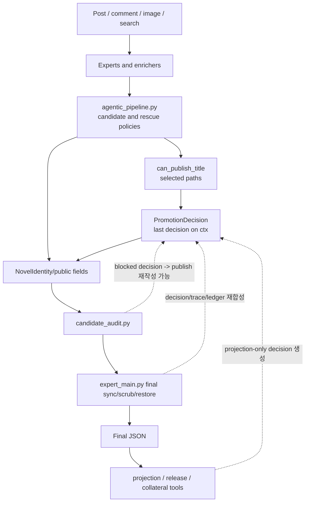
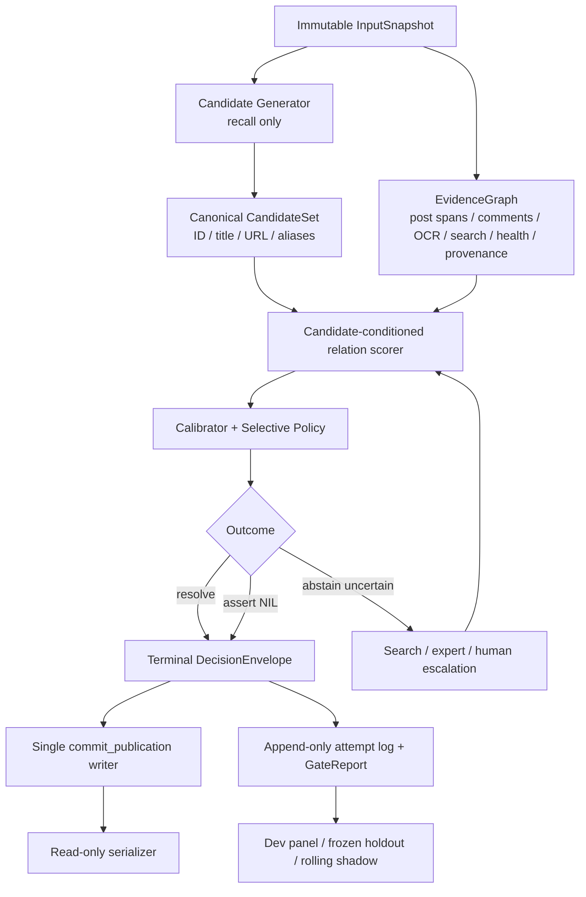

# 현재 LLM 개선 아키텍처 한계와 개선안 (2026-07-10)

> 역사적 Loop638~640 시점 리뷰다. Promotion Contract v2, Loop643, 진행 중 104,502건 런을 반영한 최신 판정은 `docs/devs/LLM_PIPELINE_ARCHITECTURE_RESEARCH_20260711.md`를 우선한다.

> 2026-07-12 후속: P3 v16 readiness v2·무쓰기 actual preflight·정책/split/source/replay bound readback·여섯 paired CI 정책 게이트와 P4 v16 부모·라벨 원장 교차 계보 검증까지 구현됐다. replay 6종은 실제 parser와 frozen coverage로 검증한다. 실제 DEV/CAL/FROZEN 자료와 fresh BEFORE/AFTER가 없어 정확도·비용 개선 수치는 계속 `null/NOT_ESTIMABLE`, 판정은 `NOT_RUN / REVIEW-LOCKED / full_scan_approval=false`다. 최신 정본은 `out/candidate_set_calibration_shadow_harness_20260711/v16/`, `out/selective_compute_shadow_harness_20260712/v16/`다.

## 1. 결론

현재 구조는 **후보 보존과 공개 제목 승격을 분리한 점은 맞지만, 공개 결정의 단일 권위점과 런타임-투영 동형성이 아직 없다.** `shared promotion gate`는 구현됐으나 모든 publish 경로의 유일한 writer가 아니고, `candidate_audit.py`와 `expert_main.py`가 gate 이후 결정을 다시 만들거나 바꿀 수 있다.

Claude와 공동 설계한 더 근본적인 후속안도 확인됐다. 2026-07-04 연구의 핵심은 `calibrated selective prediction`, `resolve / abstain-uncertain / assert-NIL`, 값싼 전역 triage, 모호한 행만 7-expert로 올리는 구조, write-once 결정이다. 합의된 도입 순서는 **현재 판단을 바꾸지 않는 shadow mode부터**였지만, 이 부분은 아직 실코드에 구현되지 않았다.

최신 Loop638~640 증거는 구조적 간극을 직접 보여 준다.

- Loop638은 projection/adjudication으로 residual `0`, static `adjusted_drift_count=0`을 만들었지만 runtime/full-scan 승인은 아니었다.
- Loop640은 `2026-07-10 03:34 KST` 기준 `75 completed / 68 flushed / 7 pending / 0 failed`, `large_run_complete=false`에서 중단됐고 runner/dashboard도 종료됐다. 종료 원인은 확정하지 않는다.
- Loop638 adjudicated baseline 대비 Loop640 partial은 flushed `68`행에서 adjusted drift 후보 `13`, checkpoint `75`행에서 `18`이 나왔다. 이 수치는 모두 확정 semantic error가 아니라 재판정 대상이다.
- 다만 adjudication ledger `59`행 중 실제 실행된 `4`행은 모두 baseline과 달라졌다. `11663514`, `11665110`, `11702094`, `11710045`는 source-native 판결과 runtime public identity가 불일치하므로 강한 P0 증거다.

따라서 다음 큰 full375를 먼저 재개하기보다 **핵심 계약 테스트의 Git 추적 → 4행 반복 gate → 59행 adjudication-first runtime gate → write-once publication owner** 순서로 닫는 편이 비용과 오류를 동시에 줄인다.

현재 판정은 다음과 같다.

| 축 | 판정 | 근거 |
| --- | --- | --- |
| Runtime integrity | `NO-GO / STOPPED_INCOMPLETE` | Loop640 `75/68/7/0`, `large_run_complete=false` |
| Search | `GO_SUBSET_ONLY` | Loop640 completed subset은 양호하나 375 전체가 아님 |
| Publication schema | `GO_SUBSET / 의미 승인 아님` | 형식 violation `0`은 adjudicated drift `0`을 뜻하지 않음 |
| Semantic quality | `REVIEW-LOCKED` | partial adjusted drift `18`, adjudicated overlap `4/4` 불일치 |
| Full scan | `false` | full375/runtime/full_scan path 미완료 |
| Goal | `ACTIVE / NOT_COMPLETE` | queue `0`과 projection `0`은 승인 아님 |

## 2. Claude 협업 아키텍처 복원

두 설계를 구분해야 한다.

### 2.1 선행 additive shared promotion gate

2026-06-30 Codex/전문가 협업으로 먼저 문서화·구현됐다. `expert_main.py`의 manifest/checkpoint/flush/shard 하네스는 유지하고 다음 계층을 추가하는 안이다.

```text
GroundingState
  -> ScopeState
  -> EvidenceRecord[]
  -> can_publish_title(...)
  -> PromotionDecision
  -> candidate preservation 또는 public title
  -> GateReport
```

Loop179은 `promotion_gate.py`와 일부 고위험 publish 경로를 연결했고, Loop193 이후 `ScopeState`, Loop190 이후 `publish_contract_trace`, Loop200 이후 final publication ledger sync를 보강했다. 최초 아이디어 자체를 Claude가 만들었다고 단정할 근거는 없다.

### 2.2 Claude 감사와 근본 후속안

- Claude는 2026-07-01 개선 루프를 감사하며 상위 `PromotionDecision`/trace 수렴, queue 감소와 safe 단조 비감소, flip-rate 측정을 steering했다.
- 2026-07-04 별도 7-agent 연구에서 categorical veto를 calibrated selective prediction으로 바꾸는 후속안을 제안했다.
- 커밋 `7ba58a45435127750cf62414d7a11d36fb9bdb41`은 `Co-Authored-By: Claude Opus 4.8 (1M context)`를 명시한다.
- 합의된 도입 순서는 현재 loop 유지 → 확률+NIL shadow log → 비교에서 이길 때 gate switch → 이후 2단 cascade다.

즉 기억한 Claude 협업안은 실제로 존재한다. 다만 **additive gate의 최초 설계**와 **Claude 공동설계의 calibrated/NIL 후속안**은 같은 것이 아니다.

## 3. 현재 실제 구조



현재 구조의 정확한 명칭은 `single publication gate`보다 **selected-path shared evaluator + last-decision ledger + late convergence layer**에 가깝다.

## 4. 잘 된 부분

버릴 필요가 없는 기반도 분명하다.

1. `expert_main.py`의 manifest, checkpoint, pending/flush, 병렬도, VLM/OCR readiness는 대형 런 하네스로 유용하다.
2. candidate ledger와 public publish를 분리해 근거 부족 후보를 `HOLD/candidate_only/quarantine`으로 보존하는 방향은 맞다.
3. runtime completion, search health, semantic quality, full-scan approval을 분리하는 문서 계약은 강하다.
4. source-native 판결, adjudication ledger, old baseline raw diagnostic과 adjusted baseline 분리는 goalpost 이동을 추적할 최소 기반을 제공한다.
5. `slang_db off/read-only`, post_id/title 하드코딩 금지, dashboard는 승인 증거가 아니라는 원칙도 유지해야 한다.

## 5. 확인된 한계

### P0-1. Gate가 public title의 단일 writer가 아니다

- runtime `can_publish_title()` 호출은 `agentic_pipeline.py`의 공통 wrapper 한 곳에 모였지만, public identity 생성은 terminal `PromotionDecision`을 필수 입력으로 요구하지 않는다.
- `_can_promote_title_after_semantic_no_work()`는 semantic no-work 조건이 없으면 gate 호출 없이 `True`를 반환할 수 있다.
- `candidate_audit.py`는 blocked decision을 `publish`로 직접 재작성한다.
- `expert_main.py`에는 `promotion_decision` dict write site가 다수 있고, serialized identity로부터 새 publish decision을 추론하기도 한다.

결과적으로 `bypassed_gate=false`는 실제 단일 게이트 통과 증명이 아니다. 여러 후처리 코드가 이 값을 직접 쓸 수 있고, trace builder도 임의 dict를 받아 `false`로 덮는다.

### P0-2. Gate는 evidence-aware scorer가 아니라 caller boolean veto다

`can_publish_title()`은 다음 필드를 실질 판정에 쓰지 않거나 매우 제한적으로만 쓴다.

- `EvidenceRecord.kind`, `strength`, `source_path_or_snippet`
- `ScopeState.confidence`, `direct_bridge_sources`, `competing_candidates`

로컬 read-only probe 결과:

| 입력 차이 | 결과 |
| --- | --- |
| `current_work/high`, 경쟁 후보 없음 | `publish` |
| `current_work/low`, 경쟁 후보+conflict 존재 | `publish` |
| 임의 weak evidence 하나에 `supports_publish=true` | `publish` |
| 같은 evidence를 strong으로 변경 | 동일 `publish` |
| `context_only` nonwork | `candidate_only` |
| `unknown` uncertain | 동일 `candidate_only` |

또한 `thematic_overlap_only` hard negative가 있어도 caller가 `row_discusses_work_as_work=true`를 주면 publish할 수 있다. 이는 evidence strength와 negative monotonicity가 gate 내부 계약이 아님을 뜻한다.

### P0-3. Projection과 production runtime이 두 세계다

Loop631~638의 residual 감소는 대부분 projection-only contract 적용이며 `runtime_replay_allowed=0`이었다. Loop638 static baseline은 스스로와 비교해 `adjusted_drift_count=0`이지만, 실제 Loop640 partial에서 즉시 다음 drift가 생겼다.

| 비교 | Shared | Changed | Adjusted drift 후보 |
| --- | ---: | ---: | ---: |
| Flushed result | 68 | 16 | 13 |
| Checkpoint completed | 75 | 22 | 18 |

Checkpoint `18`의 이동은 `resolved_to_different_title=3`, `resolved_to_null=8`, `null_to_resolved=7`이다. 단순 `null_to_resolved`에는 정당 recall이 섞일 수 있으므로 source-native review 없이 전부 오류라고 부르지 않는다.

반면 adjudication ledger overlap `4/4`는 강한 불일치다.

| post_id | Adjudicated baseline | Loop640 runtime |
| --- | --- | --- |
| `11663514` | `마탄 속의 제국` | `올바른 슬라임 사용법` |
| `11665110` | `사이키델리아` | `낭만적인 초능력을 위하여` |
| `11702094` | `댓글창의 천재 마법사` | `null` |
| `11710045` | no-publish / `null` | `공주는 언니를 황제로 만든다` |

네 행 모두 `bypassed_gate=false`였으므로 publication contract의 형식 수렴과 semantic correctness가 분리돼 있음을 보여 준다.

### P0-4. 핵심 계약 테스트가 Git에 없다

`tests/test_promotion_gate_contract.py`는 로컬에서 `24 tests OK`지만 `.gitignore`의 `/tests/*`에 걸리고 allowlist에 없다. `git ls-files` 결과도 비어 있다. Loop179 보고서가 이 테스트를 검증 근거로 인용하지만 새 clone/CI에는 전달되지 않는 상태다.

이는 코드 버그와 별개로 즉시 닫아야 하는 재현성 blocker다.

### P1-1. NIL과 불확실성이 한 상태로 붕괴한다

현재 `candidate_only`에는 적어도 다음이 섞인다.

- 글이 작품을 논하지 않는 confident NIL
- 후보는 있으나 어느 작품인지 모르는 uncertain abstain
- 검색/공식 근거가 일시적으로 없는 info missing
- policy hold, quarantine

이 상태로는 coverage-risk 조절, 인간 review 우선순위, 검색 재시도 정책을 정확히 나눌 수 없다.

### P1-2. 실행 계약이 row 0 전에 fail-closed가 아니다

Loop639는 계획상 search non-light였지만 child manifest가 `include_search=false/light=true`인 채 `40/24/16`까지 비용을 쓴 뒤 무효가 됐다. 실행 계약, child env, model/prompt/config hash를 첫 row 전에 검증하고 불일치 시 즉시 종료해야 한다.

### P1-3. 대형 런 경제성과 durability가 약하다

- Loop629 full375는 `31080.8s`, 약 `8.6h`였다.
- single slow frontier가 ordered flush를 막았고 LLM stream과 `_context_to_output` 후처리가 병목으로 관측됐다.
- Loop640도 `75 completed`지만 `68 flushed`, `7 pending`으로 끝났다.

행별 durable commit과 마지막 deterministic compaction을 분리하지 않으면 한 long-tail 행이 저장 가시성, 재시작 비용, dashboard 상태를 함께 막는다.

### P1-4. 개선 하네스가 golden/판결셋에 과적합될 위험이 있다

Golden18은 반복적으로 수정·재실행된 개발셋에 가깝다. adjudication ledger도 re-baseline 생성에 직접 사용됐다. 개발 패널, frozen holdout, rolling shadow를 분리하지 않으면 `18/18` 또는 static drift `0`이 일반화 증거가 되기 어렵다.

### P2. `slang_db` feedback loop가 구조적으로 버전되지 않았다

현재 운영은 write-back off/read-only로 위험을 줄이고 있지만, 장기적으로는 append-only event log, provenance, snapshot/rollback, 독립 다중런 승격, TTL/decay, golden shadow-diff가 필요하다.

## 6. 목표 아키텍처



핵심 원칙은 다음과 같다.

1. Candidate generator는 후보만 만든다. public title을 쓰지 않는다.
2. `EvidenceGraph`는 후보별 근거, 반증, search health, provenance를 보존한다.
3. outcome은 최소 `RESOLVE`, `ASSERT_NIL_NONWORK`, `ABSTAIN_UNCERTAIN`으로 분리한다. Policy hold/quarantine은 별도 축으로 둔다.
4. `DecisionEnvelope`는 `schema_version`, `gate_version`, `evaluation_id`, `input_hash`, `state_digest`, `evidence_digest`, `writer`, `created_at`을 가진다.
5. public field writer는 `commit_publication()` 하나뿐이고 serializer/candidate audit은 읽기 전용이다.
6. expensive experts는 ambiguous band에만 사용한다.

## 7. 단계별 개선 순서

### Phase 0 — 재현성과 fail-closed 계약

- [ ] `tests/test_promotion_gate_contract.py`를 Git 추적/CI 대상에 넣는다.
- [ ] empty input, duplicate `post_id`, unknown action/lane, missing decision/trace/provenance를 모두 `NO-GO`로 만든다.
- [ ] 4행 adjudication smoke를 동일 조건으로 3회 실행한다.
- [ ] 4/4 × 3회 baseline 일치, flip `0`, search hard blocker `0`을 만족하기 전 fresh full375 발주를 보류한다.
- [ ] 이어서 ledger 59행을 production runtime으로 실행해 `adjusted_drift_count=0`을 확인한다.

### Phase 1 — 단일 writer와 위조 불가능한 결정

- [ ] `build_publish_contract_trace()`는 typed `PromotionDecision`/`DecisionEnvelope`만 받는다.
- [ ] `bypassed_gate`를 caller 입력값이 아니라 provenance 검증 결과로 계산한다.
- [ ] scope를 필수 enum으로 만들고 `unknown`은 publish 불가로 둔다.
- [ ] hard negative는 모든 weak/boolean positive보다 우선하도록 monotonic rule을 테스트한다.
- [ ] 허용 모듈 밖의 `official_title`/`publish_allowed=True` write를 AST 검사로 차단한다.
- [ ] projection과 runtime이 같은 serialized `GateInput`과 evaluator를 쓰게 한다.

### Phase 2 — Claude 후속안 shadow mode

- [ ] 기존 판단은 바꾸지 않고 `p(current_work|post,candidate)`, `p(nonwork)`, `p(uncertain)`만 로그한다.
- [ ] 기존 59행 adjudication, full375, frozen holdout으로 calibration/ECE와 risk-coverage를 비교한다.
- [ ] confidence/strength/competition/search-health feature가 실제 decision에 미치는 효과를 측정한다.
- [ ] 현 gate보다 같은 coverage에서 위험이 낮거나 같은 위험에서 coverage가 높을 때만 switch를 검토한다.

### Phase 3 — selective compute와 runtime durability

- [ ] deterministic triage와 retrieval scorer로 쉬운 resolve/NIL을 먼저 처리한다.
- [ ] ambiguous band만 7-expert/judge로 올린다.
- [ ] `(input_hash, candidate_id, evidence_snapshot, policy_version)` 기준 캐시를 사용한다.
- [ ] unordered per-row durable commit + deterministic final compaction A/B를 수행한다.
- [ ] supervisor가 heartbeat, terminal exit reason, resume cursor, dashboard reattach를 기록하게 한다.

## 8. 필수 계약 테스트

다음 assertion은 구현 세부가 아니라 아키텍처 불변식으로 둔다.

1. terminal decision 없이 public title을 주입하면 final JSON은 null이고 audit은 `NO-GO`다.
2. handcrafted decision dict는 trace builder가 거부한다.
3. `scope=None/unknown`은 publish할 수 없다.
4. `thematic_overlap_only` 등 hard negative는 positive boolean보다 우선한다.
5. arbitrary weak evidence는 publish 권한을 가질 수 없다.
6. evidence 순서 permutation으로 decision이 바뀌지 않는다.
7. negative evidence 추가가 block을 publish로 바꾸지 않는다.
8. competing candidate 추가가 confidence를 높이거나 publish를 새로 열지 않는다.
9. 모든 `post_id`에 terminal decision이 정확히 하나 있다.
10. `public_title_count == terminal resolve count`다.
11. projection/runtime의 `GateInput` hash와 terminal decision이 100% 일치한다.
12. 0행/duplicate/missing provenance audit는 fail-closed다.

## 9. 바로 실행할 검증 실험

### 실험 A — adjudication 4행 × 3회

대상: `11663514`, `11665110`, `11702094`, `11710045`.

측정:

- adjudicated target과 final public identity
- `PromotionDecision.status`, `scope`, `reason_codes`
- candidate set, search health, evidence hash
- cross-run flip

### 실험 B — 59행 projection/runtime differential

Loop638 adjudication ledger 59행을 동일 production runtime으로 실행한다. projection result를 runtime seed로 덮어쓰지 않고, 두 경로의 `GateInput`과 `DecisionEnvelope`를 row별로 직접 diff한다.

### 실험 C — slow-frontier durability A/B

- A: 현 ordered final flush
- B: 행별 immutable commit 후 deterministic compaction

측정:

- 최대 `completed-flushed` gap
- 강제 중단 후 재처리 행 수
- frontier 30분 이상일 때 보존된 완료 행 수
- dashboard/manifest/checkpoint 일치

## 10. 증거 맵

- Claude 공동 연구: `docs/devs/ARCHITECTURE_RESEARCH_AND_CASE_STUDY_20260704.md`
- 합의된 shadow 도입 순서: `docs/devs/RESEARCH_JOURNAL_AND_INDEX_20260705.md`
- additive migration 정본: `docs/devs/ARCHITECTURE_PROMOTION_GATE_MIGRATION.md`
- gate 구현: `src/llm_batch/promotion_gate.py`
- runtime wiring: `src/llm_batch/agentic_pipeline.py`
- post-gate restore: `src/llm_batch/grounding/candidate_audit.py`
- late convergence/scrub: `expert_main.py`
- re-baseline: `docs/devs/loop_reports/LOOP_638_REPORT_20260709.md`
- full375 비용/long-tail: `docs/devs/loop_reports/LOOP_629_REPORT_20260709.md`
- 중단 partial manifest: `out/regression_safe_grounding_20260626_000008_928006_loop01/canary/loop640_full375_after_loop639_runtime_contract_fix_result_manifest.json`
- adjudication ledger: `docs/devs/loop638_adjudicated_rebaseline_adjudication_ledger.json`

## 11. 최종 Gate

- architecture ownership: `NO-GO / NOT_SINGLE_WRITER`
- projection-runtime conformance: `NO-GO / PARTIAL_DRIFT_18_OF_75`
- contract test durability: `NO-GO / LOCAL_IGNORED_TEST`
- runtime integrity: `NO-GO / STOPPED_INCOMPLETE_75_68_7_0`
- semantic quality: `REVIEW-LOCKED`
- full_scan_approval: `false`
- goal: `ACTIVE / NOT_COMPLETE`

이 보고서는 아키텍처 리뷰와 우선순위 제안이다. 코드 변경이나 full375 재실행은 수행하지 않았다. Loop640 partial 비교는 기존 repo 함수로 stdout만 생성한 read-only 검사이며 새 compare artifact를 쓰지 않았다.
