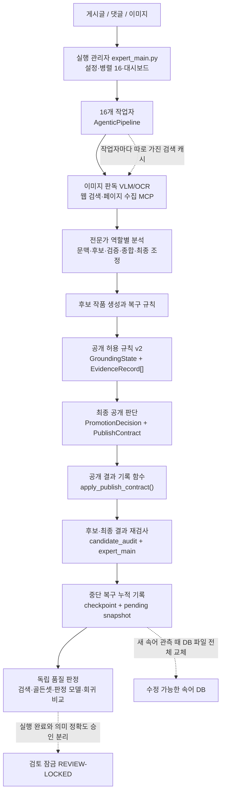
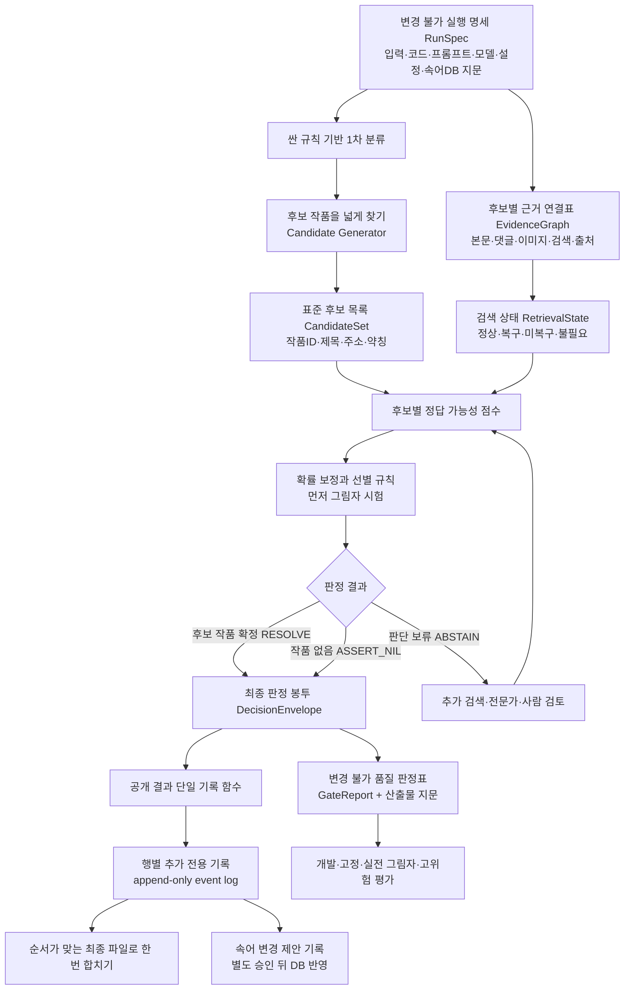

# 대규모 언어 모델(LLM) 처리 파이프라인: 현재 한계와 개선 기능 (2026-07-11)

> 이 문서는 0~5장의 기능 설명과 `A-1` 이후의 기술 부록으로 나뉜다. 처음 읽는 분은 0~3장만 읽어도 핵심을 이해할 수 있다. 4장은 낯선 용어를 만났을 때, 5장은 실제 개선 순서를 확인할 때 선택해서 읽으면 된다. 영어 코드명은 검색용 표식일 뿐이다.

## 0-A. 2026-07-12 P2 v8 / P3 v18 / P4 v19에서 확인된 기능

| 기능 | 쉬운 설명 | 현재 한계 |
| --- | --- | --- |
| 물리 호출 원장 (`physical-call ledger`) | 모델에 실제로 보낸 요청 하나마다 보내기 전 intent와 성공·실패 terminal을 retry 관계로 남긴다. | immutable-frame v1은 18/59 bounded 검증 전용이며 104k에서는 비활성화한다. |
| 호출 wrapper | Gatekeeper·Decoder·Verifier·Arbiter·reason review·VLM 호출을 같은 행과 연결한다. | 모든 미래 provider 경로를 자동으로 포착한다는 뜻은 아니다. |
| fresh paired 측정 | RunSpec을 먼저 동결하고 BEFORE·AFTER의 실제 input/output·WAL·원장·route receipt를 다시 읽는다. 공개 WAL에는 새 결정을 쓰지 않는다. | 실제 양쪽 실행과 실제 강제 중단·재시작 증거는 아직 없다. |
| recovered-arm witness | 중단 복구 arm의 source manifest/result/checkpoint/pending·summary·output·claim·WAL·single-attempt ledger·AFTER route를 self-hash로 결속해 다시 재생한다. | 실제 중단 runtime witness는 아직 없으며, witness가 없거나 원본이 바뀌면 arm 전체를 거부한다. |
| 독립 호출 재판독 | writer와 별도로 원장 frame을 읽어 호출·retry·token·source snapshot을 다시 계산한다. | 실제 paired ledger가 없어 actual KPI는 아직 `null`이다. |
| AFTER 측정 라우터 | 원문 위험 신호가 있으면 full, 신호가 전혀 없는 행만 deterministic NIL 0-call 측정 후보로 둔다. | 기존 WAL 결과 복사 기반의 `REFERENCE_COPY_COST_ONLY`이며 production router가 아니다. |
| 측정 완료 게이트 | missing/unsealed/unlinked/ambiguous/`NOT_ESTIMABLE` 행이 하나라도 있으면 REQUIRED run 완료를 막는다. | 실제 fresh runtime을 아직 실행하지 않았다. |
| 실제 자료 준비도 원본 재생 v2 | P1 RunSpec·비교표·결속 라벨 원장과 actual 정책 파일 raw-byte 참조에서 준비도를 다시 만들어 거짓 READY를 막는다. | 현재 ready `0/18`이며 actual 자료가 없다. |
| actual bound runner | 정책·동결 split·source manifest·expected/producer/AFTER/baseline을 재판독해 SHA를 유도한다. | 실제 파일이 없어 bundle과 성능 출력은 없다. |
| 정확도·비용 결합 게이트 | 여섯 paired CI와 후보 재현율·NIL·risk-coverage·hard regression을 통과하지 못하면 cheap routing을 열지 않는다. | 정책 판정은 구현됐지만 실제 DEV/CAL/FROZEN 출력이 없다. |
| P4 교차 계보 | P3/P4가 같은 P1·P2 부모와 같은 라벨 원장을 사용했는지 exact path/bytes/SHA로 확인한다. | 실제 fresh pair가 없어 runtime 개선 근거는 아니다. |

### 영어 상태값을 한국어로 읽기

| 상태값 | 뜻 |
| --- | --- |
| `FULL_EXPERT_REQUIRED` | 위험 신호가 있어 기존 전체 전문가 경로를 유지해야 한다. |
| `CHEAP_RULE_ELIGIBLE` | 안전 조건을 통과했지만 아직 적용하지 않는 그림자 후보다. |
| `NOT_ESTIMABLE` | 계산 근거가 부족하므로 숫자를 만들면 안 된다. |
| `PENDING_INDEPENDENT_READBACK` | writer 기록은 있으나 다른 reader가 원장을 다시 확인하기 전이다. |
| `GO_P4_SHADOW_CONTRACT_FOUNDATION_ONLY` | 계약·저장본·합성 기반만 통과했으며 실제 개선 승인이 아니다. |
| `REVIEW-LOCKED` | 의미 품질 검토가 잠겨 있어 운영 승인으로 승격할 수 없다. |
| `full_scan_approval=false` | 전체 스캔 운영 승인이 명시적으로 없다. |

## 0. 한눈에 보는 결론

> 최신 P4 구현 상태 v19: 선택적 비용 그림자 라우터, bounded physical-call ledger, writer 독립 reader, AFTER source-only 측정 라우터, paired RunSpec/source replay, exact recovered-arm witness와 P3/P4 부모·라벨 원장 교차 계보 검증을 구현했다. Golden18은 full `18`, cheap `0`, public/CandidateSet 불변 `18/18`이다. 실제 fresh BEFORE/AFTER가 없어 calls/post·회피율·after wall time은 전부 `null/NOT_ESTIMABLE`이다. 합성 `16→8`·50%와 reference-copy 0-call은 실제 production 절감률이 아니다. recovery/paired `71/71`, P2/P3 `58/58`, P4 `33/33`, 합계 `162/162 PASS`; false cheap `0`이다. 판정은 `GO_P4_SHADOW_CONTRACT_FOUNDATION_ONLY / NOT_RUN / REVIEW-LOCKED / full_scan_approval=false`다. 정본은 `out/selective_compute_shadow_harness_20260712/v19/`, 쉬운 보고서는 `docs/devs/LLM_PIPELINE_IMPROVEMENT_STATUS_KO_20260712.md`다.

> 최신 P3 구현 상태 v18: 후보 작품 ID들과 `NIL`의 확률 합을 100%로 만드는 계약, readiness v2, 무쓰기 actual preflight, 정책/split/source/replay bound actual-readback, 여섯 paired CI 정책 게이트를 구현했다. replay 6종은 실제 parser로 재생해 frozen coverage와 split/policy 결속을 확인한다. Golden18 실제 지표는 전부 `null`; 실제 DEV/CAL/FROZEN 자료와 출력이 없기 때문이다. 현재 ready `0/18`, 판정은 `GO_P3_CONTRACT_FOUNDATION_ONLY / NOT_RUN / REVIEW-LOCKED / full_scan_approval=false`다. 정본은 `out/candidate_set_calibration_shadow_harness_20260711/v18/`다.

> 최신 P2 구현 상태 v7: 같은 입력·게시글 순서·판정 설정·release 범위의 같은 게시글은 첫 정상 최종 공개 판정과 결과 행을 WAL에 한 번만 확정한다. 같은 재시도는 첫 정본을 무쓰기 재생하고 실제 분석 내용이나 범위가 다르면 상충으로 거부한다. Golden18 유효 commit `0→18`, replay no-op `18`, 기존 공개 결과·전체 행 불변 `18/18`, 합성 공격 `21/21`, false GO `0`이다. 실제 새 runtime은 `NOT_RUN`, 의미 품질은 `REVIEW-LOCKED`, 전체 승인은 `false`다. 정본은 `out/publication_exact_once_harness_20260711/v7/`다.

> 이전 P1 구현 상태 v8/v6: canonical query/search/fetch bounded plan과 작업별 receipt를 결합하는 producer completion proof를 구현했다. 사전 고정 정상 계획 1건만 `COMPLETE(계획 범위 완료)`, cache provenance 미결합·누락·저하/오류·조기 종료 4건은 `UNKNOWN`, raw `11→10` 손실 1건은 `TRUNCATED`, 거짓 COMPLETE는 `0`이다. explicit completion 누락, partial/generic/blocked/malformed search, fetch fallback, posthoc direct plan, required producer 축소를 fail-close한다. Golden18은 새 receipt가 없는 과거 저장본이므로 실제 CandidateSet은 `UNKNOWN`, recall은 `NOT_EVALUABLE`, 확률은 `null`이다. 실제 runtime은 `NOT_RUN`, 정본은 `out/candidate_generation_completeness_harness_20260711/v6/`, 쉬운 보고서는 `docs/devs/loop_reports/LOOP_P1_PRODUCER_COMPLETION_PROOF_20260711.md`다.

이 프로젝트는 게시글·댓글·이미지·검색 결과를 읽고 **“어떤 웹소설을 말하는 글인지, 아니면 작품을 특정하면 안 되는 글인지”** 판단한다. 작품을 찾더라도 근거가 부족하면 사용자에게 보이는 작품명과 주소를 비워 두어야 한다.

현재 시스템을 전부 다시 만들 필요는 없다. 실행을 관리하고 중단 결과를 보존하는 장치와, 작품명을 공개해도 되는지 검사하는 규칙은 이미 상당히 잘 갖춰져 있다. 문제는 그 앞뒤에 남아 있다.

1. **후보 작품을 하나로 너무 일찍 좁힌다.** 두 작품이 모두 가능하거나 “작품 언급이 아님”이 정답일 때 세 선택지를 함께 비교하지 못한다.
2. **검색 실패가 최종 공개 판단에 직접 묶여 있지 않다.** 검색 근거가 복구되지 않아도 내부 형식 검사를 통과해 작품명이 공개될 수 있다.
3. **실제 보정된 정확도 퍼센트가 아직 없다.** 안전 계약 기반은 구현했지만 현재 `High`, `Medium`과 합성 수치는 실제 적중률 80%, 90%를 뜻하지 않는다.
4. **쉬운 글과 어려운 글의 실제 운영 비용은 아직 나누지 않았다.** 측정 라우터·source replay·행별 호출 원장은 구현했지만 actual fresh pair가 없어 production routing은 계속 닫혀 있다.
5. **실행 중 공용 약칭·속어 자료까지 바로 바뀐다.** 이번 결과의 오류가 다음 실행의 입력으로 증폭될 수 있다.

가장 안전한 개선 순서는 다음과 같다.

`필수 검색이 복구되지 않으면 공개 금지 → 여러 후보를 함께 비교 → 정확도 퍼센트 계약을 그림자로 검증 → 실제 자료·신뢰구간 통과 → 쉬운 글은 싸게, 어려운 글만 전문가에게 전달`

현재 상태는 **전체 품질 미승인(검토 잠금)**이다. 코드 기록에는 `REVIEW-LOCKED`로 남으며, “일부 실행 증거는 있지만 작품 판정 품질을 전체 승인하지 않았다”는 뜻이다. `full_scan_approval=false`는 운영 전체 승인도 꺼져 있다는 뜻이다. 이 문서의 최초 조사와 104,502건 상태 확인은 읽기 전용으로 수행했다. 같은 날 이어진 첫 P0 게이트·하네스 개선은 아래에 별도로 갱신했으며, 진행 중인 104,502건 프로세스에는 주입하지 않았다.

### 이것만 기억하면 된다

후보를 여러 개 유지하고, 필수 근거가 없으면 공개를 보류하며, **확정·작품 아님·정보 부족을 구분해 기록한다.** 정확도 퍼센트는 현재 무근거 숫자를 막는 기반까지만 구현됐고, 실제 자료와 신뢰구간을 통과하기 전에는 공개하지 않는다.

## 1. 현재 파이프라인은 글 한 건을 어떻게 처리하는가

아래 표는 각 단계가 무엇을 입력받아 무엇을 검사하거나 남기는지 설명한다. 괄호 안 영어는 코드에서 위치를 찾기 위한 이름이므로, 기능을 이해할 때는 한국어 설명만 읽어도 된다.

| 순서 | 구성요소 | 실제 기능 | 이 단계가 잘못되면 |
| ---: | --- | --- | --- |
| 1 | 실행 관리자 (`expert_main.py`) | 입력을 읽고 16개 작업자에게 나누며, 진행률·중단 복구 파일·대시보드를 관리한다. | 어디까지 처리했는지 모르거나 중단 뒤 결과를 잃는다. |
| 2 | 이미지·검색 보강 (`VLM/OCR`, `MCP search`) | 이미지 내용을 읽고 글자를 추출하며, 웹에서 공식 작품명과 주소 근거를 찾는다. | 잘못된 작품을 고르거나 근거 없이 작품명을 공개한다. |
| 3 | 전문가 분석 묶음 | 글의 주제, 약칭, 작품 후보, 반대 근거를 여러 역할의 모델이 나눠 분석한다. | 한 모델의 착각이 그대로 최종 결과가 된다. |
| 4 | 후보 작품 만들기 | 가능한 작품명·주소·약칭을 내부 후보 목록에 모은다. 이 단계는 넓게 찾는 것이 목적이다. | 정답 후보를 처음부터 놓치거나 엉뚱한 후보만 남는다. |
| 5 | 공개 허용 규칙 (`Promotion Contract v2`) | 현재 선택된 후보와 내부 근거·차단 조건을 받아, 작품명을 공개하거나 후보만 내부에 보존하는 결정을 기록한다. 검색 실패 상태는 아직 이 결정이 직접 보지 못한다. | 내부 참고 후보가 근거 없이 공개 결과로 새어 나온다. |
| 6 | 후보·최종 결과 재검사 (`candidate_audit`, 최종 직렬화 코드) | 사용자에게 보일 결과가 후보·근거·앞 단계 판정과 어긋나면 작품명과 주소 공개를 막는다. | 앞 단계에서 막은 후보가 뒤에서 다시 살아나거나 반대로 정답이 지워진다. |
| 7 | 저장과 중단 복구 (`WAL`, checkpoint, pending snapshot) | P2 경로는 최종 판정과 복구 행을 WAL에 먼저 한 번 확정한다. 이어 checkpoint와 순서 대기 결과를 보존한다. 현재 진행 중 production은 P2 변경 전 코드다. | 재시도 덮어쓰기, 긴 실행 중단 뒤 결과 손실, 영수증과 결과 행 불일치가 생긴다. |
| 8 | 독립 품질 판정 | 실행 완료, 검색 상태, 작품 판정 정확도, 운영 전체 승인을 서로 따로 검사한다. | “100% 실행됨”을 “100% 정확함”으로 잘못 해석한다. |

### 여러 전문가 모델은 역할을 어떻게 나누는가

영어 이름은 구현 위치를 찾을 때만 필요하다. 먼저 첫 번째 열의 한국어 역할과 세 번째 열의 기능만 읽으면 된다.

| 한국어 역할 | 실제 코드에서 찾을 이름 | 하는 일 |
| --- | --- | --- |
| 작품 여부 1차 분류 | `Gatekeeper` | 작품 관련 글인지 먼저 거른다. |
| 글의 맥락 분류 | `Discourse` | 질문·감상·비교·잡담 중 무엇인지 판단한다. |
| 약칭과 흐린 표현 해석 | `Decoder` | 원문 표현을 가능한 작품 후보로 바꾼다. |
| 근거 확인 | `Verifier` | 후보를 지지하는 공식 근거와 반대 근거를 확인한다. |
| 분석 결과 종합 | `Synthesizer` | 앞선 여러 분석을 하나의 결론 후보로 정리한다. |
| 충돌 조정 | `Arbiter` | 결과가 엇갈릴 때 최종 선택 또는 보류를 결정한다. |
| 추가 찬반 검토 | `jury/debate` | 모호한 경우 다른 모델들이 결론의 찬반을 다시 검토한다. |

### 실제 글 한 건으로 보는 현재 처리 예

가상의 게시글을 예로 들면 이해하기 쉽다.

- 제목에는 **작품 A의 약칭**이 있다.
- 본문에는 **작품 B의 인물과 설정**이 섞여 있다.
- 두 작품 중 어느 쪽을 주로 말하는지 확인하려면 웹 검색이 필요하다.
- 그런데 검색 서버가 응답하지 않았다.

| 확인할 항목 | 현재 처리 | 개선 후 처리 |
| --- | --- | --- |
| 작품 후보 | 앞 단계에서 작품 A 하나로 일찍 좁혀질 수 있다. | 작품 A, 작품 B, 작품 아님을 함께 보존한다. |
| 근거 사용 | 선택된 작품 A를 중심으로 형식과 내부 근거의 일관성을 본다. | 제목·본문·댓글·이미지·검색 근거를 후보별로 따로 연결한다. |
| 검색 실패 | 별도 감사에는 남지만 최종 공개 판단의 필수 조건은 아니다. | 필수 검색 실패를 최종 판단에 직접 전달한다. |
| 최종 판단 | 내부 기록끼리 맞으면 의미상 틀린 작품 A가 공개될 여지가 있다. | 지금 확정하면 위험하므로 **정보 부족 보류**로 끝낸다. |
| 사용자 화면 | 작품 A의 이름과 주소가 보일 수 있다. | 작품명과 주소를 비운다. |
| 다시 판단할 자료 | 다른 후보와 실패 상태가 한 판단 묶음에 충분히 남지 않는다. | 작품 A·B 후보와 실패 이유를 보존하고 검색 복구 뒤 다시 판단한다. |

즉, 개선 목표는 “무조건 답을 더 많이 내기”가 아니라 **틀릴 가능성이 큰 답은 공개하지 않고, 다시 판단할 재료는 잃지 않는 것**이다.

## 2. 제안하는 개선 기능은 각각 무엇인가

| 한국어 기능 이름 | 이 기능이 실제로 하는 일 | 예시 | 기대 효과 |
| --- | --- | --- | --- |
| 실행 조건 봉인 | 입력 파일, 코드, 모델 지시문, 사용할 모델, 검색·이미지 설정, 공용 약칭·속어 자료의 시점을 실행 전에 한 묶음으로 기록한다. | 개선 전·후 결과가 달라졌을 때 코드 변경 때문인지 설정 차이 때문인지 구분한다. | 같은 조건 재실행과 공정한 전후 비교가 가능해진다. |
| 여러 작품 후보 보존 | 처음 발견한 한 작품만 남기지 않고 가능한 작품과 “작품 아님”을 끝까지 함께 들고 간다. | 제목은 A, 본문은 B를 가리키면 A와 B를 둘 다 비교한다. | 초기에 고른 오답이 끝까지 굳는 일을 줄인다. |
| 후보별 근거 연결 | 본문, 댓글, 이미지, 검색 결과가 어느 후보를 지지하거나 반박하는지 따로 기록한다. | A의 공식 주소를 B의 근거로 잘못 사용하는 일을 막는다. | 근거가 섞여 다른 작품을 공개하는 오류를 줄인다. |
| 검색·이미지 실패 차단 | 꼭 필요한 검색이나 이미지 판독이 실패했는지를 최종 판단이 직접 확인한다. | 검색 장애인데 “검색 결과가 없으니 작품이 아니다”라고 결론 내리지 않는다. | 외부 근거가 없을 때 안전하게 보류한다. |
| 세 갈래 최종 판단 | 결과를 “작품 확정”, “작품 아님”, “정보 부족 보류”로 명확히 나눈다. | 후보가 없는 것과 검색 장애로 모르는 것을 다르게 저장한다. | 재시도할 행과 정상 종료한 행을 구분할 수 있다. |
| 정확도 퍼센트 시험 | 새 퍼센트를 기존 결과 옆에만 기록하고, 실제 정답률과 맞는지 먼저 시험한다. | 80%라고 한 100건 중 실제 약 80건이 맞는지 확인한다. | 과신한 숫자를 운영 판단에 쓰는 일을 막는다. |
| 난이도별 처리 경로 | 쉬운 글은 짧고 싼 경로에서 끝내고, 충돌·검색 실패·다작품 글만 전문가 단계로 보낸다. | 명백한 일반 잡담은 조기 종료하고 약칭 충돌 글만 추가 검토한다. | 정확도를 지키면서 모델 호출 수와 시간을 줄인다. |
| 안전한 행별 저장 | 끝난 글을 즉시 한 줄씩 보존하고, 최종 순서는 마지막에 한 번 맞춘다. | 앞번호 한 건이 느려도 뒤에서 끝난 결과를 잃지 않는다. | 중단 복구가 쉬워지고 큰 파일 반복 저장 비용이 줄어든다. |
| 속어 변경 승인 분리 | 실행 중 발견한 새 약칭을 공용 약칭·속어 자료에 바로 쓰지 않고 제안 목록에 쌓는다. | 한 번의 모델 착각이 다음 실행의 지식으로 굳지 않게 한다. | 오류 전파를 막고 변경 이력과 되돌리기를 확보한다. |

이 기능들은 한꺼번에 새 시스템으로 교체하자는 뜻이 아니다. 현재 공개 검사와 중단 복구 기능은 보존하고, **후보 선택 앞단과 최종 판단 입력을 먼저 보강한 뒤** 정확도 퍼센트와 속도 개선을 순서대로 붙이는 제안이다.

## 3. “정확도 판단을 퍼센트로 하자”는 제안

맞다. Claude 공동 연구의 핵심 제안 중 하나다. 핵심은 그럴듯한 숫자를 붙이는 것이 아니라, **과거 실제 정답률에 맞춰 퍼센트를 교정하고 위험한 글은 답하지 않는 것**이다.

### 단순히 모델에게 “몇 퍼센트 같아?”라고 묻는 방식이 아니다

모델이 근거 없이 `90%`라고 말하게 하는 것이 아니다. 게시글, 후보 작품, 공식 검색 근거, 이미지 근거, 반대 근거, 후보 간 충돌을 입력으로 받아 **각 후보가 정답일 가능성과 후보 중 정답이 없을 가능성**을 함께 계산한다.

이 값들은 처음에는 **모델이 낸 시험 점수**일 뿐, 사실을 보증하는 확률이 아니다. 개발에 쓰지 않은 고정 평가 자료에서 실제 적중률과 비교해 교정한 뒤에만 공개 기준 후보로 사용할 수 있다.

| 계산하려는 것 | 기록할 짧은 이름 | 한국어 의미 | 제안하는 처리 |
| --- | --- | --- | --- |
| 후보별 정답 가능성 | `p(candidate_i)` | 후보 `i`가 실제 정답일 가능성 | 충분히 높으면 작품명·주소 공개 후보 |
| 후보 중 정답 없음 | `p(NIL)` | 작품 이야기가 아니거나 준비된 후보 중 정답 작품이 없을 가능성 | 충분히 높으면 “작품 없음” 후보 |
| 선택 행동의 예상 오류 위험 | `p(error \| chosen_action)` | 지금 가장 높은 후보나 NIL을 선택했을 때 틀릴 가능성 | 위험이 높으면 검색 확대, 전문가 또는 사람 검토 |

후보별 값과 `p(NIL)`은 하나의 정답 목록이므로 서로 겹치지 않고 합이 `100%`가 되게 정의한다. **판단 보류(`ABSTAIN`)는 정답 종류가 아니다.** 검색이 실패했거나 선택 행동의 예상 오류가 허용 기준보다 높을 때 시스템이 취하는 안전 행동이다. 기존 제안의 `p(uncertain)`을 유지한다면 같은 확률 목록에 더하지 말고 `p(error | chosen_action)`처럼 별도 위험값으로 정의해야 한다.

또한 정답 작품이 처음부터 후보 목록에 없으면 확률 계산만으로 복구할 수 없다. 따라서 정확도 퍼센트에 앞서 “정답 후보가 목록에 포함됐는가”를 재는 **후보 목록 재현율(candidate-set recall)** 게이트를 통과해야 한다. 후보 생성 실패와 후보 점수 보정 실패를 서로 다른 오류로 기록한다.

### 퍼센트가 믿을 만하려면 실제 정답률과 맞춰 봐야 한다

예를 들어 시스템이 `80%`라고 판정한 글 100건을 모았을 때 실제로 약 80건이 맞아야 한다. 100건 중 50건만 맞는다면 그 숫자는 정확도가 아니라 과신한 자기평가다. 기술 부록에서는 이 차이를 **확률 보정 오차**라고 부른다.

자동으로 확정하는 글을 늘리면 처리량은 커지지만 오답도 늘 수 있다. 반대로 모호한 글을 보류하면 자동 처리량은 줄지만 오답을 낮출 수 있다. 따라서 “몇 건을 자동 처리했는가”와 “그중 몇 건이 틀렸는가”를 항상 한 쌍으로 비교한다.

실제 공개 기준을 `90%`처럼 미리 고정해서는 안 된다. 개발에 사용하지 않은 고정 평가 자료에서 목표 오답률을 정한 뒤 기준값을 찾아야 한다.

### 먼저 “시험 기록”으로만 붙여야 한다

새 확률은 당분간 실제 결과를 바꾸지 않는다. 기존 판정 옆에 후보/NIL 확률과 별도 선택 오류 위험만 기록하는 **그림자 시험(`shadow mode`)**으로 비교한다.

1. 기존 공개 결과는 그대로 둔다.
2. 후보별 확률과 `p(NIL)`, 별도 선택 오류 위험만 함께 기록한다.
3. 정답을 `후보 ID 또는 NIL` 중 정확히 하나로 라벨링하고, 판단 보류는 운영 행동으로 따로 기록한다.
4. 개발용·확률 보정용·최종 동결 시험 자료를 서로 겹치지 않게 나눠 실제 적중률과 비교한다.
5. 검색 실패·다작품·약칭·이미지 등 위험 유형별 후보 목록 재현율과 오차를 따로 측정한다.
6. 기존 방식보다 같은 처리 범위에서 오답 위험의 신뢰상한이 낮고, 기존 안전 게이트가 나빠지지 않을 때만 전환을 검토한다.

검색이 실패했거나 후보 목록이 잘못되면 확률 모델도 “높은 확률로 틀릴” 수 있다. 그래서 **검색 실패 차단과 여러 후보 동시 비교가 확률 도입보다 먼저**다.

### P3에서 실제로 구현한 안전 경계

| 구현 | 기능 | 아직 못 하는 것 |
| --- | --- | --- |
| 분할 manifest | 게시글 그룹·본문·출처·후보 묶음·작품 지문이 개발·보정·동결 자료를 건너지 못하게 한다. | 실제 라벨 자료 자체를 만들어 주지는 않는다. |
| 보정기 학습 영수증 | 보정 자료 수, 작품/NIL 수, 미해결 라벨 0, 점수 생성기와 온도값을 기록한다. | 실제 보정 학습 실행은 아직 없다. |
| 확률 사건 공간 | 후보 ID들과 NIL의 정수 질량 합을 정확히 `1,000,000`으로 고정한다. | 정답 후보가 목록 밖에 있는 문제는 해결하지 못한다. |
| 원본 재생 | 기본 후보 기록·원점수·보정기·정책·행을 다시 만들어 저장된 확률과 비교한다. | 파일 바이트 reader도 구현됐지만 실제 산출물이 아직 없다. |
| 평가 시작 snapshot | 검증 뒤 입력 Mapping이 다른 값을 반환해 지표를 바꾸는 시간차 공격을 막는다. | 외부 파일 안정 재판독 기반은 구현됐고 actual run 증거가 남았다. |
| 검색 차단 무수치 | 필수 검색 미복구 행이 있으면 headline 지표 전체를 `null`로 둔다. | 검색 장애를 복구하지는 않는다. |
| 작은 표본 신뢰구간 | 후보 재현율·NIL 비율·선택 위험에 Clopper–Pearson 구간을 쓰고, ECE·Brier·자연로그 손실·AURC와 paired baseline에는 그룹 bootstrap 기반을 쓴다. | 실제 DEV/CAL/FROZEN 출력 구간은 아직 없다. |
| 보고서 저장 검증 | RunSpec·정책·공격 요약·승인 경계를 다시 확인한 뒤 JSON/Markdown을 함께 쓴다. | 서명된 외부 배포 증명은 아니다. |

따라서 합성 4행 수치가 좋아져도 `conversion_allowed=false`다. Golden18은 생산 완료 영수증과 분리된 평가 자료가 없어 실제 지표를 전부 `null`로 유지한다. 파일 바이트·생산 행 coverage·예측 payload 재판독과 그룹 bootstrap 기반은 구현됐지만, 실제 동결 평가 표기를 허용하려면 actual 자료·보정기 영수증·completed output을 이 reader로 통과시켜야 한다.

## 4. 꼭 알아야 할 용어

이 절은 코드를 직접 찾거나 기술 부록을 읽을 때만 참고하면 된다. 기능 설명만 읽는 경우 건너뛰어도 된다.

| 한국어 설명 | 코드·연구 용어 | 이 문서에서 뜻하는 것 |
| --- | --- | --- |
| 후보 작품 | `candidate` | 정답일 가능성이 있어 내부에 보관한 작품명·주소 |
| 통과 여부 판정 | `gate` | 공개, 보류, 거절 중 무엇을 할지 정하는 규칙 |
| 정해진 형식의 계약 | `typed contract` | 필요한 필드와 형태를 코드로 고정한 판정 데이터 |
| 조건 불충족 시 공개 금지 | `fail-close` | 모르면 일단 작품명을 비우고 후보만 보존하는 방식 |
| 외부 근거 연결 | `grounding` | 게시글 판단을 공식 페이지·검색·이미지 근거와 연결하는 것 |
| 이미지·웹 근거 수집 | `VLM/OCR`, `MCP search` | 이미지를 읽고 글자를 추출하거나 웹에서 공식 근거를 찾는 기능 |
| 후보별 근거 기록 | `EvidenceRecord` | 어떤 근거가 어느 후보 작품을 지지하거나 반대하는지 남긴 항목 |
| 작품 없음 | `NIL` | 작품 이야기가 아니거나 준비된 후보 중 정답 작품이 없음 |
| 판단 보류 | `abstain` | 정보가 부족해 지금 확정하지 않고 다음 단계로 넘김 |
| 확률 보정 | `calibration` | 80% 예측이 실제로도 약 80% 맞게 만드는 과정 |
| 그림자 시험 | `shadow mode` | 실제 결과를 바꾸지 않고 새 판정값만 나란히 기록하는 검증 |
| 선별 처리 | `selective compute` | 쉬운 글은 싸게 처리하고 모호한 글만 비싼 전문가 단계로 보냄 |
| 한 번만 확정 기록 | `write-once` | 최종 공개 판정을 여러 후처리가 다시 바꾸지 못하게 함 |
| 입력 지문 | `fingerprint` | 같은 입력·근거·설정에서 나온 판정인지 비교하는 해시값 |
| 개발에 쓰지 않는 평가셋 | `frozen holdout` | 기준 조정에 사용하지 않고 최종 비교에만 쓰는 고정 문제집 |
| 중단 복구 기록 | `checkpoint` | 완료한 행을 누적 저장해 재시작에 쓰는 파일 |
| 순서 대기 결과 | `pending snapshot` | 처리는 끝났지만 앞번호 지연 때문에 최종 파일에 아직 못 쓴 결과 |
| 최종 합치기 | `compaction` | 여러 누적 결과 조각을 순서가 맞는 최종 파일 하나로 만드는 작업 |

## 5. 권고하는 개선 순서

| 단계 | 먼저 하는 일 | 해결하는 문제 | 완료 확인 방법 |
| ---: | --- | --- | --- |
| 1 | 필수 검색 미복구 상태를 최종 판정 입력에 포함 | 반드시 검색 근거가 필요한데 검색이 실패한 행에서 작품명이 공개되는 문제 | 필수 검색 미복구 행의 잘못된 공개 `0` |
| 2 | 여러 후보와 “작품 없음”을 함께 비교 | 후보 하나를 너무 일찍 골라 틀리는 문제 | 다작품·약칭 충돌 사례의 잘못된 작품 선택 `0` |
| 3 | 최종 공개 판정을 한 곳에서 한 번만 기록 | 뒤쪽 후처리가 판정을 다시 바꾸는 문제 | 모든 게시글에 최종 판정 정확히 1개 |
| 4 | 정확도 퍼센트를 그림자 시험으로 기록 | 현재 `High/Medium`이 실제 정확도를 뜻하지 않는 문제 | 확률 보정 오차와 처리범위-오류 관계를 측정 가능 |
| 5 | 쉬운 글과 어려운 글의 처리 경로 분리 | 10만 건 전부에 비싼 전문가 호출이 붙는 문제 | 고위험 정답률을 유지하면서 호출 수와 지연 감소 |
| 6 | 행별 누적 저장과 속어 제안 승인 분리 | 느린 한 건·중단·자기학습 오염 문제 | 중단 후 재처리 `0`, DB 되돌리기 가능 |

### 1단계는 현재 어디까지 진행됐는가

| 확인 대상 | 현재 결과 | 쉽게 말하면 |
| --- | --- | --- |
| 검색 상태를 받는 공개 검사 기능 | 게이트에 선택 기능으로 구현, 실제 실행 경로 연결은 미완료 | 검색 실패 정보를 받으면 공개를 막을 수 있지만 현재 104k 실행에는 적용하지 않았다. |
| 저장된 실제 18건 정적 비교 | 대상 5건의 기존 판정 재현 `5/5`, 검색 미복구 공개 `1→0`, 후보 자료 누락 `0` | 실제 저장 결과에서 위험했던 공개 1건을 막는 방향을 확인했다. |
| 검색 근거 자체 | 미복구 차단 `5→5`, `NO-GO` | 작품명 공개는 막았지만 검색 장애를 해결한 것은 아니다. |
| 정확도 퍼센트 | `NOT_AVAILABLE_UNCALIBRATED` | 보정 자료가 없어 퍼센트를 만들지 않았다. |
| 실제 개선 후 실행 | `NOT_RUN_STATIC_PROJECTION` | 진행 중인 104k와 충돌하지 않도록 저장 결과만 읽어 비교했다. |

사람이 읽는 비교 결과는 `out/pipeline_improvement_harness_20260711/retrieval_failclose_v5/before_after_comparison.md`에 있다.

### 2단계는 현재 어디까지 진행됐는가

| 확인 대상 | 현재 결과 | 쉽게 말하면 |
| --- | --- | --- |
| 여러 작품 후보 묶음 | frozen typed shadow 구현, Golden18 후보 묶음 무결성 `18/18` | 작품 A와 B가 모두 가능하면 하나를 버리지 않고 함께 보존할 그릇을 만들었다. |
| 작품 없음 사건 | 모든 18행에 `NIL` 정확히 1개 | “작품 아님”을 빈 값이나 검색 장애와 분리할 수 있다. |
| 판단 보류 | `ABSTAIN`을 확률 사건에서 제외 | 정보 부족으로 답하지 않는 행동을 정답 종류로 잘못 세지 않는다. |
| 약칭 처리 | 작품 사건 `34`, 비사건 약칭 `13`, 후반 관측 `6` | `아생갤`을 정식 작품과 중복된 별도 작품으로 세지 않는다. |
| 정답 원장 | 작품 후보 `9`, NIL `6`, 단일 정답 미지정 `3` | 복합·미상·이미지 HOLD를 억지 단일 정답으로 만들지 않았다. |
| 구조 검사 | 작품 후보 정답의 사건 후보 내 관측 `9/9`, NIL 정답 원장 행의 공통 선택지 `6/6` | 필요한 사건이 현재 저장본에 보였다는 구조 검사이며 정확도·재현율 검사가 아니다. |
| 기존 공개 결과 | title/URL/decision/gate/trace/fingerprint/version/bypass `18/18` 불변 | 새 구조는 아직 사용자 결과에 영향을 주지 않는다. |
| 정확도 퍼센트 | 전 확률·선택 라벨 `null`, `NOT_AVAILABLE_UNCALIBRATED` | 보정 정답셋 전에는 숫자를 만들지 않는다. |
| 상류 제목 순위 잘림 | 고유 제목 7개 `TRUNCATED 7→6`, 정확히 6개·중복 제거 고유 6개 `UNKNOWN` | `_build_title_candidates`의 정책 필터 뒤 ranked-title cap 초과를 탐지한다. 후속 필터·rescue 뒤 최종 후보 목록과 같은 목록이라는 뜻은 아니다. |
| serializer 후보 잘림 | 고유 후보 25개 `TRUNCATED 25→24`, 정확히 24개·원본25/고유24 `UNKNOWN` | 최종 직렬화 직전 로컬 보존 목록의 cap 초과를 탐지한다. 두 단계의 count 기준은 달라 합산하지 않는다. |
| 전문가 내부 후보 잘림 | Gatekeeper1·Decoder1·Verifier2·Arbiter3 cap+1 `7/7 TRUNCATED`, 경계 오탐 `0` | 실제 후보 상태를 5개/8개로 자르기 직전 count/hash 영수증을 남긴다. 다른 경로 회복 가능성이 있어 CandidateSet 상태에는 합성하지 않는다. |
| 후보 목록 재현율 | Golden18 generation `UNKNOWN`, `NOT_EVALUABLE` | bounded query/search/fetch producer proof는 합성 계약에서 구현했지만 Golden18 저장본에는 새 receipt가 없다. 실제 runtime·broader holdout 전에는 재현율 계산을 금지한다. |
| 실제 새 실행 | `NOT_RUN` | 진행 중 production과 충돌하지 않게 저장본만 읽었다. |

기능 중심 설명은 `docs/devs/LLM_PIPELINE_IMPROVEMENT_READER_GUIDE_KO_20260711.md`, P1 구조 정본은 `out/candidate_set_nil_shadow_harness_20260711/v8/comparison.md`, 후보 생성 완료 증명 정본은 `out/candidate_generation_completeness_harness_20260711/v6/comparison.md`에 있다.

### 3단계는 현재 어디까지 진행됐는가

| 확인 대상 | 현재 결과 | 쉽게 말하면 |
| --- | --- | --- |
| 처리 범위 봉인 | input SHA·post_id 순서·전체 판정 설정·release/slang provenance를 scope와 sidecar SHA로 결속 | 다른 입력이나 설정의 결과가 같은 실행에 섞이면 거부한다. |
| 최종 판정 최초 기록자 우선 | Golden18 commit `0→18`, 신규 `18`, replay no-op `18` | 같은 재시도는 첫 정상 결과를 돌려주고 새로 덮어쓰지 않는다. |
| 공개 결과 비간섭 | 작품명·주소와 전체 결과 행 `18/18` 불변 | 저장 안전장치를 붙였지만 기존 Golden18 의미 결과는 바꾸지 않았다. |
| 공격 경계 | 합성 `21/21`, false GO `0`, 16-way 신규 commit/line `1/1` | 누출·위조·범위 혼합·동시 기록·끊긴 마지막 줄을 거짓 정상으로 통과시키지 않았다. |
| 실제 새 실행 | `NOT_RUN` | 현재 production은 변경 전 코드로 시작했으므로 P2 runtime 증거로 쓰지 않는다. |
| 의미 품질·전체 승인 | `REVIEW-LOCKED`, `full_scan_approval=false` | 한 번 저장했다는 사실은 작품 판단이 맞다는 증거가 아니다. |

기능 중심 설명은 `docs/devs/loop_reports/LOOP_P2_PUBLICATION_EXACT_ONCE_20260711.md`, P2 최신 정본은 `out/publication_exact_once_harness_20260711/v7/comparison.md`에 있다.

### 4단계 정확도 퍼센트 시험은 현재 어디까지 진행됐는가

| 확인 대상 | 현재 결과 | 쉽게 말하면 |
| --- | --- | --- |
| 실제 Golden18 수치 | 전부 `null`, 후보 재현율 `NOT_EVALUABLE` | 과거 저장본에 없는 완료·분할 증거를 꾸며 퍼센트를 만들지 않았다. |
| 무근거 보정 주장 | 합성 `1→0` | 숫자 합과 상태 문자열만으로 “보정됐다”고 할 수 없다. |
| 합성 계약 공격 | `20/20`, 거짓 통과 `0` | 분할 누수·지문 변조·NIL 0건·소표본·정책 세탁을 막았다. |
| 시간차 입력 공격 | Sol 재공격 2건 차단 | 검증 뒤 Mapping이 다른 shadow를 반환해 지표나 검색 차단을 세탁하지 못한다. |
| 보고서 승인 위조 | 저장 전 `ValueError` | `full_scan_approval=true`를 임의로 넣은 JSON/Markdown은 생성하지 않는다. |
| 합성 계산식 | 최고 후보 정확도 `0.5→1.0`, Brier·자연로그 손실·ECE 감소 | 수식 방향 시험이며 실제 성능 증거가 아니다. |
| 실제 동결 평가 | `IMPLEMENTED_FOUNDATION_NO_ACTUAL_ARTIFACT` | 파일 재판독 기반은 구현됐지만 실제 자료가 없어 수치를 만들지 않는다. |
| 전체 신뢰구간 | `IMPLEMENTED_POLICY_BOUND_NO_ACTUAL_OUTPUT` | 여섯 paired CI 정책 판정은 구현됐고 실제 출력 구간만 없다. |
| 실제 runtime·승인 | `NOT_RUN`, `REVIEW-LOCKED`, `full_scan_approval=false` | active production에는 주입하지 않았고 목표는 계속 진행 중이다. |

기능 중심 설명은 `docs/devs/loop_reports/LOOP_P3_CALIBRATION_CONTRACT_FOUNDATION_20260711.md`, P3 최신 정본은 `out/candidate_set_calibration_shadow_harness_20260711/v16/comparison.md`에 있다.

### 5단계 선택적 비용 라우팅은 현재 어디까지 진행됐는가

| 확인 대상 | 현재 결과 | 쉽게 말하면 |
| --- | --- | --- |
| Golden18 경로 | full-expert `18`, cheap `0` | 저장 Golden18에 새 source/ledger artifact가 없어 싸게 처리할 행을 억지로 만들지 않았다. |
| 공개 비간섭 | public/CandidateSet `18/18` 불변 | 비용 시험이 작품명·URL·공개 판정을 바꾸지 않는다. |
| 실제 정확도·안전 자동 범위 | `null/NOT_ESTIMABLE` | reader 기반은 구현됐지만 실제 동결 정답·paired artifact가 없어 퍼센트를 만들지 않는다. |
| 실제 calls/post·회피율 | `null/NOT_ESTIMABLE` | 실제 행별 ledger와 paired before/after가 없다. |
| 실제 처리시간 개선 | `null/NOT_ESTIMABLE_NO_AFTER_RUNTIME` | 개선 후 런을 아직 실행하지 않았다. |
| actual 경로 분포 | escalation `1.0` | 저장 Golden18 18행이 모두 full을 요구한 관측 분포이며 절감률이 아니다. |
| 합성 산술 | `16→8`, 회피 `50%` | 계산식·안전 차단 시험이며 상태도 `SYNTHETIC_CONTRACT_ONLY`다. |
| 적대 검증 | `20/20`, false cheap `0` | 검색·후보·scope·비용·public 위조가 cheap으로 빠지지 않는다. |
| 실제 runtime·승인 | `NOT_RUN`, `REVIEW-LOCKED`, `full_scan_approval=false` | 기반만 구현했고 실제 비용 최적화는 열지 않았다. |

독립 physical-call reader, P3 readiness v2·actual preflight·정책/split/source/replay bound runner·여섯 paired CI 정책 게이트, P4 교차 계보와 exact recovered-arm witness 검증은 구현됐다. 다음 단계는 실제 DEV/CAL/FROZEN 파일로 bound bundle과 `FROZEN_ACTUAL` 평가를 만들고, 동일 RunSpec·동결셋에서 fresh BEFORE와 fresh AFTER를 각각 실행하는 것이다. 후속 런은 active production 종료 뒤 `--parallel 16`, dashboard ON, slang off/read-only로 분리한다. 현재 정본은 `out/selective_compute_shadow_harness_20260712/v19/comparison.md`에 있다.

# 기술 근거와 설계 상세

아래부터는 위 결론을 뒷받침하는 코드명, 실행 수치, 파일 경로를 보존한 기술 부록이다. **기능을 이해하려는 독자는 여기서 읽기를 멈춰도 된다.** 구현하거나 수치를 재검증할 때만 필요한 부분이다.

## A-1. 조사 범위와 최신 기준점

확인한 근거는 다음과 같다.

- Claude 공동 연구 정본: `docs/devs/ARCHITECTURE_RESEARCH_AND_CASE_STUDY_20260704.md` — 정확도 확률·작품 없음·선별 처리 제안의 원문.
- 합의된 점진 도입 순서: `docs/devs/RESEARCH_JOURNAL_AND_INDEX_20260705.md` — 그림자 시험부터 시작한다는 결정 기록.
- 선행 공개 규칙 설계: `docs/devs/ARCHITECTURE_PROMOTION_GATE_MIGRATION.md` — 기존 구조와 공통 공개 규칙을 비교한 문서.
- 현재 공개 허용 규칙: `src/llm_batch/promotion_gate.py` — 후보 작품을 실제 공개 결과로 내보내도 되는지 판단하는 코드.
- 현재 처리 흐름과 후처리: `src/llm_batch/agentic_pipeline.py`, `src/llm_batch/grounding/candidate_audit.py`, `expert_main.py` — 전문가 실행, 후보 재검사, 저장·복구 담당.
- P3 확률 계약: `src/llm_batch/grounding/candidate_set_calibration_shadow.py`, `tools/run_candidate_set_calibration_shadow_harness.py` — 분할·보정 학습 영수증·원본 재생·무수치 경계와 저장본 비교 담당.
- P3 최신 정본: `out/candidate_set_calibration_shadow_harness_20260711/v10/`, `docs/devs/loop_reports/LOOP_P3_CALIBRATION_CONTRACT_FOUNDATION_20260711.md`.
- P4 비용 라우팅·물리 호출·복구 witness 계약: `src/llm_batch/measurement/selective_compute_shadow.py`, `src/llm_batch/ledger/decision_call_events.py`, `src/llm_batch/ledger/decision_call_readback.py`, `src/llm_batch/measurement/early_route_measurement.py`, `src/llm_batch/measurement/paired_measurement_readback.py`, `tools/recover_expert_run_from_checkpoint.py`, `tools/run_selective_compute_shadow_harness.py`, `out/selective_compute_shadow_harness_20260712/v19/`.
- v2 구현 근거: `docs/devs/PROMOTION_CONTRACT_V2_IMPLEMENTATION_20260710.md` — 최종 공개 경계를 어떻게 보강했는지 설명.
- 최신 검증: `docs/devs/loop_reports/LOOP_642_REPORT_20260711.md`, `docs/devs/loop_reports/LOOP_643_REPORT_20260711.md` — 실제 실패와 수정 후 결과.
- Fable 감사 근거: `docs/devs/loop643_arch_multiwork_title_body_subject_conflict_static_audit_20260711_060457.md/.json` — 다작품 충돌 수정안의 독립 안전 감사.
- 진행 중 전수 실행: `out/expert_result_20260711_113712_379597_manifest.json`, `logs/expert_run_20260711_113712_379597.log` — 진행 수치와 상세 실행 로그.

Git working tree에는 진행 중인 Loop641~643 변경과 산출물이 많다. 최초 연구 단계는 code/runtime를 바꾸지 않았고, 후속 P0/P1 구현은 active production process·result·checkpoint·pending·slang DB에는 주입하지 않은 별도 코드·정적 하네스·문서 변경으로 진행했다.

## A-2. 현재 실제 처리 구조

### 보존해야 할 강점

- 실행 상태 파일(`manifest`), 완료 행 누적 기록(`checkpoint JSONL`), 순서 때문에 대기 중인 결과(`pending snapshot`), 대시보드를 따로 남긴다.
- 내부 참고 후보와 사용자에게 보이는 공개 작품명을 구분한다.
- 판정 데이터의 형식을 코드로 고정하고(`GroundingState`, `EvidenceRecord`, `PromotionDecision`, `PublishContract`), 같은 입력인지 비교하는 지문(`fingerprint`)을 남긴다.
- `apply_publish_contract()` 한 곳이 공개 결과와 판정 흔적을 같은 내용으로 기록하도록 한다.
- 후보 재검사와 최종 직렬화 단계는 v2 판정과 결과가 다르면 공개하지 않고 보류한다(`fail-close`).
- 전체 글 판정 모델(`full-post judge`)에는 파이프라인이 스스로 작성한 이유문(`reason_lines`)을 주지 않는다. 원문·댓글·이미지·검색 근거만 보고 독립적으로 판단한다.
- 실행 완료, 검색 정상, 작품 판정 정확도, 운영 전체 승인을 서로 다른 상태로 기록한다.

## A-3. Claude/Fable 선행 아이디어 복원

### A-3.1 출처 확인

- commit `7ba58a45435127750cf62414d7a11d36fb9bdb41`은 `Co-Authored-By: Claude Opus 4.8 (1M context)`를 명시한다.
- 이 커밋의 연구 정본은 `ARCHITECTURE_RESEARCH_AND_CASE_STUDY_20260704.md`와 `RESEARCH_JOURNAL_AND_INDEX_20260705.md`다.
- 핵심 아이디어는 **보정된 정확도 확률**, **작품 확정/작품 없음/판단 보류의 3가지 결과**, **싼 1차 분류**, **모호한 글만 전문가 단계로 올리기**, **최종 판정을 한 번만 기록하기**다.
- 반면 저장소에서 확인되는 `claude-fable-5`의 명시적 역할은 Loop643 다작품 충돌 수정안에 대한 읽기 전용 안전 감사다. 치명적인 우회가 없고(`HARD_UNSAFE 0`) 합성 사례 5건을 통과했다고 보고했지만, 최종 메시지 전달은 provider 400 오류로 끝났다. 최종 승인권은 메인 에이전트에 남았다.

따라서 **아키텍처 아이디어의 정본 provenance는 Claude Opus 공동 연구**, **Fable의 확인 가능한 역할은 Loop643 안전 감사**다. Fable을 최초 설계자로 단정할 저장소 근거는 찾지 못했다.

### A-3.2 아이디어별 현재 상태

| 선행 아이디어 | 현재 상태 | 판정 |
| --- | --- | --- |
| 여러 공개 경로가 함께 쓰는 공통 규칙 | `Promotion Contract v2`로 강화됨 | 구현됨 |
| 최종 공개 판정을 한 번만 기록 | scope/post_id 최초 기록자 우선 WAL과 엄격 복구를 구현하고 Golden18·21개 공격으로 검증 | 저장본·합성 구현 완료, actual runtime 중단·재시작 미검증 |
| 후보마다 따로 점수를 계산 | CandidateSet/NIL 확률 사건·보정 계약과 actual reader 기반 구현, 저장 Golden18 값은 `null` | 기반 구현, 실제 점수 산출물·runtime 미실행 |
| 정확도 확률과 처리범위-오류 비교 | ECE·Brier·log loss·AURC·선택 위험과 그룹 bootstrap 계산 기반 구현 | actual DEV/CAL/FROZEN 출력·전환 판정 미실행 |
| “작품 없음”과 “정보 부족” 분리 | NIL 사건과 ABSTAIN 행동을 shadow에서 분리 | 계약 구현, 실제 selector/runtime 미실행 |
| 쉬운 글을 먼저 싸게 처리 | AFTER 측정에서 무신호 행만 NIL 0-call 후보로 두는 source-only route 구현 | reference-copy 측정 전용, production routing 미구현 |
| 모호한 글만 추가 전문가 검토 | AFTER 측정 라우터가 원문 신호·위험이 있으면 full-expert로 보낸다. | actual paired runtime과 운영 승격 미실행 |
| 속어 변경 이력 누적과 되돌리기 | 현재값 JSON 파일을 새 관측 때마다 교체 | 미구현 |
| 개발에 쓰지 않는 평가셋과 실전 그림자 표본 | 현재는 Golden18/full375 중심 | 미구현 |

## A-4. 2026-07-10 리뷰 뒤 달라진 점

기존 `LLM_IMPROVEMENT_ARCHITECTURE_REVIEW_20260710.md`는 당시에는 정확했지만 현재 일부가 갱신됐다.

| 7월 10일 판정 | 현재 판정 |
| --- | --- |
| 최종 기록자가 하나가 아님 (`NOT_SINGLE_WRITER`) | P2는 메인 스레드 commit owner와 scope/post_id 최초 기록자 우선 WAL로 저장본·합성 범위의 단일 정본을 강제했다. actual runtime의 정상 완료와 강제 중단·재시작은 아직 검증하지 않았다. |
| 로컬에만 있던 계약 테스트 | `.gitignore` 예외는 작업 폴더에 추가됐지만 `tests/test_promotion_gate_contract.py`는 아직 Git 추적 대상이 아니다. 새 환경과 CI에서 자동 재현된다는 증거가 아직 없다. |
| 예상 결과와 실제 실행의 차이 | 입력 지문과 결과 일치 감사가 보강됐고 Loop643 Golden18을 통과했다. 그러나 검색 필수 조건이 실패해 반복 5회와 새 375건 검증은 실행하지 않았다. |
| 다작품 오귀속 `11698880` | 잘못된 작품 공개를 막고, 공개 제목·주소는 비우되 내부 후보는 보존하는 상태로 바꿨다. Golden 예상 결과는 통과했지만 작품을 완전히 해소했거나 전체 품질을 승인한 것은 아니다. |
| 검색 정확성 공백 | 그대로 남아 있다. Loop643에서 반드시 검색이 필요한 행 5건이 막혔고, 검색 미복구 상태의 잘못된 공개 1건이 확인됐다. |

## A-5. 진행 중 104,502건 실행 스냅샷

읽기 전용 스냅샷 시각은 `2026-07-11T12:51:08+09:00`이다. 아래 표는 그 시각에 한 번 찍은 과거 상태이며 현재 진행률을 주장하지 않는다. 최신 값은 실행 상태 파일(`manifest`)을 직접 읽는다.

| 항목 | 값 |
| --- | ---: |
| 실행 번호 | `20260711_113712_379597` |
| 전체 입력 | `104,502` |
| 처리 완료 / 최종 파일 기록 / 순서 대기 / 실패 | `138 / 129 / 9 / 0` |
| 요청한 작업자 / 실제 작업자 | `16 / 16` |
| 순서대로 쓰기 | 앞번호 지연으로 대기 중(`blocked=true`), 다음 기록 번호 `130` |
| 이미지 이해 / 문자 추출 | 켜짐 / 켜짐 / 현재 준비됨 |
| 이미지 포함 게시글 | `55,259` (`52.9%`) |
| 이미지 기능 부재 시 실행 시작 금지 | 꺼짐(`false`) |
| 검색 서버 상태 | `16 정상 / 0 실패`, 실제 검색 포함 모드 |
| 진행 대시보드 | `http://127.0.0.1:8080`, 정상 응답 |
| 속어 DB | 실행 명령에서 저장 켜짐(`--slang-db on`), 로그에서 반복 저장 확인 |
| 전체 실행 완료 | 아님(`large_run_complete=false`) |

관측된 초기 처리율은 분당 약 `1.862건`이다. 현재 속도가 끝까지 같다고 단순 계산하면 잔여 처리에 약 `38.9일`이지만, 시작 준비 시간·게시글별 난이도·후반 저장 비용을 무시한 참고치다. 실제 완료 예상 시각이나 완료 약속이 아니다.

이 실행은 “얼마나 처리했는가”를 보여 주는 진행 증거일 뿐이다. 앞부분 결과가 깨끗하거나 대시보드가 초록색이어도 “작품 판정이 정확하다” 또는 “전체 운영 승인”이라고 해석하지 않는다.

## A-6. 확인된 한계

### P0-1. 공개 판단 전에 후보 작품이 하나로 굳어진다

현재 판정 입력(`GroundingState`)은 선택된 작품명 하나와 후보 개수만 가진다. 근거 기록(`EvidenceRecord`)에 여러 작품명과 주소가 들어 있어도 `can_publish_title()`은 이미 고른 한 작품을 공개할지만 판단한다.

영향:

- 후보 A와 후보 B가 모두 공식 근거를 가질 때 `A 선택 / B 선택 / 작품 없음`을 한꺼번에 비교하지 못한다.
- 처음부터 잘못 고른 후보가 정해진 형식과 입력 지문에 일관되게 기록되면, 형식 검사는 통과하면서 의미상 다른 작품을 공개할 수 있다.
- Loop642의 `11698880`이 이 문제를 드러냈다. Loop643은 제목의 작품 A와 본문의 작품 B가 충돌하는 한 유형을 막았지만, 후보 목록 전체를 비교하는 선택기까지 만든 것은 아니다.

### P0-2. 검색·이미지 판독 실패가 최종 공개 판단에 직접 묶이지 않는다

현재 판정 입력에는 검색 성공·복구·실패 상태나 “이 글은 이미지 판독이 반드시 필요하다”는 조건이 없다. 검색, 이미지 이해, 문자 추출 상태는 실행 후 별도 감사에서 판정한다.

영향:

- 검색 정상(`OK`), 장애 후 복구, 장애 미복구, 검색 불필요 상태가 공개 판단 데이터에서 명확히 구분되지 않는다.
- Loop643은 Golden `18/18`, publication violation `0`이어도 required search hard blocker `5` 때문에 전체 gate가 `NO-GO`였다.
- `11694019`는 검색이 복구되지 않았는데도 작품명이 실제로 공개됐다. 내부 기록끼리 일치해도 외부 근거에 맞는 정답이라는 보장은 없다는 사례다.
- 진행 중 104k 실행은 이미지 게시글이 `52.9%`인데, 이미지 기능이 없으면 시작 자체를 막는 설정은 꺼져 있다. 현재 기능은 준비됐지만 다음 실행에서도 자동으로 보장되는 기본 규칙은 아니다.

### P0-3. 실제 적중률을 뜻하는 정확도 퍼센트가 없다

현재 공개 규칙은 “현재 작품을 말하는가”, “직접 연결 근거가 있는가”, “후보를 지지하는가”, “차단 사유가 있는가” 같은 예/아니오 조건으로 상태를 정한다.

- `ScopeState.confidence`는 결과 파일에 적히지만 공개 판단 계산에 사용되지 않는다.
- `EvidenceRecord.strength`도 근거별 가중치나 확률 기준값으로 사용되지 않는다.
- 종합 판정 보고 형식(`GateReport`)은 선언돼 있지만 실제 실행에서 만들고 소비하는 경로가 없다.
- 후보만 보존하는 한 상태(`candidate_only`)에 “작품 아님”, “정보 부족”, “후보 충돌”, “정책상 보류”가 섞인다.

따라서 자동으로 확정하는 범위를 줄였을 때 오답률이 얼마나 내려가는지, 같은 오답 위험에서 어느 방식이 더 많은 글을 처리하는지, 표시한 퍼센트가 실제 적중률과 맞는지 측정할 수 없다.

### P1-1. 일반 글은 여러 전문가를 차례로 호출해 비용이 크다

짧거나 명백한 글을 빠르게 끝내는 경로(`fast path`)는 일부 존재한다. 그러나 그 밖의 일반 경로는 이미지 판독과 검색 뒤 여러 전문가 모델을 순서대로 호출하고, 결과가 충돌하면 추가 찬반 검토까지 실행한다. 작품이 분명히 없거나 정답이 매우 명백한 글과 정말 어려운 글을 한 번에 나누는 전체 선별 장치는 없다.

현재 104k 런의 초기 관측 처리율은 약 `1.9 post/min`이고, 55k 이미지 post까지 포함한다. 전수 품질을 높이려는 반복 실험이 비용 때문에 작은 Golden/단건 replay에 과도하게 의존할 위험이 있다.

### P1-2. 앞번호의 느린 한 건이 뒤 결과 저장을 막는다

완료한 행은 중단 복구 기록(`checkpoint JSONL`)에 계속 추가하므로 기본 안전성은 좋다. 그러나 최종 결과는 입력 순서대로만 쓴다. 앞번호 한 건이 늦으면 뒤에서 끝난 여러 건은 순서 대기 상태가 된다. 순서가 조금 전진할 때마다 지금까지의 전체 결과 JSON을 다시 쓴다.

- 앞번호 하나가 느리면 뒤 완료 행은 순서 대기(`pending`)에 남는다.
- 자료가 커질수록 전체 파일 반복 재작성 비용이 제곱 수준으로 늘어날 수 있다(`O(N²)` 가능성).
- 스냅샷에서도 처리 완료 138건 중 129건만 최종 파일에 기록되고 9건이 순서를 기다렸다.
- 메인 실행 명령에는 중단 지점부터 바로 이어가는 일반 대형 실행용 `--resume`이 없다. 별도 복구 도구와 결과 합치기 절차가 필요하다.

### P1-3. 어떤 조건으로 실행했는지가 상태 파일 하나에 모두 남지 않는다

각 행에는 프롬프트 버전과 설정 지문이 있지만, 전체 실행 상태 파일에는 속어 DB 사용 여부, 프롬프트·설정 지문, 코드 지문, 입력 파일 지문이 모두 모여 있지 않다. 이번 실행에서 속어 DB 저장이 켜졌다는 사실도 프로세스 실행 명령과 로그를 함께 봐야 확인된다.

영향:

- 계획한 조건과 실제 하위 프로세스가 같은 조건으로 실행됐는지 한 파일만으로 검증하기 어렵다.
- 재시작하거나 두 결과를 비교할 때 모델·프롬프트·설정·코드·입력·속어 DB 시점을 하나의 변경 불가 실행 명세(`RunSpec`)로 대조하기 어렵다.

### P1-4. 작품 판정 실행이 학습용 속어 DB를 바로 바꾼다

속어 DB 관리자(`SlangDBManager`)는 새 약칭 후보를 발견하면 현재 DB 전체를 임시 파일에 쓴 뒤 기존 파일과 바꾼다. 현재 실행은 저장이 켜져 있고(`--slang-db on`), 로그에서 후보 약칭이 반복 저장되는 것을 확인했다.

파일 교체가 중간에 깨지지 않도록 한 번에 바뀌고, 예시마다 실행 번호와 출처 역할을 남기는 점은 좋다. 그러나 기존 기록을 지우지 않고 변경 사건만 추가하는 이력, 승인 전 대기 구역, 특정 시점으로 되돌리기, 독립 실행 여러 번의 확인 뒤 승격, 오래된 후보의 신뢰도를 낮추는 규칙은 없다.

영향:

- 긴 전수 실행 중 모델 추론 결과가 다음 실행에서 사용할 공용 DB 현재값을 계속 바꾼다.
- 앞 실행의 오류가 다음 실행의 초기 지식으로 들어가 증폭될 수 있다.
- DB 전체 파일 쓰기가 완료 작업을 수거하는 주 실행 흐름에서 동기적으로 일어난다.

### P1-5. 연습문제와 최종 시험 문제가 충분히 분리되지 않았다

Golden18은 오류를 고치면서 반복해서 사용한 개발용 문제집이다. Loop643의 `18/18`은 고친 규칙이 이 문제집을 통과했다는 중요한 증거지만, 전체 게시글에도 똑같이 잘 맞는다는 증거는 아니다. 검색 필수 조건이 실패해 반복 5회와 새 375건 검증도 실행하지 않았다.

필요한 분리는 다음과 같다.

- 빠르게 확인하는 개발용 골든셋
- 수정 과정에 사용하지 않는 유형별 고정 평가셋
- 실제 104k에서 계속 새로 뽑는 그림자 표본
- 검색·이미지·다작품·속어 문제만 모은 고위험 평가 묶음

### P2. 검색·모델·이미지 단계별 속도 제한이 없다

최상위 `--parallel 16`은 동시에 처리하는 게시글 수만 제한한다. 작업자마다 검색 캐시를 따로 가져 같은 검색을 중복 호출할 수 있다. 같은 검색은 한 번만 실행하고 나머지가 결과를 기다리게 하는 중복 방지(`singleflight`)가 없다. 검색·페이지 수집·모델 호출·추가 토론의 부하를 단계별로 조절하지 못하고 하나의 병렬도 값으로만 제어한다.

## A-7. 권고하는 목표 처리 구조

### 각 설계 부품이 하는 일

| 설계 부품 | 누가 언제 사용하나 | 막으려는 문제 |
| --- | --- | --- |
| 변경 불가 실행 명세 (`RunSpec`) | 실행 시작 전에 입력·코드·모델·검색·이미지·속어 DB 조건을 고정한다. | 계획과 실제 실행 조건이 달라지는 문제 |
| 표준 후보 목록 (`CandidateSet`) | 후보 생성 단계가 가능한 작품들을 같은 형식으로 묶는다. | 한 후보를 너무 일찍 고르고 다른 후보를 잃는 문제 |
| 후보별 근거 연결표 (`EvidenceGraph`) | 검색·이미지·본문 근거를 각 후보와 연결한다. | A 작품의 근거를 B 작품의 공개 근거로 잘못 쓰는 문제 |
| 검색 상태 (`RetrievalState`) | 검색이 정상인지, 장애 후 복구됐는지, 미복구인지 기록한다. | 검색 실패를 “검색 결과 없음”으로 오해하는 문제 |
| 선별 판정 (`SelectiveDecision`) | 확률 보정 뒤 작품 확정·작품 없음·판단 보류를 구분한다. | 정보 부족을 작품 없음과 섞거나 무조건 답하는 문제 |
| 최종 판정 봉투 (`DecisionEnvelope`) | 최종 후보·근거 지문·규칙 버전·작성자를 한 묶음으로 봉인한다. | 뒤쪽 후처리가 근거 없이 판정을 다시 바꾸는 문제 |
| 공개 결과 단일 기록 함수 | 봉인된 최종 판정만 사용자에게 보이는 작품명·주소에 쓴다. | 여러 코드 경로가 서로 다른 공개 결과를 쓰는 문제 |
| 행별 추가 전용 기록 | 완료 행을 기존 기록을 지우지 않고 계속 추가한다. | 앞번호 지연·중단·전체 파일 반복 재작성 문제 |
| 실행 품질 판정표 (`RunGateReport`) | 실행·검색·이미지·의미 정확도·전체 승인을 서로 다른 칸에 기록한다. | 한 종류의 초록 신호를 전체 승인으로 오해하는 문제 |
| 속어 변경 제안 기록 | 실행 중 발견한 약칭을 바로 DB에 넣지 않고 승인 대기 목록에 쌓는다. | 모델의 오답이 다음 실행의 학습값이 되는 문제 |

선별 판정의 세 핵심 결과는 다음과 같다.

- 작품 확정(`RESOLVE`): 후보와 근거가 충분해 공개를 검토할 수 있다.
- 작품 없음(`ASSERT_NIL`): 글이 작품을 말하지 않거나 맞는 작품이 없다.
- 판단 보류(`ABSTAIN`): 검색 실패·정보 부족·후보 충돌로 지금 확정하면 안 된다.

## A-8. 단계별 개선 계획

### 단계 0 — 현재 실행은 건드리지 않고 다음 실행 조건부터 고정

- [x] 진행 중인 `20260711_113712_379597`에 코드나 설정을 중간 주입하지 않는다.
- [ ] 다음 전수 실행은 변경 불가 실행 명세(`RunSpec`)를 첫 게시글 처리 전에 검증한다.
- [ ] `tests/test_promotion_gate_contract.py`를 실제 Git과 CI 추적 대상으로 만든다.
- [ ] 전수 실행·판정 모델·재현율 복구 실행별 속어 DB 정책을 상태 파일의 필수 항목으로 만든다. 기본은 읽기 전용 고정본과 별도 변경 제안 출력이다.
- [ ] 이미지 게시글이 있으면 이미지 이해·문자 추출 기능이 없을 때 시작하지 않도록 기본 차단한다.

### 단계 1 — 여러 후보와 검색 상태를 최종 판정에 포함

- [ ] 현재 단일 후보 입력 앞에 표준 후보 목록(`CandidateSet`)과 후보별 근거 연결표(`EvidenceGraph`)를 추가한다.
- [x] serializer 로컬 후보 보존 목록을 cap 뒤까지 세고 `UNKNOWN/TRUNCATED` 상태·수·지문을 장부 전용으로 기록한다.
- [x] 제목 cap 6과 Gatekeeper·Decoder·Verifier·Arbiter 후보 상태 cap 7곳의 pre-cap count/truncated 진단을 연결한다. 전문가 영수증은 CandidateSet에 합성하지 않는다.
- [x] 검색 query/search/fetch bounded plan과 작업별 receipt를 연결하고, 계획 전체가 누락·저하·오류·raw/retained 손실 없이 끝난 경우에만 `COMPLETE(계획 범위 완료)`를 허용한다. 웹 전체 열거 의미는 금지한다.
- [ ] active production 종료 뒤 실제 runtime에서 receipt 생성·cache/restart provenance를 확인하고 broader frozen holdout의 candidate-set recall을 측정한다.
- [x] 검색 상태(`RetrievalState`)를 선택형 판정 입력과 입력 지문에 포함한다. 기본값에서는 기존 판정과 지문을 유지한다.
- [x] 저장된 실제 결과와 합성 계약 시험에서 필수 검색 미복구 시 공개를 막고 후보 자료를 보존하는 동작을 확인한다.
- [ ] 실제 검색 상태를 생산하는 실행 경로에 연결하고, 별도 개선 후 runtime에서 같은 동작을 확인한다.
- [ ] “정보 부족 보류”를 기존 `candidate_only + search_evidence_missing`과 구분되는 1급 최종 상태로 만든다.
- [ ] 공개 결과를 쓸 수 있는 코드 위치를 검사로 제한하고, 임의 사전형 판정 데이터를 받는 옛 호환 도구를 정해진 형식만 받도록 줄인다.
- [x] Golden18 저장본·합성 범위에서 모든 게시글 번호의 최종 판정이 정확히 하나인지 감사했다. commit `18/18`, replay no-op `18`, 공격 `21/21`, false GO `0`이다.
- [ ] 별도 actual runtime의 정상 완료와 강제 중단·재시작에서 같은 exact-once 계약을 확인한다.

### 단계 2 — 정확도 퍼센트를 그림자 시험으로 검증

- [x] 정답 사건을 상호배타적인 `Y ∈ {candidate_id, NIL}`로 고정하고 후보별 `p(candidate_i)`와 `p(NIL)`의 정수 질량 합을 `1,000,000`으로 만드는 계약을 구현했다.
- [x] `ABSTAIN`을 정답 클래스가 아니라 검색 실패 또는 위험 기준 초과 때의 운영 행동으로 분리했다.
- [x] 현재 공개 결과를 바꾸지 않는 shadow 확률·위험 기록 계약을 구현했다. actual Golden18 값은 자료 부재로 `null`이다.
- [ ] 문맥 신뢰도, 근거 강도, 경쟁 후보 수, 검색 상태, 전문가 불일치를 확률 계산 입력 후보로 측정한다.
- [x] 후보 목록 재현율을 확률 지표보다 먼저 판정하고, 정답 후보 누락을 보정 실패가 아닌 후보 생성 실패로 분리하는 계약을 구현했다. actual 측정은 남았다.
- [ ] 개발·보정·최종 동결 시험셋을 분리하고, 라벨 지침·복수 판정 불일치 조정·검색 실패/다작품 등 위험 계층별 최소 표본 수를 먼저 고정한다.
- [x] 사전 고정 ECE 구간, Brier·log loss·AURC·선택 위험·NIL 지표와 게시글 그룹 bootstrap 계산 기반을 구현했다. 실제 동결 출력 계산은 남았다.
- [ ] 목표 자동 처리 범위에서 오답 위험의 신뢰상한이 기준 이하고 기존 방식보다 나쁘지 않으며 retrieval fail-close 위반이 0일 때만 실제 전환 후보로 올린다.

**이 단계에서는 새 퍼센트가 실제 공개 결과를 바꾸지 않는다.**

### 단계 3 — 쉬운 글과 어려운 글을 나누고 저장을 단순화

- [x] AFTER 측정에서 원문 신호가 전혀 없는 행만 deterministic NIL 0-call 후보로 조기 분기한다. 공식 근거가 충분한 positive cheap 경로는 아직 열지 않는다.
- [x] AFTER 측정에서 원문 신호·잘림·미지·위험이 하나라도 있으면 full-expert로 올린다. 실제 paired runtime은 남았다.
- [ ] 검색·페이지 수집·모델·추가 토론별로 동시 처리 수와 비용 한도를 따로 둔다.
- [ ] 작업자들이 함께 쓰는 버전 고정 검색 캐시와 동일 검색 중복 방지를 도입한다.
- [x] P2에서 scope-owned WAL을 행별 정본 기록으로 두고 checkpoint·최종 JSON·manifest를 뒤따르게 했다. 실제 runtime 종단 검증은 남았다.
- [x] `publication_scope_id + post_id`를 같은 행의 중복 판정 키로 사용하고 WAL 정본 재생 경로를 구현했다. 실제 crash/restart canary는 남았다.

### 단계 4 — 속어 DB와 평가 자료를 실행 결과에서 분리

- [ ] 새 약칭 관측은 기존 기록을 지우지 않고 변경 제안 사건으로 추가한다.
- [ ] 독립 실행 여러 번 또는 사람·공식 출처 확인 뒤에만 현재 DB에 반영한다.
- [ ] 특정 시점 저장본·되돌리기·오래된 후보 신뢰도 감소·평가셋 변화 자동 차단을 추가한다.
- [ ] 개발용·고정 시험용·실전 그림자·고위험 평가 묶음을 분리하고, 판정 모델 패널은 모호하거나 위험한 행에만 사용한다.

## A-9. 최소 검증 실험

| 실험 | 무엇을 시험하나 | 비교 방법 | 통과 의미 |
| --- | --- | --- | --- |
| A. 검색 실패 시 공개 금지 | Loop643의 검색 필수 차단 5건 | 저장된 결과에서 검색 상태만 새 계약에 넣어 재판정 | 검색 미복구 상태의 잘못된 공개 `0`, 내부 후보 손실 `0` |
| B. 여러 후보 선택기 | 다작품·약칭·제목/본문 충돌 묶음 | A 작품, B 작품, 작품 없음의 세 선택지를 함께 비교 | 다른 작품 공개 `0`, 보류 증가 이유를 자동 처리 범위-오류 관계로 설명 가능 |
| C. 정확도 퍼센트 보정 | 서로 겹치지 않는 개발·보정·최종 동결 표본과 위험 유형별 사람 판정 | 실제 결과는 그대로 두고 후보/NIL 확률·선택 오류 위험·후보 목록 재현율을 기록 | 사전 고정 지표와 신뢰구간으로 같은 처리 범위의 비열화 없음과 fail-close 위반 0을 확인 |
| D. 선별 처리 | 유형별 1,000건 그림자 표본 | 쉬운 글 조기 종료와 모호한 글 전문가 승격 | 고위험 정답 후보를 놓치지 않으면서 게시글당 모델 호출 수와 느린 5% 처리시간 감소 |
| E. 저장 안정성 | 같은 1,000건에 느린 앞번호와 강제 중단 삽입 | 전체 JSON 반복 쓰기와 행별 누적 후 최종 합치기 비교 | 재처리 `0`, 완료 행 즉시 보존, 최종 순서와 파일 지문 일치 |
| F. 속어 변경 되돌리기 | 현재 DB 고정본과 새 약칭 제안 기록 | 바로 쓰기와 승인 뒤 반영 비교 | 원래 상태 완전 복원, 고정 평가셋 결과가 바뀌면 자동 차단 |

## A-10. 최종 권고

다음 구현 목표는 한꺼번에 모든 것을 바꾸지 않고 아래 순서로 진행한다.

1. **검색이 반드시 필요한 행에서 검색이 복구되지 않으면 작품명을 공개하지 않는다.**
2. **여러 후보 작품과 작품 없음을 한 번에 비교한다.**
3. **최종 판정과 근거를 한 묶음으로 봉인하고 공개 결과는 한 곳만 쓴다.**
4. **행별 저장과 속어 변경 제안을 현재 실행에서 분리한다.**
5. **정확도 퍼센트는 그림자 시험에서 기존 방식보다 낫다는 것이 확인된 뒤에만 실제 판정에 사용한다.**
6. **그 뒤 쉬운 글은 싼 경로, 모호한 글만 비싼 전문가 경로로 보낸다.**

바로 하지 말아야 할 것은 다음과 같다.

- 현재 104k 프로세스에 실행 도중 코드나 설정을 주입하지 않는다.
- Golden18 `18/18`이나 내부 공개 기록 일치를 검색·의미 정확도·전체 운영 승인으로 확대 해석하지 않는다.
- 검증하지 않은 정확도 퍼센트를 기존의 안전 차단 규칙보다 우선하지 않는다.
- 실행 중 속어 DB에 저장된 값을 독립 승인 없이 다음 실행의 정답 지식으로 사용하지 않는다.

## A-11. 현재 상태를 한국어로 읽는 법

| 한국어 판정 | 원문 상태값 | 의미 |
| --- | --- | --- |
| 근거를 확인한 아키텍처 연구 완료 | `COMPLETE_EVIDENCE_BACKED` | 코드·문서·실행 산출물에 근거해 조사 보고서를 작성했다. 구현 완료 뜻은 아니다. |
| 최종 공개 판정 exact-once 저장본·합성 검증 | `GO_SAVED_ARTIFACT_AND_SYNTHETIC_ONLY / NOT_RUNTIME_VALIDATED` | scope/post_id 단일 WAL 정본은 Golden18과 21개 공격에서 확인했다. 실제 새 runtime·중단 재시작·의미 정확도 승인은 아직 아니다. |
| CandidateSet/NIL·정확도 reader 기반 구현 | `SHADOW_AND_READBACK_FOUNDATION_IMPLEMENTED / ACTUAL_OUTPUT_NOT_AVAILABLE / UNCALIBRATED` | 후보/NIL 사건, 무영향 기록, 파일 재판독·그룹 bootstrap 기반은 구현했다. 실제 DEV/CAL/FROZEN 확률 출력과 runtime 전환은 아직 없다. |
| Fable 안전 감사 역할 확인, 최초 설계자 근거 없음 | `LOOP643_ADVERSARIAL_AUDIT_CONFIRMED / ORIGINATOR_NOT_CONFIRMED` | Fable은 확인자로 기록됐으며 아이디어 최초 제안자로 단정하지 않는다. |
| 104k 실행 중, 승인 아님 | `RUNNING_NOT_APPROVAL` | 처리 중이라는 뜻일 뿐 결과 정확도 승인이 아니다. |
| 의미 품질 검토 잠금 | `REVIEW-LOCKED` | 작품 판정 품질을 최종 승인하지 않았다. |
| 운영 전체 승인 꺼짐 | `full_scan_approval=false` | 10만 건 결과를 제품 수준으로 사용해도 된다는 승인이 없다. |

## A-후속. P0 개선 착수 (테스트구동, 2026-07-11)

위 5장 1단계(필수 검색 미복구 시 공개 금지)를 테스트구동으로 착수했다. 진행 중 104k에는 주입하지 않는 게이트 opt-in·정적 비교 단계다.

- 실제 저장본: Loop643 Golden18의 대상 5건을 현재 게이트로 baseline `5/5` 재현한 뒤 retrieval만 추가해 unsafe publish `1→0`, 후보 누락 `0`을 확인했다.
- 미해결: 필수 검색 hard blocker는 `5→5`, 실제 개선 후 runtime은 `NOT_RUN_STATIC_PROJECTION`, 검색 gate는 `NO-GO`다.
- 합성 계약: `tools/search_fail_close_probe.py` 7행은 unsafe `5→0`, 정상 공개 `2→2`, lost correct `0`이다. 실제 `1→0`과 별도 증거다.
- 구현: `src/llm_batch/promotion_gate.py`에 strict typed `RetrievalState`와 저장/복원 경로를 추가했다. 기본값에서는 기존 판정·지문을 유지한다.
- 실행 명세: v5가 input/result/manifest/runtime plan/integrity/search gate, 18행 runtime metadata, 현재 구현 SHA를 결속한다.
- 회귀: focused/promotion `119`, composite/candidate/publication `156`, 합계 `275 tests OK`다.
- 남은 작업: `agentic_pipeline`/`orchestrator`가 실제 검색 상태를 `GroundingState.retrieval`로 채우고, 104k 종료 뒤 별도 runtime에서 검증한다.
- 정본 보고서: `docs/devs/loop_reports/LOOP_P0_RETRIEVAL_FAILCLOSE_HARNESS_20260711.md`.
- 진행 계약: `docs/devs/GOAL_PIPELINE_IMPROVEMENT_TESTDRIVEN_20260711.md`.
