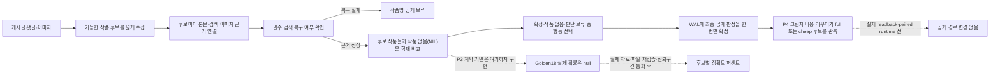

# LLM 파이프라인 개선, 지금 어디까지 됐나

## 먼저 세 문장으로 읽기: P3/P4 v14

1. **구현은 됐다.** 실제 model send·retry·성공·실패를 행별로 기록하는 bounded physical-call ledger와, 위험한 글을 full-expert로 남기는 그림자 라우터가 있다.
2. **실제 개선 퍼센트는 아직 없다.** fresh BEFORE·AFTER와 독립 readback을 실행하지 않았으므로 정확도·calls/post·회피율·처리시간 개선은 모두 `null/NOT_ESTIMABLE`이다.
3. **운영 적용도 아니다.** `REVIEW-LOCKED`, `full_scan_approval=false`이며 cheap routing은 꺼져 있다.

| 낯선 상태값 | 한국어 뜻 |
| --- | --- |
| `FULL_EXPERT_REQUIRED` | 위험 신호가 있어 기존 전체 전문가 처리를 유지한다. |
| `CHEAP_RULE_ELIGIBLE` | 안전 조건은 통과했지만 실제 적용 전인 그림자 후보다. |
| `PENDING_INDEPENDENT_READBACK` | 기록은 끝났지만 다른 reader가 원장을 다시 확인해야 한다. |
| `NOT_ESTIMABLE` | 근거가 없어 숫자를 계산하면 안 된다. |
| `FOUNDATION_ONLY` | 계약 기반만 통과했으며 실제 성능·운영 승인이 아니다. |

`DecisionCostTrace`는 기존 합계 진단이고, physical-call ledger는 실제 호출마다 별도 사건을 남기는 원장이라 서로 같은 기능이 아니다. 현재 원장 v1은 Golden18/59 같은 작은 검증 전용이다.

## 한눈에 보는 결론

- **검색 실패 안전장치는 첫 단계까지 검증했다.** 저장된 Golden18 결과에 새 규칙을 적용했을 때, 필수 검색이 복구되지 않은 5건 중 잘못 공개되던 작품 1건이 0건으로 줄었고 후보 손실은 없었다. 다만 저장본 정적 비교이므로 실제 새 실행 결과는 아니다.
- **여러 작품 후보와 `작품 없음(NIL)`을 함께 다룰 그릇을 만들었다.** Golden18 18건 모두에서 기존 공개 작품명·주소·판정·추적 지문은 그대로였고, 후보/NIL 정보는 별도 그림자 기록에만 붙었다.
- **후보 목록이 6개 또는 24개 제한에서 잘렸는지 기록할 수 있게 됐다.** 정책 필터 뒤 고유 제목 7개는 `TRUNCATED(7개 관측·6개 보존)`, serializer 고유 후보 25개는 `TRUNCATED(25개 관측·24개 보존)`로 잡았다. 각 cap과 같거나 중복을 제거해 cap 이하인 경우는 `UNKNOWN`으로 남겨 완전하다고 과장하지 않았다.
- **후보가 어느 전문가 단계에서 사라졌는지도 추적한다.** Gatekeeper 1곳, Decoder 1곳, Verifier 2곳, Arbiter 3곳의 실제 cap 직전에 진단 영수증을 남긴다. 합성 cap+1 사례 7/7에서 고유 후보 손실을 잡았고, 정확히 cap인 사례와 cap 밖 중복 사례는 잘림으로 오탐하지 않았다. 이 영수증은 진단 전용이며 CandidateSet·확률·공개 판정을 바꾸지 않는다.
- **최종 공개 판정을 한 번만 확정하는 장치를 만들었다.** 같은 입력·설정·코드 범위의 같은 게시글은 첫 정상 판정 한 건만 WAL에 정본으로 저장한다. 같은 재시도는 새로 쓰지 않고 첫 결과를 돌려주며, 내용이 다르면 충돌로 멈춘다. Golden18은 유효 영수증 `0→18`, 재시작 무쓰기 `18/18`, 기존 결과 불변 `18/18`이었다.
- **정확도 퍼센트의 안전 계약 기반을 구현했다.** 외부 예상 행·producer·AFTER·baseline을 다시 읽고, P1 라벨 원장에서 준비도를 재생하며, 여섯 paired CI를 사전 정책에 대조한다. 다만 Golden18 실제 지표는 계속 전부 `null`이고 합성 4행 수치는 계산식 시험일 뿐이다.
- **쉬운 글과 어려운 글의 비용 경로를 그림자로 구분하는 기반을 구현했다.** Golden18은 full-expert `18`, cheap `0`; 실제 calls/post·절감률·처리시간 개선은 모두 `null`이다. 합성 `16→8`·50%는 실제 절감률이 아니다.
- **현재는 운영 전체 승인 상태가 아니다.** 파일 재판독 v2와 신뢰구간 정책 판정 코드는 구현됐지만 실제 보정 자료·actual 출력은 없다. 의미 품질은 `REVIEW-LOCKED`, 전체 스캔 승인은 `full_scan_approval=false`, P2/P3/P4 실제 런타임은 `NOT_RUN`이다.

### 2026-07-11 최신 구현: 최종 공개 판정을 한 번만 확정

이 기능은 작품을 더 잘 맞히는 모델이 아니라, **한 번 결정한 최종 공개 결과가 재시도·중단 복구·동시 기록 때문에 바뀌거나 섞이지 않게 하는 저장 안전장치**다.

- 입력 파일, 게시글 순서, 판정 설정, 실행 코드 지문을 하나의 처리 범위로 묶는다.
- 그 범위의 같은 게시글은 첫 정상 판정과 복구 가능한 결과 행을 WAL(선행기록 로그)에 한 번만 확정한다.
- 실행 번호나 로그 경로만 다른 같은 재시도는 첫 정본을 사용하고, 실제 분석 내용이 다르면 덮어쓰지 않고 중단한다.
- `HOLD`나 `ERROR_HOLD`일 때 내부 trace·ledger에 작품명·주소가 숨어 있어도 공개 필드 누출로 보고 거부한다.
- 저장 중 마지막 줄이 끊기면 이전 정상 기록은 보존하고, 끊긴 바이트의 해시와 크기를 감사 기록으로 남긴 뒤 복구한다.

Golden18 저장본은 개선 전 유효 판정 영수증 `0/18`, 개선 후 `18/18`이었다. 재시작 때는 기존 정본 18건을 반환했고 추가 WAL 기록은 `0`건이었다. 공개 결과와 전체 결과 행은 `18/18` 그대로였으며 합성 공격은 `21/21`, 거짓 통과는 `0`이었다. 다만 실제 새 LLM 실행에서 중단·재시작까지 확인한 것은 아니므로 저장본·합성 `GO`, 실제 runtime `NOT_RUN`, 의미 품질 `REVIEW-LOCKED`를 분리한다. 자세한 설명은 `loop_reports/LOOP_P2_PUBLICATION_EXACT_ONCE_20260711.md`, 최신 재결속 정본은 `../../out/publication_exact_once_harness_20260711/v6/comparison.md`다.

| 확인 층위 | 무엇을 확인했나 | 말할 수 있는 것 | 말할 수 없는 것 | 현재 |
| --- | --- | --- | --- | --- |
| 저장본 | Golden18 기존 결과의 전후 구조 | 영수증 `0→18`, 기존 결과 불변 | 새 LLM 실행과 운영 정확도 | 범위 내 `GO` |
| 합성 공격 | 중복·위조·혼합·동시 기록·끊긴 저장 21건 | 안전장치가 공격을 막는지 | 실제 장애율과 실서비스 성능 | `21/21` |
| 실제 실행 | 새 `expert_main --parallel 16` | WAL·checkpoint·결과·종료 파일의 실제 일치 | 아직 실행하지 않아 결론 불가 | `NOT_RUN` |
| 의미 승인 | 사람·공식 근거·동결 평가셋의 작품 정답 검토 | 전체 스캔 사용 가능 여부 | 저장 성공만으로 승인 | `REVIEW-LOCKED`, `full_scan_approval=false` |

`18/18`은 저장본 18행의 **기록 계약**이 맞았다는 뜻이고 `21/21`은 **합성 공격 21건을 막았다**는 뜻이다. 작품 정답률 100%가 아니다. 앞으로 `p(A)+p(B)+p(NIL)=100%`라고 표시하더라도 선택지에 확률을 나눠 합이 100%라는 뜻이지 시스템이 100% 맞는다는 뜻은 아니다.

### 2026-07-11 최신 P3 구현: 근거 없는 정확도 퍼센트 차단

이 기능은 지금 바로 80%·90%를 공개하는 기능이 아니다. **실제 퍼센트를 만들기 전에 필요한 자료 분리·출처 결합·위조 차단 규칙**을 먼저 구현한 것이다.

- 정답은 후보 작품 ID들 또는 `작품 없음(NIL)` 중 정확히 하나다. 판단 보류(`ABSTAIN`)는 정답 종류가 아니라 안전 행동이다.
- 개발 자료, 확률을 맞추는 보정 자료, 마지막 동결 평가 자료가 게시글·본문·출처·작품 단위로 겹치면 거부한다.
- 저장된 확률만 믿지 않고 기본 후보 기록, 원점수, 보정기 학습 영수증, 정책, 행을 다시 재생해 정확히 같은지 확인한다.
- 필수 검색이 실패했거나 후보 목록이 불완전하거나 표본이 너무 작으면 0%·100%를 만들지 않고 모든 headline 지표를 `null`로 둔다.
- 실제 동결 평가라고 주장하려면 외부 예상 행, producer, AFTER, baseline 파일을 각각 다시 읽어야 한다. 이 v2 reader는 구현됐지만 실제 artifact가 없으므로 `FROZEN_ACTUAL` 수치는 fail-close로 전부 차단된다.
- readiness는 P1 comparison과 P1-bound 라벨 원장에서 다시 만들며, blocker를 지우고 hash만 바꾼 거짓 READY를 거부한다.
- 정확도는 paired CI 하한, Brier·log loss·ECE·선택 위험·AURC는 paired CI 상한을 사전 정책과 대조한다.

Golden18은 후보 생산 상태가 `UNKNOWN`이고 준비 행이 `0/18`이므로 후보 재현율은 `NOT_EVALUABLE`, 실제 정확도 지표는 전부 `null`이다. 인위적 4행에서는 최고 후보 정확도 `0.5→1.0`, Brier `0.606777→0.004498`, 자연로그 손실 `0.813262→0.048587`, ECE `0.231059→0.047426`이었지만 **수식 방향 시험이지 실제 모델 개선률이 아니다.** v14 bound runner는 정책·split·source·P1·라벨·네 JSONL을 재판독해 SHA를 유도한다. 현재 판정은 `GO_P3_CONTRACT_FOUNDATION_ONLY`, `conversion_allowed=false`, 실제 runtime `NOT_RUN`, 의미 품질 `REVIEW-LOCKED`, `full_scan_approval=false`다. 쉬운 상세 보고서는 `loop_reports/LOOP_P3_CALIBRATION_CONTRACT_FOUNDATION_20260711.md`, 최신 정본은 `../../out/candidate_set_calibration_shadow_harness_20260711/v14/comparison.md`다.

### 2026-07-12 최신 P4 구현: 비용 라우팅은 아직 그림자 관측

P4는 작품을 더 잘 맞히는 모델이 아니라 **안전한 글은 나중에 싼 경로로 보낼 수 있는지, 위험한 글은 계속 전체 전문가 경로가 필요한지 관측하는 기능**이다.

- 검색 차단·저하, 후보 누락·잘림, 복수 작품·주제 충돌, 이미지 근거 부족, HOLD·격리·미판결, 범위·출처 결속 불일치가 하나라도 있으면 full-expert를 요구한다.
- Golden18은 `FULL_EXPERT_REQUIRED 18 / CHEAP_RULE_ELIGIBLE 0`이며 기존 작품명·URL·판정과 CandidateSet은 `18/18` 바뀌지 않았다.
- 실제 safe auto coverage, calls/post, call avoidance, after 처리시간은 모두 `null/NOT_ESTIMABLE`이다.
- actual escalation `1.0`은 18행 모두 full을 요구한 그림자 경로 분포이며 비용 절감이나 정확도 수치가 아니다.
- 로그의 expert prompt `191`, VLM `14`, token `2,269,227`은 정식 행별 비용 영수증이 아닌 진단값이다.
- 합성 4행의 before `16`, after `8`, 회피 `50%`는 계산식 시험이다. 상태도 `SYNTHETIC_CONTRACT_ONLY`이며 실제 파이프라인 절감률로 인용하면 안 된다.
- 공격 `20/20`, false cheap `0`이고 source reader는 구현됐지만 actual BEFORE/AFTER 입력이 없으므로 실제 cheap 경로는 항상 닫혀 있다.

physical-call ledger와 fresh 복구 게이트의 bounded 구현은 끝났지만 새 runtime에서 강제 중단·재시작을 실행하지 않았다. 다음에는 bound runner로 P3 실제 파일을 동결·평가하고 독립 reader로 비용 원장·aggregate를 대조한 뒤, 저장본 재사용이 아닌 fresh BEFORE와 fresh AFTER를 각각 같은 RunSpec·동결셋으로 실행한다. active production 종료 뒤 별도 `--parallel 16`, dashboard ON, slang off/read-only로 검증하기 전에는 public routing을 열지 않는다. 자세한 보고서는 `loop_reports/LOOP_P4_SELECTIVE_COMPUTE_SHADOW_20260712.md`, 정본은 `../../out/selective_compute_shadow_harness_20260712/v14/comparison.md`다.

### 이전 P1 구현: 검색·fetch가 계획대로 끝났는지 증명

후보 목록의 뒤쪽이 잘렸는지만 보던 단계에서 한 걸음 더 나아가, **실행하기로 한 검색과 문서 가져오기를 실제로 모두 수행했는지** 확인하는 장부를 붙였다.

- 사전에 고정한 정상 search+fetch 합성 사례 1건만 `COMPLETE`가 됐다.
- 원 실행 receipt/hash가 없는 cache, fetch 영수증 누락, 검색 저하·오류, 조기 종료 4건은 `UNKNOWN`이다.
- 검색 결과 11개를 보고 10개만 보존한 1건은 `TRUNCATED`다.
- 거짓 `COMPLETE`는 0건이다.

여기서 `COMPLETE`는 **미리 정한 제한 범위의 작업을 손실 없이 끝냈다**는 뜻이다. 웹 전체 후보를 모두 찾았다거나 정답률이 100%라는 뜻은 아니다. 캐시는 원 실행 receipt/hash와 결합하기 전까지, 사후에만 발견한 direct 작업과 검색·fetch fallback은 항상 `UNKNOWN`이다. Golden18은 이 장부가 생기기 전 결과라 실제 행은 여전히 `UNKNOWN`, 후보 재현율은 `NOT_EVALUABLE`, 확률은 `null`이다. 자세한 최신 보고서는 `loop_reports/LOOP_P1_PRODUCER_COMPLETION_PROOF_20260711.md`, 정본은 `../../out/candidate_generation_completeness_harness_20260711/v6/comparison.md`다.

이 보고서는 “영어 코드명이 무엇인가”보다 **각 기능이 실제로 무엇을 막고 무엇을 아직 못 하는가**를 설명한다. 자세한 구현·근거는 `LLM_PIPELINE_ARCHITECTURE_RESEARCH_20260711.md`와 각 루프 보고서에서 확인한다.

## 개선 구조는 이렇게 바뀐다

핵심은 작품 하나를 일찍 고르는 대신 후보를 끝까지 보존하고, 근거가 부족하면 공개를 멈추는 것이다. P1 그림자 기록은 기존 결과를 바꾸지 않으므로 새 구조를 안전하게 시험할 수 있다.

이 보고서의 P0/P1/P2는 이번 **구현 순서**를 뜻한다. 상세 아키텍처 문서의 `P0-1/P1-1`은 문제의 우선순위 번호라서 같은 분류가 아니다. 독자용 본문에서는 각각 ‘검색 실패 차단’, ‘후보/NIL 그림자’, ‘최종 판정 한 번만 기록’ 단계로 읽으면 된다.

## 각 개선 기능은 무엇을 하는가

### 전문가와 저장 구성요소의 역할

| 구성요소 | 무엇을 받나 | 무엇을 하나 |
| --- | --- | --- |
| 1차 수집자 (`Gatekeeper`) | 게시글·댓글 표현 | 작품 제목처럼 보이는 표현을 넓게 모은다. 최종 작품을 확정하지 않는다. |
| 표현 해석자 (`Decoder`) | 약칭·제목 표현·문맥 | 표현이 가리킬 수 있는 작품 후보를 만든다. |
| 근거 검증자 (`Verifier`) | 후보·본문·검색·댓글 신호 | 후보마다 찬성·반대 근거를 다시 평가한다. |
| 충돌 조정자 (`Arbiter`) | 여러 전문가의 후보와 판단 | 충돌 후보를 합치고 낮은 신뢰 후보를 거른 뒤 최종 판단 재료를 만든다. |
| 후보 묶음 (`CandidateSet`) | 여러 경로의 작품 후보 | 최종 선택 전까지 후보를 함께 보존하고, 목록 완전성 상태를 따로 기록한다. |
| 제목 후보 생성 (`_build_title_candidates`) | 후보 제목 표현 | 정규화·필터·순위화 뒤 기존처럼 최대 6개를 반환하고, 그 뒤 후보가 잘렸는지 장부에 남긴다. |
| 후반 결과 저장기 (`serializer`) | 제목·주소·역할 조합 후보 | 결과에 최대 24개를 보존하고 25개 이상이면 해당 단계 잘림을 기록한다. |
| 최종 공개 기록자 | 검증된 최종 판정 | 작품명·주소 누출을 다시 검사하고 게시글별 WAL 정본을 한 번 기록한다. |
| 물리 호출 원장 | 실제 모델 호출의 행·단계·retry·terminal | 비용 합계가 어떤 실제 호출에서 나왔는지 원문 없이 해시와 개수로 증명한다. |
| P4 그림자 라우터 | 검색·후보·보정·공개 안전 상태 | 전체 전문가 유지 또는 cheap 후보를 관측만 하고 실제 공개 경로는 바꾸지 않는다. |

`UNKNOWN`은 완전성 증거가 부족하다는 뜻이지 실패 확정이 아니다. `TRUNCATED`는 해당 단계 제한 밖으로 후보가 밀렸다는 뜻이지 최종 정답 후보 손실 확정이 아니다. `NIL`은 후보 중 정답 없음, `ABSTAIN`은 근거 부족으로 답을 보류하는 행동, `shadow`는 기존 공개 결과를 바꾸지 않는 관찰 기록이다.

| 기능 | 쉽게 말하면 | 막으려는 오류 | 현재 상태 |
| --- | --- | --- | --- |
| 검색 실패 차단 (`retrieval fail-close`) | 꼭 필요한 웹 근거를 못 찾았으면 작품명을 공개하지 않는다. | 검색 장애를 “근거 없음”으로 오해해 틀린 작품을 공개 | 게이트·저장본 정적 비교 완료, 실제 새 실행 배선 미완료 |
| 여러 후보 보존 (`CandidateSet`) | 작품 A와 B가 모두 가능하면 둘 다 남긴다. | 처음 고른 오답이 끝까지 굳는 현상 | typed shadow 및 Golden18 저장본 그림자 검증 완료 |
| 작품 없음 (`NIL`) | 후보 중 정답이 없거나 작품 이야기가 아닌 경우를 하나의 정답 사건으로 둔다. | 빈 결과와 시스템 실패를 같은 것으로 처리 | 모든 P1 행에 정확히 한 번 포함 |
| 판단 보류 (`ABSTAIN`) | 검색 실패나 후보 무결성 문제로 지금 답하지 않는 행동이다. | 정보 부족인데 억지로 작품 또는 NIL을 선택 | 확률 정답 종류와 분리 완료 |
| 비사건 약칭 표면 (`UNLINKED_SURFACE`) | `아생갤` 같은 약칭은 보존하되, 독립 작품 후보로 중복 확률 계산하지 않는다. | 약칭과 정식 작품명을 서로 다른 작품으로 세는 오류 | 실제 특수 행 회귀 보강 완료 |
| 후보 생성 완전성 | 후보 목록이 전부인지, 잘렸는지, 모르는지 단계별로 기록한다. | 일부 후보만 보고 재현율 100%라고 주장 | ranked-title cap 6과 serializer cap 24 초과를 각각 `TRUNCATED`; 상류 전체는 계속 `UNKNOWN`, 재현율 평가 금지 |
| 전문가 단계 잘림 영수증 (`candidate_stage_receipt_v1`) | Gatekeeper·Decoder·Verifier·Arbiter가 후보를 자르기 직전 몇 개를 봤고 몇 개를 남겼는지 개수와 해시로 기록한다. | 어느 내부 단계에서 후보가 사라졌는지 모르는 문제 | 실제 cap 7곳 배선, 합성 cap+1 `7/7` 검출; CandidateSet 상태에는 합성하지 않는 진단 전용 |
| 최종 판정 한 번만 기록 (`publication exact-once`) | 같은 처리 범위·게시글은 첫 정상 공개 판정과 결과 행만 WAL 정본으로 둔다. | 재시도 덮어쓰기, 다른 범위 혼합, 중단 복구 중 결과 불일치 | Golden18 commit `0→18`, replay no-op `18`, 공격 `21/21`; actual runtime 미검증 |
| 정확도 퍼센트 보정 (`calibration`) | 80%라고 한 사례가 실제로도 약 80% 맞는지 고정 정답셋으로 확인한다. | 그럴듯하지만 틀린 자신감 숫자 | 분할·학습 영수증·원본 재생·무수치 fail-close 구현, Golden18 값은 `null` |
| 물리 호출 원장 | 실제 model send와 retry마다 intent·terminal을 남긴다. | 실패 fallback을 성공 호출로 세거나 재시도를 빠뜨리는 오류 | bounded v1 구현, 실제 runtime·독립 readback 미실행 |
| 난이도별 처리 | 쉬운 글은 싼 경로 후보, 충돌·검색 실패 글은 전체 전문가 유지로 관측한다. | 10만 건 모두에 비싼 모델을 호출하는 비용 | P4 shadow 구현, 실제 route 적용은 금지 |

### 두 잘림 장부는 각각 무엇을 보는가

| 장부 | 세는 시점 | 잡을 수 있는 문제 | 잡을 수 없는 문제 |
| --- | --- | --- | --- |
| 제목 순위 장부 (`title_candidate_generation_v1`) | `_build_title_candidates` 내부 정책 필터가 끝난 뒤, 상위 6개만 반환하기 직전 | 고유 제목이 7개 이상인데 cap 6 때문에 뒤 후보가 사라지는 경우 | 그보다 앞선 Decoder·Gatekeeper·검색 단계에서 이미 잘린 후보, 후속 필터·rescue 뒤 최종 후보 목록 |
| serializer 보존 장부 (`candidate_generation_v1`) | 후반 후보 추가·보정 뒤, 최대 24개를 결과에 보존하기 직전 | 로컬 보존 후보가 25개 이상인데 cap 24 때문에 잘리는 경우 | 상류 생성기가 애초에 만들지 못했거나 앞 단계에서 버린 후보 |
| 합성 상태 | 두 장부를 각각 검증한 뒤 | 어느 한 장부라도 `TRUNCATED`면 전체 상태를 `TRUNCATED`로 보수적으로 표시 | 두 장부가 모두 `UNKNOWN`일 때 전체가 완전하다고 선언하는 것 |

두 장부의 개수 기준은 서로 다르다. 제목 순위 장부는 **정규화 제목 하나**를 한 사건으로 세고, serializer 장부는 **제목·주소·역할 조합**을 센다. 따라서 `7 + 25`처럼 합산하지 않는다. 이 기능은 후보 정답 여부나 모델 정확도를 재는 기능이 아니라, “현재 단계에서 cap 때문에 목록이 잘렸는가”를 남기는 추적 기능이다.

### 단계별 진단 영수증은 무엇을 보는가

| 내부 단계 | 쉬운 설명 | cap |
| --- | --- | ---: |
| `gatekeeper.comment_title_candidates` | 댓글에서 제목처럼 보이는 표현을 메인 후보 생성기로 넘기기 직전 | 8 |
| `decoder.new_suspected_titles` | Decoder가 새로 해석한 작품 후보를 공유 목록에 더하기 직전 | 5 |
| `verifier.ranked_update` | Verifier가 증거로 후보 점수를 다시 매긴 직후 | 5 |
| `verifier.comment_boost` | 댓글의 제목 확인 신호를 반영해 재정렬한 직후 | 5 |
| `arbiter.critic_filter` | Arbiter가 낮은 신뢰도 후보를 거른 직후 | 5 |
| `arbiter.candidate_merge` | 기존 후보와 Arbiter 후보를 합친 직후 | 5 |
| `arbiter.llm_candidate_merge` | 근거 검사를 통과한 Arbiter LLM 후보를 합친 직후 | 5 |

영수증에는 후보 이름 원문을 새로 넣지 않고 정규화 key의 순서·집합 해시와 개수만 넣는다. `TRUNCATED`는 해당 내부 단계에서 고유 후보 하나 이상이 cap 밖으로 밀렸다는 뜻이다. 다른 검색·댓글·공식 URL 경로가 같은 후보를 뒤에서 복구할 수도 있으므로 **최종 CandidateSet이 반드시 잘렸다는 뜻은 아니다**. 따라서 이 7개 상태는 CandidateSet의 `generation_status`나 정확도 퍼센트에 합성하지 않는다.

## 정확도 퍼센트는 이렇게 정의한다

한 게시글의 정답은 아래 중 정확히 하나다.

`Y = 후보 작품 A 또는 후보 작품 B 또는 ... 또는 NIL`

따라서 보정이 끝난 뒤에는 `p(후보 A) + p(후보 B) + ... + p(NIL) = 100%`가 되어야 한다. 이 100%는 서로 겹치지 않는 정답 선택지에 확률을 모두 나눴다는 뜻이지, 후보 목록이 완전하거나 모델 정답률이 100%라는 뜻이 아니다. `ABSTAIN`은 이 합에 넣지 않는다. 이는 “정답이 보류”라는 뜻이 아니라, 현재 근거로 정답을 고르면 위험하므로 시스템이 답변을 멈춘다는 뜻이다.

### 지금 바로 퍼센트를 표시하지 않는 이유

1. 현재 Golden18 저장본은 새 생산 단계 작업 영수증이 없어 후보 생성 상태가 `UNKNOWN`이다. 새 코드는 실행 전에 고정한 검색·문서 가져오기 계획을 실제로 모두 수행했는지 증명할 수 있지만, 기존 저장본이나 웹 전체 후보 열거까지 소급해 증명하지는 않는다.
2. Golden18에서 기대 작품이 후보 안에 보인 9건을 확인했지만, 이것은 고정 최종 평가셋의 후보 재현율이 아니다.
3. 18건 중 3건은 복합 작품·미상 가설·이미지 단서라 단일 후보 또는 NIL 정답으로 만들지 않았다.
4. 개발·보정·최종 시험 자료가 분리되지 않은 상태에서 같은 자료로 숫자를 맞추면 과적합된 퍼센트가 된다.

그래서 현재 확률 상태는 `NOT_AVAILABLE_UNCALIBRATED`이며 모든 후보 확률과 `p(NIL)`은 `null`이다. 숫자를 숨긴 것이 아니라 **근거 없는 숫자를 만들지 않는 안전 기능**이다.

### 나중에 숫자를 표시할 수 있는 조건

| 순서 | 먼저 통과할 조건 | 확인할 값 |
| ---: | --- | --- |
| 1 | 정답 작품이 후보 목록에 충분히 들어온다. | 위험 유형별 후보 목록 재현율과 신뢰구간 |
| 2 | 개발·보정·최종 동결 시험셋을 겹치지 않게 나눈다. | 게시글 ID·출처·시간 중복 0 |
| 3 | 예측 퍼센트와 실제 적중률을 맞춘다. | ECE, Brier 또는 log loss |
| 4 | 자동 처리 범위를 늘려도 오답 위험이 기준 아래다. | risk-coverage와 오류 위험 신뢰상한 |
| 5 | 검색 실패 차단과 기존 안전 게이트가 나빠지지 않는다. | hard regression 0, 후보 손실 0 |

먼저 정답 작품이 후보 목록에 들어오는지 확인한다. 그다음 ECE·Brier·log loss로 “말한 퍼센트와 실제 적중률이 얼마나 맞는지” 검사한다. 마지막으로 자동 처리 비율을 늘릴 때 오답 위험이 얼마나 커지는지 risk-coverage로 확인한다. ECE는 퍼센트와 실제 적중률의 간격, Brier와 log loss는 틀린 확률 예측에 주는 벌점이며 낮을수록 좋다.

### 비슷해 보이지만 서로 다른 핵심 수치

| 수치 | 쉬운 정의 | 무엇을 알 수 있나 |
| --- | --- | --- |
| 후보 목록 재현율 | 생산 단계 완료 증명이 있고 사람의 작품 정답 라벨이 있는 행 중 정답 작품이 CandidateSet에 포함된 비율 | 검색·후보 생성이 정답 작품을 놓쳤는지 |
| 최고 후보 정확도 | 생산 단계 완료 증명이 있고 정답 후보가 목록에 들어온 행 중 최고 점수 후보가 정답인 비율 | 주어진 후보 안에서 선택을 잘하는지 |
| 작품 없음 정밀도·재현율 | NIL을 선택한 행 중 실제 NIL인 비율과, 실제 NIL 행 중 NIL을 선택한 비율 | 작품 없음 판정의 과잉 선택과 누락을 각각 얼마나 만드는지 |
| 자동 처리 범위 | 보류하지 않고 실제 후보 또는 NIL을 선택한 행 비율 | 시스템이 얼마나 많은 글을 자동 처리하는지 |
| 선택 위험 | 자동 선택한 행 중 오답 비율 | 자동 처리 결과가 얼마나 위험한지 |

후보 목록 재현율이 낮으면 최고 후보 점수가 높아도 정답 후보가 없어 틀릴 수 있다. 자동 처리 범위를 줄여 보류를 늘리면 선택 위험은 낮아질 수 있으므로 두 값은 함께 공개해야 한다. 생산 단계 영수증이 없거나 단일 정답 라벨이 없는 Golden18 행은 이 비율의 분모에 억지로 넣지 않고 `NOT_EVALUABLE`로 둔다.

### 데이터를 세 부분으로 나누는 이유

| 자료 | 용도 | 금지 사항 |
| --- | --- | --- |
| 개발 자료 (`DEV`) | 프롬프트·후보 규칙·기능 수정 | 최종 성능 근거로 재사용 금지 |
| 확률 보정 자료 (`CALIBRATION`) | 온도 보정(temperature scaling) 등 확률 보정값 학습 | 개발 규칙 튜닝과 혼용 금지 |
| 최종 동결 평가 자료 (`FROZEN-HOLDOUT`) | 모든 기준을 고정한 뒤 1회 최종 평가 | 결과를 본 뒤 기준 변경·반복 재사용 금지 |

게시글 ID뿐 아니라 같은 작품·약칭·복제 원문 계열도 서로 다른 묶음에 섞이지 않게 분리한다. 실제 필요한 표본 수는 목표 오차폭, 허용 오류 위험, 위험군 비율을 먼저 정한 뒤 사전 계산해 RunSpec에 고정한다. 근거 없이 300건·500건 같은 수를 승인 기준으로 쓰지 않는다. 계산된 최소치보다 부족한 전체 표본이나 위험 계층은 숫자를 억지로 내지 않고 `NOT_ESTIMABLE`로 둔다.

첫 보정 방법은 과적합 위험이 낮은 온도 보정(temperature scaling)을 우선한다. 이항 비율은 작은 표본에도 맞는 Clopper–Pearson 구간을 쓰고, 정확도·Brier·자연로그 손실·ECE·선택 위험·AURC는 게시글 그룹 bootstrap의 동일 행 baseline 차이 구간을 쓴다. 여섯 구간을 사전 정책에 대조하는 코드는 구현됐지만 actual 출력은 없다. Golden18은 생산 완료 영수증과 분리된 평가 자료가 없어 보정 학습이나 성능 승인에 사용할 수 없다.

## Golden18은 무엇을 확인했나

P1 라벨 원장은 18건을 억지로 모두 “작품 또는 작품 아님”으로 만들지 않았다.

| 라벨 종류 | 건수 | 뜻 | 이번 확인 |
| --- | ---: | --- | --- |
| 작품 후보 정답 (`CANDIDATE`) | 9 | 기대 작품명이 정확히 하나 있는 행 | 9건 모두 현재 사건 후보 안에서 관측됨 |
| 작품 아님 (`NIL`) | 6 | 특정 작품 논의가 아닌 음성 행 | 6건 모두 공통 NIL 선택지 존재 |
| 단일 정답 미지정 (`UNJUDGED`) | 3 | 복합 작품, 미상 가설, 이미지 단서 HOLD | 퍼센트 평가에서 제외하고 보류 정책 유지 |

여기서 “후보 정답 9/9 관측”은 **현재 저장본에 기대 제목이 보였다는 구조 검사**다. 후보 생성 완전성이 `UNKNOWN`이므로 후보 목록 재현율 100%나 모델 정확도 100%로 읽으면 안 된다.

NIL도 마찬가지다. NIL 선택지는 정답 라벨 6행뿐 아니라 전체 18행에 정확히 한 번씩 공통으로 붙었다. 따라서 `6/6`은 NIL을 실제로 골라내는 능력이나 NIL 정확도가 아니라, NIL 정답 원장 행에 필요한 선택지가 빠지지 않았다는 구조 검사다.

특수 사례 `11698880`은 다음처럼 보존된다.

- 작품 후보: `아카데미 생존 갤러리`
- 작품 후보: `가챠 중독자의 퓨전펑크 생활`
- 비사건 약칭 표면: `아생갤`
- 후보 중 정답 없음 사건: `NIL`

즉, `아생갤`을 현실 DC 갤러리명으로 단정하지도 않고, 정식 작품명과 별개의 세 번째 작품으로 중복 계산하지도 않는다.

## 개선 전·후에서 실제로 달라진 것

| 구분 | 개선 전 | 현재 개선안 | 검증 범위 |
| --- | --- | --- | --- |
| 검색 미복구 행 | 내부 형식이 맞으면 작품 공개 여지 | 필수 검색 미복구면 공개 차단 | Golden18 저장본 대상 5건, 잘못 공개 `1→0` |
| 여러 작품 충돌 | 선택된 작품 하나 중심 | 여러 작품 후보와 NIL을 함께 기록 | Golden18 18건 saved-artifact shadow |
| 약칭 | 독립 후보로 중복될 위험 | 정식 제목의 alias provenance + 비사건 표면 | `아생갤` 실제 행과 단위 회귀 |
| 제목 순위 cap 6 | 상위 6개만 반환하고 7번째 이후 존재를 기록하지 않음 | 정책 필터 뒤 전체 ranked title을 센 뒤 기존과 같은 앞 6개 보존 | 합성 고유 제목 7개 `TRUNCATED 7→6` |
| serializer cap 24 | 24번째에서 조기 반환해 뒤 후보 존재를 기록하지 않음 | 로컬 고유 후보를 끝까지 센 뒤 기존과 같은 앞 24개 보존 | 합성 고유 후보 25개 `TRUNCATED 25→24` |
| 전문가 내부 cap 7곳 | 후보를 5개 또는 8개로 줄인 뒤 이전 목록을 잃음 | cap 직전 개수·고유 개수·유지 개수·순서 해시를 진단 ledger에 기록 | 합성 cap+1 `7/7 TRUNCATED`, 정확히 cap·중복은 `UNKNOWN` |
| 최종 공개 판정 저장 | 재시도·복구·동시 기록에서 어느 행이 정본인지 증명하기 어려움 | scope/post_id 첫 정상 판정만 WAL에 확정, 같은 재시도는 무쓰기 재생 | Golden18 commit `0→18`, replay `18`, 공격 `21/21`, false GO `0` |
| 공개 결과 | 새 구조가 건드릴 위험 | P1은 ledger 안의 shadow만 추가 | 공개 계약 불변 `18/18` |
| 정확도 수치 | `High/Medium` 또는 출처 없는 숫자가 실제 적중률처럼 보일 수 있음 | 분할·학습 영수증·원점수·정책·행 재생이 맞지 않으면 `null`; 실제 파일 재검증 전에는 운영 전환 금지 | Golden18 `NOT_AVAILABLE_UNCALIBRATED`, 합성 계약 기반만 `GO` |
| 호출 비용 근거 | worker 합계 로그만 있어 실제 send와 retry를 구분하기 어려움 | 행별 physical-call ledger와 REQUIRED 완료 게이트 | 구현 완료, 새 runtime이 없어 actual KPI는 `null` |
| 비용 경로 | 모든 행에 같은 고비용 경로를 적용 | `FULL_EXPERT_REQUIRED`와 `CHEAP_RULE_ELIGIBLE`을 그림자로 구분 | Golden18 `18/0`, 실제 경로 전환 없음 |

구체적으로, 필수 검색이 끊긴 행은 개선 전에는 형식만 맞으면 작품명이 공개될 수 있었지만 검색 실패 차단 뒤에는 `HOLD/ABSTAIN`으로 멈춘다. Golden18 저장본 대상 5건에서 잘못된 공개가 `1→0`이 됐지만, 이것은 저장본 정적 비교이며 실제 새 runtime 결과가 아니다. P2에서는 같은 판정 재시도는 기존 정본을 반환하고 다른 작품 판정은 덮어쓰지 않고 충돌로 막는다.

## 다음 실행 순서

1. 완료: P1 saved-artifact v8에서 RunSpec·코드 지문·Golden18 라벨 원장·게시글 순서를 봉인하고 행별 무영향 정본을 생성했다.
2. 완료: ranked-title cap 6과 serializer cap 24의 `UNKNOWN/TRUNCATED` 상태·수·지문을 장부 전용으로 기록하고, bounded search/fetch 계획의 완료 증명을 v6 합성 하네스로 검증했다.
3. 완료: Gatekeeper·Decoder·Verifier·Arbiter의 실제 cap 7곳에 진단 영수증을 배선하고 합성 cap+1 `7/7`, 경계 오탐 `0`, 유지 출력 불변 `9/9`를 확인했다.
4. 완료: P2 저장본·합성 하네스에서 최종 공개 판정 commit `0→18`, 재시작 무쓰기 `18`, 공격 `21/21`, 기존 결과 불변 `18/18`을 확인했다.
5. 완료: P3 v14에서 readiness v2 정책 파일 결속, 정책/split/source bound readback, 여섯 paired CI 정책 게이트와 Golden18 실제 지표 전부 `null`을 확인했다.
6. 진행 중인 104,502건 production 실행이 끝난 뒤, 별도 출력 경로와 대시보드에서 P0 검색 상태와 P2 WAL을 실제 파이프라인으로 검증한다.
7. 같은 입력의 개선 전·후 runtime을 `--parallel 16`, dashboard ON, slang DB off 또는 읽기 전용으로 비교하고 강제 중단·재시작 canary를 수행한다.
8. 검색 query budget·MCP 결과·fetch URL 등 아직 계측하지 않은 상류 producer와 `enumeration_finished` 증거를 추가한 뒤에만 `COMPLETE` 표본과 후보 목록 재현율을 평가한다.
9. 겹치지 않는 실제 보정·동결 평가셋, 파일 바이트 재검증, 전체 그룹 신뢰구간을 갖춘 뒤에만 후보/NIL 퍼센트와 선택 오류 위험을 실제 수치로 계산한다.
10. 완료: P4 그림자 라우터에서 Golden18 full `18`·cheap `0`, public/CandidateSet 불변 `18/18`, 합성 `16→8`, 공격 `20/20`을 확인했다. actual 비용 KPI는 null이다.
11. 완료: bounded physical-call ledger·retry 계보·REQUIRED manifest·P3/P4 교차 부모/라벨 계보 게이트를 구현하고 P2 v7→P3 v14→P4 v14로 재결속했다. 새 runtime은 아직 없다.
12. 독립 ledger readback과 P3 actual readback을 완료한 뒤 동일 RunSpec의 fresh paired runtime으로 실제 calls/post·회피율·p50/p95를 측정한다.

## 현재 경계와 남은 질문

- P0 저장본 정적 개선은 실제 runtime 개선 증거가 아니다.
- P1은 기존 결과에 영향을 주지 않는 shadow이며 실제 후보 선택기는 아직 없다.
- `generation_status=UNKNOWN`인 동안 후보 재현율은 `NOT_EVALUABLE`이다.
- `TRUNCATED` 탐지는 목록이 잘렸다는 사실만 알려 주며, 정답 후보가 들어왔는지나 모델이 맞았는지는 알려 주지 않는다.
- 전문가 단계 영수증의 `TRUNCATED`는 그 단계의 고유 후보 손실만 뜻한다. 다른 경로의 회복 가능성이 있어 CandidateSet 상태에는 합성하지 않는다.
- P2의 WAL coverage 100%는 저장 무결성이지 작품 판정 정확도 100%가 아니다. 실제 runtime·의미 품질·전체 승인은 각각 별도 게이트다.
- 제목 순위 장부는 후속 후보 필터·rescue 이전 시점이고 serializer 장부는 더 늦은 시점이다. 두 retained 목록이 같아야 한다고 해석하지 않는다.
- 확률 보정 자료와 동결 holdout이 없으므로 정확도 퍼센트는 계속 `null`이어야 한다.
- P4 합성 50%는 실제 절감률이 아니며, actual readback과 paired runtime 전에는 cheap routing을 실제로 적용하지 않는다.
- `REVIEW-LOCKED`, `full_scan_approval=false`, `NOT_RUN`은 서로 다른 게이트이며 하나가 좋아져도 다른 승인을 뜻하지 않는다.
- 전체 `test_agentic_pipeline_rework`의 선행 `8F+1E`는 이번 변경 전 로그에도 동일하게 존재했다. 이번 cap 6/24 변경의 회귀는 아니지만, 별도 baseline debt로 판정·수정하기 전까지 전체 테스트가 모두 초록이라고 말하지 않는다.

## 관련 산출물

- 상세 아키텍처 연구: `docs/devs/LLM_PIPELINE_ARCHITECTURE_RESEARCH_20260711.md`
- 개선 목표 프롬프트: `docs/devs/GOAL_PIPELINE_IMPROVEMENT_TESTDRIVEN_20260711.md`
- P0 저장본 비교: `out/pipeline_improvement_harness_20260711/retrieval_failclose_v5/before_after_comparison.md`
- P1 라벨 원장: `docs/devs/p1_candidate_set_nil_golden18_label_ledger_20260711.json`
- P1 saved-artifact 하네스: `tools/run_candidate_set_nil_shadow_harness.py`
- P1 정본 비교: `out/candidate_set_nil_shadow_harness_20260711/v8/comparison.md`
- 후보 잘림 탐지 하네스: `tools/run_candidate_generation_completeness_harness.py`
- 후보 생성 완료 증명 정본: `out/candidate_generation_completeness_harness_20260711/v6/comparison.md`
- P2 exact-once 재결속 정본: `out/publication_exact_once_harness_20260711/v7/comparison.md`
- P3 정확도 퍼센트 계약 재결속 정본: `out/candidate_set_calibration_shadow_harness_20260711/v14/comparison.md`
- P4 선택적 비용 라우팅·물리 호출 원장 정본: `out/selective_compute_shadow_harness_20260712/v14/comparison.md`
- 기능 중심 최신 보고서: `docs/devs/loop_reports/LOOP_P4_SELECTIVE_COMPUTE_SHADOW_20260712.md`
- P2 기능 보고서: `docs/devs/loop_reports/LOOP_P2_PUBLICATION_EXACT_ONCE_20260711.md`
- 이전 P1 기능 보고서: `docs/devs/loop_reports/LOOP_P1_PRODUCER_COMPLETION_PROOF_20260711.md`
