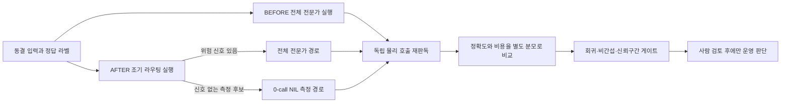

# LLM 파이프라인 개선 현황 — 한국어 독자판

작성일: 2026-07-12 KST

## 먼저 결론

1. 이전 작업의 Goal API는 `blocked` 재활성화를 지원하지 않아, 새 프로젝트 작업 `019f5532-580e-7d40-a3c3-ee8a208dadf8`에서 새 Goal을 `active`로 생성했다. 전체 논리 상태는 `ACTIVE / NOT_COMPLETE`다.
2. 정확도 퍼센트와 비용 감소 퍼센트를 검증할 코드 기반은 구현됐지만, 실제 동결 라벨 자료와 fresh BEFORE/AFTER 실행이 없어 실제 개선 수치는 아직 `null / NOT_ESTIMABLE`이다.
3. 현재 운영 판정은 계속 `REVIEW-LOCKED`, `full_scan_approval=false`다. 계약 테스트 통과나 처리 queue 0만으로 운영 승인을 내리지 않는다.
4. 최초 목표 대비 상세 중간점검은 `LLM_PIPELINE_ORIGINAL_GOAL_MIDPOINT_AUDIT_KO_20260712.md`에 있으며, 판정은 `아키텍처 기반 구현은 중후반 / 실제 효과 검증은 시작 전`이다.

## 지금 어디까지 됐나

| 판단 층 | 현재 상태 | 쉬운 설명 |
| --- | --- | --- |
| 코드 구현 | `IMPLEMENTED_FOUNDATION` | 정책·동결 split·source/replay bound readback, 무쓰기 actual preflight, 준비도 v2 원본 재생, 신뢰구간 정책 판정, 물리 호출 원장, exact 복구 witness, 개선 후 전용 조기 라우터가 코드에 들어갔다. |
| 이번 변경 집중 시험 | `162/162 PASS` | recovery/paired `71`, P2/P3 `58`, P4 `33`을 통과했다. 실제 정확도·비용 개선률 시험과는 별개다. |
| 실제 자료·실행 | `NOT_RUN / NOT_ESTIMABLE` | 실제 DEV/CAL/FROZEN 라벨 자료와 동일 RunSpec의 fresh BEFORE/AFTER 산출물이 없다. |
| Goal | `ACTIVE / NOT_COMPLETE` | 정적 코드·하네스·시험·문서 개선은 계속한다. 정책 숫자 확정, 새 source-backed 판결, active production 종료는 actual 측정 게이트의 대기 조건이다. |
| 운영 승인 | `REVIEW-LOCKED` | 실제 cheap 경로와 전체 스캔 승인은 열지 않는다. `full_scan_approval=false`다. |

현재 production run `20260711_113712_379597`은 읽기 전용으로만 확인했다. `2026-07-12 14:20:20 KST` 이동 스냅샷은 input/completed/flushed/pending/failed `104502/2665/2650/15/0`, next save `2651`, requested/effective parallel `16/16`, dashboard `http://127.0.0.1:8080` `/api/health` HTTP 200, `partial_flush_gap=true`, `ordered_flush_blocked=true`, `large_run_complete=false`다. manifest는 `14:20:07 KST` 갱신본이며 이 실행은 중지·재시작·수정하지 않았고 개선 전후 수치나 승인 근거로 사용하지 않는다. `out/actual_calibration`, `out/paired_measurement`는 아직 없다.

## 전체 흐름

현재 `E`는 기존 authoritative WAL 결과를 복사해 공개 결과를 보존하는 **반사실 비용 측정**이다. 새 입력을 실제로 추론한 운영 절감이 아니므로 `REFERENCE_COPY_COST_ONLY`로 읽어야 한다.

## 새 기능이 각각 하는 일

| 기능 | 하는 일 | 하지 않는 일 | 현재 상태 |
| --- | --- | --- | --- |
| P3 actual bound runner | 수동 SHA를 받지 않고 정책·P1·라벨 원장·동결 split·source manifest·예상 행·producer·AFTER·baseline 파일을 다시 읽어 결속값을 유도한다. | 같은 post ID의 다른 정답·분할, producer 자기신고 source digest, raw SHA 우회를 허용하지 않는다. | 코드 구현, 실제 DEV/CAL/FROZEN 자료·실행 없음 |
| actual 무쓰기 사전점검 | 필수 입력 10종과 replay 6종의 존재·확장자·readiness를 회계하고, 전체 bound runner를 메모리에서 통과할 수 있는지 확인한다. | 파일을 만들거나 모델을 실행하지 않으며, preflight GO를 정확도·운영 승인으로 쓰지 않는다. | `READ_ONLY_NO_WRITE_NO_RUNTIME`, 현재 actual packet 없음 |
| actual KPI 사전등록 | 후보 재현율·top accuracy·확률 손실·선택 위험·NIL 품질·coverage의 숫자를 결과를 보기 전에 고정한다. | synthetic/test fixture의 느슨한 값을 actual 목표로 복사하지 않는다. | A 안전 우선 권고/B 제한적 비열화 제안, 소유자 결정 대기 |
| 동결 source payload 결속 | 각 평가 행의 원문 JSON/JSONL을 최상위 `ArtifactRef`로 올려 최종 단계까지 재판독하고, 내부 `schema_version/source_run_id/example_id/post_id`가 manifest 행과 같은지 확인한다. | 해시 문자열만 맞춘 다른 원문, 행 간 원문 바꿔치기, 평가 도중 파일 변경을 허용하지 않는다. | v15 구현·회귀 시험 통과, actual 원문 없음 |
| replay 6종 구조 검증 | AFTER/BEFORE의 base shadow·score vector·calibration artifact를 실제 parser로 재생하고 frozen ID coverage·post identity·split/policy 결속을 확인한다. | 이름만 맞춘 `{}` JSON을 readback 가능 증거로 받지 않는다. | v16 구현·회귀 시험 통과, actual replay 없음 |
| 실제 자료 준비도 원본 재생 v2 | P1 RunSpec에서 비교표를 다시 만들고 P1 결속 라벨 원장과 정책 파일 path·raw SHA·bytes를 재생한다. | blocker를 지우고 재해시한 거짓 READY, 다른 라벨·정책 파일 끼워 넣기를 허용하지 않는다. | `0/18 READY`, `NO_GO_ACTUAL_DATASET_NOT_READY` |
| 여섯 지표 paired CI 게이트 | 같은 행의 AFTER−BEFORE 신뢰구간을 정확도·Brier·log loss·ECE·선택 위험·AURC별 사전 한계와 비교한다. | 신뢰구간이 계산됐다는 사실만으로 GO를 만들지 않는다. 정확도는 하한, 손실·위험은 상한을 본다. | 정책·판정 코드 구현, actual 구간 없음 |
| 물리 호출 원장 | 각 모델 send의 `DISPATCH_INTENT`, 성공·실패 terminal, retry 부모, token 출처, 행 봉인, 공개 decision 링크를 기록한다. | 기존 합계 로그를 실제 호출 횟수로 세탁하지 않는다. | writer와 독립 reader 구현, actual paired ledger 없음 |
| 독립 호출 재판독 | 원장 frame을 writer와 별도로 읽어 expert/text/VLM 호출, retry, token, 모델 호출 누적 wall time을 재계산한다. | 누적 model-call wall time을 배치 전체 지연시간으로 부르지 않는다. | 구현됨 |
| fresh 복구 게이트 | publication WAL의 논리 판정과 fresh 측정 원장을 분리하고, 모든 행이 같은 authoritative decision에 연결됐는지 확인한다. | 부분·중단 원장을 완료로 만들지 않는다. 실패하면 전체 arm 재실행을 요구한다. | 게이트 구현, 실제 중단·재시작 실행 없음 |
| recovered-arm witness | 중단 복구 arm의 RunSpec·source manifest/result/checkpoint/pending·summary·recovered output·attempt claim·WAL·단일 attempt 원장·AFTER route를 독립 재생한다. | witness가 없거나 self-rehash한 partial/multi-attempt/바뀐 source를 fresh pair로 받지 않는다. | `GO_EXACT_BOUND_WITNESS_REPLAY` 계약·공격 시험 통과, 실제 중단 runtime 없음 |
| AFTER 조기 라우터 | `SOURCE_ONLY_V1`에서 제목·본문·댓글·이미지·URL·숨은 증거·잘림·미지 신호가 있으면 전체 전문가로 보낸다. 신호가 전혀 없는 행만 결정적 NIL 측정 후보로 둔다. | BEFORE나 일반 production에서 호출을 건너뛰지 않는다. 공개 제목·URL을 새로 결정하지 않는다. | `FROZEN_OFF` 측정 전용 구현 |
| paired RunSpec 동결 | 입력 bytes·게시글 순서·parallel 16·dashboard·검색 shard·VLM/OCR·설정 SHA를 실행 전에 고정한다. | 서로 다른 입력이나 실행 조건을 BEFORE/AFTER라고 비교하지 않는다. | 구현됨, actual pair 없음 |
| paired 비용 판독 | 동일 pair의 실제 input/output·WAL·원장·route receipt를 다시 읽어 호출·retry·token 차이를 계산한다. | 정확도, 배치 E2E 지연, 금액, 운영 승인을 비용 수치와 합치지 않는다. | source replay 구현, actual 실행 없음 |
| P4 부모 계보 결속 | P4가 읽는 P1·P2와 P3가 실제로 사용한 P1·P2가 같은지, P1과 P3 라벨 원장이 같은지 exact path/bytes/SHA로 확인한다. | 서로 다른 유효 실행을 섞어 하나의 BEFORE/AFTER처럼 보고하지 않는다. | v19 validator·공격 시험 통과 |

## “정확도 판단을 %로 하자”의 정확한 뜻

모델에게 “자신감이 몇 %인가?”만 묻는 구조가 아니다. 정답 사건을 `후보 작품 ID 또는 NIL`로 먼저 고정한 뒤, 동결 라벨에서 관측된 분자와 분모로 계산한다.

| 지표 | 분자 | 분모 | 용도 |
| --- | --- | --- | --- |
| 후보 목록 재현율 | gold 작품이 CandidateSet에 들어 있고 producer가 `COMPLETE`인 행 | 동일 조건의 평가 가능한 단일 gold 행 | 정답 후보를 애초에 놓쳤는지 확인 |
| top-label 정확도 | 가장 큰 확률의 후보 또는 NIL이 gold와 같은 행 | 사전 등록된 frozen 평가 행 | 최종 1순위 선택 정확도 |
| NIL 정밀도 | NIL을 선택했고 실제로 NIL인 행 | NIL을 선택한 행 | 작품이 있는데 없다고 한 과잉 차단 점검 |
| NIL 재현율 | 실제 NIL인데 NIL을 선택한 행 | 실제 NIL인 행 | 작품 없음 사건 누락 점검 |
| 자동 처리 범위 | `ABSTAIN`하지 않은 행 | 평가 가능한 전체 행 | 자동화 범위 |
| 선택 위험 | 자동 선택 중 오답 행 | `ABSTAIN`하지 않은 행 | 자동 처리 구간의 오류율 |

가상 예시: 후보 목록 재현이 `45/50`이면 `90.0%`다. 이 숫자는 예시일 뿐 현재 모델 실측값이 아니다. 실제 보고에는 분자·분모·95% 신뢰구간을 함께 기록한다. `ABSTAIN`을 top-label 분모에 넣을지 여부도 실제 metric protocol에서 사전 고정해야 하며, 선택 위험은 반드시 non-ABSTAIN 분모를 쓴다.

현재 Golden18은 producer 상태가 `UNKNOWN`이므로 `9/9` 같은 구조 coverage를 정확도 100%로 부를 수 없다. 실제 후보 재현율과 top-label 정확도는 계속 `null / NOT_EVALUABLE`이다.

## 비용 감소 %는 정확도 %와 다르다

비용 감소율은 각 항목마다 다음 식을 쓴다.

`100 × (BEFORE - AFTER) / BEFORE`

가상 예시: expert call이 `200 → 150`이면 호출 감소율은 `25.0%`다. 분모는 정답 행 수가 아니라 BEFORE의 물리 호출 `200회`다. BEFORE가 0이면 퍼센트는 만들지 않고 `null`로 둔다.

`zero physical-call coverage = AFTER에서 호출 0인 행 / 전체 paired 행`도 정확도가 아니다. 특히 현재 cheap 행은 authoritative WAL reference copy이므로 0-call이라는 사실만으로 “새 입력을 안전하게 무추론 처리했다”거나 “실제 production 비용을 절감했다”고 주장할 수 없다.

## 영어 상태값을 한국어로 읽는 법

| 상태값 | 뜻 |
| --- | --- |
| `FULL_EXPERT_REQUIRED` | 위험 신호가 있어 전체 전문가 경로가 필요함 |
| `CHEAP_RULE_ELIGIBLE` | 안전 조건을 통과한 그림자 후보이며 아직 운영 적용 아님 |
| `CHEAP_NIL_MEASUREMENT` | AFTER 측정에서만 쓰는 결정적 NIL·0-call 후보 |
| `REFERENCE_COPY_COST_ONLY` | 기존 authoritative WAL 결과 복사에 기반한 반사실 비용 측정 |
| `FROZEN_OFF` | 실행 중 공유 메모리·학습 상태를 바꾸지 않음 |
| `EXACT_INDEPENDENT_READBACK` | writer가 아닌 reader가 물리 호출 원장을 정확히 재계산함 |
| `NOT_ESTIMABLE` | 근거나 분모가 없어 숫자를 만들면 안 됨 |
| `SYNTHETIC_CONTRACT_ONLY` | 계산식·차단 계약 시험용 합성 값이며 실제 성능 아님 |
| `NO_GO_ACTUAL_DATASET_NOT_READY` | 실제 평가 자료의 생산 완료·라벨·분할·정책 근거가 부족해 분할 생성 금지 |
| `IMPLEMENTED_READ_ONLY_NO_ACTUAL_PACKET` | actual preflight는 구현됐지만 검사할 완전한 실제 증거 묶음이 없음 |
| `IMPLEMENTED_V2_BOUND_RUNNER_NO_ACTUAL_ARTIFACT` | 정책·split·source를 포함한 독립 재판독 runner는 구현됐지만 읽을 actual 파일이 없음 |
| `IMPLEMENTED_POLICY_BOUND_NO_ACTUAL_OUTPUT` | 여섯 paired CI 정책 판정은 구현됐지만 actual 신뢰구간 출력이 없음 |
| `REVIEW-LOCKED` | 사람·공식 근거 기반 의미 품질 승인이 잠겨 있음 |
| `full_scan_approval=false` | 전체 스캔 또는 운영 전환 승인 아님 |

## 지금 확인 가능한 산출물

- P2 계약 정본: `out/publication_exact_once_harness_20260711/v8/`
  - RunSpec self hash: `f6a74648054a8ae0216746501280223f6bcb4a6875d6c81225ef2d4e4d563381`
- P3 계약 정본: `out/candidate_set_calibration_shadow_harness_20260711/v18/`
  - RunSpec self hash: `ca26d8d39485171e5d8a0673fabbf6353aca91389413a834eea4d4827f48e64b`
  - 현재 `run_spec.json`, `comparison.json`, `comparison.md`만 있다.
  - 실제 DEV/CAL/FROZEN dataset·prediction artifact는 없다.
- P4 계약 정본: `out/selective_compute_shadow_harness_20260712/v19/`
  - RunSpec self hash: `3161c96d49b1c9889c6aebc76c6068ad9e44321accbf9633219c8ac2d870ead3`
  - 현재 `run_spec.json`, `comparison.json`, `comparison.md`만 있다.
  - fresh BEFORE/AFTER manifest·physical-call ledger는 없다.
- 주요 구현:
  - `src/llm_batch/grounding/calibration_actual_readback.py`
  - `src/llm_batch/ledger/decision_call_readback.py`
  - `src/llm_batch/measurement/early_route_measurement.py`
  - `src/llm_batch/measurement/paired_measurement_readback.py`
  - `tools/recover_expert_run_from_checkpoint.py`

이번 오케스트레이션에서 Fable·Opus는 모델 선택 자체는 적용됐지만 재전송에도 과제별 결과 대신 일반 안내를 반환했다. 따라서 둘의 응답은 최신 구현 근거에서 제외했다. Sol·Terra·Luna 결과도 로컬 코드와 테스트로 다시 확인된 내용만 반영했다.

## 다음에 통과해야 할 게이트

1. `P3_ACTUAL_POLICY_DECISION_KO_20260712.md`의 A/B 또는 수정값을 확정한 뒤에만 canonical policy JSON을 만든다.
2. 구현된 actual bound runner에 policy JSON·외부 expected universe·COMPLETE producer·P1-bound 라벨 원장·동결 split/source manifest를 공급해 DEV/CAL/FROZEN을 고정한다. 행별 source payload는 `candidate-set-calibration-actual-source-payload-v1`과 `source_run_id/example_id/post_id` 신원 필드를 가져야 한다.
3. active production 종료 뒤 별도 output에서 동일 RunSpec의 fresh BEFORE와 AFTER를 `--parallel 16`, dashboard ON으로 실행한다.
4. RunSpec·input·output·checkpoint·publication WAL·physical-call ledger·early-route receipt를 독립 source replay로 모두 결속한다.
4. 정확도·후보 재현율·NIL 지표·신뢰구간과 호출·token 감소율을 서로 다른 표로 판정한다.
5. hard regression 0, public/CandidateSet 비간섭, 복구 공격 차단을 통과한 뒤에도 별도 사람 검토 전에는 production routing을 열지 않는다.

따라서 현재 직접 판단은 **goal 계속 진행**, **실제 paired runtime은 production 종료까지 대기**, **운영 적용은 계속 금지**다.
