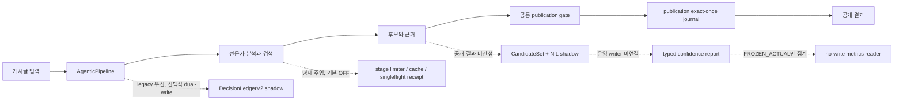

> **정리 전 이력 문서 — 2026-10-15 보존.** 원래 위치는 `README.md`, 원형 SHA-256은 `0e76083f2db5901d47d0b4bb7d50ce37f194e1aa622228aa12f2701765e3cd47`이다. 현재 상태는 [현재 상태 문서](../../CURRENT_STATUS_KO.md), 실행법은 [README](../../../../README.md)를 따른다. 아래 상태·명령·수치는 당시 기록이며 상대 링크만 새 위치에 맞췄다. 로컬 `out/` 증거는 Git에 포함되지 않는다.

# LLM 웹소설 매칭 파이프라인

<!-- r5-resolution-current:start -->

## 2026-10-15 현재80 범위 개발·검증 완료

최신 사용자 지시인 “R5 실패 원인을 해결하고 현재80으로 가능한 검증을 마무리”한 범위는 **CURRENT80_SCOPED_VALIDATION_COMPLETE**다. [최종 보고서](../../../../out/r5_resolution_20261014_v2/REPORT_KO.md)와 [통합 검산](../../../../out/r5_resolution_20261014_v2/finalization/completed_current80_001/CHECK_KO.md)을 기준으로 한다. 아래 날짜별 문단은 당시 이력으로 보존한다.

- [x] 기존80 저장자료·두 모델 검토 결속 및 DEV48 독립 재검산.
- [x] R5 혼합 매체·후보 관계/상태 수리,398개 최종 제품 회귀와 실패 사례의 native→main→WAL 재생.
- [x] 동일 설정 A/A 두 실행 종료와 원장 판독,64번 source475 ACCEPT,55번 source483 최종1/1·exit0·ACCEPT 및 UI 확인.
- [x] 원문·실패·서로 다른 소스 버전을 보존하고, 최종483파일·실행·UI 근거 검산 오류0 확인.

최종55 `20261015_005606_489420`은 요청12/실효1·대시보드ON·저부하에서 false/context_only/none/HOLD로 저장됐다. 검색·후보 관측0이어서 새 proposal/delta 분기의 실제 효과는 미관측이며, 그 경계는 저장 실패의 제품 재생으로 검증했다. A/A의39/45호출·682,095/737,254토큰과 최종 단건5호출·85,175토큰은 관측량이다. 정식 개선율·정답률·최신 전체80 재실행으로 해석하지 않는다.

독립 자료·재사용 근거·정식 TRAIN/CAL/FROZEN·일반화 성능과 R7 production은 보류한다. 기존 확대시험5개 실패도 [판독과 후속 항목](../../../../out/r5_resolution_20261014_v2/finalization/broad5_triage_v1/TRIAGE_KO.md)으로 남긴다.14번은 판본 계약/시험 기대 차이,35번은 원래 행·현재 가설 차단에는 재현되지 않은 보조 전언 경계 누락이다. 전체 회귀 PASS·제품 무결함·전체80 의미 승인은 주장하지 않으며 의미 게이트 REVIEW를 유지한다.

Goal API 상태: complete.

<!-- r5-resolution-current:end -->

<!-- research-completion-current:start -->

## 2026-10-14 source462 단계 이력 — 최신 상태는 위 완료 기록 참조

[최종 결과와 남은 수용 조건](../../../../out/research_completion_20261014_v1/REPORT_KO.md)는 당시 단계의 근거다. 기존80의 개발용 회수48관측,50번 수리·실제1건 검토, JSONL 댓글 생략 호환성·시작 전 실패·상대경로 이력·화면 전환 수리를 마쳤다. source462를 고정한 R6 실제1건은 원래 HOLD와 별도 native PUBLISH를 보존하며 HTTP9회·230.172초로 종료했고 원장 검산을 통과했다. 실제 화면과 관련 회귀도 확인했다.

R5 기준3건은 정상 종료했으나 BEFORE에서64번 공개 판정이 PUBLISH→HOLD로 달라 strict 비교가 거절됐다. runner exit1·DRAINED, AFTER 미시작, formal KPI는 NOT_ESTIMABLE이다. 기존 실패·원문·참조는 보존했다. 현재 실행 정책 차단은 없었다.

별도 자료가 없다는 사용자 답변에 따라 기존80으로 수행 가능한 DEV 연구를 끝냈다. MODEL_REFERENCE는 허용하지만 재사용 근거·미노출 평가 자료·TRAIN/CAL/FROZEN 조건은 미충족이다. R6 의미 검토는 원본 픽셀 미확인으로 HOLD/Medium이며 일반화 성능 승인이 아니다. **Goal 전체 완료 조건은 미충족으로, 조회된 blocked 상태를 complete로 바꾸지 않았다.** 요청 병렬12·대시보드 ON·저부하와 R7 보류를 유지한다. 아래 날짜별 기록은 당시 이력이다.

- [x] 기존80 자료 연결·개발용48관측과 반례 판독.
- [x] 50번 수리·실제 검토, 입력·대시보드 수리와 회귀·실제 화면 검증.
- [x] R6 실제 복구1건의 실행·예산·원본 보존·별도 guard 검산.
- [x] R5 실제 BEFORE 실패·AFTER 미시작·최종 종료 및 원인 판독.
- [ ] 같은 공개 결정에 결속되는 실제 paired 비교와 정식 지표 산출.
- [ ] 적격 자료에 근거한 정식 R2–R4 및 R6 일반화 품질 수용.

<!-- research-completion-current:end -->

<!-- source-quality-current:start -->

## 2026-10-14 최신 실측: 실제12 정상 종료·의미 품질 REVIEW

**현재 정책 거절은 없었다.** 검색3354 중지로 사전점검이 멈췄으나 기존 컨테이너3개를 기동한 뒤 `20261014_144947_200849`가 current source454·parallel12/12·대시보드ON·저부하 조건으로 정상 종료했다. completed/flushed12·failed/pending0·exit0, 결과/체크포인트12/12와 보호소스454/454 불변을 확인했다. [최종 실행·협업 평가](../../../../out/source_remaining12_actual_20261014_search_restored01/RUN_STATUS_KO.md)가 현재 상태다. 아래의 정책차단/미시작/실행중 문장은 당시 이력으로 보존한다.

새12 평가: Sol A7/H4/R1, Opus A9/H2/R1.24 무관참조 제거·44 self/own 및 embedded 상태 교정을 관측했다.65는 후보가 회복됐지만 High 경로라 Low 보존분기 효과는 미입증이다. **50번은 양측 REPROCESS**로 분류·후보 소실 원인 판독이 남는다.13·33은 검토 범위 차이가 있고 전체 의미는 REVIEW다. 전체80 승인·R5 paired·R2–R6 실제 연구 품질·사람정답/권리/holdout은 미완료이며 formal KPI는 NOT_ESTIMABLE이다. 제품코드 변경0.

- [x] 현재 코드 실제12 실행·종료·원본 결속·두 모델 전행 평가 완료.
- [x] 과거 정책거절과 이번 검색 서비스 중지의 구분 및 복구 확인.
- [ ] 50번 분류/후보 소실 원인 판독과 남은 작품 근거·실제 연구 수용.


## 2026-10-14 실행 재확인: 정책 거절 없이 실제12 분석 시작

**현재 실행 명령은 허용됐다.** 첫 호출은 검색3354 연결 거부로 사전점검에서 멈췄고, 기존 중지 검색 컨테이너3개를 시작해 query probe1/1·degraded0을 확인했다. 이후 `20261014_144947_200849`가 현재source454·parallel12/12·대시보드ON·저부하 조건으로 시작했다. [현재 실행 상태와 근거](../../../../out/source_remaining12_actual_20261014_search_restored01/RUN_STATUS_KO.md)를 따른다. 아래 과거 정책차단·미시작 기록은 당시 이력이며 현재 진행 상태가 아니다. 최종 품질·R5paired·연구 수용 완료는 아직 주장하지 않는다.

- [x] 현재 도구 호출·프로세스 기동·검색 복구·실모델 응답 확인.
- [ ] 실제12 종료·결과 결속·수정 효과 판독.


## 2026-10-14 후속: Opus 5.5·Sol 6.1 협업 평가 완료

[저장80 협업 평가와 최종 검증 상태](../../../../out/collaborative_final_eval_20261014_v1/root/REPORT_KO.md)가 이번 후속의 통합 결론이다. Opus 5.5 새 채팅과 Sol 6.1 서브에이전트가 각각80행을 독립 평가한 뒤 교차검토했다. 초기 판정은 Opus A60/H18/R1/I1, Sol A33/H37/R6/I4이며 일치50·불일치30이다. 일치율은 정확도가 아니다. 71의 Sol REPROCESS와 후보 URL·역할 누락 관련 과장된 근거를 정정했고 최초 라벨은 보존했다.

과거24·44·55·57·65 문제의 기존 수리를 확인했으며 **새롭게 확정한 현재 코드의 미수리 결함은0건**이다. 보호소스454/454·release253/253은 마지막 적용 SHA와 같다. 기존754 PASS·하위22, Node94 PASS·선택3 SKIP 및 저장 이력 화면 확인을 유지하되 이번에 새 시험이나 expert_main 모델 실행은 하지 않았다. 55/57의 과거 직접 시험을 최신754에 포함된 것으로 소급하지 않는다.

**의미 품질 REVIEW·최신 source454 모델 효과 NOT_OBSERVED·formal KPI NOT_ESTIMABLE**이다. 최신 실측, R5 paired, 실제 corpus/정답/권리/holdout·R2–R6 품질 수용은 남아 있다. 네이티브 Goal 조회값은 blocked이며 완료로 변경하지 않았다. 이전 실행 차단의 세부 이유는 미제공이고 콘텐츠 검열로 확정하지 않는다. 사용자 승인·parallel12·대시보드 ON·저부하 정책과 R7 보류를 유지한다.

- [x] 두 모델80행 결속·독립 평가·교차검토와 과거 문제/현재 수리 분리 완료.
- [x] 평가자 오류 정정, 원본 보존, 연구 지표 산출 범위와 다음 조건 기록 완료.
- [ ] 최신 코드 실제 모델 효과·R5 대조실행·실자료 연구 품질 수용.

아래 구현·시험·차단 기록은 원래 근거와 함께 보존한다.


## 2026-10-14 현재: 최종 754 PASS·19파일 적용·source454·저장 이력 화면 확인

**44번 화자/부정·65번 후보 보존·사건 카드/진단 저장·캐시 이력 탐색 수리를 적용했다.** [29개 전체 파일 754 PASS·하위22 PASS](../../../../out/r5_attempt_failure_validation_v1/run_final44_65_ui_history_v4_001/receipt.json) 후 [검증 바이트 19파일](../../../../out/source_final_application_v1/application_001/receipt.json)을 정확 적용했다. 제품6(기존5·신규1)·시험9(Python8·Node1)·fixture4이며 신규14파일, 기존5파일 백업, gitignore 시험 예외9와 기존 prefix·index 보존을 확인했다. [적용 후 검사](../../../../out/source_final_application_v1/application_001/post_apply_check.json)는 diff check0·신규 무시 없음이다. 현재 보호 소스는 **454개**다. [적용 보고서](../../../../out/source_final_application_v1/application_001/REPORT_KO.md)에 구현·적용·화면 확인 범위를 모았다.

| 적용 범위 | 검증된 동작과 범위 |
|---|---|
| 44번 내용절·부정 | [원문·바깥 주체와 부정 범위](../../../../out/source44_compound_speaker_review_v1/REPORT_KO.md)를 결속해 내용절 명사를 화자로 올리지 않는다. 긍정 어휘·원문 좌표를 남기며 최종 근거 채택과 구분한다. |
| 65번 후보 회수 | [F1–F4와 동일 문서 encoded URL 반증 경계](../../../../out/source65_candidate_preservation_review_v4/REPORT_KO.md)를 수리했다. 검산된 인물-작품 관계만 Low/noURL/noalias 후보로 보존하며 후단에서 같은 원자료를 재검산한다. 공개·학습 권한을 만들지 않는다. |
| 사건 카드·exporter | [성립 상태·성립 근거·평가 방향·최종 채택](../../../../out/source_context_event_state_ui_repair_v2/HANDOFF_KO.md)을 저장값으로 표시한다. native 근거 필드 하나를 기존 상한 안에서 저장하고 과거 미기록을 추정하지 않는다. |
| 실행 이력 탐색 | [전용 URL 캐시의 50,000항목 예산 선점](../../../../out/history_latest_discovery_audit_v1/REPORT_KO.md)을 분리했다. [root 직계 캐시 하위만 제외](../../../../out/history_cache_scan_review_v1/REPORT_KO.md)하며 디렉터리 자체 집계·깊은 동명·안전한 current-output·기존 상한을 유지한다. |

동일 presentation 제품의 [Node 97수집·94 PASS·기존 선택3 SKIP](../../../../out/source_context_event_state_ui_validation_v2/node_001/receipt.json)에서 새 카드6은 모두 PASS다. [74번 시험 후손](../../../../out/source_context_event_state_test_repair_v3/HANDOFF_KO.md)은 구·신 exporter에 공통인 graph edge1건 생략(`TRUNCATED/FIELD_LIMIT`)을 정확히 요구하고 사건 전체/native/bytes 상한 검사를 유지한다. 중간566·610·100과 최종754 및 Node 수를 합산해 고유 시험 수나 모델 정답률로 쓰지 않는다. **이 결과는 명시 파일의 오프라인 기능 검증이며 실제 모델 개선 효과·전체80 품질 승인이 아니다.**

[현재 디스크 source 결속](../../../../out/source_final_application_v1/application_001/source_binding.json)의 release는 `19de4b231ece83ec9c780f722433cdda501be12d7a450232eefc2a919e52df6d`, selected runtime source는 `c6065808971154a0ce6023776b78e8facbfa88d8888a2729968d43601a31c1bf`다. 모델 runtime generation 실측은 없다. [적용 후 실제 화면 확인](../../../../out/source_final_ui_validation_v1/receipt.json)은 로컬18868(PID51484, BelowNormal·affinity2)에서 최근80·24 이력 복구, 80건 상세와 저장 병렬12/12를 확인했다. 목록75·전체 탐색 상한 안내는 유지돼 무제한 전체 이력 복구를 뜻하지 않는다. 과거44 카드는 `actual / 성립 근거 미기록 / pos / 최종 근거 채택 false`와 저장 당시 화자 `마무리`를 그대로 표시한다. 새 코드의 모델 재실행 결과가 아니다. 콘솔 오류·경고 관측0이며 CUA 캡처는 도구로 관측했지만 파일로 저장하지 않았다. 제공 presentation은 적용 바이트와 같고 실제80 원본 SHA는 변하지 않았다.

**실제12는 미시작이다.** [자동 승인 검토가 실행 명령을 `blocked by policy`로 거절](../../../../out/source_remaining12_launch_prep_v1/rejected_attempt_001.json)했고 세부 이유는 제공되지 않았다. 기존 사용자 승인은 유지되며 재승인 요청·우회·재시도는 하지 않았다. [과거 source440 실행 ready](../../../../out/source_remaining12_launch_prep_v1/launch_plan.ready.json)는 당시 준비물로 보존하며 현재 source454의 실행 명세가 아니다. requested parallel12·dashboard ON·저부하 원칙은 유지하지만 새 actual run/scope·모델 결과는 없다.

이전80 `20261013_181711_146907`의 [A39/H33/R8/I0·END44·history842](../../../../out/p4_quality_followup_20261013/actual80_current_followup_parallel12_v1/final_review_80_v1/REPORT_KO.md)와 의미 **REVIEW**를 유지한다. 이번 적용으로 과거 라벨을 바꾸지 않는다. [R5 BEFORE exit1·FAILED/DRAINED](../../../../out/r5_actual24_pair_after_failure_repair_001/end_observation_001/receipt.json)·AFTER 미시작·동일 reference/WAL 결정 계약의 paired 미완료도 유지한다. guard 완화·참조 재봉인·실행 반복으로 완료를 주장하지 않는다.

준비80 관측192·HUMAN_GOLD0·권리UNKNOWN·training ready0·독립 holdout0, 실제 연구 품질·R2–R6 수용 미확정, 49번 full-context 진단2·69번10 미완료를 보존한다. **Goal blocked·formal KPI NOT_ESTIMABLE·R7 보류**다. 전체80 ACCEPT나 새 전체80 자동 재실행을 완료 조건으로 추가하지 않는다.

- [x] 29전체파일754 PASS·하위22 PASS와 source454 정확 적용을 확인했다.
- [x] Node94 PASS·기존 선택3 SKIP, 원형 실패와 시험 기대 정정 근거를 구분했다.
- [x] 저장80·24 이력, 80건 상세와 과거44 사건 카드의 실제 표시를 확인했다.
- [ ] 실제12 모델 효과·R5 paired·사람 정답/권리/실자료 품질은 미완료다.

[v33 후속 원형](../../../../out/p4_quality_followup_20261013/docs_integration_update_v33_followup_v1/REPORT_KO.md)을 보존하고 [v34 갱신 보고서](../../../../out/p4_quality_followup_20261013/docs_integration_update_v34/REPORT_KO.md)에 CURRENT 전후와 검산을 기록한다.

2026-10-14 같은 미해결 실행 차단과 자료 조건을 세 목표 턴 연속 확인해 Goal을 blocked로 전환했다. 추가로 진행할 확정 로컬 수리는 확인되지 않았다. 사용자 승인은 유지하며, [재개 조건과 보존 근거](../../../../out/goal_blocked_20261014_v1/HANDOFF_KO.md)를 따른다. 구현·로컬 시험·저장 화면 확인과 실제 모델·연구 평가의 미완료를 구분한다.

<!-- source-quality-current:end -->

## 직전 단계 기록: 191128 실행 종료와 첫 통합 후보 시험

> 아래 후보 미완료·실패 원인·진행 문장은 그때의 기록이다. 최신 수리 및 검증 상태는 위 현재 구역을 따른다.

실행 `20261012_191128_106718`은 **exit0·80/80 저장·실패0·대기0·terminal 확정**, 요청·실효 병렬도 **12/12**로 종료했다. [종료 검산](../../../../out/p4_quality_followup_20261012/actual80_parallel12_v1/end_check_prep_v1/end_verification_02.json)은 **44개 PASS_TECHNICAL_ONLY**이며 실제 Python·venv launcher·supervisor 세 PID 종료를 확인했다. 실행 소스288개와 보호 목록6,279개의 보존은 해당 수령증 범위다. 시작 전 PREPARED 및 실행 중 RUNNING 기록은 당시 이력으로 보존한다.

[이력 API](../../../../out/p4_quality_followup_20261012/actual80_parallel12_v1/history_check_prep_v1/run_first/receipt.json)는 **80행·11 GET·820개 검사 PASS**로 저장 원시 필드·BOUND·새 NSFW 상태·parallel12를 대조했다. [실제 화면](../../../../out/p4_quality_followup_20261012/actual80_parallel12_v1/browser_final_readback_v1/receipt.json)은 **PASS_SCOPED_FINAL_LIVE_HISTORY_UI**다. live 100%·80/80·활성0, 최종 이력80건·12/12와 74번 live/history, 10·15·49·61번 history의 선택된 상세를 확인했다. NSFW 미평가/모델 false/규칙 양성 표시와 메모·댓글 귀속을 구분했고, 74번의 행별 장부 상태와 종료 manifest 요약을 덮어쓰지 않았다. 관측 콘솔 오류·경고0이며 이력 탐색 상한 경고는 유지한다. API 검사 수와 UI 관측·과거 Python/Node 시험 수를 합산하지 않는다.

[최종 행 결속·59행 리뷰 재사용](../../../../out/p4_quality_followup_20261012/actual80_parallel12_v1/final_review_prep_v1/run_first/final_reconciliation_receipt.json)은 기존 **ACCEPT20·HOLD31·REPROCESS2·INFO_MISSING6**을 보존했다. [남은21행 리뷰](../../../../out/p4_quality_followup_20261012/actual80_parallel12_v1/final_review_remaining21_v1/REVIEW_KO.md)와 [21행 결속 수령증](../../../../out/p4_quality_followup_20261012/actual80_parallel12_v1/final_review_remaining21_v1/reviewer_receipt.json)은 **ACCEPT10·HOLD9·REPROCESS1·INFO_MISSING1**이다. **80행 검토는 완료했으며 인계용 합계는 ACCEPT30·HOLD40·REPROCESS3·INFO_MISSING7**이다. [전행 통합 결속](../../../../out/p4_quality_followup_20261012/actual80_parallel12_v1/final_review_reconciled_v1/receipt.json)은 80행 원문·typed ID·전체 결과 SHA와 중복·누락0을 확인했고 [최종 종합](../../../../out/p4_quality_followup_20261012/actual80_parallel12_v1/final_review_reconciled_v1/SUMMARY_KO.md)에 남겼다. REPROCESS는 **8·55·57번**이다. 55번 [정적 원인 조사](../../../../out/p4_quality_followup_20261012/semantic_state55_followup_v1/REPORT_KO.md)는 초기 제목 힌트와 작품성을 부정한 표면 anchor가 별도 제목 상태 계산에 남는 경로를 확인했다. 57번과 같은 질문 규칙이 아니며, 동일 문맥 동작 재현·수리는 미실행이고 신규 코드 회귀 귀속도 미확정이다. 74번 SOURCE_RULE_POSITIVE는 원문 댓글에 결속된 좁은 수리 효과를 ACCEPT로 검토했으며 전체 NSFW 정답으로 확대하지 않는다. 픽셀을 보지 않은 49번의 규칙 양성도 이미지 정답을 뜻하지 않는다. 전체 품질은 REVIEW다. [직전80 대비 공개 값 목록](../../../../out/p4_quality_followup_20261012/actual80_parallel12_v1/publication_delta_inventory_v1/REPORT_KO.md)은 145104→191128의 공식 제목·URL 변경0·동일80(제목+URL10·제목만1·null69)을 확인했다. 1·12·14번도 직전과 같으며, 더 오래된 변화와 구분한다. 값 동일성은 오공개0이나 공개 적격성 증명이 아니다.

8번 [명명 표현 v3 후보](../../../../out/p4_quality_followup_20261012/slang_role_expression_candidate_v3/SOURCE_FROZEN.json)와 57번 [제목 상태 후보](../../../../out/p4_quality_followup_20261012/semantic_state57_candidate_v1/SOURCE_FROZEN.json)는 AST·독립 정적 검토를 거쳐 [통합 후보 동결](../../../../out/p4_quality_followup_20261012/source_quality_bundle_validation_v1/SOURCE_FROZEN.json)에 결합됐다. [통합 후보 첫 시험](../../../../out/p4_quality_followup_20261012/source_quality_bundle_validation_v1/run_first/validation_receipt.json)은 **13파일 411 PASS·104 subtest PASS·2 FAIL, 오류·스킵0**이다. 정상57 serializer·main wrapper·WAL과 역할3 경로는 통과했지만, 57번 payload 제목 상태 및 candidate ledger의 입력 fingerprint 변조를 거절하지 못한 두 시험이 실패했다. **57번 optional scope seal을 별도 v2 후보에서 수리 중이며 통합 후보는 primary 미적용**이다. 실패 원본은 보존한다. 기존 pipeline `ee9088f6…`로 끝난 이번80은 이 두 후보의 실측 증거가 아니다. 이후 후보가 적용되면 이번 결과는 수리 전 기준 실행으로 남기며, 새 코드의 실측 여부를 별도로 표시해야 한다. 기존 수리 Python12파일251 PASS·104 subtest와 별도 Node87 PASS는 당시 로컬 증거로 유지한다.

R2/R3/R4 candidate 기능·community knowledge·native recovery는 OFF였으므로 연구 기능 ON 실측을 대체하지 않는다. 사람 정답0·학습 준비0·권리 UNKNOWN·formal KPI **NOT_ESTIMABLE**·품질 **REVIEW**·Goal active·R7 보류를 유지한다. 이후 Expert-main 실행 기본은 `--parallel 12`·대시보드 ON·기존 저부하 정책이다.

## 2026-10-12 이전 단계: 병렬12 전체80 정상 종료·전행 검토 완료, 품질 수용 REVIEW

실행 `20261012_145104_574531`은 **요청12·실효12·대시보드 ON**, exit0·80/80 저장·실패0·대기0·terminal 확정으로 종료했다. [종료 검산](../../../../out/development_plan_20261010/p4_reapproval_v1/final80_parallel12_v1/end_verification.json)27개와 [이력 API 대조](../../../../out/development_plan_20261010/p4_reapproval_v1/final80_parallel12_v1/history_api_receipt.json)499개가 통과했고 실행 종료 시점의 보호 파일4,718개에 변경이 없었다. 최종 코드의 토큰·검색 집계는 실제 검증을 마쳤다. 문맥 이벤트 토큰6,288,623과 검색74 hits/395 misses가 저장 trace·CLI·12워커 합계에 일치한다. manifest 관측9,059,040토큰은 별도 범위이며 모두 정식 KPI·전체 청구 비용이 아니다.

[실제 화면](../../../../out/development_plan_20261010/p4_reapproval_v1/final80_parallel12_v1/browser_receipt.json)은 live100%·80/80·활성0, 최종 이력80건·병렬12/12, 메모·NSFW·구조화 문맥·유효 설정·주변 관련 배지와 원시 진단 구분을 확인했다. 관측 콘솔 오류·경고0이며 이력 탐색 상한 경고는 유지한다. 현재 renderer의 [합성 저장자료84 PASS·0 FAIL·0 SKIP](../../../../out/development_plan_20261010/p4_reapproval_v1/ui_final_optional_readback_v1/receipt.json)은 별도 시험이며 검사 수를 합산하지 않는다. [대시보드](http://127.0.0.1:18864/)는 완료 결과를 표시한다.

[80행 최종 리뷰](../../../../out/development_plan_20261010/p4_reapproval_v1/final80_parallel12_v1/review_reconciled_v1/review_receipt.json)는 원문·댓글·최종 행 전체 SHA에 결속됐으며 **ACCEPT32·HOLD33·REPROCESS8·INFO_MISSING7**, gate **REVIEW**다. 나머지48건을 오류율로 계산하지 않는다. 새 제목 공개12·14번은 HOLD다.74번은 전문가 최초 응답부터 NSFW가 달랐으며, 새 저장 코드 회귀는 입증되지 않았다. 댓글 NSFW 검산 공백으로 REPROCESS를 유지한다. 미판정 근거를 두고 전체80의 새 오공개0이나 품질 통과를 선언하지 않는다. [종합 인계와 후속 개발](../../../../out/development_plan_20261010/p4_reapproval_v1/final80_parallel12_v1/REVIEW_SUMMARY_KO.md)에 근거·범위·미완료 조건을 정리했다.

[새80 snapshot](../../../../out/development_plan_20261010/p4_reapproval_v1/final80_parallel12_v1/final_snapshot_v1/receipt.json)은 저장 관측80·고유 원문80, VERIFIED / COMPLETE_WITH_LIMITS다. 기존80·실제12·112관측 준비물은 보존했다. 사람 정답0·학습 준비0·권리 UNKNOWN·독립 holdout 없음·formal KPI **NOT_ESTIMABLE**을 유지한다. R2/R3/R4/native는 OFF였으므로 실제 연구 기능 검증을 대체하지 않는다. **P4 기술 검증과 전행 리뷰 수행은 완료, 의미 품질 수용과 R2~R6 실제 평가 조건은 미완료이며 Goal은 active**다. 이후 Expert-main 테스트는 `--parallel 12`·대시보드 ON을 따른다.

아래 실제12·차단·미실행 등 설명은 해당 시점 이력이다. 이전 RUNNING 구역의 바이트는 이번 문서 갱신 백업에 보존했다.

## 이전 2026-10-12 단계: 병렬12 기술 종료·12행 리뷰와 제한된 UI 확인

실행 `20261012_134614_949602`는 **exit0·12/12 저장·실패0·대기0·terminal=true**, 요청12·실효12로 종료했다. [종료 기술 검산](../../../../out/development_plan_20261010/p4_reapproval_v1/parallel12_regression_v1/end_verification_v2.json)은 **PASS_TECHNICAL_ONLY·21개 검사**, [이력 API](../../../../out/development_plan_20261010/p4_reapproval_v1/parallel12_regression_v1/history_api_receipt.json)는 **84개 검사·12행 원시 저장값 일치·BOUND·병렬12/12**다. 초기 검산 실패는 병렬 체크포인트의 완료 순서를 입력 순서로 가정한 것으로, 원본 기록을 보존하고 v2에서 고유행·최종 입력 순서·WAL 결속을 확인했다. 이력 탐색 상한 경고는 유지한다.

[3개 에이전트 리뷰 종합](../../../../out/development_plan_20261010/p4_reapproval_v1/parallel12_regression_v1/REVIEW_SUMMARY_KO.md)은 고유 12행에 중복·누락 없이 **ACCEPT9·HOLD3**, gate **REVIEW**다. 약먹마의 비교 역할·별칭 source 연결, 회모장의 이미지·작품 결속, 추천 글의 구조화된 비교·추천 표면 보존이 남아 있다. CF01 및 의미 상태 v3의 독립 검토는 각 수리 당시 소스 범위에서 통과했다. CF03은 새 Decoder가 이전 오염 제목을 만들지 않아 이번 실측만으로 필터의 직접 효과를 입증하지 않는다.

[실제 화면 확인](../../../../out/development_plan_20261010/p4_reapproval_v1/related_label_fix_v1/browser_receipt.json)은 **PASS_SCOPED_UI_WITH_METRICS_PENDING**이다. root가 18863의 live 100%·12/12·활성 worker0, 이력의 현재 run 최상단·최종 저장12건, 11718092의 NSFW true·메모·진단 STORED·BOUND 및 8670967의 adjacent 상태를 확인했다. 11663522는 live/history 모두 **주변 관련**과 원래 `is_relevant=false` 진단을 보존하면서 중복 무관 배지를 제거했다. 관측 콘솔 오류·경고는 0이며 로컬 스크린샷 파일은 만들지 않았다. [Node 판독](../../../../out/development_plan_20261010/p4_reapproval_v1/related_label_fix_v1/node_readback.json)은 **81 PASS·3 SKIP·실패0·총84**로, native/provider/inference 환경 자료 미설정 선택 시험 3개는 이번에 실행되지 않았다. JavaScript 캐시 때문에 자산 버전 한 줄을 갱신한 뒤 실제 화면을 확인했으며 [최종 자산](../../../../out/development_plan_20261010/p4_reapproval_v1/related_label_fix_v1/final_static_receipt.json)과 [독립 검토 v2](../../../../out/development_plan_20261010/p4_reapproval_v1/related_label_fix_v1/independent_review_v2.json)는 기능 코드 동일성을 결속한다. 전체 UI·전체 기능 검증 PASS로 확대하지 않는다.

[토큰 context 수리](../../../../out/development_plan_20261010/p4_reapproval_v1/token_context_fix_v1/SOURCE_FROZEN.json)는 7파일 **104개·하위59개**, [검색 통계 worker 합산](../../../../out/development_plan_20261010/p4_reapproval_v1/cache_stats_fix_v1/validation_receipt.json)은 7파일 **115개·하위54개** 로컬 통과다. [토큰 독립 리뷰](../../../../out/development_plan_20261010/p4_reapproval_v1/token_context_fix_v1/independent_review.json)와 [캐시 독립 리뷰](../../../../out/development_plan_20261010/p4_reapproval_v1/cache_stats_fix_v1/independent_review.json)도 PASS이며 두 집계 상태는 **LOCAL_VERIFIED_ACTUAL_PENDING**이다. **18863의 Python 프로세스는 집계 수리 전 코드이고 정적 UI만 갱신했다.** 실제12의 token 965.2K·cache 0% 및 CLI hits20/misses96 관측을 소급 보정하지 않는다. 실제12 자체도 token/cache/UI 최종 수정 전 소스다. [후속 조치](../../../../out/development_plan_20261010/p4_reapproval_v1/parallel12_regression_v1/action_queue.json)에 남은 범위를 구분했으며 서로 겹치는 시험·기술 검사 수를 합산하지 않는다.

기존80의 기술 종료와 전행 리뷰는 보존하며 **최종 코드의 새 전체80 재실행은 아직 하지 않았다.** 실제12는 개발 노출80의 부분집합이고 독립 holdout·R5 paired 실측이 아니다. R2/R3/R4/native OFF였으므로 해당 기능의 실제 성공 근거로 쓰지 않는다. 사람 정답0·학습 준비0·권리 UNKNOWN·formal KPI **NOT_ESTIMABLE**·Goal **active**를 유지한다. 새 Expert-main 실행 기본은 요청12·실효 `min(input_count,12)`·대시보드 ON이다. 아래 단계별 기록은 당시 이력이며 현재 운영은 [P4 인계](../../P4_REAPPROVAL_RUN_20261010_KO.md)를 따른다.

## 이전 차단 이력: 2026-10-10 blocked 전환 당시

같은 실행 차단과 자료 선행 조건 미충족을 세 차례 연속 확인해 Goal을 **blocked**로 전환했다. 실제80·최신 브라우저·사람 판정과 사용 권리·실자료 품질·R5 실측은 미완료이며, formal KPI는 NOT_ESTIMABLE, R7은 보류다. [재개 조건과 인계](../../GOAL_BLOCKED_HANDOFF_20261010_KO.md)를 따른다. 아래 Goal active 표기와 전달 문서 SHA는 각 단계 작성 당시 기록이다.

## 2026-10-10 최신 진행: 전체 진입점과 완료 표시

80건 검토 자료 준비를 유지하면서 일반 `expert_main` 전체 진입점의 합성 입력 OFF·재생 ON·최초 분석 ON을 검증했다. 최초 ON은 provider1회·native7회를 거쳐 원래 HOLD와 별도 결과를 보존했다. 대시보드의 완료 상태·부분집합·실패·저장 대기와 이력 건수 표시를 수리했다.

관련 Python 3파일은 **71 passed, 40 subtests passed in 10.17s**, **Node 84개 통과·실패 0개·skip 0개**다. 일반 CLI 검증과 이후 UI/API 변경의 시험 범위를 분리한다. [현재 검증·남은 개발](../../EXPERT_ENTRY_COMPLETION_REVIEW_20261010_KO.md)을 따른다. 아래 수치와 당시 미완료 설명은 이전 단계 기록이다.

후속으로 semantic NIL/CAL→actual readback·baseline 연결을 구현하고 합성 로컬 검증을 마쳤다. **271 passed, 9 subtests passed in 167.12s (0:02:47)**이며 [R4 연결 검증](../../R4_ACTUAL_BRIDGE_20261010_KO.md)에 범위와 한계를 기록했다. 적격 실제 자료의 전체 성공 경로, 실제80·새 브라우저·사람 판정·실자료 품질·R5 실측은 미완료다. Goal active·formal KPI NOT_ESTIMABLE·R7 보류를 유지한다.

## 이전 검증: 기존 회귀 수리와 80건 검토 준비

기존 rework 실패 33개는 이름 변경 대응표와 실제 JUnit을 대조해 모두 통과했다. 마지막 3개 파일 실행은 **494 passed, 55 subtests passed in 181.10s (0:03:01)**다. 앞선 9개 파일 실행의 **5 failed, 578 passed, 64 subtests passed in 572.95s (0:09:32)**에서 시험 의존 파일 누락 4건과 최종 후보 단계의 기대 불일치 1건을 확인하고 보완했다. 제품 소스는 두 실행 사이에 그대로이며, 앞선 나머지 6개 파일의 통과를 따로 보존한다. 서로 다른 실행 수치를 합산하지 않으며 전체 저장소 회귀나 전체 CLI 검증 완료로 해석하지 않는다. [현재 수리 기록](../../LEGACY_REWORK_REPAIR_20261010_KO.md)과 [최종 실행 검산](../../../../out/development_plan_20261010/r6_rework_phase4_reconciled.json)을 따른다.

원형 본문에 결속된 별칭은 비권한 후보로 보존하고, 일반 화자 발화는 명시적인 작성자 복귀 전까지 보류한다. URL·시각 예외, OCR 작가 검색, 추천 보류와 최종 설명 봉인을 검증했다. 후보 제목·URL 보존과 최종 공개 title/URL을 따로 확인하며, 검색 후보만으로 공개 권한을 만들지 않는다.

[80건 검토 자료](../../../../out/development_plan_20261010/actual80_review_queue_v1/review_guide.md)는 원문·저장 관측 112개와 참조를 연결했고 [독립 재판독](../../../../out/development_plan_20261010/r6_rework_actual80_preparation_readback_v1_KO.md)에서 원문·참조 52개 파일의 존재와 SHA 일치를 확인했다. 사람 정답 0건·학습 준비 0건·전 행 개발 노출·권한 UNKNOWN이며 후보 누락 3행, 미검토 이미지 25개는 남아 있다.

현재 상태는 **REWORK_LOCAL_VERIFIED_ACTUAL_PENDING**이다. 아래 자동 복구 수치와 33개 실패·NOT_PASS 표기는 이전 단계 이력이다. 실제80 모델 실행·새 브라우저는 자동 승인 검토의 `blocked by policy` 거절 이후 재시도하지 않았다. 실제 품질·사람 판정·적격 분할 자료·R5 실측·formal KPI는 미완료이며 formal KPI는 NOT_ESTIMABLE, Goal은 active, R7은 보류다.

## 이전 자동 연결 단계: 일반 main 자동 복구의 로컬 검증 (2026-10-10)

일반 `expert_main`의 같은 호출 문맥을 원래 guard·commit·AUDIT·최종 저장 이후 제한된 복구로 연결하고, 별도 결과를 대시보드 live/history API와 표시까지 로컬 검증했다. 기본값은 OFF이며 ON에는 고정 정책·예산과 대시보드가 필요하다. 원래 결과·manifest·WAL은 보존하며 공개 적용·권한·중앙 DB 쓰기는 false다.

현재 상태는 **AUTOMATIC_NATIVE_LOCAL_VERIFIED_ACTUAL_AND_LEGACY_REWORK_PENDING**이다. [운영 계약](../../NATIVE_RECOVERY_AUTOMATION_20261010_KO.md)과 [실행별 검증·수리 기록](../../../../out/development_plan_20261010/r6_auto_reconciled_receipt.json)을 따른다. 검증은 합성 HTTP 응답으로 실제 전문가·guard·AST로 추출한 실제 main 함수 본문·원장·API·Node 표시를 통과한 범위다. 전체 CLI 기동과 실제 브라우저 통과를 뜻하지 않는다. 실행별 시험 수는 합산하지 않으며 마지막 수리 뒤 최초 전체 파일을 모두 다시 실행한 결과도 아니다.

최종 HOLD의 OCR 근거 누락은 새 `strict_evidence_v2` 검토 규칙으로 수리했고 기존 v1 영수증 판독은 보존했다. 실제80 모델 실행·새 브라우저·사람 정답·적격 실제 TRAIN/CAL/FROZEN 품질·R5 실측과 기존 rework 33개 실패는 남아 있다. 전체 회귀는 NOT_PASS, formal KPI는 NOT_ESTIMABLE, Goal은 active, R7은 보류다. 아래 단계별 수치와 미완료 설명은 당시 이력이며 현재 범위는 이 절을 따른다.

## 이전 단계: 명시 native 복구 연결과 당시 남은 자동화

R6의 **명시 same-call native 복구 연결을 합성 응답·HTTP mock으로 로컬 검증했다**. 현재 검증 상태는 `PASS_NATIVE_EXISTING_REWORK_FAILURES_PENDING`이며 기존 rework 시험 실패는 미해결이다. `run_native_recovery`는 같은 분석 호출에서 보존한 pre-final 문맥을 원래 입력·저장 provider 근거에 결속하고, 실제 Decoder·Verifier·Synthesizer·Arbiter와 기존 native 공개 guard를 호출한다. 원래 결과·manifest·WAL을 덮어쓰지 않고 별도 scope의 새 publication WAL과 결과를 저장·재판독한다. guard 판정 기록은 공개 반영이 아니며 `public_apply`, `publication_authority`, `central_db_write`는 false다.

native 추가 LLM·검색·fetch는 하나의 영속 호출·byte·시간 예산을 공유하며 먼저 예약하고 전송한다. 완료 job만 저장 결과를 0회 호출로 재생하고, 미완료·불확실 요청은 재시작 후 재발송하지 않는다. upstream provider 수집은 별도 앞 단계로 합계에 표시하며, MCP 내부 원격 검색 횟수·취소·가격은 확정하지 않는다. 과거 actual80/32 저장 JSON을 살아 있는 native 문맥으로 복원하는 기능은 없다.

최초 Python 16개 파일의 원시 결과는 시험 893개 통과·32개 실패와 하위 시험 21개 통과다 (`32 failed, 893 passed, 21 subtests passed in 1228.60s (0:20:28)`, [최초 전체 수령증](../../../../out/development_plan_20261010/r6_native_final_receipt.json)). 합성 응답 fixture만 보정한 뒤 workflow 1개 파일의 시험 7개가 통과하고 실패는 1개, 하위 시험은 0개다 (`1 failed, 7 passed in 657.84s (0:10:57)`, [보정 후 수령증](../../../../out/development_plan_20261010/r6_native_repair_receipt.json)). 그 뒤 실제 fetch 응답의 identity 캐시를 복제하는 제품 코드를 수리하고 context·workflow 2개 파일을 재검증해 시험 67개와 하위 시험 0개가 통과했고 실패는 0개다 (`67 passed in 701.00s (0:11:41)`, [캐시 수리 후 수령증](../../../../out/development_plan_20261010/r6_native_capture_final_receipt.json)). **세 실행의 시험은 겹치므로 합산하지 않는다. 마지막 수리 뒤 전체 16파일을 다시 실행한 결과도 아니다.** [재조정 수령증](../../../../out/development_plan_20261010/r6_native_reconciled_receipt.json)은 새 native 경로의 실패가 수리됐음을 기록하며 최초 전체 실행을 PASS로 바꾸지 않는다.

기존 rework 시험은 전체 실행에서 31개가 실패했다. 동일한 빈 캐시·단일 파일 격리 조건의 이전 baseline과 현재 소스에서는 각각 33개 실패가 재현됐고, 33개의 예외 종류·정규화 메시지가 같았다. 비교상 남은 차이는 0개지만 시험 상태는 `FAILED`다 ([격리 비교 근거](../../../../out/development_plan_20261010/r6_native_isolated_rework_comparison_v1.json)). **실패 33건은 해결되지 않았으며 전체 회귀 통과나 모든 OFF 동작의 동등성을 뜻하지 않는다.** [API·검증 범위](../../../../out/development_plan_20261010/r6_native_api_KO.md), [현재 코드·캐시 수리 독립 검토](../../../../out/development_plan_20261010/r6_native_capture_cache_review.json)와 [I/O 독립 검토](../../../../out/development_plan_20261010/r6_native_io_closure_review.json)를 따른다. [fixture 수정 독립 검토](../../../../out/development_plan_20261010/r6_native_fixture_repair_review.json)는 앞선 수리 이력으로 보존한다. 이번에는 Node·브라우저 시험을 실행하지 않았다. 화면 소스는 이전 provider 단계의 [Node 66개 통과 기록](../../../../out/development_plan_20261010/r6_provider_node_receipt.json)과 같으며, 그 기록은 새 native 화면이나 브라우저 통과 증거가 아니다. 이전 probe 실패와 simulation/provider 시험도 별도 이력으로 보존한다.

[80건 검토 큐](../../../../out/development_plan_20261010/actual80_review_queue_v1/review_guide.md)는 그대로 보존했다. 입력 80행·저장 관측 112개·중복 게시물 32개이며, 사람 정답과 학습 준비는 모두 0건이다. 기존 WORK/NIL 참조를 사람 정답으로 승격하거나 새 독립 분모로 세지 않았다.

**일반 main의 자동 복구 스케줄과 native 결과의 대시보드 live/history 연결은 아직 미완료다.** 실제 외부 모델·검색 호출은 0회이며 실제 복구 품질·비용·formal KPI는 `NOT_ESTIMABLE`이다. P4 실제80 실행과 새 Chrome 검증은 기존 자동정책 차단을 재시도하지 않았다. 실제 자료·사람 판정·R4 학습/교정 품질·R5 실측도 남아 있다. R6 전체 완료로 처리하지 않으며 Goal은 active, R7은 보류다.

## 이전 단계: provider 근거 수집과 80건 검토 준비 (2026-10-10)

당시 R6 상태는 **PROVIDER_EVIDENCE_LOCAL_VERIFIED_NATIVE_GUARD_AND_ACTUAL_RECOVERY_PENDING**였다. 원본 HOLD·AUDIT에 결속한 명시 계획 → 영속 예약 → 단일 HTTP → 원시 응답 저장·독립 판독 → `expert_main`·대시보드 연결을 구현했다. 완료된 요청은 0회 전송으로 재생하고, 완료 여부가 불명확한 요청은 재발송하지 않는다. 최초 fresh source 검사부터 응답 저장·재판독까지 같은 시간 제한을 적용한다. 마지막 `REQUEST_FINALIZED` 자체의 저장은 이 시간 범위에서 제외한다. 저장 성공은 `PROVIDER_EVIDENCE_STORED`, 공개 guard는 `GUARD_NOT_EVALUATED`이며 일반 실행의 자동 복구는 아직 연결하지 않았다.

이전 provider 단계의 변경 영향 Python 23파일 `779 passed, 163 subtests passed in 654.67s (0:10:54)`, Node 66개 PASS다. 실제 파일 원장과 HTTP mock, 저장 결과의 API·Node 표시를 확인했다. 실제 외부 모델·검색 호출과 새 브라우저 검증은 0회다. [실행 계약·한계](../../../../out/development_plan_20261010/r6_provider_api_KO.md), [Python 검증](../../../../out/development_plan_20261010/r6_provider_final_receipt.json), [Node 검증](../../../../out/development_plan_20261010/r6_provider_node_receipt.json)을 따른다. 아래 이전 단계의 수치는 당시 증거이며 이번 수치와 합산하지 않는다.

[80건 검토 큐](../../../../out/development_plan_20261010/actual80_review_queue_v1/review_guide.md)를 준비했다. 원래 입력 순서 80행에 112관측·관측별 후보 기록 121개를 연결했고 중복 게시물 32개를 별도 표본으로 세지 않았다. WORK 2·NIL 6은 기존 모델 참조, UNJUDGED는 72건이다. 사람 정답·학습 준비는 모두 0건이며 전 행이 개발에 노출됐다. 후보 결손 3행과 미검토 이미지 21행을 검토 순서에 반영했지만 정답·역할·사용 권리를 채우지 않았다. [검산 수령증](../../../../out/development_plan_20261010/actual80_review_queue_v1/verification_receipt.json)에 원본 46개·이전 준비 파일 5개의 보존 근거를 남겼다.

당시 남은 범위는 P4 실제80·새 브라우저, 실제 corpus·사람 판정·TRAIN/CAL/FROZEN 품질, R5 실측, R6 native 공개 guard·자동 복구·실제 품질이었다. 현재 native 연결과 미완료 범위는 위 최신 기록을 따른다. 당시 R6 후속 계획은 [native guard 개발 메모](../../../../out/development_plan_20261010/r6_native_guard_next_steps_KO.md)를 따른다. 기존 자동 승인 차단을 재시도하지 않았으며 formal KPI는 `NOT_ESTIMABLE`, Goal은 active, R7은 보류다.

NIL 학습·저장·화면 표시와 CAL 온도 학습·FROZEN 소비의 최신 상태는 [R4 운영 기록](../../CANDIDATE_RERANKER_SHADOW_20261010_KO.md)을 따른다. 명시적 FROZEN 재관측 교정·capture 저장·화면 표시를 연결했다. 의미 역할·검증 자료의 별칭 관측과 저장·화면 표시를 추가했다. 새 의미 관측을 버전별 학습·모델·CAL에 연결하고 합성 로컬 회귀로 검증했다. 일반 R2 graph 자동 공급과 새 입력의 고정 교정 추론을 로컬 검증했다. 실제 자료 품질 평가와 새 소비 화면의 브라우저 확인은 남아 있다. 이전 단계 시험 수는 합산하지 않는다.

[R6 제한 복구 실행](../../BOUNDED_RECOVERY_EXECUTION_20261010_KO.md): 당시 상태 **LOCAL_ENTRYPOINT_UI_VERIFIED_ACTUAL_RECOVERY_PENDING**. 별도 `expert_main` 합성 복구 진입점과 검토·계획·AUDIT·복구 보고서의 API·live/history 표시를 연결했다. 변경 영향 Python 13파일의 382개 시험·45개 하위 시험과 Node 37개, 실제 브라우저 및 별도 main 프로세스 합성 검증을 통과했다. 실제 모델·검색 호출은 0회다. 실제 provider 전체 연결·자동 복구·품질 평가는 남았으며 앱 Goal은 active다.

[R5 저부하 paired 계측](../../PAIRED_LOW_LOAD_MEASUREMENT_20261010_KO.md): **LOCAL_CONTRACTS_VERIFIED_ACTUAL_PAIRED_MEASUREMENT_PENDING**. R5 저부하 RunSpec v3·실제 실행 관측·계획 생성·판독·화면을 구현하고 Python51파일·1147개 시험·210개 하위 시험과 Node26개 PASS, reader 행 결속 보강 후 영향9파일·269개 시험·97개 하위 시험 PASS, 독립 반례18개와 합성 live/history 표시를 확인했다. 실제 모델·검색 실행0이며 비용·품질·formal KPI는 NOT_ESTIMABLE이다. 이 R5 수치는 해당 검증 범위의 기록이며 현재 R4 후속 수치와 합산하지 않는다.

## 현재 작업 인계

[R4 학습 baseline과 평가](../../CANDIDATE_RERANKER_SHADOW_20261010_KO.md): R4 상태는 **GENERAL_INFERENCE_LOCAL_VERIFIED_BROWSER_AND_ACTUAL_DATA_PENDING**다. 일반 입력의 실제 R2 원문·후보 ID·작품/판본·출처 bytes를 고정 semantic NIL 모델 및 CAL 온도에 연결하고 expert_main 저장·API·대시보드 표시를 구현했다. 현재 원문·R2·모델 점수를 재생 검산하며, FROZEN 배정이나 정답을 만들지 않는다. 이번 로컬 회귀는 Python 38파일 `1440 passed, 42 subtests passed in 229.37s (0:03:49)`, Node 58개 PASS다. 실제 pipeline에서 저장한 live/history 자료를 Node 표시 시험으로 연결했다. 실제80 준비 묶음은 112관측/80고유행을 원문과 연결했으나 사람 정답0·학습 준비0이며 전 행이 개발 노출 자료다. 실제 TRAIN/CAL/FROZEN 품질, 새80 모델 실행, 새 화면의 브라우저 검증과 R6 실제 provider 복구는 남았다. 실제 모델 API·검색·source-backed 학습은 0회다. 실제80·Chrome의 자동 승인 검토가 blocked by policy로 차단한 실행은 재시도하지 않았다. formal KPI는 NOT_ESTIMABLE, Goal은 active다.

후속 개발은 [expert_main 통합과 대시보드 개발 계획](../../EXPERT_DASHBOARD_DEVELOPMENT_PLAN_20261010_KO.md)을 따른다. 기본 폴더 통합, 화면 누락 보완, 실행 설정·문맥 진단 저장, 검증을 첫 개발 묶음으로 진행한다.

2026년 10월 10일, 최신 runtime과 대시보드·실행 설정·문맥 진단을 **현재 기본 폴더에 통합했다.** 기존 `233b` 소스·결과와 이 폴더의 연구 변경은 보존했다. 저장 결과·합성 producer 화면 검증은 통과했다. 최종 코드의 새 80건 실행은 사용자 재승인 후에도 자동 승인 검토에 차단되어 미시작이며, 의미 검토도 대기 중이다. 독립적으로 진행할 수 있는 연구 기능은 계속 개발한다. [현재 구현·검증 기록](../../EXPERT_DASHBOARD_IMPLEMENTATION_20261010_KO.md)을 우선 확인한다. 원래 G1~G7 완료, formal KPI `NOT_ESTIMABLE`과 [통합 전 인계](../../PROJECT_CHAT_HANDOFF_20261010_KO.md)는 별도 이력으로 유지한다.

후속 연구에서는 [R1 평가 snapshot](../../RESEARCH_EVALUATION_SNAPSHOT_20261010_KO.md), [R2 후보 회수 SHADOW](../../CANDIDATE_RETRIEVAL_SHADOW_20261010_KO.md), [R3 커뮤니티 지식 READ_ONLY](../../COMMUNITY_KNOWLEDGE_READ_ONLY_20261010_KO.md)의 기능 개발·로컬 검증을 마쳤다. R3 완료 시점의 통합 회귀는 Python 37개 파일의 시험 726개와 하위 시험 132개, 화면 표시 시험 24개 PASS였으며 이력으로 보존한다. R2/R3 실제 corpus·참조와 성능 평가는 남아 있으며 아래9월 연구 결과와 구분한다.

P4 실제80 실행은 자동 승인 차단 2회 뒤 재시도하지 않았고, R2/R3 실제 품질 평가는 남아 있다. [R5 준비 계약](../../../../out/development_plan_20261010/r5_implementation_contract_KO.md)은 초기 설계 기록이다. R5 실측과 R6 실제 실행·품질 평가는 남아 있고 R7은 보류다. 앱 Goal은 active를 유지한다. R1~R4 회귀시험·합성 helper 13개의 Git 제외 예외도 추가했다. 새 로컬 검증과 과거 연구 수치를 합산하지 않는다.

## 이 폴더에 남아 있는 9월 연구 트랙

| 트랙 | 상태 | 적용 범위 |
|---|---|---|
| `RESEARCH_ONLY_LOCAL_LLM_BENCHMARK` | `FIRST_TRANCHE_COMPLETE` | 합성 16건 실행 완료; 실제 로컬 LLM 품질 비교 미실시; 다음은 후보 회수·선택·NIL 진단 |
| `DEFERRED_P0_AUDIT_TRACK` | `DEFERRED / NOT_A_RESEARCH_BLOCKER` | 향후 production/publication/full-scan 승격용 fixed store·서명·runtime·review authority |

9월 당시 범위는 이 폴더의 [goal.md](../../../../goal.md), 문제·아이디어·실제 성과는 [GPT-6 Astra 인계 정리](../../GPT6_ASTRA_RESEARCH_HANDOFF_20260906_KO.md), 첫 실행 계약은 [연구 전용 로컬 LLM 벤치마크 계획](../../RESEARCH_ONLY_LOCAL_LLM_BENCHMARK_PLAN_20260905_KO.md)에 남아 있다. 연구 결과는 중앙 Slang DB나 publication 경로에 쓰지 않으며 P0/production 권위를 주장하지 않는다. 아래의 기존 blocked 문구와 P0 기록은 당시 production 전환 감사 이력으로 읽는다. 최신 상태는 위 통합 인계를 우선하며 과거 Goal의 반복 실행·모델 배분·active 지시는 현재 목표를 덮어쓰지 않는다.

디시인사이드 장르소설 갤러리 게시글을 읽고, 글이 가리키는 웹소설 작품과 관련 담론을 구조화하는 LLM 파이프라인입니다.

커뮤니티 글에는 작품명보다 축약어, 초성, 캐릭터명, 작가명, 밈이 먼저 나오는 경우가 많습니다. 이 프로젝트는 여러 분석 역할과 검색 결과를 함께 사용하되, 근거가 부족하면 작품명을 공개하지 않고 후보 상태로 남기는 것을 기본 원칙으로 삼습니다.

`DEFERRED_P0_AUDIT_TRACK`의 마지막 상태는 `BLOCKED_EXTERNAL_PROVISIONING_REQUIRED`입니다. V3/V4 fixed store와 owner-signed trust/runtime·rights/capture·actual 40+20·review package가 제공되면 production 전환 검토를 zero-input observer부터 재개합니다. 이 상태는 현재 research-only 실행을 막지 않습니다. 당시 근거는 [P0 외부 provisioning blocked handoff](../../P0_EXTERNAL_PROVISIONING_BLOCKED_HANDOFF_20260904_KO.md)를 따릅니다.

## 2026-09-04 P0 A-context lineage-capped full-frame V2

A-context full-frame V1에서 같은 source lineage의 span·revision·mirror 행이 nominal 20개 표본을 중복 점유할 수 있는 문제를 lineage 우선·context 후속 2단계 선택으로 닫았습니다. source 5개 raw, bridge 1개, A 5개 raw를 exact 결속하고, 층별 distinct lineage `G_h`에서 `n_h=5`를 먼저 선택한 뒤 lineage마다 context 하나만 선택합니다. underfill은 hard fail하며 spill·backfill·replacement는 허용하지 않습니다.

fixture는 `80 contexts→40 lineages→20 selected`, context surplus `60`, lineage surplus `20`입니다. focused `24/24`, adjacent `132/132`, 승인된 Windows host 전체 P0 `1037/1037`을 통과했고 중앙 Slang DB와 publication journal `6/6`은 불변입니다. component manifest는 `c1080b53…250b`입니다.

판정은 `ADOPT_COMPONENT_ONLY / DOWNSTREAM_WIRING_0 / ACTUAL_METRIC_NO_GO`입니다. 실제 source/context는 `0/40·0/20`이며, 외부 rights/capture/owner/runtime 권위와 사람 검토 전에는 subject/target/packet V3, Pyserini BM25, gold-lite, production/full scan을 열지 않습니다. 상세는 [P0 presented A-context lineage-capped full-frame V2 검토](../../P0_PRESENTED_A_CONTEXT_LINEAGE_CAPPED_FULL_FRAME_V2_REVIEW_20260904_KO.md)를 따릅니다.

## 2026-09-04 P0 V3→V4 전환·readiness blocker compiler V2

live V3 정책과 V4 epoch2 bundle의 연속성을 독립 재생하는 9-role parent, V3 8-role+V4 13-role을 첫 read 전 모두 여는 21-role·9-file·3-watch zero-input fixed-store observer, 그 결과와 중앙 Slang DB/publication journal 6개 endpoint의 point-in-time 전후 상태를 항상 차단 판정으로 컴파일하는 readiness compiler V2를 추가했습니다.

독립 red-team에서 supplied V4 parent replay, V3 10-field pin, signed V3/live object identity, Known Folder class·`ntpath`·Win32 constants, endpoint exact path/backslash traversal, watch scope, exact `int` type 결속을 보강했습니다. raw marshal 기반 실행순서 오판은 code-object identity+stable digest 검증으로 교체했고, public store boundary와 compiler 외부 pin으로 transition integrity checker의 no-op 변조도 거부했습니다. focused `40/40`, adjacent `149/149`, 전체 P0 `982/982`를 통과했습니다.

실행순서 검증은 stable-digest 1,000회 스트레스 뒤 store와 compiler를 각각 2회 실행해 결정성을 확인했습니다. 최종 store receipt는 `1012a6b3…b5475`, compiler receipt는 `f3537ed2…8d42`, endpoint는 `6/6` stable이며 중앙 DB/journal 6파일 noninterference receipt는 `6033c6d0…204e`입니다.

현재 호스트에는 fixed store가 없어 `FIXED_STORE / NO_GO`이며 21-role 성공 경로는 아직 실증되지 않았습니다. serialized receipt와 self-hash는 authority가 아니고 actual source/context는 `0/40·0/20`, P0 Exit·production·full scan은 false입니다. 상세는 [P0 Windows owner policy V3→V4 전환과 readiness compiler V2 검토](../../P0_WINDOWS_OWNER_POLICY_V4_TRANSITION_AND_READINESS_COMPILER_V2_REVIEW_20260904_KO.md)를 따릅니다. 이 검증은 unit/static/read-only 범위이므로 dashboard와 `--parallel 16` 적용 대상이 아닙니다.

## 2026-09-03 P0 capture intake·V4 epoch2 고정 저장소 재회의

seed 8개의 실제 수집 직전 경계를 정의하는 presented HTTP capture-intake를 추가했습니다. redirect·MIME·encoding·HTTP 시각·decoded entity bytes locator·rights/retention 후보를 exact 결속하고 본문은 receipt에 복사하지 않습니다. focused `31/31`, 인접 `84/84`를 통과했지만 network capture와 권리 승인은 수행하지 않아 actual credit은 0입니다. 상세는 [P0 presented HTTP capture-intake V1 검토](../../P0_PRESENTED_HTTP_CAPTURE_INTAKE_V1_REVIEW_20260903_KO.md)를 따릅니다.

packet-V2용 owner policy V4를 zero-input으로 관찰하는 별도 epoch2 fixed-store component도 추가했습니다. 다단계 red-team에서 validator code·상수·failure helper·base64·V3 ACL/집합/정규식/UUID dependency 변조를 실제 재현해 닫았습니다. focused `19/19`, 인접 `104/104`, 전체 P0 `942/942`, 보호 endpoint `6/6` 불변이지만 현재 저장소는 없고 receipt `06474b80…eecd`는 `FIXED_STORE / NO_GO`입니다. live V3 continuity와 external authority는 false이며 상세는 [P0 Windows owner policy V4 epoch2 fixed-store 검토](../../P0_WINDOWS_OWNER_POLICY_V4_EPOCH2_FIXED_STORE_REVIEW_20260903_KO.md)를 따릅니다.

두 tranche 모두 `ADOPT_COMPONENT_ONLY`; 실제 source/context는 `0/40·0/20`, P0 Exit·Pyserini BM25·gold-lite·reranker/NIL·production/full scan은 계속 닫혀 있습니다.

seed8 권리·접근 재회의에서는 운영상 자동 capture 승인 `0/8`을 확인했습니다. Arca wiki 1건만 CC BY-SA 4.0 기반의 조건부 clearance 후보이고, DC 2건·FMKorea 1건·Tanma 4건은 서면 허가 또는 명시적 재사용 근거 전 `NO_GO`입니다. 이에 따라 8개 전부를 자동 수집·보존하는 안을 기각하고 [seed8 권리·접근 준비도 검토](../../P0_SEED8_RIGHTS_ACCESS_READINESS_REVIEW_20260903_KO.md)를 다음 data gate로 추가했습니다.

## 2026-09-03 P0 grounding 연구 개선

외부 조사에서 선정한 URL 8개를 Track A/B `3/5`, lineage family `4`인 presented candidate inventory로 고정했습니다. legacy 7-artifact raw 통계와 pool grain 합산 금지를 독립 parent가 재생하며 capture/parser/rights/actual credit은 계속 0입니다. 상세는 [P0 seed candidate inventory V1 검토](../../P0_PRESENTED_SOURCE_SEED_CANDIDATE_INVENTORY_V1_REVIEW_20260903_KO.md)를 따릅니다.

owner policy V3와 packet V2의 signature wire 단절을 별도 signed V4 profile로 닫았습니다. 세 차례 red-team의 forged receipt·constant/helper/module alias/attribute/TOCTOU 반례를 수정해 component `9224e3c6…b9fc7`, focused `32/32`를 확인했지만 external provisioning과 actual authority는 아직 없습니다. 상세는 [P0 Windows owner policy V4 packet-V2 profile 검토](../../P0_WINDOWS_OWNER_POLICY_V4_PACKET_V2_PROFILE_REVIEW_20260903_KO.md)를 따릅니다.

annotation subject 20개를 결과 없는 primary-review target 20개와 deterministic journal genesis commitment에 결속하는 A-event V2 target/precommit component를 추가했습니다. exact 15-role raw SHA, strict RFC3339, 고정 response semantics, `iid=false`/source cluster 정책을 producer-free composed parent가 검증합니다. 사후 red-team 6건을 닫은 뒤 focused `19/19`, 인접 `133/133`, 전체 P0 `761/761`을 통과했고 기존 packet 13-child/runtime reference 0, protected endpoint `6/6`을 유지했습니다. 실제 event/review/credit은 0이고 metric/P0/production/full scan은 NO-GO입니다. 상세는 [P0 A-context annotation-event V2 target precommit 검토](../../P0_PRESENTED_A_CONTEXT_ANNOTATION_EVENT_V2_TARGET_PRECOMMIT_REVIEW_20260903_KO.md)를 따릅니다.

source selected 40·registry/capture bridge 40·A-context selected 20을 label-blind annotation subject 20과 precommit에 결속하는 별도 V2 component를 추가했습니다. standalone parent는 producer를 import하지 않고 11개 upstream raw와 2개 output, source/A 파생 ID·selection/partition·UTF-8/codepoint span을 독립 재생합니다. 누적 coherent red-team 공격 13종을 닫은 뒤 focused `19/19`, 인접 `114/114`, 전체 P0 `742/742`를 통과했습니다. 기존 packet은 13-child 그대로이며 runtime 연결은 0입니다. actual `0/40·0/20`, metric/P0/production/full scan은 NO-GO입니다. 상세는 [P0 presented A-context annotation subject V2 precommit 검토](../../P0_PRESENTED_A_CONTEXT_ANNOTATION_SUBJECT_V2_PRECOMMIT_REVIEW_20260903_KO.md)를 따릅니다.

A-context 20개에 대해 기존 packet이 caller-supplied frame SHA의 단일성만 확인하던 공백을 닫는 presented full-frame V1을 추가했습니다. pre-label full census에서 profile별 5개씩 총 20개를 future-seed rank로 선택하고 모든 eligible surplus를 exact partition으로 보존하며, producer-import 없는 parent가 raw chain을 다시 계산합니다. 전문가 반대검토의 scalar/cross-binding/1MB cap 결함을 수정한 뒤 focused `18/18`, 인접 `73/73`, 전체 P0 `723/723`을 통과했습니다. 기존 packet에는 아직 연결하지 않았고 actual `0/40·0/20`, metric/P0/production/full scan은 NO-GO입니다. 상세는 [P0 presented A-context full frame V1 검토](../../P0_PRESENTED_A_CONTEXT_FULL_FRAME_V1_REVIEW_20260903_KO.md)를 따릅니다.

dual-blind precommit 다음의 실제 dispatch 준비도를 검색·통계·MLOps 분과가 다시 감사했습니다. current host의 zero-input v3/provisioning preflight는 모두 `FIXED_STORE / NO_GO`였고, 기존 owner key domain은 review lease domain으로 재사용할 수 없습니다. 따라서 증거 없는 dispatch wrapper 구현은 보류하고 immutable trust store와 mutable durable CAS를 분리했습니다. 외부 provisioning 뒤 순서는 CSPRNG task-ID 재결속 precommit → read-only lease 검증 → 비공개 object staging → lease `ABSENT→ISSUED` → capability와 fetch `ISSUED→FETCHED_ONCE` 원자 transaction → result freeze이며, primary `80`→pair `40`→`D` reserve→final `40` 상태기계를 고정했습니다. actual review·P1·production은 계속 NO-GO입니다. 상세는 [P0 이중맹검 외부 권한·dispatch 준비도 검토](../../P0_DUAL_BLIND_EXTERNAL_AUTHORITY_DISPATCH_READINESS_REVIEW_20260903_KO.md)를 따릅니다.

새 dual-blind review campaign의 결과를 보기 전에 입력 40·primary 80·pair 40·reserve capacity 40과 reviewer/key/group 배정, fixed guideline, canonical gold-set 불일치 규칙을 봉인하는 precommit-only component를 추가했습니다. evaluator-private 120-map과 opaque-ID 정렬 reviewer task를 분리하고 producer-import 없는 parent가 전체 raw chain과 policy signature를 재생합니다. 전문가 사후 수정 뒤 focused `21/21`, 인접 `65/65`, 전체 P0 `705/705`를 통과했습니다. 실제 primary terminal은 `0/80`, required adjudication `D=null`, final judged `0/40`이며 external dispatch/authority·metric·BM25/gold-lite/reranker/NIL·P0/production/full scan은 계속 NO-GO입니다. 상세는 [P0 presented dual-blind review campaign precommit v1 검토](../../P0_PRESENTED_DUAL_BLIND_REVIEW_CAMPAIGN_PRECOMMIT_V1_REVIEW_20260903_KO.md)를 따릅니다.

후속 실제 검토 캠페인을 위한 별도 signature-math component를 추가했습니다. campaign policy·review lease·human result·final attestation은 서로 다른 role/purpose/domain을 사용하고, canonical raw bytes·RFC 5480 fingerprint·P-256 low-S를 Windows CNG로 검증하며 독립 parent가 전부 재실행합니다. 세 전문가가 component-only로 채택했고 focused `19/19`, 인접 `69/69`, 전체 P0 `684/684`를 통과했습니다. caller-presented pin과 단일 서명은 review authority가 아니므로 actual review `0/40`, metric·BM25/gold-lite/reranker/NIL·P0/production/full scan은 계속 NO-GO입니다. 상세는 [P0 presented neutral review signature math v1 검토](../../P0_PRESENTED_NEUTRAL_REVIEW_SIGNATURE_MATH_V1_REVIEW_20260903_KO.md)를 따릅니다.

40개 predecessor 입력을 `JUDGED/UNAVAILABLE/UNJUDGED` terminal review로 닫는 presented-only accounting successor를 추가했습니다. plan부터 unreviewed inventory까지 계보를 다시 검증하고, partial subset 분모·null semantics·exact relation/gold span을 standalone parent가 재생합니다. 세 전문가가 component-only 채택했으며 focused `25/25`, 인접 `62/62`, 전체 P0 `665/665`을 통과했습니다. 실제 reviewer/gold 권위는 없어 human review `0/40`, metric·credit·P0/production/full scan은 계속 NO-GO입니다. 상세는 [P0 presented neutral review accounting v1 검토](../../P0_PRESENTED_NEUTRAL_REVIEW_ACCOUNTING_V1_REVIEW_20260903_KO.md)를 따릅니다.

full frame V2의 40개 selected input을 registry/capture bridge, precommit, one-attempt result와 고정 ITT receipt에 exact 결속하는 presented neutral batch accounting component를 추가했습니다. non-error 결과는 별도 parent가 payload부터 재생하고, `CORE_ERROR`는 분모에 남기되 사실성은 부여하지 않습니다. focused `22/22`, 인접 `150/150`, 전체 P0 `640/640`을 통과했지만 사람 전수 검토와 외부 runtime/owner 권위가 없어 actual `0/40·0/20`, metric/P0/production/full scan은 NO-GO입니다. 설계와 전문가 재회의는 [P0 presented neutral batch exact-accounting v1 검토](../../P0_PRESENTED_BATCH_EXACT_ACCOUNTING_V1_REVIEW_20260903_KO.md)에 정리했습니다.

V1 selected-only 목록을 실제 모집단으로 과장하지 않도록, 제출된 full census와 고정 층·lineage·future-seed selection plan을 canonical bytes로 재생하는 V2를 component-only로 추가했습니다. producer와 독립 parent의 focused `18/18`, 인접 `128/128`, 전체 P0 `618/618`을 통과했지만 외부 enumeration completeness·서명 owner precommit·beacon이 없어 actual `0/40·0/20`, P0/production/full scan은 NO-GO입니다. 설계와 사후 전문가 판정은 [P0 full eligible sampling frame V2 검토](../../P0_FULL_ELIGIBLE_SAMPLING_FRAME_V2_REVIEW_20260903_KO.md)에 정리했습니다.

canonical envelope만 다루는 exact-envelope projector와 source-first label-blind selection v2를 전문가 재검토 뒤 component-only로 채택했습니다. mention이나 `아생갤` 표면만으로 작품·현실 갤러리·alias를 발명하지 않으며, 실제 source parser·sandbox·ledger·authority·actual 40+20은 아직 NO-GO입니다. 설계, 공격 회귀와 `585/585` P0 검증은 [P0 exact-envelope projector와 selection v2 검토](../../P0_EXACT_ENVELOPE_PROJECTOR_AND_SELECTION_V2_REVIEW_20260903_KO.md)에 정리했습니다.

후속 단계로 caller-presented COMMUNITY UTF-8 bytes의 whole-line 정의문을 claim이 아닌 neutral observation으로만 추출하는 core와 별도 구현 replay를 추가했습니다. official/OCR/generic adapter, route·runtime·credit은 연결하지 않았고 전체 P0 `600/600`을 통과했습니다. 경계와 다음 sampling-frame/protocol gate는 [presented-capture neutral observation core 검토](../../P0_PRESENTED_CAPTURE_NEUTRAL_OBSERVATION_CORE_REVIEW_20260903_KO.md)를 따릅니다.

## 2026-07 runtime 검증 — 2026-07-23

코드 동결 32행의 `BEFORE/OFF`와 `AFTER/AUDIT_ONLY`를 각각 3회 실행한 v7 qualified 검증은 runtime·measurement·publication noninterference를 `6/6`, exact linked observation을 `192/192`로 닫았습니다. 2,712행 persisted publish-contract replay도 mismatch와 정상→비정상 contract regression `0`으로 통과했습니다.

다만 majority 의미 품질은 `18/32→18/32`이고 persistent unsafe publish와 wrong-work 미해결이 남아 semantic/search/router/P2/full scan은 계속 `NO-GO`, `full_scan_approval=false`입니다. 개선·미미·실패 사례와 재시도 원장까지 포함한 정본은 [v7 최종 BEFORE/AFTER 보고서](../../NEXT_STRUCTURAL_AND_MEASUREMENT_IMPROVEMENT_FINAL_REPORT_20260723_KO.html)와 [검증문](../../NEXT_STRUCTURAL_AND_MEASUREMENT_IMPROVEMENT_FINAL_VALIDATION_20260723_KO.md)입니다.

## P0 연구 계약 최신 상태 — 2026-09-02

source-backed P0 40+20 lane은 위 2026-07 runtime 10+6 비교와 별도다. authority v2 14개 원문과 고정 7단계 supervisor에 이어 caller key 없는 trust-store executor, `O_EXCL` single-use nonce, QPC·USN·root/parent watcher·restricted-token probe, 두 module-issued one-shot state를 결합했다. 현재 판정은 `EXTERNAL_STORE_KEY_AND_NONCE_EXECUTED / BOUNDED_WINDOWS_WITNESS_COMPONENT_ONLY / ACTUAL_EVIDENCE_0_OF_40_0_OF_20 / EXTERNAL_OWNER_TIME_REVOCATION_NO_GO / PARSER_JOB_RUNTIME_NO_GO`다.

2026-09-03 당시 P0 successor는 zero-input actual readiness blocker compiler V1이었다. owner preflight를 same-call 1회 exact 검증하고 중앙 Slang DB/publication journal의 두 point-in-time projection을 비교하지만 항상 `NO_GO`이며 authority·runtime 비간섭을 부여하지 않는다. 당시 호스트는 `FIXED_STORE`에서 멈추고 actual selected source unit `0/40`, A sampling unit `0/20`, P0 Exit·production·full scan은 false였다. focused `22/22`, 당시 전체 P0 `531/531`, endpoint `6/6` 불변이다. 최신 V2는 위 2026-09-04 절을 우선하며 상세는 [actual readiness blocker compiler V1 검토](../../P0_ACTUAL_READINESS_BLOCKER_COMPILER_REVIEW_20260903_KO.md)를 따른다.

신규 focused는 external trust `30 PASS`, runtime witness `14 PASS`, 결합 supervisor `11 PASS`, 합계 `55 PASS`; 기존 direct-adjacent 포함 `130 PASS`, expanded selected-adjacent `440 PASS`다. 현 Windows에서는 QPC·root/parent watch는 통과했지만 6개 USN query가 모두 access denied(`error_code=5`)이고, callback은 validator probe-only라 actual parser sandbox가 아니다. caller-selected HMAC store·local wall clock·revocation math는 외부 owner authority가 아니며 Windows directory-entry power-loss durability도 미증명이다. 따라서 `external_trust_store_verified=false`, `trusted_time_verified=false`, `os_write_deny_verified=false`, `runtime_noninterference_verified=false`, `p0_phase_exit=false`, `full_scan_approval=false`를 유지한다. 상세 근거는 [외부 trust·runtime witness 검토](../../P0_EXTERNAL_TRUST_AND_RUNTIME_WITNESS_REVIEW_20260902_KO.md)에 기록한다.

후속으로 path-less `CAPTURE_HASH_PROBE` worker와 Windows 별도 프로세스 component를 구현했다. fixed base Python·worker·protocol, privilege-stripped restricted primary token, `CREATE_SUSPENDED→Job assign→resume`, stdio 3-handle allowlist, bounded pipe/timeout, 부모 exact request/response cross-binding의 실제 Windows E2E는 통과했다. protocol+sandbox `20 PASS`, 전체 P0 `379 PASS`, 기존 DB/journal `6/6` 불변이다. 그러나 의미 parser, AppContainer, network/protected-root write deny와 dependency closure는 없으므로 판정은 `ADOPT_COMPONENT_ONLY / PARSER_SANDBOX_NO_GO`, actual·credited `0/40`, `0/20`이다. 상세는 [parser process·Job component 검토](../../P0_PARSER_PROCESS_JOB_COMPONENT_REVIEW_20260902_KO.md)를 따른다.

이어 실행 파일과 project-source 후보를 path SHA가 아닌 held handle의 volume serial·128-bit file ID·volume-GUID final path·`ReadFile` SHA에 결속했다. ancestor directory handle, Create 직전/Resume 직전/종료 후 path reopen identity, suspended child PID·creation time·reported image reopen 검증을 추가해 sandbox `15 PASS`, 전체 P0 `384 PASS`, DB/journal `6/6` 불변을 확인했다. 다만 `-B`도 기존 `.pyc`를 읽을 수 있어 4개 `.py`는 source closure가 아니라 후보 manifest다. 따라서 Python/stdlib/DLL/dependency closure와 P0/production 승인은 계속 false다. 상세는 [handle provenance·재회의](../../P0_PARSER_PROCESS_HANDLE_PROVENANCE_REVIEW_20260902_KO.md)를 따른다.

그 후속으로 `FOLDERID_LocalAppData` 아래 고유한 empty pycache root, source/import collision exact inventory, source parent·source subtree·cache subtree의 연속 `ReadDirectoryChangesExW` 관측을 결합했다. 정상 component E2E에서 좁은 `bounded_project_source_load_candidate_closure_verified=true`를 확인했지만, 이는 전체 parser dependency closure나 filesystem 비간섭이 아니다. `LocalAppData` anchor는 외부 owner pin이 아닌 local held identity이며 MSIX redirection 관측을 receipt에 보존한다. focused `48/48 PASS`, 전체 P0 `407/407 PASS`, compile PASS, DB/journal `6/6` 불변이다. 판정은 `ADOPT_BOUNDED_PROJECT_SOURCE_LOAD_CANDIDATE_CLOSURE_COMPONENT_ONLY / PARSER_DEPENDENCY_CLOSURE_NO_GO / PARSER_SANDBOX_NO_GO / ACTUAL_0_OF_40_0_OF_20 / METRICS_NOT_ESTIMABLE / REVIEW_LOCKED`다. 상세는 [isolated pycache·source observation 검토](../../P0_PARSER_PROCESS_PYCACHE_SOURCE_OBSERVATION_REVIEW_20260902_KO.md)를 따른다.

외부 owner trust의 다음 구성요소로 Windows CNG `Microsoft Primitive Provider`에 고정한 ECDSA P-256/SHA-256 검증을 추가했다. exact canonical preauthorization bytes, domain/context, RFC 5480 DER-SPKI fingerprint, 32-byte X/Y와 64-byte low-S `r||s`를 결속해 focused `15/15`, adjacent `78/78`, 전체 P0 `422/422 PASS`, compile PASS, DB/journal `6/6` 불변을 확인했다. 그러나 pin·key·preauthorization을 모두 공격자가 바꾼 self-consistent 묶음도 서명 수학은 참일 수 있다. 따라서 판정은 `ASYMMETRIC_SIGNATURE_MATH_PASS / PRESENTED_PIN_ONLY / EXTERNAL_PROVISIONING_NO_GO / OWNER_STATE_NOT_YET_BOUND / TRUSTED_TIME_REVOCATION_DURABLE_NONCE_NO_GO / ACTUAL_0_OF_40_0_OF_20 / PARSER_SANDBOX_NO_GO`다. 상세는 [외부 owner 비대칭 서명 검토](../../P0_EXTERNAL_OWNER_ASYMMETRIC_SIGNATURE_REVIEW_20260902_KO.md)를 따른다.

후속 `OWNER_STATE` supervisor는 공개 receipt 대신 같은 호출의 raw pin/signature/preauthorization을 새로 검증하고, object identity+weakref registry가 발급한 private state를 atomic exact-once로 소비한다. exact private dataclass clone, serialized receipt, raw/context/seal/PID tamper와 16-way race를 닫아 focused `25/25`, adjacent `91/91`, 전체 P0 `432/432 PASS`, DB/journal `6/6` 불변을 확인했다. 다만 같은 raw를 다시 검증하면 새 state를 발급할 수 있으므로 artifact replay 방지가 아니다. 판정은 `OWNER_STATE_PROCESS_LOCAL_HANDOFF_PASS / PUBLIC_RECEIPT_REENTRY_REJECTED / ARTIFACT_REPLAY_NO_GO / EXTERNAL_PROVISIONING_NO_GO / ACTUAL_0_OF_40_0_OF_20 / PARSER_SANDBOX_NO_GO`다. 상세는 [외부 owner one-shot state 구현·재회의](../../P0_EXTERNAL_OWNER_ONESHOT_STATE_REVIEW_20260902_KO.md)를 따른다.

재회의에서 발견한 기존 external-trust `seal_id` clone 결함도 수정했다. 과거 exact private dataclass clone이 genuine 57-byte store key를 대신 소비할 수 있었으나, 이제 `id(state)+weakref(original)` registry, lock 내부 atomic pop, recursive freeze, PID/seal/context 결속과 failure-burn을 사용한다. focused `37/37`, trust/runtime 연결 `62/62`, authority 포함 direct adjacent `137/137`, 전체 P0 `439/439 PASS`, DB/journal `6/6` 불변이다. 판정은 `TRUST_STATE_OBJECT_IDENTITY_PASS / EXACT_CLONE_REJECTED / PROCESS_LOCAL_KEY_HANDOFF_ONLY / EXTERNAL_TRUST_AUTHORITY_NO_GO`다. 상세는 [external-trust state identity 강화·재회의](../../P0_EXTERNAL_TRUST_STATE_IDENTITY_HARDENING_REVIEW_20260902_KO.md)를 따른다.

2026-09-02 당시 successor는 Windows ACL-bound public-key pin candidate였다. fixed-name 전용 inventory와 pin/store/all-ancestor handle, effective thread-token `AccessCheck`, 서명된 packet/protected parent/category root handle, store/parent watcher와 exact handle-read bytes→same-call CNG/`OWNER_STATE`를 결합했다. focused `14/14`, adjacent `73/73`, 당시 전체 P0 `453/453 PASS`, DB/journal `6/6` 불변이다. 다만 정상 success는 low-level hold mock의 controlled contract이고 실제 Windows 증거는 current-user-owned store와 signed-parent sibling store의 fail-close다. 독립 owner SID/ACE policy와 externally provisioned positive store/key는 없으므로 `ACTUAL_EXTERNAL_PROVISIONING_NO_GO / ACTUAL_0_OF_40_0_OF_20 / P0_PHASE_EXIT_FALSE`다. 최신 successor는 위 2026-09-04 절을 우선하며 상세는 [Windows external public-key pin candidate 구현·재회의](../../P0_WINDOWS_EXTERNAL_PUBLIC_KEY_PIN_CANDIDATE_REVIEW_20260902_KO.md)를 따른다.

## 현재 상태

아키텍처 구현 완료와 실제 성능 검증은 서로 다른 단계입니다.

| 범위 | 상태 | 의미 |
| --- | --- | --- |
| 아키텍처 통합 | `COMPLETE_SAFE_TERMINAL / ARCHITECTURE_V2_INTEGRATED` | 공개 결과를 바꾸지 않는 선택적 shadow·측정 계층과 검증 도구가 코드베이스에 통합됐습니다. |
| 실제 효과 검증 | `ACTUAL_BLOCKED_HANDOFF / NOT_COMPLETE` | source-backed DEV/CAL/FROZEN, policy v3, 10+6 actual packet, fresh BEFORE/AFTER가 없어 정확도·비용·지연 개선률을 아직 계산할 수 없습니다. |
| 의미 품질 승인 | `REVIEW-LOCKED` | 테스트 통과와 처리 완료만으로 작품 매칭 품질이 승인되지는 않습니다. |
| 운영 적용 | `full_scan_approval=false` | cheap routing과 전체 스캔 운영 전환은 승인되지 않았습니다. |

현재 수치가 없는 항목은 `null` 또는 `NOT_ESTIMABLE`로 둡니다. 합성 fixture, 저장본 재생, queue 0, WAL coverage는 계약과 복구 경로를 검증하는 근거이지 실제 정확도나 비용 절감률이 아닙니다.

## 파이프라인이 하는 일

입력은 게시글 제목, 본문, 댓글, 링크, 이미지 메타데이터입니다. 파이프라인은 다음 순서로 처리합니다.

1. 게시글이 특정 작품 이야기인지, 장르 일반론이나 플랫폼 이야기인지 구분합니다.
2. 축약어와 초성을 풀고 검색·본문·댓글에서 작품 후보를 모읍니다.
3. 후보 제목과 공식 URL이 같은 작품을 가리키는지, 경쟁 후보나 검색 실패가 있는지 확인합니다.
4. 공통 publication gate가 공개 가능한 근거인지 판정합니다.
5. 근거가 충분하면 작품명과 URL을 기록하고, 부족하면 후보를 보존한 채 `HOLD` 또는 null로 닫습니다.
6. 선택적 shadow 계층은 후보 집합, 행별 확률, 호출 비용과 복구 영수증을 기록할 계약과 reader를 제공합니다. 기본 OFF 기능은 명시적으로 활성화하고, 집계 지표는 결속된 `FROZEN_ACTUAL` 입력이 있을 때만 산출합니다.



실선은 현재 공개 결과를 만드는 경로입니다. 점선은 기본 OFF이거나 관측·측정만 수행하는 경로입니다.

## Architecture V2에서 달라진 점

기존 파이프라인은 전문가가 찾은 후보를 여러 후처리 지점에서 승격하거나 차단했습니다. 개선 구조는 공개 판정, 후보 보존, 측정, 복구를 분리했습니다.

| 구성요소 | 해결하려는 문제 | 현재 적용 범위 |
| --- | --- | --- |
| 공통 publication gate | 여러 위치에서 서로 다르게 작품명과 URL을 공개하는 문제 | `GroundingState`, `RetrievalState`, `PromotionDecision`을 사용해 공개 승격을 fail-close합니다. |
| publication exact-once | 재시도나 복구 중 같은 행의 최종 판정이 덮어써지는 문제 | 실행 범위와 입력에 결속된 첫 정상 판정을 정본으로 재사용합니다. |
| Producer completion proof | 검색·fetch가 일부만 끝났는데 후보 목록을 완전하다고 보는 문제 | 계획한 bounded 범위의 완료 여부를 `COMPLETE`, `UNKNOWN`, `TRUNCATED`로 구분합니다. |
| CandidateSet + NIL | 한 후보만 남기면서 경쟁 작품과 `작품 없음` 가능성을 잃는 문제 | 후보들과 `NIL`을 하나의 사건 공간에 보존합니다. 공개 결과에는 직접 개입하지 않습니다. |
| Typed confidence | 모델의 자신감과 전체 정확도를 같은 퍼센트로 오해하는 문제 | 행별 보정 확률과 집계 정확도를 다른 필드와 다른 reader로 분리합니다. |
| Stage runtime adapter | 검색 단계의 중복 호출, 대기, cache 출처를 추적하기 어려운 문제 | search 단계에 명시 주입할 때만 동작합니다. limiter는 process-local, shared result는 같은 filesystem 범위입니다. |
| DecisionLedgerV2 | 대형 원장의 재생·복구·대조 비용과 crash 경계를 확인하기 어려운 문제 | legacy writer를 정본으로 유지한 dual-write shadow입니다. 자동 production 활성화는 없습니다. |
| Actual packet intake | 서로 다른 입력과 실행 조건을 BEFORE/AFTER로 비교하는 문제 | 실제 실행 전에 policy, source, label, replay artifact와 동일 frozen input을 무쓰기 검사합니다. |

### 공개 판정의 핵심 원칙

- Decoder나 Verifier가 제시하지 않은 제목을 Arbiter가 새로 만들어 공개하지 않습니다.
- 공식 제목과 URL은 같은 작품에 결속된 근거가 있어야 합니다.
- 해당 근거가 필요한 행에서 검색이 복구되지 않았거나 후보·source·이미지 근거가 불완전하면 안전한 공개 근거로 승격하지 않습니다.
- `아생갤`처럼 실제 작품 약어일 수 있는 표현은 단순 갤러리명으로 단정하지 않고 alias 관계와 작품 근거를 함께 확인합니다.
- 차단된 제목은 버리지 않고 후보와 reason code로 남겨 후속 검토가 가능하게 합니다.

## 정확도 퍼센트는 무엇을 뜻하나

`confidence_percentage`는 한 행에서 선택한 후보가 맞을 것으로 보정된 확률입니다. 예를 들어 `78`은 그 행의 선택 확률을 78%로 기록했다는 뜻이지, 시스템 전체 정확도가 78%라는 뜻이 아닙니다.

전체 성능은 동결된 정답 자료에서 별도로 계산합니다.

| 지표 | 확인하는 질문 |
| --- | --- |
| Candidate recall | 정답 작품이 후보 목록에 들어왔는가 |
| Top-label accuracy | 가장 높은 확률의 후보 또는 NIL이 정답과 같은가 |
| NIL precision / recall | 작품 없음 판정을 과하게 하거나 놓치지 않았는가 |
| ECE / Brier / log loss | 확률값이 실제 정답 빈도와 맞는가 |
| Selective risk / AURC | 불확실한 행을 보류할 때 자동 처리 구간의 오류가 줄어드는가 |

후보 확률과 NIL 확률의 합이 100%라는 사실도 정확도 100%를 의미하지 않습니다. 실제 집계에는 producer `COMPLETE`, source-backed `FROZEN_ACTUAL`, 분리된 calibration artifact와 prediction artifact가 모두 필요합니다. 하나라도 없으면 reader는 숫자를 만들지 않고 `NOT_ESTIMABLE`로 종료합니다.

## 아직 증명되지 않은 것

다음 항목은 구현 아이디어나 계약 테스트가 아니라 실제 자료와 fresh runtime으로 확인해야 합니다.

- 실제 후보 재현율과 top-label accuracy
- 실제 NIL precision과 recall
- 실제 ECE, Brier, log loss, selective risk, AURC
- BEFORE/AFTER의 물리 호출 수, token, 비용 감소율
- 게시글별 E2E p50/p95와 paired confidence interval
- actual crash/restart recovery canary
- production cheap routing과 전체 스캔 승인

현재 external blocker는 policy owner 결정, source-backed DEV/CAL/FROZEN, complete 10+6 packet, 별도 fresh BEFORE/AFTER입니다. 준비 절차는 [실제 입력 준비와 출시 판정 런북](../../LAUNCH_READINESS_RUNBOOK_KO.md)에 정리돼 있습니다.

## 빠른 시작

Python 3.10 이상이 필요합니다.

```bash
python -m pip install -e .
docker compose up -d --build
python expert_main.py tests/inputs/sample.jsonl --parallel 4
```

`--parallel`은 최대 worker 수입니다. 실제 worker 수는 입력 수와 healthy endpoint 수에 따라 줄어들 수 있으므로 실행 manifest의 `requested_parallel`과 `effective_parallel`을 함께 확인해야 합니다.

regression-safe grounding 테스트런과 검증런은 별도 지시가 없으면 다음처럼 요청 병렬도 16과 대시보드를 사용합니다.

```bash
python expert_main.py tests/inputs/sample.jsonl --parallel 16
```

이미지 게시글의 의미 회귀를 확인하는 실행은 VLM과 OCR 누락을 조용히 허용하지 않도록 옵션을 명시합니다.

```bash
python expert_main.py tests/inputs/sample.jsonl \
  --parallel 16 \
  --vlm on \
  --ocr on \
  --require-vlm-ocr-for-images
```

### 실행 모드

| 목적 | 명령 또는 엔트리포인트 | 설명 |
| --- | --- | --- |
| 주력 분석 | `expert_main.py` | 전문가 협업, 검색, publication gate, 복구·관측 계약을 포함합니다. |
| 단일 worker 재현 | `expert_main.py --parallel 1` | 순서와 로그를 좁혀 확인할 때 사용합니다. |
| regression-safe 검증 | `expert_main.py --parallel 16` | 대시보드를 켜고 manifest의 실제 병렬도를 확인합니다. |
| 레거시 비교 | `main.py` | 기존 sequential pipeline과의 회귀 비교용입니다. |

`--no-dashboard`는 명시적인 로컬 디버그에서만 사용합니다. 이미 대시보드 없이 시작한 실행은 다음 명령으로 manifest 기반 진행률을 붙일 수 있습니다.

```bash
python tools/attach_manifest_dashboard.py --manifest <result_manifest.json>
```

## 입력과 출력

입력은 한 줄에 게시글 하나를 담은 JSONL입니다.

```json
{"post_id": 123, "title": "게시글 제목", "content_blocks": ["본문"], "comments": ["댓글"]}
```

주요 출력은 다음과 같습니다.

| 산출물 | 기본 위치 | 용도 |
| --- | --- | --- |
| 분석 결과 | `out/expert_result_YYYYMMDD_HHMMSS.json` | 작품 식별, 공개 URL, 담론 정보와 근거 |
| 실행 manifest | 결과 디렉터리의 manifest JSON | 입력, 병렬도, 모델, checkpoint, 실행 상태 추적 |
| 통합 로그 | `logs/expert_run_YYYYMMDD_HHMMSS.log` | 전체 실행과 전문가 협력 로그 |
| worker 로그 | `logs/expert_run_YYYYMMDD_HHMMSS_W<N>.log` | 병렬 worker별 진단 |
| 대시보드 | `http://127.0.0.1:8080` | 진행률과 로그 관측 |

대시보드는 실행 상태를 보여 주는 도구입니다. 대시보드 정상, pending 0, queue 0만으로 의미 품질이나 전체 스캔을 승인하지 않습니다.

화이트·다크 선택, 최초 서버 재시작, 로컬 CSS 재생성 방법은 [Expert 대시보드 디자인과 운영](../../EXPERT_DASHBOARD_DESIGN_KO.md)을 참고하세요.

## 검색과 병렬 처리

기본 검색 경로는 MCP bridge 뒤의 SearchXNG, Crawl4AI, browser fallback을 사용합니다. 로컬 자동 shard를 사용할 때 각 worker는 같은 shard의 검색·fetch·WARP egress를 사용합니다.

```text
expert_main.py worker
  -> mcp-bridge-N
  -> SearchXNG-N / Crawl4AI-N
  -> 필요한 경우 browser-search-N
  -> WARP-N egress
```

직접 endpoint를 지정하려면 `MCP_ENDPOINTS`를 사용합니다.

```bash
export MCP_ENDPOINTS="http://localhost:3333,http://localhost:3334"
python expert_main.py tests/inputs/sample.jsonl --parallel 2 --no-auto-up-shards
```

브라우저 fallback은 CAPTCHA를 완전히 제거하지 못합니다. shard별 호출 간격과 차단 cooldown을 유지하고, 상태는 `logs/warp_shards_status_*.json`과 browser-search health에서 확인합니다.

## 주요 설정

| 설정 | 용도 |
| --- | --- |
| `LLM_BACKEND` | `http` 또는 `local` LLM backend 선택 |
| `LLM_ENDPOINT` | HTTP LLM endpoint |
| `LLM_MODEL` | HTTP backend 모델명 |
| `LLM_MODEL_PATH` | local backend 모델 파일 |
| `MCP_ENDPOINTS` | 검색 shard endpoint 목록 |
| `LLM_MAX_SEARCH_ROUNDS` | 게시글당 최대 검색 라운드 |
| `LLM_MAX_SEARCH_QUERIES` | 라운드당 최대 검색 쿼리 |
| `DASHBOARD_PORT` | 대시보드 포트, 기본 `8080` |

설정 전체와 shard 운영법은 [WARP 및 검색 shard 문서](../../../warp_sharding.md)를 참고하세요.

## 코드 구조

```text
expert_main.py                    주력 실행 엔트리포인트
src/llm_batch/
  agentic_pipeline.py             게시글 단위 파이프라인
  promotion_gate.py               공개 제목과 URL의 공통 판정 경계
  domain/                         모델, 규칙, BatchContext, 제목 무결성
  grounding/                      후보·감사·보정·confidence 계약
  ledger/                         decision event, WAL, 원장, publication commit
  runtime/                        stage budget, cache, singleflight, shadow adapter
  measurement/                    early route, paired readback, selective compute
  slang/                          slang DB, governance, transaction
  pipelines/                      legacy·staged 실행기
  experts/, prompts/              전문가 구현과 실제 LLM 프롬프트
tools/                            실행, preflight, audit, readback 도구
tests/                            계약·회귀·공격 시나리오
docs/                             아키텍처와 운영 문서
```

Goal 전용 smoke·builder는 `scratch/` 또는 `out/`에서만 만들고, 반복 사용되는 계약만 `tools/`와 `tests/`의 Git allowlist로 승격합니다. 수명주기와 2026-07-15 정리 결과는 [Goal 코드 산출물 정리 정책](../../CODE_ARTIFACT_CLEANUP_POLICY_KO.md)을 따릅니다.

기능별 패키지 경계, 이전 import에서 새 import로 옮기는 표, 한국어 주석·프롬프트 규칙은 [`src/llm_batch` 소스 구조](../../SOURCE_LAYOUT_KO.md)를 참고하세요.

## 문서 안내

처음 읽을 때는 다음 순서가 가장 짧습니다.

1. [시스템 아키텍처](../../../ARCHITECTURE.md): 공개 경로와 shadow 계층의 전체 구조
2. [Architecture V2 내부 재감사](../../ARCHITECTURE_V2_INTERNAL_REAUDIT_KO_20260713.md): 구현 범위와 검증 결과
3. [실제 입력 인벤토리](../../ACTUAL_PACKET_INPUT_INVENTORY_KO_20260712.md): actual effect 검증이 멈춘 이유와 재개 조건
4. [검증 결과](../../VERIFICATION_RESULTS.md): 테스트 명령, 통과 범위와 증거 경계
5. [실제 입력 준비와 출시 판정 런북](../../LAUNCH_READINESS_RUNBOOK_KO.md): packet부터 fresh pair까지의 실행 순서
6. [개발 문서 허브](../../README.md): 상세 설계, loop 보고서, 체크리스트 인덱스
7. [P0 Windows owner-policy 계약 재검토](../../P0_WINDOWS_OWNER_POLICY_CONTRACT_REVIEW_20260902_KO.md): bootstrap-signed policy body, exact binary ACE profile, 독립 red-team 결과와 실제 provisioning 잔여 gate
8. [P0 Windows 고정 owner-policy 저장소 후보](../../P0_WINDOWS_FIXED_OWNER_POLICY_STORE_CANDIDATE_REVIEW_20260902_KO.md): 인자 없는 ProgramData/genesis observer, 전문가 재회의와 실제 provisioning NO-GO

과거 구조를 재현해야 할 때만 [레거시 파이프라인 문서](../../../../README_legacy_pipeline.md)와 [전문가 시스템 상세 문서](../../../../expert_readme.md)를 참고하세요. 최신 상태와 충돌하면 위 1~6번 문서를 우선합니다.

## 개발과 검증

변경한 범위에 맞는 테스트를 먼저 실행하고, 문서 링크와 whitespace도 함께 검사합니다.

```bash
python -m unittest tests.test_promotion_gate_contract
python -m unittest tests.test_pipeline_stage_runtime_adapter
git diff --check
```

Architecture V2 통합 시점에는 별도 clean export에서 compile/import와 핵심 `181 tests PASS`를 확인했습니다. 이 수치는 해당 통합 commit 범위의 검증 기록이며, 현재 작업트리 전체가 항상 clean하거나 모든 실제 효과가 검증됐다는 뜻은 아닙니다. 최신 명령과 결과는 [검증 결과](../../VERIFICATION_RESULTS.md)를 기준으로 확인하세요.

## 상태를 해석하는 기준

- `ARCHITECTURE_V2_INTEGRATED`: 내부 코드, rollback, 비간섭, clean-export 범위를 닫았다는 뜻입니다.
- `ACTUAL_BLOCKED_HANDOFF`: 실제 효과 검증에 필요한 외부 입력이 없어 해당 lane이 멈췄다는 뜻입니다.
- `NOT_ESTIMABLE`: 근거나 분모가 없어 수치를 만들면 안 된다는 뜻입니다.
- `REVIEW-LOCKED`: 사람과 공식 근거를 사용한 의미 품질 승인이 남았다는 뜻입니다.
- `full_scan_approval=false`: 전체 스캔 또는 production routing 전환 승인이 아니라는 뜻입니다.

아키텍처 완료, 실제 효과, 의미 품질, 운영 승인은 각각 별도로 판단합니다.

명시 FROZEN 재관측의 설정·저장·화면 계약과 검증 근거는 [운영 기록](../../CANDIDATE_RERANKER_SHADOW_20261010_KO.md)을 따른다.
