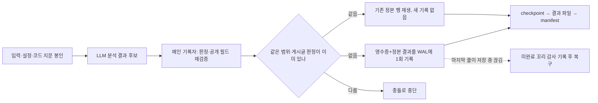

# P2 최종 공개 판정 중복 방지(한 번만 기록): 기능 설명과 전후 검증

> 2026-07-12 최신 재결속: recovered-arm witness를 원자 게시하는 복구 도구까지 P2 v8 구현 계약에 다시 봉인했다. 저장본·합성 판정과 Golden18 수치는 유지되며 RunSpec 정본은 `out/publication_exact_once_harness_20260711/v8/`다. P4는 이 WAL 안전 계약을 부모로 사용하지만 실제 runtime·의미 품질·전체 승인을 새로 증명하지 않는다.

## 한눈에 보는 결론

- **기능은 구현됐고 저장본·합성 범위에서 통과했다.** Golden18의 최종 공개 판정 영수증은 개선 전 `0/18`, 개선 후 `18/18`이며, 재시작 때는 기존 정본 18건을 반환했고 추가 WAL 기록은 `0`건이다.
- **기존 결과를 바꾸지 않았다.** 공개 작품명·주소는 `18/18`, 전체 결과 행도 `18/18` 그대로다. 최종 판정은 `HOLD 15 / PUBLISH 3`이다.
- **실패·위조 공격 21개를 모두 막았다.** 중복 행, 다른 게시글 결과 재사용, 설정 범위 혼합, 공개 필드 누출, 16개 기록자의 동시 경쟁, 저장 중 끊긴 마지막 줄을 포함해 `21/21`, 거짓 통과 `0`이다.
- **저장 비용의 제곱 증가를 제거했다.** 매 행마다 과거 WAL 전체를 다시 읽던 구조를 처음 1회 전수 검사 후 새 프레임만 검사하도록 바꿨다. 개발 PC의 800행 probe는 `16.042초`였다. 이전 구현의 800행 probe는 60초를 넘겼지만, 이는 정식 성능 시험이 아니라 구조적 병목 확인용 수치다.
- **복구 witness 게시 경로를 추가했다.** exact fresh recovery GO일 때만 witness를 먼저, recovered manifest pointer를 마지막에 원자 게시한다. NO-GO·예외에서는 stale witness/pointer를 남기지 않으며 기존 비측정 복구 호출은 호환된다.
- **아직 운영 승인은 아니다.** 실제 새 LLM/MCP 실행은 `NOT_RUN`, 의미 품질은 `REVIEW-LOCKED`, `full_scan_approval=false`, 전체 목표는 계속 진행 중이다.

## 비전문가용 한 문장

P2는 LLM이 작품을 더 잘 맞히게 하는 기능이 아니라, **이미 나온 게시글 한 행의 최종 공개 판정을 재시도·동시 처리·중단 복구 중에도 섞거나 덮어쓰지 않고 안전하게 한 번 기록하는 기능**이다. 이 보고서는 저장 안전성을 증명하며 작품 판단의 의미 정확도를 증명하지 않는다.

| 확인 층위 | 무엇을 실행했나 | 말할 수 있는 것 | 말할 수 없는 것 | 현재 |
| --- | --- | --- | --- | --- |
| 저장본 | 동결 Golden18 결과를 다시 읽어 전후 계약을 비교 | 영수증·결과 행 보존과 기존 결과 비간섭 | 새 LLM 실행과 운영 정확도 | 범위 내 `GO` |
| 합성 공격 | 중복·위조·범위 혼합·동시 기록·끊긴 저장을 인위적으로 발생 | 안전장치가 `21/21`을 거부 또는 복구 | 실제 장애율과 실서비스 성능 | `21/21`, 거짓 통과 `0` |
| 실제 실행 | 새 `expert_main --parallel 16` 실행 | 끝까지 실행될 때의 WAL·복구 동작 | 아직 아무 운영 결론도 낼 수 없음 | `NOT_RUN` |
| 의미 승인 | 사람·공식 근거와 동결 평가셋으로 작품 정답을 검토 | 전체 스캔에 사용해도 되는지 | 저장 성공만으로 정확도 승인 | `REVIEW-LOCKED`, `full_scan_approval=false` |

숫자는 다음처럼 읽는다. `18/18`은 **저장본 18행의 기록 계약**이 맞았다는 뜻이고, `21/21`은 **가짜 공격 21건을 막았다**는 뜻이다. 둘 다 작품 정답률 100%가 아니다. `HOLD 15`는 15행을 공개하지 않았다는 뜻이고, `PUBLISH 3`은 3행이 행 단위 공개 게이트를 통과했다는 뜻이지 전체 의미 승인이 아니다.

## 각 기능은 무엇을 하는가

| 기능 | 쉽게 말하면 | 막으려는 오류 | 이번 확인 |
| --- | --- | --- | --- |
| 처리 범위 봉인 | 입력 파일, 게시글 순서, 설정, 실행 코드 지문을 하나의 범위 번호로 묶는다. | 다른 입력·설정의 결과가 같은 실행 결과처럼 섞임 | 범위 기술서와 설정 출처 파일을 SHA로 결속 |
| 최종 판정 최초 기록자 우선 | 같은 범위의 같은 게시글은 첫 정상 판정 한 건만 정본으로 둔다. | 재시도나 후처리가 최종 작품명을 다시 덮어씀 | 신규 `18/18`, 재생 무쓰기 `18/18` |
| 선행기록 로그(WAL) | 영수증과 복구 가능한 최종 결과 행을 한 사건으로 먼저 저장한다. | 영수증만 남고 결과 행이 사라지거나 그 반대가 됨 | WAL 사건 `18/18`, journal line `18` |
| 저장 완료 경계 | 유효한 JSON 뒤 줄바꿈까지 기록된 프레임만 확정으로 본다. | 저장 중 끊긴 마지막 바이트를 정상 판정으로 읽음 | 정상 이전 판정 보존, 미완료 꼬리 감사 기록 `1` |
| 재시도 불변 결과 | `run_id`, worker 번호, 로그 경로만 다른 재시도는 같은 판정으로 본다. 실제 분석 내용이 다르면 충돌로 막는다. | 같은 답이 실행 시도 메타 때문에 충돌하거나, 다른 분석이 같은 답으로 뭉개짐 | 두 공격 모두 통과 |
| 원본 공개 필드 전면 검사 | 직접 필드뿐 아니라 trace·ledger·오류 행의 숨은 작품명·주소도 검사한다. | `HOLD/ERROR_HOLD`인데 중첩 필드에서 작품명이 새어 나옴 | 직접·중첩·분리 신호 누출 공격 모두 거부 |
| 복구 상태 3층 분리 | 공개 행 완결, 종료 파일 완결, 의미 품질 승인을 서로 다른 상태로 둔다. | WAL 행이 다 있다는 이유로 전체 처리·정확도·승인을 완료로 과장 | `publication_rows_complete`, `large_run_complete`, 의미 승인 분리 |
| 공용 속어 DB 승격 분리 | 실행 중 학습 내용은 실행별 작업 파일에만 두고 공용 DB 자동 덮어쓰기를 하지 않는다. | 중단 실행의 자기오염, 동시 실행의 마지막 저장 덮어쓰기, 재시도 범위 변경 | `explicit_post_run_only`; 실제 승격 도구는 후속 과제 |

### 코드에서 각 구성요소가 맡는 일

| 구성요소 | 입력 → 출력과 역할 |
| --- | --- |
| 실행 범위 만들기 (`build_publication_scope_id`) | 입력 파일·게시글 순서·설정·코드 지문 → 이번 실행만 식별하는 범위 번호; 다른 실행 결과 혼합을 차단한다. |
| 공개 결과 기록 (`commit_publication_result`) | 범위·게시글·최종 판정 → 해시 영수증과 복구 가능한 WAL 결과 1건; 같은 판정 재시도는 기존 정본을 반환하고 다른 판정은 충돌로 막는다. |
| WAL 장부 (`PublicationCommitRegistry`) | WAL 파일 → 검증된 게시글별 정본; 최초에는 전체를 검사하고 이후에는 새로 붙은 완전한 줄만 검사한다. |
| 복구 (`recover`) | WAL·checkpoint·pending·result·manifest → 공개 행 완결과 실행 종료 완결을 따로 판정한 복구 결과; 끊긴 마지막 조각은 정상 행으로 세지 않는다. |
| 실행 관리자 (`expert_main.py`) | LLM 결과 → 메인 기록자에서 공개 필드를 다시 확인하고 WAL → checkpoint → 결과 → manifest 순서로 마무리한다. |

용어는 이렇게 읽으면 된다. **WAL**은 결과보다 먼저 쓰는 선행기록 로그, **영수증(receipt)**은 내용이 바뀌었는지 확인하는 해시 기록, **범위(scope)**는 이번 입력·설정 묶음의 ID, **checkpoint**는 재시작 지점, **manifest**는 실행 조건과 종료 상태를 모은 요약 파일이다.

## 처리 흐름

여기서 **정확히 한 번**은 Python 변수에 한 번 대입한다는 뜻이 아니다. `publication_scope_id + post_id`별로 최종 공개 사건을 WAL에 한 번만 확정하고, 이후 같은 판정은 기존 정본을 돌려준다는 뜻이다.

## 개선 전과 개선 후

| 확인 항목 | 개선 전 | 개선 후 |
| --- | --- | --- |
| 판정 사건의 유일성 | 결과 행은 있으나 범위 소유 영수증이 없어 증명 불가 | 범위·순서·입력·설정·release에 결속된 영수증 `18/18` |
| 재시작 | 같은 게시글을 다시 쓰거나 어느 결과가 정본인지 모를 수 있음 | 기존 정본 재생 `18/18`, 추가 WAL 기록 `0` |
| 동시 기록 | 마지막 기록자가 덮어쓸 위험 | 16개 독립 기록자 중 신규 기록 `1`, line `1` |
| 저장 중 중단 | 끊긴 마지막 줄 때문에 이전 정상 판정까지 읽지 못함 | 이전 정상 프레임 보존, 미완료 꼬리 SHA·크기 감사 후 절단 |
| 오류 행 공개 누출 | 직접 필드가 비어도 ledger/trace/root에 값이 남을 수 있음 | 모든 권위 공개 투영에서 작품명·주소 null 강제 |
| 저장 비용 | 매 commit마다 전체 WAL 재검사로 `O(n²)` | 첫 전수 검사 뒤 새 바이트만 검사하는 `O(n)` 구조 |
| 공용 slang DB | 실행 중 변경 또는 완료 직후 덮어쓰기 | 실행별 work artifact만 생성, 원본 승격은 별도 단계 |

예를 들어 첫 시도에서 작품 A를 `PUBLISH`한 뒤 재시도가 작품 B를 내면 B로 덮어쓰지 않고 충돌로 중단한다. 같은 작품 A와 같은 분석 내용이면 기존 정본을 읽어 반환하고 새 WAL 줄은 쓰지 않는다. 저장 중 마지막 줄이 끊기면 그 조각만 감사 기록으로 남기고 이전 정상 행은 보존한다.

## 상태를 세 층으로 나누는 이유

| 상태 | 뜻 | 이번 상태 |
| --- | --- | --- |
| 공개 행 완결 (`publication_rows_complete`) | 모든 입력 게시글에 검증된 WAL 판정 행이 있는가 | 저장본 하네스 `18/18` |
| 실행 종료 완결 (`large_run_complete`) | 결과·checkpoint·pending·실패 수·종료 표시까지 모두 맞는가 | 실제 새 runtime `NOT_RUN` |
| 의미 품질·전체 승인 | 작품 판단이 실제로 맞고 전체 스캔에 사용해도 되는가 | `REVIEW-LOCKED`, `false` |

행이 모두 저장됐다는 사실은 작품 판단이 맞다는 증거가 아니다. 따라서 `queue 0`, WAL coverage 100%, `large_run_complete=true` 중 어느 것도 단독으로 의미 품질 승인이 되지 않는다.

## 정확도 퍼센트 제안과의 관계

사용자가 기억한 **정확도 판단을 퍼센트로 하자는 제안은 실제 선행 설계에 있다.** 저장소 근거상 정본 provenance는 Claude Opus 공동 연구이고, Fable은 Loop643 다작품 충돌 안전 감사 역할이 확인된다. Fable을 최초 설계자로 단정할 근거는 없다.

P2는 퍼센트를 계산하는 단계가 아니라, 퍼센트가 나중에 어떤 최종 판정 한 건에 대응하는지 고정하는 선행 단계다. P3에서는 다음 순서만 허용한다.

1. 후보 작품들과 `NIL(후보 중 정답 없음)`의 확률 합을 100%로 둔다.
2. `ABSTAIN(판단 보류)`은 정답 종류가 아니라 위험할 때 멈추는 행동으로 분리한다.
3. 개발·보정·최종 동결 평가 자료를 겹치지 않게 나눈다.
4. 온도 보정 후 ECE, Brier, log loss, NIL 정밀도·재현율, 처리범위-오류 위험을 신뢰구간과 함께 측정한다.
5. 그 전에는 모든 후보 확률과 `p(NIL)`을 `null`로 둔다.

현재 확률 상태는 계속 `NOT_AVAILABLE_UNCALIBRATED`다. `High/Medium`을 실제 80%·90%로 읽으면 안 된다.

## 검증 근거

- P2 집중 회귀: `169 tests OK`
- P1 검색·후보·공개 영향 범위 회귀: `532 tests OK`
- publication commit 집중: `33 tests OK`
- recovery 집중: `36 tests OK`
- Golden18: 유효 영수증 `0→18`, 신규 기록 `18`, 재시작 무쓰기 `18`
- 비간섭: 공개 필드 `18/18`, 전체 행 `18/18`
- 합성 공격: `21/21`, false GO `0`
- 증분 WAL 800행 개발 probe: `16.042초`
- 최종 Sol blocker 재감사: blocker급 false GO `0`, scope config 변조 probe `1/1 PASS`
- 최신 recovery/paired 회귀: `71/71 PASS`; P2/P3 묶음 `58/58 PASS`
- RunSpec self SHA: `f6a74648054a8ae0216746501280223f6bcb4a6875d6c81225ef2d4e4d563381`
- RunSpec 파일 SHA: `0875f74ac0594f4f0578d3ca976539c3f4559e121a778717d848d2b9896ecee5`
- 최초 기능 정본: `out/publication_exact_once_harness_20260711/v2/comparison.md`
- P4 호환 재결속 정본: `out/publication_exact_once_harness_20260711/v4/comparison.md`
- 최신 recovered-arm witness 재결속 정본: `out/publication_exact_once_harness_20260711/v8/comparison.md`

## 아직 증명하지 않은 것

- 실제 새 `expert_main --parallel 16` 실행에서 WAL·checkpoint·result·manifest가 끝까지 일치하는지는 아직 실행하지 않았다.
- 현재 진행 중 production은 이 변경 전 코드로 시작했으며 중단·재시작·주입하지 않았다.
- cross-post `BatchContextMemory`의 완료 순서와 모든 내부 학습 delta까지 결정적으로 재생하는 계약은 아니다. P2가 증명하는 것은 **행별 최종 공개 사건의 유일성**이다.
- 로컬 파일 쓰기 권한을 가진 악성 사용자가 descriptor·WAL·manifest 해시를 모두 다시 만드는 공격은 서명 없이 막지 못한다. 이번 위협 경계는 crash와 협력적 동시 기록자다.
- 실행 중 같은 길이의 오래된 WAL 앞부분을 제자리 변조하는 악성 공격은 tail anchor만으로 즉시 전부 잡지 못한다. 재개 시 전수 검사는 손상을 거부한다.
- `RUNTIME_RELEASE_FINGERPRINT_SHA256`은 운영자가 제공한 지문을 검증하는 `OPERATOR_ATTESTED` 경계다. 서명된 build/image attestation은 아니다. 개발용 disk fallback은 `NOT_PROVABLE`이다.
- 공용 slang DB의 병합·검토·승격 도구와 P3 확률 보정은 후속 구현이다.

## 다음 순서

1. 진행 중 production을 그대로 두고 P2 actual runtime은 별도 고정 입력·새 output 경로에서 실행한다.
2. 요청/effective parallel `16`, dashboard, release operator attestation, slang DB work artifact를 manifest에서 확인한다.
3. 강제 중단·재시작 canary로 WAL 행 완결과 종료 산출물 완결을 따로 검증한다.
4. P3 DEV/CALIBRATION/FROZEN 분할과 확률 보정 하네스를 구현한다.
5. 의미 재판정과 전체 스캔 승인은 별도 게이트로 유지한다.

## 오케스트레이션 기록

- Sol: 범위·재시도·WAL 성능·누출·복구 false GO를 반복 공격해 blocker가 없어질 때까지 재감사했다.
- Terra: WAL-only 복구, 다중 attempt union, tail/secondary/provenance/terminal 상태 분리를 구현·검증했다.
- Luna: P3 확률 보정 계약과 한국어 기능 중심 보고서 구조를 점검했다.
- Claude-Fable·Opus 호출은 이 실행에서 구체적 저장소 분석 대신 일반 메타 응답만 반환해 구현 근거에서 제외했다. 선행 Fable 근거는 저장소의 Loop643 감사 산출물만 사용했다.
