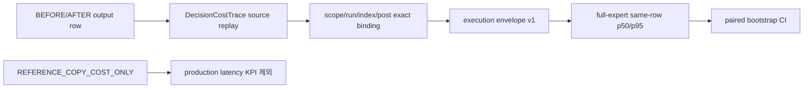

# P3 분모 정책과 P4 실행 봉투 정적 계약 보고서

작성일: 2026-07-12 KST

> 2026-09-02 현재: 이 문서의 policy v3는 당시 분모 결속을 설명하는 역사적 정본이다. 신규 `FROZEN_ACTUAL` readiness/evaluation은 분모뿐 아니라 최소 독립 group 30개, bootstrap 2,000회, percentile interval method를 SHA에 결속한 `candidate_set_calibration_policy_v4`를 요구한다. v2/v3는 저장 정본 호환용이며 새 actual readiness를 열지 않는다.

## 결론

P3와 P4의 두 측정 공백을 정적으로 닫았다. P3 actual policy v3는 `top_label_accuracy_denominator`를 정책 payload와 `policy_sha256`에 넣는다. P4 paired reader는 source-bound `DecisionCostTrace`에서 batch execution envelope를 재구성하고 full-expert comparable 행의 per-post E2E p50/p95와 paired bootstrap CI를 계산한다.

이는 actual 성능 수치가 아니다. actual DEV/CAL/FROZEN·fresh BEFORE/AFTER가 없으므로 정확도·후보 재현율·비용·지연 개선은 계속 `null / NOT_ESTIMABLE`이며 `runtime_validation=NOT_RUN`, `semantic_quality=REVIEW-LOCKED`, `full_scan_approval=false`다.

## P3 정책 결속

- 2026-07-12 당시 사전등록 정책은 `candidate_set_calibration_policy_v3`였으며, 현재 신규 actual 사전등록은 `candidate_set_calibration_policy_v4`여야 한다.
- `top_label_accuracy_denominator`는 `ALL_FROZEN_ROWS` 또는 `NON_ABSTAIN_ROWS` 중 하나여야 하며, policy SHA 재계산 대상이다.
- v2는 저장된 P3 v18 synthetic/legacy 정본을 읽기 위한 호환 경로만 제공한다. `FROZEN_ACTUAL_PRE_REGISTERED`에는 v2를 허용하지 않는다.

## P4 실행 봉투

- `physical_call_wall_ms_sum`은 provider 호출 누적시간이며 batch E2E 시간이 아니다.
- `REFERENCE_COPY_COST_ONLY`의 0-call은 authoritative WAL 복사이므로 production savings·latency 개선 수치에 넣지 않는다.
- paired CI는 RunSpec에 결속된 bootstrap seed/반복/alpha/minimum comparable rows를 따르며, fresh full-expert 같은 행이 부족하면 `NOT_ESTIMABLE`로 닫는다.

## 정본과 검증

| 단계 | 정본 | RunSpec self hash | 상태 |
| --- | --- | --- | --- |
| P2 | `out/publication_exact_once_harness_20260711/v8/` | `f6a74648054a8ae0216746501280223f6bcb4a6875d6c81225ef2d4e4d563381` | `GO` 저장본/합성 계약 |
| P3 | `out/candidate_set_calibration_shadow_harness_20260711/v20/` | `0c6f96ec37a591356589a339699066f0d412e07322d6e8b2b5e6f0749ff36f21` | `GO_P3_CONTRACT_FOUNDATION_ONLY` |
| P4 | `out/selective_compute_shadow_harness_20260712/v21/` | `ebbdec02f9db4c8801f403a39515a589847ede2c7683e0fbd76e3c0a5bd4e406` | `GO_P4_SHADOW_CONTRACT_FOUNDATION_ONLY` |

- P3/P4 집중 unittest `82/82 PASS`.
- 변경 Python `py_compile PASS`, `git diff --check PASS`.
- P3 v18/P4 v19는 immutable legacy 정본으로 보존한다.

## 다음 actual 게이트

1. 소유자가 P3 actual policy v4의 분모·interval protocol과 A/B 수치를 확정한다.
2. source-backed DEV/CAL/FROZEN packet과 COMPLETE producer·immutable candidate ID를 만든다.
3. active production 종료 뒤 별도 output에서 동일 RunSpec의 fresh BEFORE/AFTER를 `--parallel 16`, dashboard ON으로 실행한다.
4. 독립 reader가 actual 정확도·후보 재현율·호출·token·full-expert comparable E2E p50/p95 CI를 재생한다.
5. 그 뒤에도 사람 검토 전 production routing은 열지 않는다.
