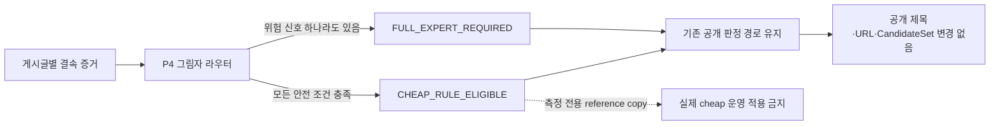

# P4 선택적 비용 라우팅 그림자 하네스 보고서

> 최신본: P4 v19. 이 문서는 `구현됨`, `실제로 측정됨`, `운영 적용 가능함`을 서로 다른 상태로 설명한다. 정본은 `out/selective_compute_shadow_harness_20260712/v19/`다.

## 한눈에 보는 결론

- P4는 작품명을 새로 고르는 기능이 아니라, **어떤 글을 반드시 전체 전문가 경로로 보내야 하는지 그림자로 관측하는 비용 라우터**다.
- 저장된 Golden18은 `FULL_EXPERT_REQUIRED 18 / CHEAP_RULE_ELIGIBLE 0`이다. 공개 작품명·URL·판정과 CandidateSet은 `18/18` 그대로다.
- 물리 호출 원장, writer와 독립된 reader, AFTER 측정 라우터, paired RunSpec/source replay, exact recovered-arm witness는 구현됐다. 실제 fresh BEFORE/AFTER 실행이 없어 호출 수·절감률·처리시간 개선률은 모두 `null/NOT_ESTIMABLE`이다.
- P4가 읽는 P1·P2와 P3가 사용한 P1·P2를 exact path/bytes/SHA로 맞추고, P1과 P3가 같은 라벨 원장을 쓰도록 강제한다. 다른 유효 실행을 섞은 거짓 pair는 거부한다.
- sidecar 로그에서 읽힌 expert prompt `191`, VLM `14`, total token `2,269,227`, wall p50 `683,200ms`, p95 `1,326,100ms`는 진단값이다. 정식 비용 KPI나 개선 후 수치로 승격하지 않는다.
- 합성 4행의 `before 16 → after 8`, 회피 `8/16=50%`는 계산식과 안전 차단 계약 시험일 뿐 실제 절감률이 아니다.
- 적대 입력 `20/20`을 차단했고 위험한 행이 cheap으로 빠진 수는 `0`이다.
- 판정은 `GO_P4_SHADOW_CONTRACT_FOUNDATION_ONLY`다. 실제 runtime은 `NOT_RUN`, 의미 품질은 `REVIEW-LOCKED`, `full_scan_approval=false`, 전체 목표는 `ACTIVE_NOT_COMPLETE`다.

## 이 기능은 무엇을 하는가

현재 파이프라인은 모든 글을 같은 고비용 경로로 처리할 수 있다. P4는 이미 결속된 검색·후보·보정·공개 안전 상태를 읽어 다음 두 경로 중 어디가 필요한지 **관측만** 한다.

| 기능 | 쉽게 말하면 | 현재 적용 범위 |
| --- | --- | --- |
| `hard_risk` | 싸게 처리하면 위험한 신호를 한데 모은다. | 검색 차단·저하·미확인, 후보 `UNKNOWN/TRUNCATED`, 복수 작품·주제 충돌, VLM/OCR 누락·충돌, HOLD·격리·미판결, 범위·출처·예산 결속 오류를 포함한다. |
| `shadow_router` | 전체 전문가 처리가 필요한지 판정만 기록한다. | `action_applied=false`, `route_applied=false`, `operational_effect=NONE_SHADOW_ONLY`다. |
| `DecisionCostTrace` | 기존 행별 합계형 시간·token·검색·VLM 진단을 같은 실행 범위에 묶는다. | 실제 호출 하나하나의 원장이 아니며 결측값을 0으로 바꾸지 않는다. |
| `physical-call ledger` | 실제 model send의 intent와 retry별 성공·실패 terminal을 행·논리 호출과 연결한다. | 독립 reader도 구현됐지만 actual ledger가 없으므로 KPI는 아직 없다. |
| `AFTER source-only route` | 원문에 위험 신호가 있으면 full로 보내고 신호가 전혀 없는 행만 deterministic NIL 측정 후보로 둔다. | REQUIRED/FRESH/AFTER/`FROZEN_OFF` 측정에서만 작동하며 production router가 아니다. |
| `fresh paired measurement` | 실행 전 RunSpec을 동결하고 BEFORE·AFTER의 input/output·WAL·ledger·route receipt를 source replay한다. | 실제 양쪽 runtime과 실제 강제 중단·재시작 증거는 아직 없다. |
| `recovered-arm witness` | 중단 복구 arm의 source manifest/result/checkpoint/pending·summary·output·claim·WAL·single-attempt ledger·AFTER route를 self-hash witness로 다시 재생한다. | witness 없는 복구, partial checkpoint, multi-attempt, source 변경을 fresh pair로 받지 않는다. |
| `parent/label lineage` | P3 부모와 P4 부모, P1 라벨 원장과 P3 라벨 원장이 같은지 확인한다. | 서로 다른 유효 RunSpec이나 라벨 원장을 섞어 전후 비교로 가장하지 못한다. |
| `public_noninterference` | 비용 시험이 공개 결과를 바꾸지 못하게 한다. | official title·URL·promotion decision·CandidateSet 쓰기를 거부한다. |

### 상태값을 한국어로 읽는 법

| 상태값 | 쉬운 뜻 |
| --- | --- |
| `FULL_EXPERT_REQUIRED` | 위험 신호가 있어 기존 전체 전문가 처리를 유지한다. |
| `CHEAP_RULE_ELIGIBLE` | 안전 조건은 통과했지만 아직 적용하지 않는 그림자 후보다. |
| `PENDING_INDEPENDENT_READBACK` | writer 기록은 있으나 다른 reader의 재검증 전이다. |
| `EXACT_INDEPENDENT_READBACK` | writer를 믿지 않고 frame 원본에서 호출·retry·token을 정확히 다시 계산했다. |
| `REFERENCE_COPY_COST_ONLY` | 기존 authoritative WAL 결과 복사에 기반한 반사실 0-call 값이며 production 절감 KPI가 아니다. |
| `NOT_ESTIMABLE` | 근거가 부족해 숫자를 계산하면 안 된다. |
| `GO_P4_SHADOW_CONTRACT_FOUNDATION_ONLY` | 계약 기반만 통과했으며 실제 비용·정확도·운영 승인이 아니다. |

### 한 번의 모델 호출이 원장에 남는 순서

원장은 prompt·응답 원문을 저장하지 않고 SHA와 개수만 남긴다. `ROW_SEAL`은 물리 성공 호출과 모순 없는 terminal이 있을 때만 가능하다. 이 흐름은 비용을 관측하는 기능이며 작품명을 고르는 공개 게이트를 대신하지 않는다.

## 개선 전·후 비교

| 항목 | 개선 전 | P4 기반 구현 후 | 현재 해석 |
| --- | --- | --- | --- |
| 처리 경로 | 모든 행의 비용 차이를 구조적으로 설명하기 어려움 | `FULL_EXPERT_REQUIRED`와 `CHEAP_RULE_ELIGIBLE`을 그림자로 분리 | 실제 경로 전환은 아직 없음 |
| 위험 차단 | 비용 절감을 주장하는 수치와 안전 조건의 결속이 약함 | hard-risk union과 정확한 source/run/post 결속을 통과해야 cheap 후보 | 측정 전용 라우터 구현, actual pair 없음 |
| 비용 관측 | worker sidecar의 단계·token·시간 진단 | physical-call ledger와 writer 독립 reader로 실제 send를 재계산 | 새 actual ledger가 없어 calls/post는 null |
| 공개 결과 | 기존 공개 게이트가 결정 | 동일 | Golden18 `18/18` 불변 |
| 실제 비용 개선 | 측정하지 않음 | paired 계산·분류 기반 구현 | 실제 pair가 없어 `NOT_ESTIMABLE` |

## 저장된 Golden18 결과

| 지표 | 값 | 상태 | 설명 |
| --- | ---:| --- | --- |
| `safe_auto_coverage` | `null` | `NOT_ESTIMABLE` | 실제 정답 readback 없이 안전 자동 처리 범위를 만들지 않음 |
| `expert_escalation_rate` | `1.0` | `OBSERVED_SHADOW_ROUTE_DISTRIBUTION` | 18행 모두 full-expert가 필요하다고 관측한 분포이며 비용 절감률이 아님 |
| `expert_calls_per_post` | `null` | `NOT_ESTIMABLE` | 행별 typed expert call event 부재 |
| `expert_call_avoidance_rate` | `null` | `NOT_ESTIMABLE` | paired before/after 실제 실행 부재 |
| `wall_time_per_post` | `null` | `NOT_ESTIMABLE_NO_AFTER_RUNTIME` | 개선 후 실제 실행 부재 |

진단용 sidecar 값은 로그 경로·줄 번호와 함께 보존했지만 다중 로그 귀속이 애매하거나 완료가 불명확한 시도는 비용 coverage에서 제외한다. 빈 문자열·bool·음수·잘못된 숫자는 0으로 세탁하지 않고 `null`로 둔다.

## 합성 계약과 적대 검증

- 합성 4행: full 2행, cheap 후보 2행, safe auto coverage `0.5`, escalation `0.5`.
- 합성 호출 산술: before `16`, after `8`, avoided `8`, avoidance `0.5`.
- 이 수치는 `SYNTHETIC_CONTRACT_ONLY_NOT_ACTUAL_SAVINGS`이며 실제 정확도·비용·처리시간 주장에 사용할 수 없다.
- 적대 사례 `20/20` 차단, false cheap `0`.
- 실제 scope를 합성으로 위장, truth/cost의 scope 혼합, truthy 문자열 readback, 검색 필요 여부 세탁, 공개 필드·CandidateSet 변조, `action_applied/route_applied` 위조, 부분 비용의 숫자 승격, 부모 comparison/RunSpec 위조, ABA 파일 교체를 fail-close한다.

## 부모 계약과 산출물

| 단계 | 최신 결속 | RunSpec self hash |
| --- | --- | --- |
| P1 | `out/candidate_set_nil_shadow_harness_20260711/v8` | `5b36fe5de439eb37d358b5a0e8185cdd61f610760676623086d92207abac16a9` |
| P2 | `out/publication_exact_once_harness_20260711/v8` | `f6a74648054a8ae0216746501280223f6bcb4a6875d6c81225ef2d4e4d563381` |
| P3 | `out/candidate_set_calibration_shadow_harness_20260711/v18` | `ca26d8d39485171e5d8a0673fabbf6353aca91389413a834eea4d4827f48e64b` |
| P4 | `out/selective_compute_shadow_harness_20260712/v19` | `3161c96d49b1c9889c6aebc76c6068ad9e44321accbf9633219c8ac2d870ead3` |

- 비교 JSON: `out/selective_compute_shadow_harness_20260712/v19/comparison.json` — file SHA-256 `8a31790d75dc7d7f685987dcf2c0895a55325c51c9ce6bd214d12981361055ec`
- 사람이 읽는 비교: `out/selective_compute_shadow_harness_20260712/v19/comparison.md` — file SHA-256 `a117d7f8093ce45d193dc3ed21993308e9301bde67819866094b7440091dd257`
- 실행 명세: `out/selective_compute_shadow_harness_20260712/v19/run_spec.json` — file SHA-256 `6caabde9e9591ff5fd5bd6896a29f0eb61020e1637db179fbd2ce9a40928031f`
- 구현: `src/llm_batch/selective_compute_shadow.py`
- paired/recovery 구현: `src/llm_batch/paired_measurement_readback.py`, `tools/recover_expert_run_from_checkpoint.py`
- 하네스: `tools/run_selective_compute_shadow_harness.py`
- 시험: `tests/test_selective_compute_shadow_contract.py`, `tests/test_selective_compute_shadow_harness.py`, `tests/test_paired_measurement_readback.py`, `tests/test_fresh_measurement_recovery.py`

## 검증 결과

- P4 계약·하네스 최종 시험: `33/33 PASS` (`428.649s`).
- 현재 변경 집중 시험은 recovery/paired `71/71`, P2/P3 `58/58`, P4 `33/33`, 합계 `162/162 PASS`다.
- 이전 v10 확장 회귀 묶음 `446/446`은 당시 역사 기록이며, 현재 v12 집중 시험 수와 섞어 최신 합계로 표시하지 않는다.
- P2 v8, P3 v18, P4 v19 RunSpec·comparison validator와 변경 파일 `py_compile`도 `PASS`다.
- P4 비교 산출물: actual cost delta `NOT_ESTIMABLE`, public/CandidateSet 불변 `18/18`, 적대 공격 `20/20`, false cheap `0`.
- 합성 escalation `0.5`의 상태를 `SYNTHETIC_CONTRACT_ONLY`로 분리해 actual Golden18의 `OBSERVED_SHADOW_ROUTE_DISTRIBUTION 1.0`과 상태명만으로 섞이지 않게 했다.
- 저장 RunSpec에서 구현 파일 참조를 제거·대체하고 implementation/self hash를 다시 계산해도 현재 `_implementation_contract()` 전체 집합과 다르면 거부한다.
- Sol 적대 검토가 보고한 mutable writer, scope 혼합, truthy readback, 비용 자체신고, parent gate 위조, ABA 교체, 부분 count 세탁, public/action 위조 문제를 수정하고 회귀 시험으로 고정했다.
- 이번 오케스트레이션의 Fable·Opus는 모델 선택은 적용됐지만 재전송에도 과제별 결과 대신 일반 안내를 반복해 최신 근거에서 제외했다.

읽기 전용 운영 스냅샷 `2026-07-12 14:20:20 KST`: run `20260711_113712_379597`, input/completed/flushed/pending/failed `104502/2665/2650/15/0`, next save `2651`, requested/effective parallel `16/16`, dashboard health HTTP 200, `ordered_flush_blocked=true`, `partial_flush_gap=true`, `large_run_complete=false`. manifest는 `14:20:07 KST` 갱신본이다. 이동 중인 실행이라 P4 runtime·비용 개선·의미 품질·승인 증거가 아니다. 프로세스·result·checkpoint·pending·dashboard·slang DB를 수정하거나 중지하지 않았다.

이 정본 생성 뒤 한때 반복 외부 blocker 임계치에 따라 `BLOCKED_HANDOFF / NOT_COMPLETE`로 전환했지만, 사용자의 `goal 재개` 지시로 현재 전체 Goal은 `ACTIVE / NOT_COMPLETE`다. comparison 내부의 `ACTIVE_NOT_COMPLETE`는 정본 생성 시점 artifact gate이고 실제 runtime·운영 승인을 뜻하지 않는다.

## 다음 실제 검증 조건

1. 완료: bounded physical-call ledger, writer 독립 reader, AFTER source-only 측정 라우터를 구현했다.
2. 완료: paired RunSpec 동결과 input/output/WAL/ledger/route receipt source replay를 구현했다.
3. 완료: authoritative WAL 논리 판정과 fresh 측정 원장을 분리하고 exact source replay witness로 recovered arm을 제한하는 fail-closed 복구 게이트를 구현했다.
4. 완료: P3 `FROZEN_ACTUAL` 파일 바이트·producer coverage·prediction payload 재판독과 그룹 bootstrap 기반을 구현했다.
5. 남음: 실제 DEV/CAL/FROZEN 자료와 metric output을 만들고 독립 readback을 통과한다.
6. 남음: 현재 production 종료 뒤 별도 output/prefix에서 동일 RunSpec의 fresh BEFORE와 AFTER를 `--parallel 16`, dashboard ON, `--slang-db off` 또는 검토된 read-only snapshot으로 실행한다.
7. 남음: 실제 강제 중단·재시작과 immutable-frame v1의 scale/crash 한계를 검증한다.
8. 정확도·후보 재현율·hard regression·public 비간섭을 통과하기 전에는 실제 cheap routing을 열지 않는다.

## 승인 경계

- `runtime_validation=NOT_RUN`
- `semantic_quality=REVIEW-LOCKED`
- `full_scan_approval=false`
- queue 0, 처리 완료, dashboard 초록, 합성 50%는 의미 품질이나 운영 승인 근거가 아니다.
- 따라서 전체 목표는 계속 `ACTIVE_NOT_COMPLETE`다.
